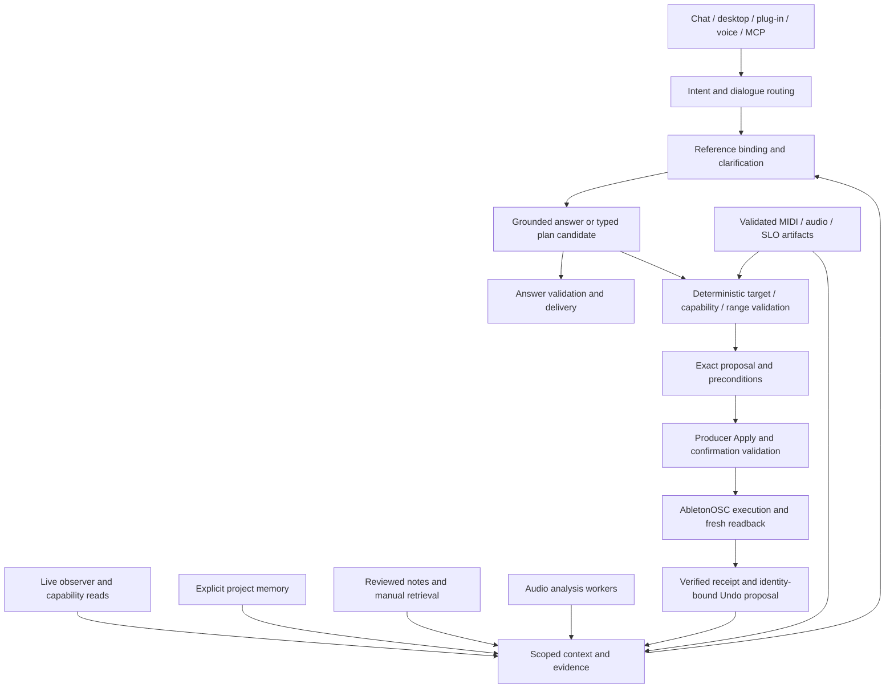

# KENN plan

Updated 14 October 2026. This is the one KENN roadmap: product direction, architecture,
the work queue and the progress checklist. Start here, then read the source, tests and
evidence for whatever task you pick up. `AGENTS.md` covers how we work in the repo.
Dated reports describe the commit and machine they were run on. They don't authorize
work and they don't prove today's build. Specs and runbooks explain contracts and
procedures.

The old North Star, mega plan, beta plans, trackers and execution prompts are retired.
Their history is in Git, and the consolidation record is
[the planning audit](docs/evidence/KENN_PLANNING_CONSOLIDATION_2026-10-02.md).
Update this file rather than starting another roadmap, handoff prompt or progress log.

The [2 October product and open-source research](docs/research/KENN_PRODUCT_AND_OPEN_SOURCE_RESEARCH_2026-10-02.md)
feeds C1-C2, L2-L3 and B1-B4 below. Its three experiment protocols are candidate
methods for local delivery, passage reranking and audio measurements. The thresholds
they propose don't replace this plan's acceptance targets. Other products inform
interface choices, but any new dependency or model asset still needs approval.

## Purpose and decisions

KENN is a local language-model assistant for a producer using Ableton Live. It should
understand ordinary requests and follow-ups, explain music and audio clearly, use
current session facts, and prepare useful changes that the producer can inspect,
Apply and Undo. Fast deterministic commands and grounded conversation both matter.

The owner's current priority is useful conversation, efficient local inference and
good Ableton integration. Large citation-capture projects, source-count targets and
new control families do not take precedence over that work. Grounding remains a
product requirement: unsupported measurements, sources and claims must be rejected.

Decisions already made:

- Current baseline: local Qwen3 4B chat (`qwen3:4b-instruct-2507-q4_K_M`) and Qwen3 4B planner.
  I confirmed the current 4B chat choice on 13 October 2026; this supersedes the
  earlier 8B chat decision. Model choice stays open per my 13 October request:
  4B is the control, not a permanent size requirement. Compare alternatives under S4/S6
  and choose from reviewed quality, retention, M3 latency and memory measurements.
  Preserve the control's identity in the offline SEAL experiment. The local
  main checkout's `.env` still names the old 8B, so pin the 4B explicitly in experiment
  manifests; do not treat that stale file as the running app's configuration. No hosted brain.
- The Mac target is Apple M3 with 16 GB unified memory. Model residency, context and
  concurrency must fit alongside Live. Do not assume both models can stay resident
  without measuring memory pressure and model switching.
- Python owns dialogue, retrieval, memory, policy and jobs. All DSP is C++ (my call,
  14 Oct 2026): meters, loudness, true peak, key and tempo, and any new analysis.
  Python's `loudness_analysis.py` (pyloudnorm, scipy, librosa) is the existing offline
  path and stays until a C++ replacement passes the same conformance tests; do not
  write new DSP in Python or numpy. A whole-backend rewrite is outside this plan.
- AbletonOSC is the Live transport owner. UI, HTTP, voice and MCP must share the
  same typed policy and execution services, without a second write authority.
- Preferences require explicit opt-in. Session inference, diagnostic hypotheses
  and a producer's saved preferences are different kinds of information.
- Engineering runs against `FakeLiveBackend`, mocks and synthetic fixtures. Real
  Live writes require an owner-scheduled, supervised qualification on a disposable
  set. Existing real-Live receipts qualify their recorded scope, not every new build.

### Standing open-source reuse check

I requested this on 14 October 2026 for all later audio-analysis work. Before
implementing or extending an audio measurement, check the existing KENN DSP and
suitable open-source tools against current upstream documentation, source and
licences. Prefer reuse when it meets KENN's requirements and saves development time.

Compare numerical accuracy and measurement semantics, supported sample rates,
latency, CPU/memory cost, allocation behaviour, maintenance, integration effort and
distribution licence fit. Record the candidates, primary-source links and the
reason for reusing or retaining an implementation with that task's evidence.
Benchmark shortlisted tools on synthetic audio in the existing offline harness;
a library's claims or agreement with another implementation do not qualify KENN.
Ask before adding a dependency. This check applies at the start of each relevant
task and again when its requirements change.

The [14 October reuse screen](docs/research/audio_analysis_reuse_2026-10-14.md)
records the current loudness/interpolation shortlist and later analysis options.
It is a source review; comparative benchmarks and any adoption remain open.

### Product direction

The owner's end goal is one assistant that is specialised in music production and
Ableton Live, answers ordinary questions well, controls Live through the existing
Apply and Undo path, and teaches Live to the producer. Local delivery targets below,
including the 15 s / 70% gate, are milestones toward that. Passing them does not show
the end goal is met.

A model that fits beside Live on 16 GB will not match a frontier model on general
intelligence. The route is a strong small model made reliable in the domain:

- Retrieval over reviewed, sourced notes and the Live manual, with the figure checker
  rejecting any number the notes do not contain.
- Deterministic reaction routing for follow-ups, vague asks, off-topic asks and
  third-party plug-ins.
- A small fine-tune (LoRA) so the model keeps the answer format, stays grounded and
  declines properly, using reviewed domain examples. Domain learning and general
  reasoning gains need separate evidence. It needs the owner's explicit approval,
  answers checked against the notes, and a held-out evaluation.
- Control of Live as typed tool calls; the model picks the action and policy executes it.

Open for the owner, not decided: whether very hard or open-ended questions may go to
a larger hosted model. That would reverse "No hosted brain" above and brings cost and
privacy terms with it. Until the owner decides, KENN stays fully local.

Review of 4 October 2026, to test before deciding:

- Note-first answers. Today the model rewrites a note and the checker throws out about
  40% of the rewrites. The notes already hold a short answer, steps and a reason, so
  serving the matched note's own sections may help more than a rewrite: figures are
  right by construction and the reply is immediate. The model would then interpret the
  ask, pick the note, ask one clarifying question and tailor a line to the session.
  This stays a hypothesis until a hand-graded comparison (note served as-is against the
  model rewrite, about 40 questions, graded 0/1/2 by the owner) shows which helps more.
- What only KENN can do. A general chatbot can explain Live from the manual. Reading
  the producer's session, listening to the mix and making the change with Apply and Undo
  is where KENN is different, so that work outranks winning the gate on general questions.
- One scoreboard. Acceptance shows the checker is satisfied, not that the answer helped.
  Owner grades on a fixed, held-out question set sit beside the gate figures.
- The owner's end goal is one assistant that is specialised in music production and Ableton Live, answers ordinary questions well, controls Live through the existing Apply and Undo path, and teaches Live to the producer. We confirmed this on 13 October: plan, evidence, and the user's request agree that the end goal includes a dedicated **mixing and music-production education system**.
- **New end goal (14 October):** In addition to the assistant above, KENN must help a producer make good mixing and music-production decisions, like an education system. It does this by:
  - Running real-time analysis of the Live session (channel levels, dynamics, spectrum, stereo width, correlation, transit time, peak analysis) to give grounded, current-state feedback.
  - Grading the current mix or a specific change out of 100 against the producer's own reference, an explicit target, and published conventions, with the reasoning shown.
  - Suggesting specific, actionable help: what to adjust, why, what a known baseline would look like, and what the producer should listen for.
  - Explaining the music and audio clearly, so the producer learns, not just executes.
  - Keeping every measurement grounded: unsupported measurements, sources and claims must be rejected, exactly as today.
- The SaaS expansion plan (`Kenn的SaaS扩展方案&Kenn SaaS Expansion Plan.md`) is referenced for commercial positioning and architecture direction only: it informs interface choices and the "local-first hybrid" boundary (local Live bridging and low-latency DSP stay local; cloud hosts billing, multi-tenant data, and model inference). No new dependency, model asset, or service is approved by this edit.
- One experiment at a time, measured on mains power. On 4 October the Mac went to
  battery at 21:04 and generation fell from about 18 to about 5 tokens a second, which
  turned 10 s answers into 30 s ones and made that evening's timing figures meaningless.

## Architecture

This is the intended dependency direction. Existing code already implements much
of it; the audit below identifies where consistency still needs proof. It is not
an instruction to add a new framework or duplicate the current services.



There are two loops. The reasoning loop may read, retrieve, analyse and propose.
The action loop validates, confirms, executes, reads back and records. A fluent
answer, retrieved note, audio finding or model plan cannot grant write permission.

| Responsibility | Existing implementation | Boundary to preserve or qualify |
|---|---|---|
| Request routing and answer delivery | [chat facade](apps/backend/src/kenn/core/chat.py), [routing](apps/backend/src/kenn/core/chat_routing.py), [Live router](apps/backend/src/kenn/core/chat_live_router.py), [answers](apps/backend/src/kenn/core/chat_answer.py) | Route once; ask one useful clarification; align streaming, foreground and background validation. Short commands must not wait for knowledge generation. |
| Model transport and generation | [LLM transport](apps/backend/src/kenn/llm/llm_rewrite.py), [background upgrades](apps/backend/src/kenn/core/answer_upgrades.py) | Qwen calls use the native Ollama path with thinking off unless explicitly configured otherwise. Bound output, timeout, workers and memory; count every attempt and fallback. |
| Retrieval and answer verification | [retrieval](apps/backend/src/kenn/retrieval/retrieval.py), [chat retrieval](apps/backend/src/kenn/core/chat_retrieval.py), [grounding](apps/backend/src/kenn/core/chat_grounding.py) | Evidence must support the claim and units. A user's question and an answer's own source list are not evidence. Keep index/model/prompt provenance. |
| Dialogue references and project facts | [session context](apps/backend/src/kenn/core/session_context.py), [Live world model](apps/backend/src/kenn/core/live_world_model.py), [session world model](apps/backend/src/kenn/core/session_world_model.py) | Separate current observations, conversation slots and durable preferences. Reuse existing owners; audit overlapping state before consolidating it. |
| Command interpretation | [Live command gateway](apps/backend/src/kenn/core/live_command.py), [rule parser](apps/backend/src/kenn/core/live_intent.py), [ordered rule stages](apps/backend/src/kenn/core/live_intent_rules) | Deterministic refusals and target binding remain authoritative. A planner supplies candidates; ambiguous or stale identities require clarification. |
| Proposal, Apply, readback and Undo | [action service](apps/backend/src/kenn/core/live_action_service.py), [backend interface](apps/backend/src/kenn/core/live_backend.py), [recipes](apps/backend/src/kenn/core/live_recipe.py) | Every enabled write needs exact identity, value/unit, preconditions, expiry, confirmation, verified outcome and a stated recovery path. |
| Multi-step tasks and MCP | [coordinator](apps/backend/src/kenn/core/assistant_coordinator.py), [MCP handlers](apps/backend/src/kenn/core/mcp) | Stop on stale state, partial failure or cancellation. No raw OSC, arbitrary execution or policy bypass through a different surface. |
| Explicit memory | [profile memory](apps/backend/src/kenn/core/assistant_profile_memory.py), [project advisory](apps/backend/src/kenn/core/project_memory_advisory.py) | Scope by project/session, expose active and superseded values, support edit/delete/restore, and identify memory when used in an answer. |
| Listening and creation | [analysis](apps/backend/src/kenn/core/audio_analysis.py), [local Mix Review](apps/backend/src/kenn/core/local_mix_review_service.py), [MIDI artifacts](apps/backend/src/kenn/core/audiogen_artifacts.py) | Measured findings, interpretation and proposed fixes stay distinct. An uploaded bounce does not identify a Live target. Generated artifacts require validation and preview before a proposal. |
| Realtime plug-in | [JUCE plug-in](plugins/kenn-vst3-au) | No model, network, filesystem work, blocking lock or allocation in the audio callback. Communicate with companion workers asynchronously. |

### Context and identity contract

Current-insert analysis (2026-10-13): native Ask can supply bounded DSP features
and audio age; [the analysis route](apps/backend/src/kenn/core/live_track_analysis.py)
separates measurements, fresh Live context, interpretations, and missing evidence.
[The host adapter](apps/backend/src/kenn/core/live_analysis_host.py) resolves one
track from a fresh snapshot and uniquely matches its host-provided name before
offering a confirmation-gated fader reduction. This connects the previously
separate plug-in bus review and Live Apply/readback/Undo paths. Sample peak/RMS
are no longer relabelled as true peak/LUFS in the native handoff or republished as
global master telemetry. Stopped or repeated sample counters cannot refresh
diagnosis; source changes reset history. No raw audio, automatic writes, or new
control authority is introduced.

The slice covers a measured insert on any uniquely named regular track. Master
and unbound inserts provide scoped observations/manual advice. Continuous insert
measurement now runs on one shared worker: coherent 100 ms peak/RMS/crest,
near-full-scale frame counts, correlation/width, stereo-power filter-bank bands,
and fast/sustain envelopes. The callback only copies into fixed queue storage;
overflow discards measurement blocks without changing playback. Validity,
generation, sequence, sample bounds, capture age and drop/invalid counts travel
together. Gaps retire evidence until a complete window recovers; continuous
audio older than 1 second cannot ground advice. Opt-in publishing sends changed
features on one shared publisher, at most two batches per second per companion
for up to 64 inserts, with editors closed and no raw audio transfer. Compact
feature batches retain the 1 MiB request cap, use a separate 120/minute budget,
and leave Live's 60/minute control limit and endpoint permissions unchanged.
Malformed batches replace no evidence. All siblings share one receipt clock;
validation time counts toward age rather than shifting their capture timestamps.
Native batches and individual Ask/file/upload snapshots now carry a local epoch
export clock. Collection, serialization and stalled HTTP count toward audio age;
the older frame/batch anchor wins. Invalid clocks reject the packet atomically,
and offsets up to 50 ms ahead of receipt clamp to receipt. Cache retention still
uses actual receipt time. Legacy clients without export clocks cannot qualify
transport-delay freshness. Each macOS publisher tick drains an autorelease pool
instead of retaining temporary feature/HTTP objects until thread shutdown.

Explicit **"bind this insert to track 1"** associations are scoped to the
conversation/insert, expire after five minutes, and recheck names/order, source
generation, sample rate and counter resets. **"unbind this insert"** requires no
running audio. Conflicting host names are refused; a declaration alone cannot
unlock a fader whose host name is missing or duplicated. This is a short-lived
revision check: no durable project/track ID is available, and switching between
identical set topologies still requires the producer to re-bind.

Cached 2,048/8,192-sample stereo Hann-power FFTs now supply bounded frequency
features with their own capture intervals. Two explicitly bound inserts in one
conversation can compare low-frequency band-power shapes only on matching
host-timed windows, with a six-window native feature history bridging publisher
phase offsets. Native insert IDs are independent of conversation ownership;
reopened processors need new bindings. This establishes a measured spectral
comparison, not audible masking or causal sidechain behavior. Routing/settings,
gain reduction, true peak/LUFS, durable project identity and delay-compensation
qualification remain unavailable. Active synthetic HTTP profiling now covers
1/8/32/64 inserts, including shared-publisher destruction/restart. Next:
controlled, matched bypass evidence and sustained host profiling before any
ducking conclusion or faster publication. Host qualification in an owner-scheduled
disposable set remains separate from offline synthetic DSP and FakeLive HTTP
verification. See the [plug-in contract](plugins/kenn-vst3-au/README.md) for
windowing and controls.

Execution plan for efficient continuous analysis (2026-10-13):

- [x] Move insert analysis behind a preallocated, single-producer/single-consumer
  queue. Overflow drops measurements, never waits for playback; a shared worker
  serves instances even with their editors closed.
- [x] Publish coherent 100 ms windows with sample positions, capture age, source
  generation and drop counts. Measure stereo energy before summing channels;
  use envelope time constants in milliseconds rather than callback counts.
- [x] Carry that contract through the feature-only companion handoff. Abstain on
  gaps/stale audio and provide explicit, revision-checked insert associations.
- [x] Verify synthetic signal correctness, queue overflow/recovery, callback
  allocations, pass-through, instance isolation, and average/p99/max timings at
  multiple rates/buffer sizes and 1/8/32/64 instances. Update this plan with evidence.
- [x] Add cached 2,048/8,192-sample FFTs, qualified power units, host-sample grid
  alignment, seek/loop/clock-loss retirement and bounded paired feature history.
  Connect two native inserts through independent insert IDs and owner-scoped
  explicit bindings; verify matching kick/bass spectra through FakeLive HTTP.
- [x] Profile real native publishers against an isolated FakeLive HTTP companion.
  Replace per-insert HTTP threads with one shared feature-batch publisher; verify
  64-insert freshness, payload caps, independent control limits, atomic validation,
  shared receipt timing, bounded responses and last-insert shutdown/restart.
- [x] Count transit time in both native batch and explicit Ask evidence. Verify
  a 1.05-second HTTP stall expires continuous audio and later windows recover;
  malformed/future clocks cannot partially overwrite a batch or renew a snapshot.
  A clock step during validation refuses the snapshot without a server exception.
- [x] Add a 15-second native retained-memory regression and per-tick macOS
  autorelease pools. Removing the pool fails the regression. Record current
  private footprint, live allocator bytes and peak RSS separately; keep synthetic
  instrumentation and host-process memory qualification distinct.
- [x] Qualify 64 native publishers for 65 seconds against isolated FakeLive HTTP,
  crossing the full 60-second rate bucket with fresh evidence, bounded request
  sizes, no one-second delivery gap and passing current-private-memory growth.
- [x] Profile optional LUFS/true-peak reuse offline across 44.1/48/96 kHz,
  400 ms/3-second clips and 1/8/32/64 inserts. Record installed-binary identity,
  process CPU, serial wall time and numerical parity. Reject the existing
  stateless integrated-LUFS/LRA clip API for live momentary/short-term metering.
- [x] Build a disabled streaming loudness/true-peak candidate with persistent
  K-weighting, ungated 400 ms/3-second energy and fixed FIR history. Verify
  retirement/warm-up, generated calibration/peak cases, continuous numerical
  references and combined worker cost across 44.1/48/96 kHz and 1/8/32/64 inserts.
- [x] Apply the standing reuse check to the peak accuracy gap: compare current
  KENN DSP with prepared JUCE 8.0.2 double FIR at 4x/8x, including batched and
  single-frame 8x processing. Record analytic tone errors, causal delay,
  boundary history, ordinary C++ allocation observations and the CPU matrix.
  This bounded comparison does not close the meter qualification gate.
- [x] Compare cheaper existing JUCE variants offline before adding a dependency:
  float/double precision, shorter FIR filters and phase-changing IIR. Add paired
  tones with analytic continuous peaks, retain failing scores, verify all batch
  histories and profile the complete 1/8/32/64-insert matrix. Shorter FIR remains
  a shortlist; the measured IIR peak errors rule out these IIR configurations.
- [x] Connect web chat to explicitly associated native inserts before showing
  this continuous analysis in the browser. Carry the chosen insert identity and
  conversation ownership through `/api/ask`; never choose the latest insert
  implicitly. Verify current evidence, wrong/stale/unbound insert refusals,
  paired-insert ownership and an analysis proposal's Apply/readback/Undo through
  the actual browser against FakeLive. Native Ask tests do not close this gate.
  Closed offline on 13 October by `plugin_audio.e2e.ts`; exact installed-build
  and supervised Ableton verification remain D2–D5 below.
- [ ] Complete meter qualification before exposing live LUFS/dBTP:
  - [x] Resolve 44.1 kHz interpolation accuracy (Tech 3341 cases 15–19 benchmarks shortlist JUCE lower-quality 8x FIR in float/double, reducing underreading from -0.313 dB to -0.021 dB) and delayed peak interval semantics (`StreamingMeterSnapshot` explicitly defines input-frame interval $[t_{\text{end}} - \text{samplesPerBin} - \text{delay},\ t_{\text{end}} - \text{delay}]$).
  - [ ] Cover remaining temporal and transient conformance cases, and measure sustained shared-worker/publisher/model contention. Investigate the intermittent callback/freshness tails recorded below.
  First apply the standing reuse check: evaluate existing JUCE DSP and upstream
  loudness/resampling tools before extending KENN's interpolation kernel.
  The 14 October comparison makes JUCE double FIR 8x an accuracy reference,
  but its measured 64-insert cost is too high to select this path. The cheaper
  variant comparison shortlists lower-quality 8x FIR in float/double, with
  remaining frequency/transient, interval, memory and combined-worker gates.
  Retain independent resampler/loudness options from the reuse review, with
  approval before adding dependencies.
  Keep the candidate disabled and its 10 Hz measurement cadence separate from 2 Hz
  HTTP publication until those gates pass.
- [ ] Qualify controlled, matched sidechain bypass comparisons before reporting
  causal ducking. Routing/trigger audio and gain-reduction settings are still
  unavailable.
- [ ] Schedule a producer-supervised disposable Live soak for transport changes,
  UI-closed operation and companion contention. Measure process CPU/RSS, callback
  tails and transport/HTTP latency with opt-in publishers active. Repeat sustained
  tests with the local model resident before increasing publication frequency. Offline timings alone
  cannot close the host-performance gate.

Final offline verification for this execution (2026-10-13, Apple M3, JUCE 8.0.2):
**214 scoped backend checks passed**, including the compiled native Ask/bind/unbind
client, a host-timed two-insert FFT comparison, and confirmed FakeLive
apply/readback/Undo, plus both offline meter profiling tools and existing loudness
analysis. The scoped run skips the four separately executed native
publisher profiles. The final profiles passed with at least four deliveries in the short
case, expired-then-fresh recovery in the delayed case, 21 fresh deliveries per
insert over 15 seconds and 92 over 65 seconds.
AU/VST3 built; **nine functional native CTest checks passed**. The latest callback
matrix repeat passed all 60 cells; its preceding run failed freshness in two cells,
and both runs contained callback deadline overruns, detailed below. Synthetic tests cover analytic RMS/crest and FFT
power, signed preroll, different insert start times, seeks/loops/clock loss,
overflow/recovery, invalid input, callback C++ allocations, transparent pass-through,
zero declared latency, instance isolation and editor-closed operation.
Mutation probes caught missing native overflow/epoch retirement, FFT normalization,
companion validity/clock matching, attribution, batch-wide validation, export-age
anchoring and the publisher autorelease-pool guards;
the original guards were restored. No producer session was written, and no work
was committed, installed or distributed.

The streaming-meter follow-up's full backend run returned
**5,173 passes, 16 skips and two pre-existing failures** in untouched
`test_mixing_doctor.py`:
`test_low_end_name_and_fader_overlap_is_an_advisory_candidate` and
`test_near_ceiling_track_meter_creates_track_specific_headroom_advisory`.
Both discard the pure audit function's return value and expect shared-store
updates; they were independently reproduced before this implementation.
Verification from `apps/backend` used `KENN_LIVE_BACKEND=fake KENN_LLM_ENABLED=0
.venv/bin/python -m pytest -q src/kenn/tests`. The focused eight-file and full runs also set
`KENN_NATIVE_COMMAND_TEST_BINARY=/tmp/kenn-live-analysis-arm64/TestCommandIntegration`
and `KENN_STREAMING_METER_TEST_BINARY=/tmp/kenn-live-analysis-arm64/TestStreamingMeter`.
Native functional verification used `KENN_TEST_OFFLINE_ONLY=1 ctest --test-dir
/tmp/kenn-live-analysis-arm64 -E 'KENN.ServerIntegration|KENN.RealtimePerformance'
--output-on-failure`, followed by the actual `TestRealtimePerformance` executable;
the excluded check expects an external server, while the Python fixture above
qualifies the actual native HTTP client against its own isolated FakeLive server.

The FFT-enabled 60-cell wall-paced callback matrix runs at **44.1/48/96 kHz**, **64/128/256/
512/1,024 samples**, and **1/8/32/64 inserts**, using the actual processor and shared
worker without editors. Each cell runs for 400 ms, excluding its first 100 ms
from callback statistics; opt-in HTTP publishing is disabled in this benchmark.

| Recorded metric | Local result | Limit of the evidence |
|---|---|---|
| Mean callback time across cells, latest repeat | 0.394–8.958 µs; 0.007–0.204% of each insert's block budget | Per insert, synthetic input; does not include all DAW processing. |
| Per-cell p99 callback time, latest repeat | 0.792–13.333 µs | Short cells have limited tail samples; this is not a deadline guarantee. |
| Largest individual callback, latest repeat | 4,164.792 µs at 96 kHz / 256 samples / 8 inserts | Exceeds that cell's 2,666.667 µs block deadline. The preceding run reached 5,260.458 µs; sustained publishing reached 7,157.958 µs. |
| Oldest capture age at cell completion, latest repeat | 0.677–126.819 ms | Includes window cadence/backlog; excludes HTTP/model delivery latency. The preceding run failed two cells at 1,747.733–1,781.263 ms. |
| Dropped measurement samples | 0 in all 60 cells | Separate overflow tests qualify the bounded drop/recovery path. |
| Shared worker elapsed DSP work, latest repeat | 1.170–133.393 ms per 400 ms cell | Elapsed work, not process CPU accounting; up to 33.3% of one core's wall-time budget. |
| Fixed queue storage | 145,976 bytes per insert; 8.910 MiB for 64 | Queue storage only, not total process RSS. |

After adding the disabled candidate, the first matrix run returned **58/60 passing
cells**. Freshness failed at 44.1 kHz / 128 samples / 8 inserts and 48 kHz / 256
samples / 64 inserts, with no measurement drops. An unchanged immediate repeat
passed **60/60**. The cause of those intermittent stalls is unresolved; this is
recovery evidence, not a fix. Both runs leave the host-performance gate open.
Logs: `/tmp/kenn-streaming-meter-callback-matrix.log` and
`/tmp/kenn-streaming-meter-callback-repeat.log`. These run-local logs are outside
the repository; preserve them with release qualification evidence if needed.

The final short transport profile ran the compiled processors for **three seconds each
at 48 kHz / 128 samples with 1/8/32/64 inserts**, without editors, against one
isolated loopback companion. The old per-insert transport exhausted the shared
mutation bucket after 60 uploads and left later sources without fresh evidence.
The shared compact batch transport passed these gates:

| Recorded metric | Local result | Limit of the evidence |
|---|---|---|
| Delivery | 17 HTTP 200 requests; 421 acknowledged frames; at least four fresh deliveries for each of 105 insert lifetimes | Short synthetic cells, one process/companion; not a sustained multi-host soak. |
| Request size | 13,337–902,007 bytes | Full-precision FFTs and six history windows; 1 MiB cap remains enforced. |
| Handler latency | p99 86.37 ms; maximum 87.24 ms | Handler duration, not full capture-to-answer or model latency. |
| Maximum acknowledged audio age | 0.23 seconds | Includes native age and validation; capture age expires at 1 second. |
| Native callback means with HTTP active | 0.543–1.550 µs; 0.020–0.058% per-insert block budget | Maximum callback 146.625 µs; no drops in these four cells. |
| Native process CPU | 2.155 CPU seconds across the four three-second cells | Includes DSP, callbacks, serialization, HTTP and lifetime setup/teardown; not a 64-insert per-cell CPU result. |
| Native maximum RSS | 63,127,552 bytes (60.20 MiB) | Child-process high-water mark across the whole profile, not queue memory or total Live memory. |
| Companion process CPU | 0.692 CPU seconds across the profile | Includes isolated HTTP handling/fixture logging; excludes a resident language model and normal app traffic. |

Run this profile alone from `apps/backend` with `KENN_LIVE_BACKEND=fake
KENN_LLM_ENABLED=0 KENN_NATIVE_PUBLISH_TEST_BINARY=/tmp/kenn-live-analysis-arm64/TestRealtimePerformance
.venv/bin/python -m pytest -q -s
src/kenn/tests/test_live_track_analysis.py::test_native_feature_publishers_remain_fresh_with_64_inserts -k short`.
The fixture creates its own server and records process CPU/RSS; no producer
companion is contacted. Normal callback benchmarking leaves publishing disabled.

The follow-up memory profile ran 64 native inserts for 15 seconds at 48 kHz /
128 samples. All 21 requests returned HTTP 200, acknowledging 1,344 fresh frames;
maximum capture age was 0.24 seconds and maximum delivery gap 0.776 seconds.
Requests peaked at 902,617 bytes, handler p99 at 91.49 ms and maximum at 108.82 ms.
Native process CPU was 4.296 CPU seconds and companion CPU 1.878 CPU seconds.
Callback mean/p99/maximum were 0.475/1.250/53.667 µs, with no measurement drops.
Peak RSS was 75,333,632 bytes (71.84 MiB); current private footprint was
57,426,688 bytes (54.77 MiB). After five seconds of warm-up, private footprint
grew by 10,076,160 bytes, including 1,919,488 bytes of newly touched timing-vector
pages; live allocator bytes grew by 223,568 bytes. The local memory gate permits
those touched pages plus 8 MiB for bounded request temporaries. Removing the
pool grew private footprint by 15,974,400 bytes over the same interval and failed.
Live allocator bytes alone missed that regression, so they remain diagnostic;
macOS current private footprint supplies the gate and peak RSS remains reported.
Other operating systems still need their own current-footprint profiler.

The final sustained profile ran **64 inserts for 65 seconds** at 48 kHz /
128 samples, crossing a full 60-second feature rate bucket. All 92 requests
returned HTTP 200; every insert received 92 fresh acknowledgements. No producer
companion, real session or model was involved.

| Recorded metric | Final sustained result | Limit of the evidence |
|---|---|---|
| Delivery and age | 5,888 acknowledged frames; maximum delivery gap 0.7775 s; maximum capture age 0.27 s | Synthetic input and one local companion; one-second freshness gate passed. |
| Request size | 676,930–906,021 bytes | Full-precision FFTs/history remain below the 1 MiB cap. |
| Handler latency | p99 110.61 ms; maximum 147.71 ms | Excludes model and full capture-to-answer latency. |
| Callback timing | mean 0.503 µs; p99 1.250 µs; maximum 7,157.958 µs; no measurement drops | Per insert. Mean is 0.019% of the block budget; the maximum exceeds the 2.667 ms deadline. |
| Shared worker elapsed work | 14,515.637 ms over 65 s | Elapsed work, not CPU accounting. |
| Process CPU | native 19.0094 CPU seconds; companion 8.5162 CPU seconds | Includes native setup/teardown and HTTP fixture logging; excludes Live/model workloads. |
| Native peak RSS | 83,853,312 bytes (79.97 MiB), versus 163,659,776 bytes (156.08 MiB) before the pool fix | Separate synthetic runs and allocator high-water marks; includes the benchmark timing vector. |
| Current private footprint | 59,163,392 bytes (56.42 MiB); post-warm-up growth 11,010,048 bytes | Newly touched timing pages account for 11,519,488 bytes; the retained-memory gate passed. |
| Live allocator bytes | 39,343,056 bytes; post-warm-up growth 221,008 bytes | Full timing-vector capacity was allocated before warm-up; this counter alone missed the original VM-backed retention. |

Run each profile in its own pytest process using the command above and `-k
short`, `-k delayed` or `-k memory`; add `KENN_NATIVE_PUBLISH_SUSTAINED=1` and
`-k sustained` for the 65-second case. The final delayed fixture held its first upload
for 1.05 seconds, below the native 1.2-second timeout but beyond the evidence
lifetime. Its first 64 frames expired at up to 1.28 seconds of age; the remaining
four 64-frame batches recovered fresh evidence. No callback samples were dropped.
The macOS regression counter uses current private footprint rather than peak
RSS: OS/allocator high-water growth alone cannot establish retained objects.

Offline LUFS/true-peak reuse follow-up (13 October): **29 scoped checks passed**
for the new profiling tool and existing loudness analysis. The installed opt-in
native clip API was profiled in **24 batch cells**, with three untimed warm-ups
and 20 timed batches per cell: 44.1/48/96 kHz, 400 ms/3-second stereo clips and
1/8/32/64 distinct input buffers. All six rate/window numerical comparisons passed
against the existing pyloudnorm/scipy algorithms; maximum LUFS/peak delta was
8.1e-12 dB. This proves synthetic clip parity, not EBU/ITU conformance. The
[receipt](docs/research/live_loudness_reuse_profile_2026-10-13.json) records fixture,
tool, installed-binary and current native-source hashes, plus dependency versions.
The source hash alone does not establish the installed binary's build provenance.

| Clip input / 64 inserts | Mean serial batch | Projected process CPU at 10 batches/second |
|---|---|---|
| 44.1 kHz / 400 ms | 22.098 ms | 22.1% of one core |
| 44.1 kHz / 3 seconds | 187.074 ms | 187.1% of one core |
| 48 kHz / 400 ms | 25.101 ms | 25.1% of one core |
| 48 kHz / 3 seconds | 206.013 ms | 206.0% of one core |
| 96 kHz / 400 ms | 50.531 ms | 50.5% of one core |
| 96 kHz / 3 seconds | 440.025 ms | 440.0% of one core |

These are short serial-kernel measurements extrapolated to 10 Hz, not sustained
worker CPU or deadline qualification. Buffer preparation is outside the timer;
native per-call allocations and Python/native dispatch are included. The existing
native call also computes LRA and appends 1.5 seconds of zero-valued LRA workspace.
The Python reference timing covers integrated LUFS and 4x peak only, so it cannot
support an equal-work speedup claim. Capture, current FFT/filterbank analysis,
publication, host scheduling and model contention are outside this profile.

The decision is to keep the stateless clip kernel out of the live worker. Its
3-second result is gated integrated loudness: a controlled 400 ms loud segment
followed by 2.6 seconds of quiet measured -22.08 LUFS there, versus -28.79 LUFS
for ungated 3-second energy, a 6.71 dB difference. A constant-DC probe also showed
that resetting the weighting filters manufactures startup energy absent from a
continuous filtered window. [EBU Tech 3341, sections 2.2–2.3](https://tech.ebu.ch/docs/tech/tech3341.pdf)
specifies ungated 400 ms/3-second windows; short-term live metering updates at
least 10 Hz. The streaming candidate below retains calibrated filter state,
rolling energy and FIR history; its initial reset/warm-up qualification does not
yet authorize live LUFS/dBTP output. Existing sample-peak/RMS claims stay as qualified.

Reproduce from `products/kenn` with `KENN_LIVE_BACKEND=fake KENN_LLM_ENABLED=0
apps/backend/.venv/bin/python tooling/scripts/profile_live_loudness.py --repeats 20
--json-out /tmp/kenn-live-loudness-reuse.json`. The optional native module and
existing NumPy/pyloudnorm/scipy dependencies must already be available; the tool
refuses a missing kernel instead of timing a fallback. It leaves runtime flags
unchanged. No DSP runtime path, dependency, permission or CI setting changed in
this clip-profiling follow-up.

Offline streaming meter follow-up (13 October): the native candidate is built,
**disabled in ordinary plug-in calls**, and absent from the HTTP feature contract.
It processes each stereo frame once, retaining K-weighting and four-phase FIR
state, with 30 fixed 100 ms energy bins. Momentary energy becomes available after
400 ms and short-term after 3 seconds; both remain ungated. Ready silence carries
zero linear energy and no finite logarithmic reading. Source changes, seeks,
overflow and invalid input retire the candidate alongside the owning analysis
passage; a new passage warms from complete host-aligned bins.

**64 native checks, 41 profiling-tool checks and 33 generated signal comparisons
passed.** Native preparation, processing and synchronous worker capture/drain
showed zero instrumented C++ heap allocations. The meter itself occupies
**1,024 bytes per insert**, excluding owning snapshots, queues and FFT storage.
Continuous SciPy filtering uses a separate coefficient-remapping method; full
causal FIR convolution checks the native phase ring. Exact sample/readiness
metadata matched. Maximum loudness delta above the numerical-check floor was
3.31e-10 dB; generated -23/-33 LUFS calibration error stayed below 0.008 LU.
Changing-level, antiphase, single-channel, DC, silence and seeded-noise cases
protect history and channel semantics. No downloaded EBU audio was used.

The [qualification receipt](docs/research/streaming_meter_qualification_2026-10-13.json)
records all signals, 36 timing cells, raw samples, dependency/compiler versions
and source/tool/binary hashes. This is an Apple M3 arm64 Release build using
Apple LLVM 21.0.0 and JUCE 8.0.2. Each cell uses 32 untimed 100 ms warm-up ticks
and 20 timed ticks, at 44.1/48/96 kHz and 1/8/32/64 inserts. Worker modes drain
the real capture/FFT/filterbank path synchronously in 128-frame blocks and
reject lost, queued or unready evidence. Process CPU is measured separately
from serial wall time.

| 64 inserts | Baseline worker CPU at 10 Hz | Meter alone CPU at 10 Hz | Combined worker CPU at 10 Hz | Combined maximum serial 100 ms tick |
|---|---|---|---|---|
| 44.1 kHz | 11.56% of one core | 4.43% | 16.18% | 20.51 ms |
| 48 kHz | 11.98% of one core | 4.80% | 17.01% | 21.28 ms |
| 96 kHz | 17.69% of one core | 9.61% | 27.74% | 32.02 ms |

These percentages project measured process CPU per synthetic 100 ms batch to
10 Hz. They exclude thread scheduling, HTTP, the model and Ableton; they do not
qualify sustained host CPU or callback deadlines. The old stateless clip API
also calculates integrated loudness and LRA, so this table cannot support an
equal-work speedup claim against that API.

Generated descriptions of [Tech 3341 cases 1/2 and 15–19](https://tech.ebu.ch/docs/tech/tech3341.pdf)
passed their calibration and selected tone-peak tolerances. This is a subset,
not complete EBU/ITU conformance. The 100 ms peak intervals describe causal FIR
output delayed by 5.875 input frames, rather than peaks exactly aligned with
loudness input windows. Fixed 4x interpolation produces 176.4 kHz at 44.1 kHz,
below [BS.1770-5 Annex 2's 192 kHz guideline](https://www.itu.int/rec/R-REC-BS.1770-5-202311-I/en),
and has frequency-dependent under-read. Resolve these limits, test temporal
loudness and transient peak cases, and run sustained combined-worker contention
before promoting live LUFS/dBTP. Integrated loudness, LRA and maximum M/S displays
are outside this candidate; it is not an EBU Mode meter.

Reproduce from `products/kenn` with `KENN_LIVE_BACKEND=fake KENN_LLM_ENABLED=0
apps/backend/.venv/bin/python tooling/scripts/profile_streaming_meter.py
--binary /tmp/kenn-live-analysis-arm64/TestStreamingMeter --repeats 20
--json-out /tmp/kenn-streaming-meter.json`. This uses already installed NumPy/SciPy
and the configured native target. No dependency, permission or CI setting changed;
no plug-in was installed or distributed, and no producer session was accessed.

Offline JUCE reuse comparison (14 October): **47 scoped tool checks passed**,
including compiled-native integration checks. The
[receipt](docs/research/peak_reuse_comparison_2026-10-14.json) records 98 generated
known-amplitude tones per mode/rate at 44.1/48/96 kHz, 12 boundary/history checks,
48 warmed timing cells with 20 raw repeats, compiler and source/binary hashes.
The standalone tool links the already cached, pinned JUCE 8.0.2 DSP module;
it does not fetch a library or change the production plug-in target.

The -0.2/+0.1 dB tone bound is an engineering margin, not a conformance claim.
At every rate, current KENN fails 28 of 98 tones (-0.455 to +0.220 dB), JUCE
double FIR 4x fails six (down to -0.436 dB), and JUCE double FIR 8x passes all
98 (down to -0.108 dB). Both 128-frame and one-frame 8x calls preserve the same
causal peak bins across silence, right-channel DC, bin-edge impulses and noise.
Upsampling-only delay measures 35.75 input frames at 4x and 38.625 at 8x;
JUCE's round-trip API reports 59.5 and 64.25 frames. Input-aligned peak bounds,
reset/gap retirement and full transient/temporal conformance remain open.

| 64 inserts at 10 Hz | Current meter CPU | JUCE double FIR 4x CPU | JUCE double FIR 8x CPU, 128-frame chunks | JUCE double FIR 8x CPU, one frame | Batched 8x maximum serial 100 ms tick |
|---|---|---|---|---|---|
| 44.1 kHz | 4.32% of one core | 24.28% | 43.46% | 50.77% | 43.57 ms |
| 48 kHz | 4.67% | 26.45% | 47.35% | 53.21% | 47.42 ms |
| 96 kHz | 9.36% | 52.86% | 94.95% | 110.01% | 97.13 ms |

These are separate serial microbenchmarks. Current mode includes K-weighting
and rolling M/S; JUCE modes only interpolate and scan peaks. They exclude the
capture/FFT worker, HTTP, model and host scheduling, so no equal-work speedup
or host deadline claim follows. All processing observations of ordinary C++
`new/new[]` are zero; malloc/aligned allocation, JUCE prepared storage and RSS
remain unmeasured. **Decision: retain double FIR 8x as an accuracy reference;
do not select this measured path for runtime integration.** Its 64-insert cost
leaves too little room for the owning worker. The variant follow-up below
applies the next reuse check; the [reuse review](docs/research/audio_analysis_reuse_2026-10-14.md)
records independent alternatives and licence screening. New dependencies
require approval. The live LUFS/dBTP candidate remains disabled.

The reuse review gives the exact build/profile/test commands. Changed files:
`KENN_PLAN.md`, `docs/research/audio_analysis_reuse_2026-10-14.md`,
`docs/research/peak_reuse_comparison_2026-10-14.json`,
`tooling/native/peak_compare/CMakeLists.txt`, `tooling/native/peak_compare/main.cpp`,
`tooling/scripts/profile_peak_reuse.py`, and
`apps/backend/src/kenn/tests/test_profile_peak_reuse.py`.

Offline cheaper-JUCE follow-up (14 October): **148 scoped checks passed, four
optional streaming-module checks skipped**. This includes all 87 peak-tool
checks against the compiled native executable, streaming-tool guards and the
sharing/export tests. The separate
[v2 receipt](docs/research/peak_reuse_variants_2026-10-14.json) preserves the
historical v1 evidence above and records seven modes, 98 single tones plus 18
paired tones per mode/rate, 72 batch-history checks and 84 warmed timing cells.
Every timing cell retains 20 raw CPU/wall repeats; source/binary hashes and
native arm64 Release identity are verified.

All maximum/lower-quality 8x FIR variants in float/double pass the -0.2/+0.1 dB
engineering bounds at all three rates. Both IIR variants pass the single tones
but fail nine paired tones per rate, underreading by as much as -0.947 dB.
Their frequency-dependent phase changes relative component timing, so reject
these IIR configurations for peak measurement. Float precision alone costs
more CPU than double maximum-quality FIR in this run.

| 64 inserts at 10 Hz | Maximum-quality double 8x FIR CPU | Lower-quality double 8x FIR CPU | Lower-quality float 8x FIR CPU |
|---|---|---|---|
| 44.1 kHz | 43.54% of one core | 31.71% | 34.33% |
| 48 kHz | 47.24% | 34.78% | 33.31% |
| 96 kHz | 94.58% | 68.48% | 66.87% |

**Decision:** shortlist both shorter FIR variants for the remaining offline
qualification. They cut the 96 kHz/64-insert microbenchmark cost by 27.6% and
29.3%; their maximum serial 100 ms batch is 68.54 ms and 67.78 ms. These figures
cover interpolation and peak scanning only. Combined capture/FFT, loudness,
publisher/model contention and host scheduling are still unmeasured for these
variants. Lower-quality FIR's measured upsampling delay is 24.625 input frames
(round trip 41), versus 38.625 (round trip 64.25) at maximum quality. IIR impulse
location is recorded separately and is not reported as fixed delay. All 72
history checks pass with zero observed ordinary C++ `new/new[]` calls; broader
frequency/transient accuracy, input-aligned intervals, reset/gap retirement,
malloc/aligned allocations, prepared storage and RSS remain open. The production
plug-in target and disabled live LUFS/dBTP gate stay unchanged.

Build/profile/test commands and the versioned decisions are in the reuse review.
This follow-up changes `KENN_PLAN.md`,
`docs/research/audio_analysis_reuse_2026-10-14.md`,
`docs/research/peak_reuse_variants_2026-10-14.json`,
`tooling/native/peak_compare/main.cpp`, `tooling/scripts/profile_peak_reuse.py`,
and `apps/backend/src/kenn/tests/test_profile_peak_reuse.py`.

Offline delayed peak interval follow-up (14 October): **70 streaming meter checks
passed with zero failures; all 11 native CTest targets passed (100%) in 28.34 s;
all 128 scoped test checks across `test_profile_streaming_meter.py` and
`test_profile_peak_reuse.py` passed.**
`KENNStreamingMeterSnapshot` now explicitly provides `peakIntervalStartSample`
and `peakIntervalEndSample` in input-frame coordinates, accounting for causal
polyphase FIR upsampling delay (`interpolationDelaySamples = 5.875` input frames).
The 100 ms peak interval is defined exactly as $[t_{\text{end}} - \text{samplesPerBin} - \text{delay},\ t_{\text{end}} - \text{delay}]$,
resolving interval ambiguity between continuous loudness windows and delayed peak output.
Comparative benchmarks on generated Tech 3341 cases 15–19 show that the shortlisted
8x lower-quality FIR variants (`juce8_low` and `juce8_low_float`) reduce maximum
underreading error from -0.313 dB (case 17) to -0.021 dB across all sample rates,
while maintaining zero dynamic allocations in processing loops. Live streaming candidate
remains disabled by default in production.

I selected **keep the next work offline** on 13 October. Continue the streaming
meter qualification above; the prepared supervised Live qualification remains open.
In a disposable set, use synthetic audio and one companion at 48 kHz / 128 samples;
close every plug-in editor. Record an analysis-disabled baseline, then five minutes each
with 1/8/32/64 inserts and opt-in publishing. Record native/companion/Live CPU,
current and peak memory, callback tails, audio dropouts, measured queue drops,
capture age, HTTP size/latency and delivery gaps. Repeat the 64-insert cell with
the local model resident and ordinary companion traffic; do not increase the
publication cadence without measuring that contention.

Exercise transport start/stop, seeking, loop wraps, insert removal/recreation and
companion disconnect/reconnect. Require pass-through audio, no added plug-in
latency, retired stale/gapped evidence, fresh recovery and no unapproved writes.
Only during my scheduled session, bind a uniquely named disposable track,
review one measured headroom proposal, approve it, verify readback and Undo.
Record a failed cell and its recovery before considering release. Long synthetic
callback tails already exceed a 2.667 ms block deadline, so a mean-time pass
cannot qualify Ableton playback. This protocol does not claim routing/settings,
gain-reduction, causal sidechain behavior or delay compensation were verified.

Changed files for this execution (all relative to `products/kenn`):

- Native implementation: `plugins/kenn-vst3-au/Source/ContinuousAnalysis.h`,
  `plugins/kenn-vst3-au/Source/ContinuousAnalysis.cpp`,
  `plugins/kenn-vst3-au/Source/CachedSpectrum.h`,
  `plugins/kenn-vst3-au/Source/StreamingMeter.h`,
  `plugins/kenn-vst3-au/Source/PluginProcessor.h`,
  `plugins/kenn-vst3-au/Source/PluginProcessor.cpp`,
  `plugins/kenn-vst3-au/Source/PluginEditor.cpp`,
  `plugins/kenn-vst3-au/Source/MeterAnalyzer.h`,
  `plugins/kenn-vst3-au/CMakeLists.txt`.
- Companion implementation: `apps/backend/src/kenn/core/live_analysis_host.py`,
  `apps/backend/src/kenn/core/live_analysis_binding.py`,
  `apps/backend/src/kenn/core/live_spectrum_contract.py`,
  `apps/backend/src/kenn/core/live_paired_analysis.py`,
  `apps/backend/src/kenn/core/live_track_analysis.py`,
  `apps/backend/src/kenn/plugin_handoff.py`, `apps/backend/src/kenn/server.py`,
  `apps/backend/src/kenn/server_rate_limit.py`.
- Browser implementation: `apps/frontend/src/api/kenn.ts`,
  `apps/frontend/src/api/paths.ts`, `apps/frontend/src/composables/pluginLaunch.ts`,
  `apps/frontend/src/composables/useKenn.ts`,
  `apps/frontend/src/components/KennLiveStatus.vue`.
- Verification: `plugins/kenn-vst3-au/Source/test_continuous_analysis_main.cpp`,
  `plugins/kenn-vst3-au/Source/test_command_integration_main.cpp`,
  `plugins/kenn-vst3-au/Source/test_numerical_parity_main.cpp`,
  `plugins/kenn-vst3-au/Source/test_realtime_performance_main.cpp`,
  `plugins/kenn-vst3-au/Source/test_streaming_meter_main.cpp`,
  `apps/backend/src/kenn/tests/test_live_track_analysis.py`,
  `apps/backend/src/kenn/tests/test_live_paired_analysis.py`,
  `apps/backend/src/kenn/tests/test_plugin_handoff.py`,
  `apps/backend/src/kenn/tests/test_plugin_insert_sources.py`,
  `apps/backend/src/kenn/tests/test_plugin_parameters_api.py`,
  `apps/backend/src/kenn/tests/test_audio_ai_features.py`,
  `apps/backend/src/kenn/tests/test_server_rate_limit.py`,
  `apps/backend/src/kenn/tests/test_profile_live_loudness.py`,
  `apps/backend/src/kenn/tests/test_profile_streaming_meter.py`,
  `apps/frontend/e2e/demo_path.e2e.ts`,
  `apps/frontend/e2e/plugin_audio.e2e.ts`, `apps/frontend/e2e/helpers.ts`,
  `apps/frontend/src/composables/pluginLaunch.test.ts`,
  `apps/frontend/src/composables/useKennPlugin.test.ts`,
  `apps/frontend/src/api/kenn.test.ts`,
  `tooling/scripts/profile_live_loudness.py`,
  `tooling/scripts/profile_streaming_meter.py`.
- Documentation: `plugins/kenn-vst3-au/README.md`, `KENN_PLAN.md`.
- Synthetic profiling receipts: `docs/research/live_loudness_reuse_profile_2026-10-13.json`,
  `docs/research/streaming_meter_qualification_2026-10-13.json`.

Every fact needs its origin and scope: Live observation, manual/note excerpt,
measured audio, generated artifact or explicit preference. Include time/version,
applicability and uncertainty. A stale observation remains stale; a predicted track
role remains a hypothesis. Conflicting evidence is surfaced rather than silently
merged. Prefer relevant official documentation and measured device data over advice;
validate the current implementation of source tiers rather than assume this policy
is fully qualified.

Current target identity uses indexes, names, display positions and snapshot
preconditions; stable host object IDs and a persistent revisioned project graph are
not fully established. Never treat a name or numeric position as durable identity.
Bind to the current snapshot, re-read affected objects before Apply, and reject a
renamed, reordered, removed or multiply matching target. Stable IDs may be adopted
only where the transport exposes and qualifies them; do not manufacture persistence
by attaching an ID to a name.

Cache keys must cover session/project, relevant state, index/model/prompt versions
and the evidence used. Semantic similarity is not exact identity. Never reuse a
cached observation as an Apply precondition. Background answers must carry the same
context scope as foreground answers, and an old job must not replace a newer turn.

### Action and failure contract

A proposal records typed operations, target identities, exact before/after values,
units/ranges, preconditions, expiry and verification predicates. Confirmation is
bound to that proposal and session. No model can create an approval token.

Writes to one Live set must be serialized and idempotency-bound; audit all routes
before claiming this is consistently implemented. Re-read before execution and
read back after it. A timeout can mean the write landed: report an unknown outcome,
inspect state, and never blindly retry. Receipts distinguish requested, attempted,
applied and verified work, including partial batches. Undo uses observed before-state
and refuses an identity mismatch or an independently changed post-state. Do not claim
atomic rollback for an operation whose backend cannot prove it.

Process restart expires in-memory confirmations. Cancellation prevents future
steps; it does not erase an already applied change. Unsupported or non-reversible
operations must state that limitation before Apply. Keep auto mode disabled.

### Performance contract

Keep deterministic command parsing, Live reads and the first useful grounded answer
responsive while a single background answer is generated. The existing upgrade
worker permits one generation at a time and retains at most 50 results for 600 s;
that bound is not proof of per-session ownership, cancellation or fair scheduling.
Audit those properties before adding another job abstraction.

Measure routing, reference binding, query embedding, retrieval, prompt construction,
model prefill, decode, validation, OSC, readback and analysis separately, plus the
complete request. Report TTFT, first useful answer and accepted final answer as
different measures. Include queue time, cache state, model digest, output tokens,
memory pressure and cold/warm residency. Rejected answers and busy attempts count.
Optimize the dominant measured cost one change at a time.

CPU ONNX query embeddings are the current choice. Native DSP remains opt-in pending
rights-cleared and cross-platform release evidence. Historical spectral-only and
later decoder/bulk-metrics results have different scopes; use the exact workload and
receipt in [native qualification](docs/research/CPP_DSP_PHASE4_RELEASE_QUALIFICATION.md).
Component design references are [DSP architecture](docs/research/CPP_DSP_TARGET_ARCHITECTURE.md)
and [shared runtime boundaries](docs/research/CPP_SHARED_RUNTIME_ARCHITECTURE.md).
Kernel timing alone cannot justify changing the default or sharing an ABI.

## Verified starting point

The source baseline for this consolidation is `153f06cb`. These ticks apply only
to the stated implementation and evidence; they do not imply release qualification.

The [2 October capability baseline](docs/evidence/KENN_CAPABILITY_BASELINE_2026-10-02.md)
records implemented features, current limits and qualification boundaries.

- [x] **V1: Query embedding overhead reduced.** Same fp32 model and index, CPU ONNX
  1.14–1.15 ms p50 versus CoreML 12.43–12.72 ms in two 40-query runs; identical
  ordered top-four results on 240 questions. [Evidence](docs/evidence/KENN_QUERY_EMBEDDING_LATENCY_2026-10-02.md).
- [x] **V2: Displayed track choices retain the unfinished request.** Exactly two
  fresh choices support “the other one” after selecting one, including after Apply.
  The 300 s window, identity checks, ambiguous model refusal and session isolation
  have 20 tests and seven caught mutations. [Evidence](docs/evidence/KENN_TRACK_CHOICES_2026-10-02.md).
- [x] **V3: Query-echo sections filtered before candidate limits.** Implemented in
  `f0ebeba6`; regression tests cover Related-questions chunks. This does not certify
  an index rebuild or a new retrieval-quality result.
- [x] **V4: Preference history and restore implemented.** Existing API/service and
  tests cover superseded values, transactional restore and session boundaries.
  Human UI qualification remains open.
- [x] **V5: Source excerpt boundary fixes implemented.** Existing
  `test_source_excerpt_boundaries.py` covers word, fence and tag truncation. Retired
  unchecked boxes for this fix and preference history were stale.
- [x] **V6: Existing monthly reporting and release qualifier identified.** Preserve
  their measurements and gate semantics; update their document paths during cleanup.

The last full backend run at V2: **3,109 passed, 12 skipped, one known failure** in
76.42 s. `test_live_command::test_llm_plan_gets_one_structural_repair_attempt` is
order-dependent and passes alone. A5 later traced that failure to collection-time
environment contamination and fixed it: the combined 2 October run passed
**3,171 tests, with 12 optional-dependency skips and no failures**, in 98.40 s.
[Current baseline and scope](docs/evidence/KENN_TEST_BASELINE_2026-10-02.md).

Model acceptance was 22/29 and 23/29 in two earlier runs recorded by the incoming
handoff. That sample is too small to establish 90%; latency also varied. Its TTFT
sample was 3.18 s median / 5.04 s p95. These are historical observations, not a
post-embedding baseline. Earlier 4090 results met a timing threshold while landing
13/30 answers: **43% does not meet a 70% acceptance requirement**. Re-measure the
current local paths before making a new claim.

## Work sequence and checkboxes

One sequence replaces the old concurrent tracks and dated week estimates. Finish
the active step's bounded slice before adding work. Real-Live or human-review gates
can stay open while independent engineering continues; they cannot be ticked by a
mock, an agent reviewer or an unrelated receipt.

### 1. Consolidate planning and audit architecture

- [x] **A1: Consolidate navigation.** Retired 45 competing or superseded files,
  preserved evidence and recovery procedures, repaired active references and release
  artifact checks. 57 introduced local links resolve; 64 scoped tests pass and both
  missing-document checks fail as required. [Audit and exact files](docs/evidence/KENN_PLANNING_CONSOLIDATION_2026-10-02.md).
- [x] **A2: Trace every request and write route.** Inventory UI/HTTP/stream/background/
  voice/MCP entry points through routing, context, proposal, Apply, readback and Undo.
  Compare function/registry bindings, not names alone. Record each bypass or duplicate
  owner with a source symbol and reproducible fixture. Finish the reachability trace
  for each owner before changing it. Two read-only source passes plus a direct trace of the
  ambient guardian found no write that skips the proposal and confirmation gate. Seven
  duplicate-owner or lost-receipt defects found on the way each have a fixture and a fix (the
  A3 sub-bullets below). Limits: a source read, not a runtime trace; the open observations
  (no concurrent-stream guard, unauthenticated local `reload-index`, a dead MCP field, caller-less
  `LiveExecutor`, track-0 fallbacks in snapshot reads, the missing `demo_feedback`) are listed
  with symbols and carried forward. [Route map](docs/evidence/KENN_A2_ROUTE_MAP_2026-10-02.md).
- [x] **A3: Resolve scoped delivery defects first.** Audit memory/cache isolation,
  project switching, upgrade polling ownership, stale-turn replacement and
  cancellation; fix verified defects with cross-session and late-job tests.
  Preserve the rule against recording the question twice.
  Closed 2 Oct 2026 with these limits, none hidden: inference is not actually aborted on cancel (needs a bridge
  change), no Live set identity scopes tokens or Undo receipts, and six held-out wrapper rows moved to C5.
  - [x] Main HTTP/UI background path retains session/plugin/correlation identifiers,
    reads project preferences without a second memory/cache write, scopes polling
    to the originating chat and discards superseded or cleared results. 48 scoped
    backend and 20 frontend tests pass; 15 mutations are caught. [Evidence and exact files](docs/evidence/KENN_BACKGROUND_CONTEXT_2026-10-02.md).
  - [x] FastAPI ask uses the actual public answer signature, retains session/plugin/
    correlation identifiers and handles nullable optional context. Ask and clear
    discard that chat's older background result; other chats remain intact. 49 scoped
    tests pass; 10 mutations are caught. [Evidence and exact files](docs/evidence/KENN_FASTAPI_CONTEXT_2026-10-02.md).
  - [x] MCP knowledge and both public knowledge wrappers use request-local retrieval
    policy without replacing shared engine functions. Knowledge preserves scoped
    preferences and typed review context without creating transport proposals or
    another chat turn. 218 scoped backend and 100 wrapper tests pass; 25 mutations
    are caught. [Evidence and exact files](docs/evidence/KENN_KNOWLEDGE_POLICY_2026-10-02.md).
  - [x] Both public wrapper imports preserve shared model policy and the default
    corpus. Request-local index reads isolate lexical/matrix/status and semantic
    cache identity, including equal-size corpus replacement. 132 scoped cases
    pass, including 28 new cases; four mutations are caught. [Evidence and exact files](docs/evidence/KENN_WRAPPER_INDEX_ISOLATION_2026-10-02.md).
  - [x] Dismiss revokes the issuing chat's token before hiding a card; held tokens
    cannot execute after acknowledgement. Apply/revoke share the consumption lock,
    pending state counts live tokens and recipe children retire. Chat cancel
    invalidates its delivery without claiming inference or applied work stopped.
    281 backend compatibility and 66 frontend tests pass; typecheck/build pass and
    42 mutations are caught. [Evidence and exact files](docs/evidence/KENN_CONFIRMATION_DISMISSAL_2026-10-02.md).
  - [x] HTTP/CLI streams preserve the authoritative grounded final answer, run
    short commands before cache and discard superseded delivery. Bound memory,
    cache and checkpoint writes share the turn lock; plug-in/proposal events do
    not replay stale evidence or tokens. 97 scoped cases and the combined 3,413-case
    backend run pass; 23 mutations are caught. [Evidence and exact files](docs/evidence/KENN_STREAM_DELIVERY_2026-10-02.md).
  - [x] Semantic cache now clears a session's entries when a preference is saved,
    restored, forgotten or the profile cleared. Proposals, confirmation tokens and
    orchestrator results are never stored, on either path, and the non-stream path
    skips the cache for plug-in-bound requests like the stream path. 3,463 backend
    cases pass; 12 mutations are caught. [Evidence and exact files](docs/evidence/KENN_SEMANTIC_CACHE_STATE_2026-10-02.md).
  - [x] Semantic cache also skips follow-ups and diagnostic reports inside a session,
    answers built from saved mix reviews or track memory, and audio-generation payloads
    that carry a queued job, on both paths. 20 scoped cases pass and nine mutations
    are caught; the gate is a list of routes found by reading, not a proof that no
    other route reads session state. [Evidence and exact files](docs/evidence/KENN_SEMANTIC_CACHE_SESSION_STATE_2026-10-02.md).
  - [x] A semantic-cache hit now records its turn and returns the current session block
    on both paths; before, a repeated question left the last question, turn count and
    topics at the previous exchange. The stream path records only while its turn is
    current. 73 scoped cases pass, six mutations are caught and the full backend run is
    3,480 passed, 12 skipped. Cached answers are not made current by this; it only keeps
    session memory in step. [Evidence and exact files](docs/evidence/KENN_SEMANTIC_CACHE_TURN_RECORD_2026-10-02.md).
  - [x] `/api/feedback` has one owner: FastAPI no longer says "recorded" for a rating it
    threw away. It now returns 503 when nothing can store the rating, 400 for an unknown one
    and 201 with the stored row. Five mutations caught. `demo_feedback` is missing from the
    tree, so feedback is stored nowhere on either server until that is decided.
    [Evidence and exact files](docs/evidence/KENN_FEEDBACK_SINGLE_OWNER_2026-10-02.md).
  - [x] A client that sends only `confirmation_token` (the key proposals hand out) now
    reaches the service on all nine Live apply branches instead of being refused with an empty
    token. 12 scoped cases pass, all nine sites mutation-checked and the full backend run is
    3,500 passed, 12 skipped. `routes/daw_routes.py` still carries a duplicate
    `handle_live_command`. [Evidence and exact files](docs/evidence/KENN_CONFIRMATION_TOKEN_ALIAS_2026-10-02.md).
  - [x] FastAPI `/api/ableton/command` now runs the stdlib handler instead of a drifted copy.
    Before, a MIDI clip, duplication, rename, audition or sample proposal came back
    "requires confirmation" and was never applied there, and an applied command recorded no
    receipt for Undo. 61 scoped cases pass, three mutations caught and the full backend run is
    3,505 passed, 12 skipped. `/api/ableton/osc/undo` still has two owners.
    [Evidence and exact files](docs/evidence/KENN_FASTAPI_LIVE_COMMAND_OWNER_2026-10-02.md).
  - [x] `/api/ableton/osc/undo` has one owner: the inline block in `server.py` moved to
    `daw_command_handler.handle_osc_undo` and FastAPI calls it. Before, FastAPI could not plan
    or apply an undo for any domain receipt (MIDI clip, duplication, rename, audition, sample)
    and recorded no receipt. Four mutations caught, 165 existing tests still pass and the
    full backend run is 3,507 passed, 12 skipped. Only the duplication path has a new
    test; the other moved branches rely on the existing suite.
    [Evidence and exact files](docs/evidence/KENN_OSC_UNDO_SINGLE_OWNER_2026-10-02.md).
  - [x] `/api/session/doctor/remediate` is closed (410). It answered 500 to every request
    because it called the proposal builder with arguments it does not take, and its confirmed
    branch said "applied" without writing to Live. The MCP `kenn_session_doctor` no longer posts
    to `/api/kenn/autonomous-execute-batch`, a route neither server has; it reports
    `not_executed`. Four new cases, both old files fail them, full backend run is 3,511 passed,
    12 skipped. No confirmed remediation path exists yet.
    [Evidence and exact files](docs/evidence/KENN_DOCTOR_REMEDIATION_CLOSED_2026-10-02.md).
  - [x] A batch parameter change with no `track_index` is refused instead of being planned
    against track 0 (the planner inspected track 0's device and issued a token for it). Device
    and parameter indices still default to 0 because parameters can be named. One new case,
    the old line fails it, full backend run is 3,512 passed, 12 skipped.
    [Evidence and exact files](docs/evidence/KENN_BATCH_TRACK_INDEX_2026-10-02.md).
  - [x] Confirmed writes made through the agent tools (track volume/pan/mute/solo/arm, transport,
    device parameter and macro) are now journaled like the HTTP routes, so Undo can find them
    and the cached Live state is invalidated. Failed writes are journaled too. Six new cases,
    each of the three call sites fails the file when deleted, full backend run is
    3,518 passed, 12 skipped.
    [Evidence and exact files](docs/evidence/KENN_AUTONOMOUS_TOOL_RECEIPTS_2026-10-02.md).
  - [x] Removed `tool_auto_remediate_session_issues` and `_track_confirmation` from
    `autonomous_agent.py`. Neither had a caller, and the first applied a whole batch through
    `execute_batch_autonomous`, which confirms its own proposals. Two new cases fail on the old
    file, full backend run is 3,520 passed, 12 skipped.
    [Evidence and exact files](docs/evidence/KENN_AUTONOMOUS_DEAD_WRITE_PATHS_2026-10-02.md).
  - [x] Trace other request owners, Live-change cache invalidation for any remaining
    state-describing routes, raw trace/trust persistence, project switching and
    Apply/Undo during generation.
    Discarding delivery keeps
    the model slot occupied until inference finishes; actual inference cancellation
    remains unqualified.
    each was traced by reading source and ends in a fix or a recorded open finding: owners in
    [the A2 route map](docs/evidence/KENN_A2_ROUTE_MAP_2026-10-02.md), cache invalidation in
    [its receipt](docs/evidence/KENN_LIVE_CACHE_INVALIDATION_2026-10-02.md), and project switching,
    Apply/Undo during generation and trace storage in
    [the session-clear receipt](docs/evidence/KENN_SESSION_CLEAR_REVOKES_TOKENS_2026-10-02.md). Limits:
    no Live set identity scopes tokens or Undo receipts (open, needs a decision); inference is not
    cancelled and the cancel reply reports `inference_aborted: false`; nothing was run against real Live.
  - [x] **Monolith Route Modularization (14 Oct):** refactored inline route clusters out of
    the monolithic `server.py` into dedicated, typed modules in `products/kenn/apps/backend/src/kenn/routes/`:
    - Ableton diagnostics and matrix (`/api/ableton/ping`, `/api/ableton/watchdog`, `/api/ableton/capabilities`,
      `/api/ableton/device-matrix`) to `ableton_routes.py`.
    - Project analysis routes (`/api/project-manager/report`, `/api/project-health/report`) to `doctor_handler.py`.
    - DAW audio detection routes (`/api/ableton/session-tracks`, `/api/ableton/project-audio/poll`,
      `/api/ableton/project-audio/file`) to `daw_routes.py`.
    - OSC session, song time, locators, return tracks, clip states, and parameter inspection/value string
      endpoints, plus arrangement analysis to `ableton_routes.py`.
    - Live clip action proposals (`/api/ableton/midi-clip/proposal`, `/api/ableton/midi-clip/update-proposal`,
      `/api/ableton/clip-duplication/proposal`, `/api/ableton/clip-rename/proposal`,
      `/api/ableton/sample-import/proposal`, `/api/ableton/clip-audition/proposal`) to `daw_routes.py`.
    - Aligned MIDI generation pitch labels and piano roll with Live octave convention ($60 = \text{C3}$).
    All scoped tests (76 route, smoke, and command tests) pass; changes synced to `kenn-app/main`.
  - [x] Remove confirmed dead code and redundant ownership after checking callers,
    exports, dynamic registries, packaging and tests. Keep cleanup independent of
    the fixed benchmark revision; qualify each deletion with scoped checks.
    Every deletion below was confirmed and checked that way. What is not confirmed dead (the Audio_Too/thursday
    duplicate, `knowledge_flywheel_agent`, `podcast_repair_api`, `listening_benchmark_*`, the four missing files
    `kenn_demo_doctor.py` checks) is listed for a decision in the dead-code evidence and was not deleted.
  - [x] Deleted 17 uncalled Audio_Too scripts and modules plus the `package` command whose script no longer
    exists. Collection is identical before and after; the Audio_Too suite does not run cleanly here, so
    that is parity, not a green run. Candidates left for decision are listed in the
    [evidence](docs/evidence/KENN_AUDIO_TOO_DEAD_CODE_2026-10-02.md).
  - [x] Removed eight more unreferenced Audio_Too functions (`generate_llm_simple` and its helper
    `_ollama_generate`, `stop_automix_worker`, `save_records` and `replace_records`, `export_xlsx`, `str_date`,
    `start_ableton_web`). Collection and the 19 related test files give identical results before and after;
    the Audio_Too suite still cannot run clean here. See the same
    [evidence](docs/evidence/KENN_AUDIO_TOO_DEAD_CODE_2026-10-02.md).
  - [x] Removed two overridden, unreachable clip methods from `AbletonOSCClient`;
    the final public methods retain the same behavior. Caller/registry and AST
    checks establish reachability; 39 scoped OSC/clip tests pass. [Evidence and exact files](docs/evidence/KENN_DEAD_CLIP_METHODS_2026-10-02.md).
  - [x] Removed two uncalled private helpers and four unused import bindings from
    five active modules after symbol/AST/export/registry/packaging checks. Public
    behavior remains covered by 139 scoped cases before and after deletion.
    [Evidence and exact files](docs/evidence/KENN_UNUSED_HELPERS_2026-10-02.md).
  - [x] Removed the overwritten mix-output assignment and unreachable analysis
    branch, cleaned six retired-plan headers, and corrected the wrapper dependency
    include and standalone builder's canonical backend default. 51 scoped backend
    and 58 canonical-wrapper cases pass; six builder mutations are caught.
    [Evidence and exact files](docs/evidence/KENN_ACTIVE_PATH_CLEANUP_2026-10-02.md).
  - [x] Removed four uncalled Audio_Too helpers, one unreachable KENN MIDI return
    and five unused KENN imports after caller/export/registry and retained-AST checks.
    Corrected three wrapper/Mix Review READMEs to match current source and qualification
    limits. 75 KENN and 21 isolated Audio_Too cases pass; four Audio_Too mutations
    are caught. [Evidence and exact files](docs/evidence/KENN_AUDIO_TOO_UNUSED_CODE_2026-10-02.md).
  - [x] Resolve the two existing package-wrapper evaluation failures: three chat
    coverage rows and five held-out rows fail identically before/after cleanup.
    Preserve expected behavior, citation guards and index provenance; trace the
    boundary/diagnosis/citation findings recorded in the cleanup evidence.
    One row is fixed: `wwise-mobile-ambience-memory` was a routing gap (a mobile-build audio
    memory question routed to `production` and was answered by the public wrapper, which refuses
    game audio). Two coverage rows and five held-out rows remain; each cause is in
    [the evidence](docs/evidence/KENN_MOBILE_AUDIO_MEMORY_ROUTE_2026-10-02.md). Full backend
    run is 3,527 passed, 12 skipped.
    A second held-out row is fixed: `new-topic-does-not-inherit-old-diagnosis` (a symptom report with Live
    offline was answered as a control error; see
    [the evidence](docs/evidence/KENN_SYMPTOM_REPORT_OFFLINE_ADVICE_2026-10-02.md)). Four held-out rows
    and two coverage rows stay open as retrieval-ranking or corpus findings, diagnosed in that receipt.
  - Live cache invalidation audited: a gain-staging run that failed readback moved and restored
    volumes without clearing the cached world state; it now does. The other candidate gaps (returns
    cache, doctor-poll fallback age, bridge cache races, unjournaled failure paths) are recorded as open
    in [the evidence](docs/evidence/KENN_LIVE_CACHE_INVALIDATION_2026-10-02.md). Full backend run is
    3,532 passed, 12 skipped.
  - Pointer audit, first part: the LaunchAgent installer substituted a placeholder the plist no longer
    uses, so an installed agent kept literal `<KENN_REPO_ROOT>` paths; fixed with a test, and four docs
    with dead file pointers re-pointed (see
    [the evidence](docs/evidence/KENN_LAUNCHAGENT_AND_DOC_POINTERS_2026-10-02.md)). The Audio_Too symlink
    and the two chat Dockerfiles that depend on it are recorded there as open, along with the finding
    that `chat/` and `packages/chat` are two diverged tracked copies of the wrapper (13 and 23 files). Full backend run is
    3,534 passed, 12 skipped.
  - Clearing a chat now revokes its pending Apply tokens and drops its last-command and undo-link state
    on both servers; before, an old card stayed good for the rest of its five minutes and "again" still
    repeated the old command. Six new cases, the revoke and "again" cases failed on both servers
    before the fix. The trace also found that no set or project identity scopes tokens or Undo
    receipts, and recorded the Apply/Undo-during-generation and trace-storage findings as open in
    [the evidence](docs/evidence/KENN_SESSION_CLEAR_REVOKES_TOKENS_2026-10-02.md). Full backend run is
    3,540 passed, 12 skipped.
  - A third held-out row is fixed: `upgrade-room-null` (a bass-null question never said "room", so the
    acoustics topic did not fire and the room-placement note ranked 4th). The row now cites the note,
    but the generated answer is still weak and does not warn against EQ-boosting a null; see
    [the evidence](docs/evidence/KENN_ACOUSTICS_TOPIC_TERMS_2026-10-02.md). Three held-out rows and
    two coverage rows remain. Full backend run is 3,544 passed, 12 skipped.
    Root cause of three of the five remaining rows is now known: they passed only through "Related
    questions" echo chunks that `f0ebeba6` deliberately excludes, and re-allowing the echo breaks
    `bass-processing` ([evidence](docs/evidence/KENN_EVAL_ROWS_RELATED_QUESTION_ECHO_2026-10-02.md)).
    Closing them is a decision on the rows' expected sources or a note rewrite and index rebuild, not a
    retrieval tweak. `harsh-after-mastering` and `upgrade-buffer-recording` fail either way.
    I chose to write answer text: step 7 was added to `thin-vocal-body.md` and
    `arrangement-energy-and-transitions.md` (git-ignored, text kept in the evidence). Verified on the GPU box with a
    fresh CPU build of an isolated copy: coverage goes from 125 to 128 of 128, after a third note
    (`mastering-prep-and-headroom.md`) turned out to be echo-dependent too
    ([evidence](docs/evidence/KENN_ECHO_ROWS_BOX_REBUILD_2026-10-02.md)). The held-out wrapper eval still fails the
    same six rows before and after, so this parent item stays open. The Mac's live index is not rebuilt.
    Each of the six is traced to a cause (ranking behind long transcript notes, answer built from the wrong note, or a
    corpus gap) in [the held-out rows receipt](docs/evidence/KENN_WRAPPER_HELDOUT_ROWS_FRESH_INDEX_2026-10-02.md).
    They are held-out rows, so they are not tuned against. I chose on 2 Oct to re-scope: the six rows move to C5
    (below) as its known failing set, and this item is ticked with that receipt as its limit, not as a pass. For
    `harsh-after-mastering` a draft note, `harsh-after-mastering-limiting.md` (local, git-ignored, Status: Draft so it
    is not indexed), awaits my review.
  - [x] Measured what a cancelled answer does to the model slot, on the real Qwen3-4B bridge on the GPU box:
    after the client gives up at 2 s the generation runs on and the slot stays busy another 45.5 s (a 58 s
    generation), refusing 30 retries with 429; an idle short request takes about 1.2 s. KENN's cancel still
    reports `inference_aborted: false`. Stopping generation is an open finding that needs a bridge change; see
    [the evidence](docs/evidence/KENN_INFERENCE_CANCELLATION_MEASURED_2026-10-02.md).
  - [x] Continue the remaining document-pointer and container-path audit, including
    tracked Audio_Too callers and packaging. Its `studio/kenn` compatibility symlink
    points at this product; inventory it once and preserve active exports/CLIs.
    Repointed 19 dangling links in six docs (scan now 257 links, 0 broken), checked every Dockerfile/compose
    source and all 11 tracked symlinks. One open finding: the Audio_Too image's symlinked `studio/` dirs sit
    outside its build context, so it likely cannot build; Docker not run, no change made.
    [Evidence](docs/evidence/KENN_DOC_POINTERS_CONTAINER_PATHS_2026-10-02.md).
  - [x] `packages/chat` is the single chat wrapper: the duplicate `chat/` copy is removed (its two unique
    tests moved) and the wrapper Dockerfile no longer reads Audio_Too, with its own ignore file. Image not
    built (no Docker here) and it needs the git-ignored notes and models on disk.
    [Evidence](docs/evidence/KENN_CHAT_WRAPPER_CANONICAL_2026-10-02.md).
  - [x] Retargeted the Audio_Too `studio/kenn` symlink at `apps/backend/src`, the directory its 164
    `studio/kenn/kenn/...` callers expect. Of the 27 test files that use it, passes went from 22 to 126;
    the Audio_Too suite still does not run green here and no image or CI run was done.
    [Evidence](docs/evidence/KENN_AUDIO_TOO_SYMLINK_RETARGET_2026-10-02.md).
- [x] **A4: Replace unconditional status claims with observed status.** Audit
  `chat_answer._short_circuit_evaluator`, including its MLX/OSC status text and cancel
  reply, against actual selected inference backend, connection and pending actions.
  Transport branches propose through the action service; trace their validation path
  before changing or describing them as a bypass.
  - [x] Public rewrite status reports an enabled Ollama configuration without a model
    as unavailable. Six new cases and 20 scoped tests pass; the readiness regression
    catches a deliberate mutation. This describes whether configuration permits an
    attempt, not provider health or model residency. [Implementation](apps/backend/src/kenn/llm/llm_rewrite.py)
    and [tests](apps/backend/src/kenn/tests/test_llm_public_status.py).
  - [x] Nonstream chat status reports configured inference and cached Live
    observations without loading weights, probing a provider or claiming current
    health. 21 new cases and 51 scoped tests pass; an unconditional-status mutation
    is caught. [Evidence and exact files](docs/evidence/KENN_CHAT_STATUS_2026-10-02.md).
    Streaming now uses this shortcut; cancel and transport proposal parity are
    covered by the dismissal and stream-delivery evidence above.
  - [x] The play/stop shortcut no longer says "not reachable on OSC port 11000" for every
    refusal; it repeats the action service's own reason. Both branches were traced: they
    propose through `LiveActionService.propose_transport_action` and are not a bypass. Four new
    cases, the old sentence fails two, full backend run is 3,524 passed, 12 skipped. This
    closes the `_short_circuit_evaluator` audit (status, cancel, transport).
    [Evidence and exact files](docs/evidence/KENN_TRANSPORT_SHORTCUT_REASONS_2026-10-02.md).
- [x] **A5: Establish the clean test baseline.** Scoped collection-time model policy
  to individual tests and the offline replay CLI without changing planner assertions
  or production enablement precedence. Eight import and four CLI guards pass; seven
  mutations are caught. Full backend: 3,171 passed, 12 optional-dependency skips,
  no failures in 98.40 s. [Evidence and exact files](docs/evidence/KENN_TEST_BASELINE_2026-10-02.md).

**Next executable task: continue A2/A3 through the remaining bound request owners.**
Do not resume citation capture, a speculative rewrite or an unfinished extraction
merely because an old document suggested it.

Remaining-owner review, 3 Oct: the revoke import serves both HTTP cancellation
routes. The Live-command and autonomous-producer dispatch paths now reject missing
or malformed owners before preparing proposals or starting deliberation. Explicit
owners and anonymous read-only inspection are covered. Scoped checks: 77 passed;
the shared-owner mutation causes 10 failures. Full backend: 4105 passed, 12 skipped,
the same pre-existing personal-path failure. No broad A2/A3 tick is claimed.
[Code commit, commands, result and limits](docs/evidence/KENN_A2_ANONYMOUS_DISPATCH_OWNERS_2026-10-03.md).
Recipe dispatch review, 3 Oct: rack, MIDI and surgical masking routes now reject
missing or malformed owners before snapshot/telemetry reads or proposal work.
Valid owners and distinct proposal tokens are covered; anonymous rack catalogue
requests remain available. Scoped checks: 134 passed. Full backend: 4133 passed,
12 skipped and the same pre-existing personal-path failure. No broad A2/A3 tick
is claimed. [Code commit, commands, result and limits](docs/evidence/KENN_A2_RECIPE_DISPATCH_OWNERS_2026-10-03.md).
Autonomous producer tokens, 3 Oct: `react_deliberate` no longer invents a `react_`
hash. Its proposal comes from the recipe service, so the `v1.` token is registered, owner-bound,
dismissible and applies once with Undo on fake Live. Steps a recipe cannot carry (more than
three, unsupported actions, no exact target, duplicate targets) are listed as not included.
Eight new cases, seven failed before the fix; scoped checks 136 passed; full backend 4008 passed,
137 skipped, 10 failed, the same ten as on a clean checkout (nine cloud-environment gaps plus the
personal-path failure). No real Live or model run; C1, C2 and C3 stay open.
[Code commit, commands and limits](docs/evidence/KENN_A2_AUTONOMOUS_CONFIRMATION_TOKENS_2026-10-03.md).
Generated-clip owner, 3 Oct: an anonymous `/api/ask` "write chords" request was filed under
the shared owner `chat`; it is now refused without a session ID, and a named chat's clip stays
its own. Scoped checks 165 passed; full backend 4014 passed, 137 skipped, the same ten failures
as a clean checkout. Fake Live only; C1, C2 and C3 stay open. Still untraced: `default_session`
defaults in the agent tool functions and `live_executor.py`.
[Receipt](docs/evidence/KENN_A2_GENERATED_CLIP_OWNER_2026-10-03.md).
Default-session trace, 3 Oct: the `default_session` defaults in the agent tools,
`live_executor.py` and the tool registry are not reachable from any route (chat and upload can
only trigger analysis tools); a guard test pins that. No behavior change, A2/A3 not ticked.
[Receipt](docs/evidence/KENN_A2_DEFAULT_SESSION_TRACE_2026-10-03.md).
Advanced-question probe, 3 Oct (tooling only; C1-C3 stay open): `tooling/scripts/probe_advanced_questions.py` with 47 cases in `tooling/evaluation/advanced_questions.json` records, per question, whether the model ran and whether its text was delivered, and stops if the model never runs. Prompted by the Mac companion answering from the template with the model off. First hand-reported misses and one invented-plugin answer are in [the receipt](docs/evidence/KENN_ADVANCED_QUESTION_PROBE_2026-10-03.md). Run it on the Mac with the model on and `KENN_LLM_CACHE=0`.

Scope correction, 3 Oct: Thursday is a separate
product; its compatibility fallback is removed from KENN's work queue.
[Remaining source trace](docs/evidence/KENN_A2_REMAINING_OWNER_AUDIT_2026-10-03.md).

At my request, a [Claude Cloud handoff](docs/evidence/KENN_CLAUDE_CLOUD_HANDOFF_2026-10-03.md)
is prepared for work while my Mac is off. It summarizes this queue and existing
evidence; it does not start a cloud task or replace this plan. Refresh it when
I ask to hand over. Cloud fake-Live checks cannot qualify the local delivery gate.

Sharing request, 3 Oct: I approved a one-way, matching-branch `kenn-app`
mirror, its GitHub workflow and repository-scoped write credential. He also
requested Mac catch-up for pushed cloud work: fetch at login and every five
minutes while awake; fast-forward only a clean checked-out branch. Dirty files
and independent local or destination commits pause updates for review.
[Setup and activation limits](docs/runbooks/KENN_REPOSITORY_SYNC.md).
[Dated verification receipt](docs/evidence/KENN_REPOSITORY_SYNC_RECEIPT_2026-10-03.md).
Initial `main` reconciliation remains a review PR; neither `main` is merged
by setup. Local runtime engineering remains paused; C1/C2/C3 remain unticked.

### 2. Qualify useful local conversation and performance

Needs the route/context audit; fixes may land in small slices while that audit continues.

Decisions, 13 Oct, made under my delegation ("go with the best way of doing it, your choice"). These settle
what to do; they do not supply owner grades, and each still runs only when its own gate is met.

- **Reranker (C5, abstentions):** build it as a trial that is off by default. It is served only if it clears the
  experiment 2 bar (0.05 more recall@4 or 20% fewer retrieval-caused failures, inside 150 ms p95 and 250 MB) on a
  held-out set that excludes the six rows the 2 Oct spike was tuned on. `onnxruntime` is already in
  `apps/backend/requirements.txt`; the model file is the only new asset. Pin it by digest and licence when it is
  added: the spike's own config named L-12 while the fetched repo path was L-6.
- **Note-served answers do not count as model answers** for the 15 s / 70% gate. If notes are served they get their
  own delivery class, reported beside model answers the way abstentions are; C5 forbids relabelling a missed
  target as passed. Whether to serve them at all still waits on me grading the ~40-question pack.
- **MLX and speculative decoding: parked.** The speed item was opened because v4 had 8 late answers; v7 (11 Oct,
  Live open, mains) had 0 model answers over 15 s and a 6 s median in all six runs. Speed is not what keeps the
  gate open now; owner-graded correctness is. Reopen only if the C1 receipts or a later bench show late answers
  again, and then on the same explicitly pinned checkpoint as the selected Ollama control,
  with held-out quality unchanged. Compare a change of model separately from a change of runtime.
- **Reference-numbers and precedence-effect notes: held, then done together.** The 11 Oct check found the reference
  figures already indexed and the misses to be retrieval, and any rebuild makes the next bench incomparable with
  v7 while its grading is pending. After I grade v7, write both notes from cited sources, check each figure
  against its source, and rebuild once on a GPU box per L2, never on the Mac.
- **Cool-down between runs: none fixed.** v7 ran six back to back without slowing; v4's 29 to 20 tok/s fall did not
  recur. Instead the C1 session prints each run's median decode rate so throttling shows up, rather than a pause
  whose length nobody measured.
- **128-token cap:** keep it until the C1 receipts are in, then compare truncation and timely acceptance against the
  384-token ceiling on the same 30 questions before changing it.
- **Scope, 13 Oct (me): KENN is a music-production and audio-engineering specialist,** so third-party plug-ins are in
  scope, under the existing rule of real control names from the maker's documentation and no invented controls.
  First draft: a FabFilter Pro-Q 3 de-essing note from FabFilter's manual, delivered with the precedence-effect note.
  The local order for the knowledge work (measure the retrieval draft, grade v7, review notes, one GPU-box rebuild,
  then the reranker trial) is in [the local knowledge checklist](docs/runbooks/KENN_KNOWLEDGE_LOCAL_SESSION.md).

Knowledge work from 13 Oct (each item's evidence is linked where it is done):

- [ ] **Third-party plug-in notes** for the plug-ins I named: FabFilter, iZotope, Soundtoys, Kilohearts and Damage
  (to confirm: Heavyocity's Damage for Kontakt). Each from the maker's own manual, version-checked, every claim cited,
  delivered outside git with a check sheet, and a matching "with Ableton's own devices" note where it helps.
  - [x] FabFilter Pro-Q 3 de-essing with a dynamic band, drafted 13 Oct from FabFilter's Pro-Q 3 manual pp.13-15
    (Pro-Q 3 has no attack/release knobs; Pro-Q 4 does). With me for review; when it lands, decide whether the
    `trap-third-party-plugin` probe row becomes an `answer` row.
  - [x] FabFilter Pro-DS de-essing, drafted 13 Oct from the Pro-DS manual pp.8-12 (one major version, no split).
  - [x] FabFilter Pro-C 3 styles and setup, drafted 13 Oct from the Pro-C 3 manual pp.3-15, with what Pro-C 2 lacks;
    "Pro-C 2 has eight styles" is an inference marked for me.
  - [x] FabFilter Pro-L 2 mastering limiter, drafted 13 Oct from the Pro-L 2 manual pp.10-13 and 24-25; one listening
    tip is marked as KENN's own advice rather than FabFilter's.
  - [x] FabFilter Saturn 2 multiband saturation (manual pp.3-4, 9-12, 27), Pro-R 2 vocal reverb (pp.7-11; the manual
    gives two Decay Rate ranges, flagged), Timeless 3 tempo delay (pp.3-4, 9-11) and Pro-Q 4 dynamic/spectral
    de-essing (pp.3, 13, 15-18), drafted 13 Oct with check sheets.
  - [x] FabFilter Pro-MB one-band control (manual pp.3-4, 9-12, 16) and Pro-G drum gating (pp.3, 8-12, 32), drafted
    13 Oct. Pro-C 3's Live side-chain step now follows FabFilter's own Live instructions (Pro-C 3 manual p.42).
  - [ ] The rest of the FabFilter bundle (Volcano 3, Twin 3 and the smaller ones), then iZotope, Soundtoys,
    Kilohearts and Damage.
- [ ] **Ableton stock devices, the same way** (me, 13 Oct). The 2 Oct L1a audit found a dedicated corpus note for 77 of
  78 stock devices, so this is gaps and accuracy, not rewriting: from Ableton's Live 12 manual, every claim cited.
  - [ ] Drum Synth, the one device with no note.
  - [ ] Devices added in Live 12 updates that the 78-device list does not include (Granulator III is one), checked
    against Ableton's release notes.
  - [ ] Check the existing 77 device notes against the Live 12 manual (ranges, control names, version). The notes live
    only on the Mac, so this waits for it or for the files to be shared.
- [ ] **Audio calculators**, merged to main 14 Oct (branch `draft/audio-calculators-rebased`): note lengths at a tempo (straight,
  dotted, triplet, as ms and LFO Hz), buffer latency, frequency to note and back, dB to gain factor. The figures go in
  as tool readings, so the gate accepts them. [Draft receipt](docs/evidence/KENN_AUDIO_CALCULATORS_DRAFT_2026-10-13.md),
  on that branch.
  - [x] Built and tested 13 Oct: 21 cases with hand-checked values, a contrast test showing the same "351.6 ms" kept
    with the calculator and cut without it, mutations caught; full backend 4849 passes.
  - [x] Probe and merge, 14 Oct: paired 47-case probe on main vs the branch (1.7B, FakeLive, AC power, one run each;
    receipt `.runtime/probe-calc-2026-10-14/`). The calculators fire on none of the 47 cases, so the four flipped
    rejections (`psy-itd-ild`, `dyn-attack-release`, `dyn-limiter-truepeak`, `loud-plr`) are single-run model noise, offset by three new
    acceptances (33 vs 32 within 15 s). On 8 calculator questions the branch was accepted 6/7 against 3/7 and printed
    352 ms, 5.8 ms, 440 Hz and 500 ms correctly. Two gaps: "What is -3 dB as a gain factor?" is answered by the
    which-track clarification before the calculator is reached, and "MIDI note 60" gets no pitch fact.
  - [ ] Confirm on the Mac with real Live that it labels middle C as C3 (me).
  - [x] KENN's MIDI card names pitches in scientific pitch (middle C = C4) while Live shows C3; make the two agree.
    Done 14 Oct (`cf639a31`): the generated-clip card and the studio piano roll now use Live's numbering (MIDI 60 =
    C3); a regression test checks the card's range against the proposed notes. The calculators branch already names
    both conventions. Seeing Live's own C3 label on the Mac stays with the item above.

- [ ] **C1: Current-path baseline.** At least 30 knowledge questions on M3/16 GB,
  separate streaming, foreground and background runs, both caches declared, exact
  model/index/code versions. Capture each stage and rejection reason. Repeat comparable
  runs; keep TTFT separate from completion time. Compare Live-open/closed only under
  controlled owner-supervised conditions, without writing to Live.
  Include admission/queue, context/retrieval, prefill, generation, verification,
  polling and displayed-result timing. Declare model-cold/warm conditions and record
  combined memory pressure, swap and audio dropouts at a fixed Live buffer/session.
  - [x] Captured five existing public knowledge questions through the real stream
    runner on M3/16 GB at `b1d97ad`: two generated answers accepted, two stopped
    for unsupported measurements and one provider timeout with template fallback.
    All-row median completion is 15.603 s; provider streaming takes 98.6–99.4%
    of each row. Caches, cold start, model/index/embedding hashes and isolated
    FakeLive runtime are declared; native phase telemetry and full C1 remain open.
    [Evidence and numeric receipt](docs/evidence/KENN_QWEN_SMALL_CURRENT_PATH_2026-10-02.md).
  - [x] Thirty questions through the stream runner at `7539ec10`, one run, FakeLive, response cache off: 22 of 29
    generated answers accepted, 7 stopped mid-stream (six unsupported measurements, one claimed a Live change).
    Median completion 18.9 s (p95 28.5 s), median first token 3.4 s (p95 8.9 s); completed calls spend about 3.2 s
    in prefill and 16.8 s generating. Stream surface only: no foreground/background runs, no repeat, no
    queue/verification/polling timing, no memory or dropout readings, cold/warm not separated. Against the 15 s/70% local
    delivery gate: 0 of 30 accepted within 15 s (fastest 15.01 s), 10 of 30 within 20 s. C1 stays open.
    [Evidence and numeric receipt](docs/evidence/KENN_C1_STREAM_30Q_2026-10-02.md).
  - Payload surface, same 30 questions (2 Oct): 10 answers kept, 17 cut off by the 20 s foreground read timeout, 3 of 30
    within 15 s, 10 of 30 within 20 s. One run, no repeat; the runner's attempted/accepted counters are empty on this
    surface, so the counts come from each row's `llm_enhanced` flag. C1 stays open.
    [Evidence](docs/evidence/KENN_C1_PAYLOAD_30Q_AND_CACHE_CONTRACT_2026-10-02.md).
  - Stream repeat (2 Oct): 23 of 29 accepted, 3 of 30 within 15 s, 14 of 30 within 20 s; the medians moved by about a second
    and a half between runs. Two of the rejected answers were the guard cutting "-6 dB" before "FS" arrived, fixed with
    tests. C1 stays open. [Evidence](docs/evidence/KENN_C1_STREAM_REPEAT_AND_GUARD_SPLIT_2026-10-02.md).
  - Stream run 3 with the guard fix (3 Oct): 25 of 29 accepted, 4 of 30 within 15 s, 18 of 30 within 20 s. Both false
    rejections are now accepted; the 15 s gate is still failed. C1 stays open. Same evidence note.
  - [x] Every rejected background upgrade now carries the check that rejected it, and the probe counts them by cause
    (`fcd2914f`, `2be6a7c6`, reviewed 5 Oct). Before this, 34 rejected rows in the 4 Oct runs said nothing about why.
  - [x] Measurement accounting, 13 Oct (cloud, tooling only): `measure_chat_latency.py` booked a stopped companion as
    a timeout and a superseded reply as a template, dropped the companion's stage timings and the delivered
    template on a polling timeout, and hard-coded memory pressure and swap to unknown. It now reports `error` and
    `cancelled`, keeps `server_timing_ms`, `server_upgrade_seconds` and `initial_reply_seconds`, resolves
    response-cache state and per-task models, samples swap and pressure per row on the Mac, and keeps audio
    dropouts explicitly unmeasured. Scoped checks: 265 passes; full backend: 4795 passes, 137 skips, the pre-existing typo-routing failure (also red
    on clean main) and a 2 ms timing check that passes alone. No model or Live run, so no
    latency, memory or quality result; C1 stays open pending the local 30-question stream/foreground/background
    repeats in the [return packet](docs/evidence/KENN_C1_HTTP_ACCOUNTING_AND_LOCAL_PACKET_2026-10-13.md).
  - [x] Scripted the supervised C1 Mac session, 13 Oct: `tooling/scripts/c1_supervised_session.sh` (seven stages,
    about 1.5 to 2 hours). A stubbed dry run walked every stage here, so it is ready, not run.
  - [ ] Run that session on the M3/16 GB (me): stream, foreground and background repeats, Live-open run, dropout count.
- [ ] **C2: Remove measured wasted work.** Review serial model calls, critique of a
  deterministic fallback, repeated retrieval, prompt/output budgets and residency.
  Native Ollama thinking-off behavior and the general 384-token output cap already
  exist; verify the selected model digest and actual response path before blaming
  hardware. Any MLX comparison must explicitly use the selected control's checkpoint
  lineage, rather than the engine's default model. Require unchanged safety and a held-out
  quality comparison for each latency change.
  - [x] Reviewed the pinned Ollama runtime, existing cache/attention behavior,
    conditional source costs, fixed-model backend options and Jev/Kev fit against
    the five-question diagnostic. This establishes research findings, not an
    implementation or speed gain. [Findings and primary sources](docs/research/KENN_PRODUCT_AND_OPEN_SOURCE_RESEARCH_2026-10-02.md#12-accelerating-the-fixed-qwen-models-follow-up-findings).
  - [ ] Preserve native load/prefill/decode/cache/completion metrics for every
    attempt, including route calls and rejected/interrupted streams. Missing metrics
    remain unknown; superseded requests cannot persist text or memory/cache writes.
    - [x] Provider attempts record native phase timings, token counts and completion
      reason, including failed, interrupted and cached calls; unreturned metrics stay
      unknown, and the latency script keeps each question's provider calls. Stubbed
      providers only, no mutation checks, no real-model run, and the superseded-request
      write clause is not covered. [Evidence and exact files](docs/evidence/KENN_LLM_ATTEMPT_TELEMETRY_2026-10-02.md).
    - Stream persistence, 3 Oct: cancelled/replaced template and model streams now check request ownership before
      saving citation counts or reasoning traces; critique remains outside the owner lock. Scoped checks: 88 passes;
      full backend: 3680 passes, 12 skips and the pre-existing personal-path failure. Payload foreground ownership
      and provider response-cache writes remain outside this regression; no speed or Live-open qualification.
      [Code commit, commands, results and research limits](docs/evidence/KENN_C2_SUPERSEDED_STREAM_PERSISTENCE_2026-10-03.md).
    - Payload persistence, 3 Oct: foreground and background payloads share the HTTP request owner; superseded knowledge
      answers cannot save memory, citations, traces, semantic-cache turns, feedback or checkpoints after revocation.
      Read-only calls preserve that owner, and invalid session bindings stay unbound. Scoped checks: 149 passes;
      full backend: 3697 passes, 12 skips and the pre-existing personal-path failure. Provider response-cache writes
      remain open; no decode-speed or Live-open qualification.
      [Receipt, exact files and limits](docs/evidence/KENN_C2_SUPERSEDED_PAYLOAD_PERSISTENCE_2026-10-03.md).
    - Provider cache persistence, 3 Oct: bound payload/background/stream calls now hold the request-owner lock around
      the SQLite response-cache save. Cancelled and replaced requests cannot populate it; suspended streams restore
      context before yielding so other chats and unbound calls retain their own cache behavior. Scoped checks: 266
      passes; full backend: 3723 passes, 12 skips and the pre-existing personal-path failure. Stubbed providers only;
      other action/fast-path persistence and the Live-open gate remain outside this check. C2 stays open.
      [Code commit, commands, results and research limits](docs/evidence/KENN_C2_SUPERSEDED_PROVIDER_CACHE_2026-10-03.md).
    - Shortcut stream delivery, 3 Oct: greeting, status and transport proposal streams recheck ownership between
      events, discarding cancelled/replaced replies while preserving other-chat delivery and cancellation replies.
      Scoped checks: 204 passes; full backend: 3747 passes, 12 skips and the pre-existing personal-path failure.
      A removed guard fails eight cases. No decode-speed gain or Live-open qualification; explicit-memory writes
      remain outside this regression. [Code commit, commands and limits](docs/evidence/KENN_C2_SUPERSEDED_SHORTCUT_STREAM_2026-10-03.md).
    - Explicit memory commands, 3 Oct: payload and stream preference saves, forgets and clears now retain request
      ownership through persistence. Scoped checks: 188 passes; removing the guard restores 12 failures.
      Full backend: 3765 passes, 12 skips and the pre-existing personal-path failure. Fake Live only; this protects
      persistence without stopping inference or establishing a speed gain. C2 stays open.
      [Code commit, commands, results and limits](docs/evidence/KENN_C2_SUPERSEDED_MEMORY_COMMANDS_2026-10-03.md).
    - Cancelled stream work, 3 Oct: ownership is checked before advancing the raw stream, avoiding provider startup
      after stale metadata and another provider read after a stale token. Scoped checks: 198 passes; removing the
      check restores eight failures. Full backend: 3789 passes, 12 skips and the pre-existing personal-path failure.
      Stubbed transport and Fake Live only; no measured speed gain or proven inference abort. C2 stays open.
      [Code commit, commands, limits and research priorities](docs/evidence/KENN_C2_CANCELLED_STREAM_WORK_2026-10-03.md).
    - Cancelled payload work, 3 Oct: stale foreground and read-only payloads skip generation after retrieval and
      optional critique after generation or metadata assembly. Scoped checks: 246 passes; removing the two guards
      restores eight and sixteen failures. Full backend: 3837 passes, 12 skips and the pre-existing personal-path
      failure. Stubbed models and Fake Live only; already-started inference is not aborted and no speed gain or
      Live-open gate is established. C2 stays open.
      [Code commit, commands, results and research limits](docs/evidence/KENN_C2_CANCELLED_PAYLOAD_WORK_2026-10-03.md).
    - HTTP shortcut delivery, 3 Oct: eight shortcut exits now discard cancelled/replaced replies after augmentation
      on both ask endpoints, including proposal tokens. Scoped checks: 304 passes; disabling the guard restores
      48 failures. Full backend: 3947 passes, 12 skips and the pre-existing personal-path failure. Already-performed
      shortcut work, token retirement and checkpoint writes remain outside this check; no speed gain or Live-open
      qualification. C2 stays open. [Code commit, commands, exact files and limits](docs/evidence/KENN_C2_SUPERSEDED_HTTP_SHORTCUTS_2026-10-03.md).
    - HTTP checkpoint storage, 3 Oct: cancelled/replaced turns cannot clear, rate or overwrite a newer listening
      checkpoint; a started storage operation finishes before cancellation revokes its owner. Scoped checks: 340
      passes; removing either guard restores failures. Full backend: 3983 passes, 12 skips and the pre-existing
      personal-path failure. No decode-speed gain, inference abort or Live-open qualification; proposal-token
      retirement was outside that slice. C2 stays unticked. [Code commit, commands and limits](docs/evidence/KENN_C2_HTTP_CHECKPOINT_OWNERSHIP_2026-10-03.md).
    - Discarded HTTP proposal tokens, 3 Oct: discarded shortcut replies now revoke their exact confirmation token,
      including tokens issued after cancellation. Newer cards and other chats remain usable. Red regression: 12
      failures; scoped checks: 437 passes. Full backend: 4042 passes, 12 skips and the pre-existing personal-path
      failure. Engine shortcut token ownership was outside that slice; no inference abort, decode-speed gain or Live-open
      qualification. C1, C2 and C3 stay unticked. [Code commit, commands and limits](docs/evidence/KENN_C2_DISCARDED_PROPOSAL_TOKENS_2026-10-03.md).
    - Discarded engine transport tokens, 3 Oct: payload and stream play/stop shortcuts revoke their exact token
      when cancelled or replaced, including cancellation before issuance and a stream suspended after delivery.
      Red regression: 12 failures; scoped checks: 469 passes. Full backend: 4074 passes, 12 skips and the
      pre-existing personal-path failure. Raw dispatch proposal paths were outside that slice; no decode-speed gain,
      inference abort or Live-open qualification. C1, C2 and C3 stay unticked.
      [Code commit, commands and limits](docs/evidence/KENN_C2_ENGINE_PROPOSAL_TOKENS_2026-10-03.md).
    - Discarded dispatch proposal tokens, 3 Oct: the public payload and stream wrappers now retire the exact token
      when a raw dispatch reply loses its turn owner. Newer cards and other chats remain usable. Red regression:
      6 failures; scoped checks: 485 passes. Full backend: 4090 passes, 12 skips and the pre-existing personal-path
      failure. No decode-speed gain, inference abort or Live-open qualification. C1, C2 and C3 stay unticked.
      [Code commit, commands and limits](docs/evidence/KENN_C2_DISPATCH_PROPOSAL_TOKENS_2026-10-03.md).
  - [ ] Measure the HTTP template/upgrade path's conditional repeated routing,
    retrieval and critique; resolve confirmed repetition and task-budget/cache
    contract drift with offline regressions and paired held-out measurements.
    - Measured 2 Oct: the repeated routing, retrieval and critique cost about 25 ms a question against about 15 s of
      generation, so it stays. The background answer did write a second reasoning trace and a second set of citation
      counts, and that is fixed with a regression test. Budget/cache drift and the streaming path are not covered.
      [Receipt](docs/evidence/KENN_UPGRADE_PATH_REPEATED_WORK_2026-10-02.md).
    - Cache contract, 2 Oct: a stream that timed out left a high-confidence template that the semantic cache kept for
      an hour; those results are now marked transient and not cached (guard trips still are). Stream path only. The
      route-classification model call ignoring `allow_llm` is recorded, not changed.
      [Receipt](docs/evidence/KENN_C1_PAYLOAD_30Q_AND_CACHE_CONTRACT_2026-10-02.md).
    - [x] Payload cache contract, 13 Oct (cloud, Fake Live, stubbed model): the non-streaming answer path cached the
      high-confidence template left by a failed model request for an hour, as the stream did before 2 Oct. Failed
      requests are now marked `generation_transient` and not cached; structure-check failures and accepted answers
      still are. Six regression tests, three mutations caught. Full backend: 4802 passes, 137 skips and the
      pre-existing typo-routing failure. No speed gain or model run. The C1 harness now also reports retrieval time
      on the payload and foreground surfaces. [Receipt](docs/evidence/KENN_C2_PAYLOAD_TRANSIENT_CACHE_2026-10-13.md).
  - [ ] Use measured phase costs to select stable-prefix, KV/residency or explicit
    same-checkpoint MLX experiments. Preserve full grounding policy and exact
    assets; justify new dependencies/assets separately before adding them.
    - Phase and cap diagnostic, 3 Oct: five questions per surface on M3 / 16 GB with Fake Live. Baseline accepted
      within 15 s: stream 2/5, payload 2/5; a temporary 128-token cap: stream 4/5, payload 1/5. Decode slowed during
      the cap run and accepted answers were truncated. Production cap and residency stay unchanged pending my
      decision; no Live-open gate or held-out quality qualification. C2 stays open.
      [Receipt and keep_alive trade-off](docs/evidence/KENN_C2_MODEL_PHASES_AND_OUTPUT_CAP_2026-10-03.md).
    - Research follow-through, 3 Oct: isolated brief-style instruction with the 384-token ceiling unchanged.
      Fresh baseline timely acceptance was 2/5 on both surfaces; brief style was stream 3/5, payload 1/5.
      No brief answer hit the ceiling, but acceptance and workflow quality declined; production style stays
      unchanged for my decision. A fixed Qwen3 8B / approximately 1,100-token MLX comparison proposal is
      written, not executed; no dependencies/assets added or residency changed. C2 stays open.
      [Measurements, quality limits and runtime proposal](docs/evidence/KENN_C2_BRIEF_STYLE_AND_RUNTIME_PROPOSAL_2026-10-03.md).
    - Response cache identity, 3 Oct: task, answer mode, provider and endpoint now separate cached prose on both
      chat surfaces, while identical contracts retain reuse. Scoped checks: 105 passes; full backend: 3646 passes,
      12 skips and the same pre-existing personal-path failure. Offline correctness repair, no measured decode
      gain or Live-open qualification; remaining configuration drift is documented. C2 stays open.
      [Regression, mutation, full-suite receipt and research priorities](docs/evidence/KENN_C2_RESPONSE_CACHE_IDENTITY_2026-10-03.md).
    - Effective generation cache, 3 Oct: changed numeric ceilings, thinking transport and effective sampling now
      separate HTTP responses on both surfaces; unchanged contracts still reuse across surfaces. Scoped checks:
      116 passes; full backend: 3657 passes, 12 skips and the same pre-existing personal-path failure. Production
      settings stay unchanged; no measured decode gain or Live-open gate claim. C2 stays open.
      [Regression, mutation, full-suite receipt and research decisions](docs/evidence/KENN_C2_EFFECTIVE_GENERATION_CACHE_2026-10-03.md).
    - HTTP background phases, 3 Oct: five real-model requests on Fake Live; 1/5 accepted upgrades within 15 s.
      Repeated retrieval cost 7–26 ms versus 8.8–15.1 s decoding; no foreground provider calls in this selected set.
      Scoped checks: 75 passes. Warm cache, Live closed, fast polling, no unknown-route or held-out qualification;
      production style/residency stay unchanged, and C2 stays open.
      [Native phases, Mac state, research decisions and limits](docs/evidence/KENN_C2_HTTP_BACKGROUND_PHASES_2026-10-03.md).
    - Model admission probe, 3 Oct: held stubbed background transport while advancing foreground payload and stream
      provider wrappers. Both reached peak 2 active requests; a second background upgrade was refused. Scoped checks:
      59 passes; a broken counter restores three failures. No production behavior, real-model concurrency, latency
      or Live-open qualification changed. C2 stays open.
      [Code commit, commands, research decisions and limits](docs/evidence/KENN_C2_MODEL_ADMISSION_PROBE_2026-10-03.md).
    - Local model admission, 3 Oct: competing foreground/background generation now returns a grounded fallback
      immediately instead of overlapping local transport. Cached replies remain available and keep-alive skips
      occupied intervals. Scoped checks: 224 passes; full backend: 3867 passes, 12 skips and the pre-existing
      personal-path failure. Process-local generation only; no priority, abort, measured decode gain or Live-open
      qualification. Production style/residency stay unchanged, and C2 stays open.
      [Code commit, commands, regression and research limits](docs/evidence/KENN_C2_LOCAL_MODEL_ADMISSION_2026-10-03.md).
    - Audio fundamental routing, 3 Oct: precedence effect, phantom power and balanced cabling reach knowledge
      without a model classifier. Scoped checks: 64 passes; full backend: 3999 passes, 12 skips and the pre-existing
      personal-path failure. Same three real-model questions: stream 2/3 timely accepted, payload 0/3; accepted
      stream replies abstained, with useful explanations 0/3 on both surfaces. Routing repair only, no speed gain
      or Live-open qualification. C2 stays open. [Code commit, phases, Mac state and limits](docs/evidence/KENN_C2_AUDIO_FUNDAMENTAL_ROUTING_2026-10-03.md).
    - Research and quality checkpoint, 3 Oct: other-hardware speed figures remain hypotheses. At 13 tok/s,
      220–280 output tokens already take 17–21 s; prefill tuning cannot meet the 15 s gate alone. Cap/brief-style
      trials remain disabled for my decision, residency is unchanged, and the exact Qwen3 8B M3/16 GiB MLX
      comparison remains a proposal requiring approval. Thinking is already off.
    - Measurement and retrieval diagnosis, 3 Oct: the phase harness now separates explicit abstentions from
      raw accepted responses. Recount of the three-question run: stream 2/3 timely accepted but both abstained;
      timely non-abstaining answers 0/3 on each surface. Scoped checks: 65 passes. Existing-index audit found
      sparse concept coverage and unrelated displayed notes; no index rebuild, grounding change or useful-answer
      speed gain. C2 stays open. [Code commit, commands, result and limits](docs/evidence/KENN_C2_ABSTENTIONS_AND_RETRIEVAL_GAP_2026-10-03.md).
    - GPU 1 Qwen inventory, 3 Oct: read-only inspection found 771 generated notes; 762 filenames already
      exist locally and 670 are identical. Nine missing notes need source review; changed notes need comparison
      against local curation. Existing Haas/precedence aliases are present, so inspect current-index passage selection
      before any import or rebuild. Older 4B planner receipts used multiple visible GPUs and do not qualify current
      8B Mac latency. Scoped checks: 65 passes. No runtime/corpus change; C1, C2 and C3 stay open.
      [Inventory, source-review tasks, commands and limits](docs/evidence/KENN_GPU1_QWEN_NOTES_INVENTORY_2026-10-03.md).
    - GPU permission, 3 Oct: I authorized physical GPU 0 and GPU 1 for KENN work. GPUs 2–7 remain off limits;
      server restarts, dependency installation, model downloads and an MLX switch still require approval.
    - Precedence/Haas retrieval, 3 Oct: the exact precedence-effect phrase now selects existing Haas evidence
      consistently in candidate and displayed-source ranking. Bare precedence keeps its original meaning.
      Scoped checks: 74 passes; full backend: 4010 passes, 12 skips and the same pre-existing personal-path failure.
      The existing 4642-chunk index was read without rebuilding; phantom power and balanced cabling remain unresolved.
      No new model, decode-speed or Live-open qualification; C1, C2 and C3 stay open.
      [Code commit, commands, result and limits](docs/evidence/KENN_C2_PRECEDENCE_ALIAS_RETRIEVAL_2026-10-03.md).
    - Fundamental source review, 3 Oct: phantom-power and balanced-cabling questions still display unrelated
      passages, while the weak-evidence check accepts their retrieval results. The two exact phantom-power
      matches contain suspect hardware/software category errors; the single balanced-cabling match is a short
      hum-prevention tip. Review provenance and concept coverage before promoting or importing these sources.
      Scoped checks: 45 passes. Existing index only; no model, grounding-policy change or latency qualification.
      C1, C2 and C3 stay open. [Audit, commands, sources and limits](docs/evidence/KENN_C2_FUNDAMENTAL_SOURCE_REVIEW_2026-10-03.md).
- [ ] **C3: Five-turn conversation qualification.** Model in the loop: anaphora,
  corrections, two-track choices, changing topics, partial requests, failed jobs,
  cancel/restart and project switching. Read-only answers remain distinct from proposed
  actions; only explicit Apply produces an execution receipt. Include the UI delivery path.
  - First model run, 3 Oct: six scripted conversations, 30 turns, 24 reached the model and 12 were accepted (11 guard
    rejections, 1 timeout); accepted answers took 13 to 58 s. Corrections and short follow-ups often lose the thread,
    clarify replies forget the conversation, and a question about an analysis that never ran got an accepted answer
    describing one (fixed 3 Oct with a wording guard; other jobs and phrasings are not covered). One run, answers read in part, no two-track, project-switch or UI turns, so C3 stays open.
    [Evidence](docs/evidence/KENN_C3_FIVE_TURN_FIRST_RUN_2026-10-03.md).
  - Correction dispatch, 3 Oct: both chat surfaces now pass corrections to the history-aware router rather than
    the Live translator. Twelve scoped tests pass, including a mutation check; the full suite has one pre-existing
    personal-path gate failure. No new model qualification. [Receipt](docs/evidence/KENN_C3_CORRECTION_DISPATCH_2026-10-03.md).
  - History boundaries, 3 Oct: natural cancellation avoids retrieval; clarification names earlier requests;
    parameter follow-ups retain context and new export/loudness topics drop unrelated history. Ninety-four scoped
    tests pass; the final full suite has 3605 passes, 12 skips and the same pre-existing personal-path failure.
    Deterministic Fake Live tests only; C3 stays open. [Receipt and limits](docs/evidence/KENN_C3_HISTORY_BOUNDARIES_2026-10-03.md).
  - Generation history, 3 Oct: a 30-turn real-model rerun had 21 attempts and 10 accepted answers, but reading all
    delivered answers found topic and instruction-echo failures. Generation now drops the old conversation when
    retrieval changes subject while retaining typed evidence. Both export replay answers stay on topic; stream
    takes 19.499 s and payload 14.211 s. Scoped checks: 117 passes; full backend: 3619 passes, 12 skips, the same
    pre-existing personal-path failure. No Live/UI or held-out qualification; C3 stays open.
    [Rerun, regression checks and replay receipt](docs/evidence/KENN_C3_GENERATION_HISTORY_AND_MODEL_RERUN_2026-10-03.md).
  - Parameter-suggestion context, 3 Oct: threshold follow-ups retain the limiter request and corrected drum bus
    on both surfaces. Scoped checks: 45 passes; full backend: 3626 passes, 12 skips, the same pre-existing personal-path
    failure. Real-model replay: stream 20.755 s accepted wrong-device guidance; payload 15.306 s rejected and fell
    back to AutoMix. History is fixed, quality and timing remain failed. Research triage keeps style/residency and
    new runtime/assets behind my decision; no plan tick.
    [Regression, replay and research triage receipt](docs/evidence/KENN_C3_THRESHOLD_CONTEXT_AND_RESEARCH_TRIAGE_2026-10-03.md).
  - Limiter command routing, 3 Oct: Put/Add/Insert requests on both chat surfaces now reach the existing honest
    unsupported-device refusal without retrieval, answer generation, proposal or Fake Live writes. Advice questions
    retain knowledge routing. Scoped checks: 52 passes; full backend: 3635 passes, 12 skips and the same pre-existing
    personal-path failure. No decode-speed or Live-open gate claim; C3 stays open.
    [Regression, mutation and full-suite receipt](docs/evidence/KENN_C3_LIMITER_COMMAND_ROUTING_2026-10-03.md).
  - Post-routing model diagnostic, 3 Oct: 30 turns, 20 answer attempts, 8 accepted and 4 accepted within 15 s.
    Median completed rewrite prefill 2.486 s and decode 17.605 tok/s; 12 interrupted calls have unknown phases.
    All delivered answers were read: routing improves, but accepted mono/snare advice and follow-up fallbacks
    still miss intent. No controlled speed gain, payload/UI/Live qualification or plan tick.
    [Measurements, Mac state, answer review and research decisions](docs/evidence/KENN_C3_POST_ROUTING_MODEL_DIAGNOSTIC_2026-10-03.md).
  - Reverb follow-up evidence, 3 Oct: close intent evidence now leads both the fallback and history-aware source
    cards. Scoped checks: 80 passes; full backend: 3666 passes, 12 skips and the same pre-existing personal-path
    failure. Final-commit model replay delivers reverb fallbacks on both surfaces but accepts neither rewrite;
    internal-label echo and generic advice remain. No decode gain or Live-open qualification; C3 stays open.
    [Regression, mutation, final-commit replay and research receipt](docs/evidence/KENN_C3_REVERB_FOLLOWUP_EVIDENCE_2026-10-03.md).
  - Fallback history label, 3 Oct: previous-question prompt context stays in retrieval and generation but no
    longer appears verbatim in the delivered fallback. Scoped checks: 94 passes; full backend: 3668 passes,
    12 skips and the same pre-existing personal-path failure. Presentation repair only; no acceptance,
    decode-speed or Live-open gate claim. C3 stays open.
    [Regression, commands, results and research limits](docs/evidence/KENN_C3_FALLBACK_HISTORY_LABEL_2026-10-03.md).
- [ ] **C4: Independent language and answer qualification.** Keep tuning, sealed and
  human-reviewed sets separate. Publish per-family correct/clarify/wrong results and
  all attempted/accepted/rejected/busy counts. No regenerated expectations that bless
  a new implementation's mistakes; no tuning on sealed cases.
  - [ ] **Bounded offline SEAL experiment, requested 13 Oct.** Compare unchanged
    retrieval, reviewed ordinary SFT, reviewed synthetic SFT with a fixed generator,
    and an explicitly learned self-edit policy, starting with the current Qwen3 4B
    control; separately qualified model candidates follow S4. This covers
    conversational answers and follow-ups; planner training is only a code reference.
    [Paper/upstream findings](docs/research/KENN_SEAL_RESEARCH_2026-10-13.md) and
    [contracts, commands and baseline](docs/runbooks/KENN_SEAL_OFFLINE_EXPERIMENT.md).
    - [x] Implemented isolated offline tooling, content-bound source/target review,
      family splits, numeric/duplicate/leakage guards, fresh GPU 1 trial processes,
      bounded inner adaptation, filtered context→edit policy SFT, resampling and
      retention checks. Experimental serving stays disabled. The B.10-derived
      quality screen records measured gain separately; its default skips no trial.
    - [x] Pinned the installed 4B Q4_K_M digest, native Ollama 0.40.3, current
      `v-db8c6334cf63` index, code/tokenizer/prompt/settings hashes and M3/16 GiB
      hardware by read-only inspection. This is an asset baseline, not an answer
      benchmark. Synthetic dry run exercises two policy rounds and seven trial
      adaptations; all scores and missing timings remain explicitly synthetic.
    - [x] Scoped verification: **79 offline tests + 28 existing grounding tests
      passed**, byte compilation passed; five isolated numeric, checkpoint-start,
      delivery, timing and abstention mutations failed their regressions. No production path, model selection,
      dependency, CI or Live-session changes.
    - [x] Prepared an 18-card pilot in
      `.runtime/seal-pilot-2026-10-13`: two training contexts, four ordinary
      targets, seven reward tasks, two retention checks and seven reserved final
      tasks. I approved the exact displayed packet in chat; the ignored approval
      receipt binds all 38 source/target records and records the limits of owner
      acceptance. The approved copy validates; the untouched draft remains rejected.
      Primary references and arithmetic were checked separately. Password SSH now
      works; physical GPU 1 remains the only authorized device for this pilot.
    - [x] Verified the existing HF Qwen3-4B-Instruct-2507 checkpoint against all 13
      official repository files and the installed Ollama manifest against the
      registry. These establish published lineage; BF16 GPU trials remain a distinct
      condition from Q4_K_M serving. The isolated remote source passed **79 offline
      tests + 28 existing grounding tests**. No server restart was needed.
    - [x] Recorded real baseline answers: I accepted seven reward answers and
      two retention answers shown in chat. Ordinary SFT completed four steps on
      the four approved targets: 176 training tokens, 96 target tokens, 18.06 s
      operation wall time and 8.55 GB peak reserved GPU memory. The adapter is an
      isolated artifact. I accepted all seven ordinary-arm answers; reward gain
      is zero on this packet. The lunch batch completed the adapter's retention
      checks and one/two-step ordinary trials in 409.94 s on GPU 1. Eight newly
      worded answers await owner grading; no model was selected. The first fixed-policy
      self-edit reached the 768-token ceiling and was rejected before training; its failure
      receipt is preserved. New self-edits still need exact-content owner review.
      Baseline reward is already 1.0 on this tiny packet, so its positive-gain
      threshold cannot demonstrate an improvement; broader, harder tasks are needed.
    - [ ] Prepare the specialist corpus through the staged C4 work below, with
      independently reviewed targets and reward/retention references. Inventory found
      807 existing Markdown notes, including 118 Ableton-named notes; 758 carry Approved status,
      but none has an explicit license or shared-weight training-permission field.
      The current retrieval manifest uses 748 notes and two PDFs, including the
      Live 11 manual. Preserve manual-version provenance and review new targets
      before a separate audio-engineering corpus run. The prior 505 gate-kept
      teacher answers are not owner-reviewed targets.
      My smaller-model question is recorded in the research note: consider
      pretrained Qwen3 1.7B as a specialist challenger before a smaller trial,
      fine-tuned on reviewed audio-engineering examples with the same retrieval
      evidence and held-out questions. Measure accuracy, units, unsupported claims,
      retention, proposal boundaries and M3 delivery costs against the 4B control.
      These are candidates, not a model-selection change; the worker currently
      accepts only the pinned Qwen3 4B architecture.
    - [ ] Grade sealed answers blind, compare B/C/D across development-only step
      budgets, check retention and proposal boundaries, then measure grounded
      M3 product delivery, displayed timing, memory/pressure, model switches and
      cold/warm/cache conditions. GPU timings cannot close the Mac gate. SEAL's
      value over ordinary fine-tuning and amortization remain **unmeasured**;
      no promotion recommendation until these checks support one.
  - [ ] **Ableton and audio-engineering specialist pass, requested 13 Oct.** Teach
    transferable production concepts, diagnosis and concise grounded dialogue on a
    pretrained model. Keep exact manual facts, version-specific controls and current
    session evidence in retrieval and existing services. Keep the current 4B as the
    control; test alternative sizes before choosing the serving model. A smaller
    inference-only comparison can precede specialist training.
    This is the next staged experiment, not a production model change or a bulk run.
    Today's [offline pipeline](docs/runbooks/KENN_SEAL_OFFLINE_EXPERIMENT.md) supplies
    source/target review, isolated adaptation, family splits and trial receipts.

    | Curriculum | Behavior to teach and independently check |
    |---|---|
    | Signal flow and levels | Explain gain staging, sends/returns, headroom, dBFS/dBTP/LUFS, sample rate and bit depth with correct units; use existing deterministic calculations for numeric results. |
    | EQ and dynamics | Explain filter choices, masking, compression, sidechains, gates and transient trade-offs; distinguish a diagnostic hypothesis from a measurement and avoid universal presets. |
    | Space and translation | Explain delay/reverb, stereo and mono checks, polarity/phase, monitoring and room issues; identify when EQ cannot resolve a cancellation problem. |
    | Ableton workflows | Teach Session/Arrangement, clips, Warp, recording, automation, routing, racks and export through version-applicable references; distinguish manual capability from implemented KENN control. |
    | Device knowledge | Use actual device/control names, units and documented ranges; cover missing devices, third-party plug-ins and version conflicts without inventing controls. Coordinate scope with L1/L2. |
    | Producer dialogue and proposals | Handle short follow-ups, incomplete evidence and conflicting briefs; request the missing audio or meter evidence; prepare inspectable proposals through existing services and report confirmation/readback/Undo truthfully. |

    - [ ] **S1: Curate a first source batch and freeze the experiment.** Audit 20
      candidate notes, predominantly checked against the Live 12 manual, starting
      from observed failure families rather than note count. Record source URL/author,
      content hash, license and shared-weight permission, review, Live version and
      manual/observed/measured status. I delegate factual note corrections,
      derived-target review and knowledge decisions to the agent/Gemini workflow;
      do not wait for owner sign-off. Record evidence, uncertainty and hashes.
      This delegation does not grant rights to third-party source material: use
      only sources with a documented basis for the intended training, and exclude
      sources whose reuse rights remain unknown. Public availability alone is
      not a training-rights finding.
      Use the [official Live 12 manual](https://www.ableton.com/en/live-manual/12/)
      to check version applicability; the indexed Live 11 PDF cannot settle a
      Live 12 control question. Exclude private audio, session facts, preferences
      and conversations from shared weights. Freeze code, prompts, model/tokenizer,
      quantization, index and settings for each condition. Do not scrape or rebuild
      the index as part of this first training comparison.
      **13 October resume:** [20 notes corrected against primary evidence](docs/research/KENN_SEAL_SOURCE_AUDIT_2026-10-13.md),
      17 primarily Live 12 manual-backed, with exact before/after hashes and five
      four-note review pages. The 807-note inventory has 118 flagged records and
      347 “ableton” filenames; no purge or index rebuild at that point. The
      initial owner factual-review gate was pending; my later delegation and
      the remaining source-rights boundary are recorded below. Read-only assets
      were re-frozen after pulling cloud main `ab63cd33`; paired retrieval
      and full condition manifests remain pending. S1 stays open.
      **MiMo batch 1 correction pass, 13 Oct:** seven evidence-supported note
      corrections were applied and I delegated factual and knowledge approval
      to the agent/Gemini evidence-review process; no further owner sign-off is
      required. Ten other proposed findings were not adopted; MiMo's ten “no issue”
      classifications were not freshly claim-audited. Third-party training rights
      still need a documented basis; unknown sources stay out of shared-weight
      training. Receipt: `.runtime/mimo-note-review-validation-2026-10-13/REVIEW.md`.
      A shadow index was rebuilt from 752 local sources into 3,906 chunks
      (`v-d1788545da5c`) using the CPU ONNX embedder capped at one inference
      thread because the configured GPU host was unreachable. The active index
      remains `v-db8c6334cf63`. The candidate passed all 16 available Live 11
      manual-grounding checks and abstained on an unsupported official-manual
      question; the Live 12 manual is not available locally, so this does not
      qualify Live 12 claims. The separate sound-stage note that called “Pro-D2”
      a compressor was corrected against FabFilter's product catalog and replaced
      by a searchable correction distinguishing Pro-C 3 compression, Pro-R 2
      reverb and unsupported former settings. Two pending Batch 2 notes, mastering
      streaming loudness and phase/polarity, were also checked against primary
      sources and approved. The complete 20-note Batch 2 review remains open;
      approval of these two is not a pass for the other 18. I delegated factual
      note corrections and derived-target decisions to the agent/Gemini evidence
      review process; no per-item owner approval is required. Source rights remain
      a separate gate: unknown or unsupported rights keep material out of
      shared-weight training. Rebuild the shadow candidate with these accepted
      changes, rerun the targeted product-name retrieval checks, and keep it
      inactive until those checks and applicable manual-grounding checks pass.
      The 44-case
      1.7B probe remains
      ungraded and mostly cut off at its 128-token response cap, so it is latency
      and format diagnostics only, not a quality result.
      **14 October follow-up (agent/Gemini evidence review, no owner sign-off
      required):** the Pro-D2 conflict was resolved against FabFilter primary
      sources checked 2026-10-13 (catalog lists no Pro-D2; Pro-C 3 is the
      compressor, Timeless 3 a delay, Pro-R 2 a reverb). The sound-stage note
      body already denied Pro-D2; its false-name Tags were removed (2660B
      `9bc90930` to 2765B `f0d6e27c`), denial body kept. Targeted BM25 rerun
      against older staged `v-d1788545da5c` (read-only) surfaced pre-correction
      text, confirming a clean rebuild was required before qualification.
      **14 October clean candidate qualification (agent/Gemini evidence review):**
      defined explicit `source-allowlist.json` with 763 vetted notes (743 Approved,
      13 factual-owner-review-pending, 7 unmarked; 44 Draft/Unreviewed excluded) and
      2 verified manuals (`live11-manual-en.pdf` SHA-256 `7afedc8d8fb1...`,
      `audio-too-workflow-checklist.pdf` SHA-256 `cd8e0061...`). Rebuilt clean
      staged candidate index `v-f303b83a1e01` into isolated `.runtime/mimo-note-review-validation-2026-10-13/candidate-index-clean`
      (3903 chunks, 750 notes indexed, 57 skipped, 2 manuals indexed). Active index
      `v-db8c6334cf63` remained untouched. Runbook shadow preflight verified
      1435 official-manual chunks bound to Live 11 manual, passing 16/16 manual
      grounding checks across 9 categories and 1/1 unsupported reference query
      abstention check. Targeted product-name evaluation passed: "Does FabFilter Pro-D2 exist?"
      surfaces corrected Short answer at rank 1 (score 47.61) and Common mistakes at
      rank 2 (score 40.53) explicitly denying Pro-D2 per FabFilter catalog evidence.
      Qualification receipt: `.runtime/mimo-note-review-validation-2026-10-13/candidate-index-clean-receipt-2026-10-14.json`.
      **14 October promotion to active index (owner authorized):** audited and promoted the
      13 `factual-owner-review-pending` core notes (`ableton-audio-fact-sheet-neutral-operations.md`,
      `ableton-compressor-device.md`, `ableton-eq-eight-device.md`, `ableton-hybrid-reverb-device.md`,
      `ableton-warp-modes-and-transient-smearing.md`, `ableton12-mixer-gain-staging-and-headroom.md`,
      `ableton12-return-tracks-and-parallel-send-routing.md`, `ableton12-warp-algorithms-and-transient-preservation.md`,
      `clip-automation-basics.md`, `gain-staging-basics.md`, `sample-rate-bit-depth-dither.md`,
      `sends-and-returns-in-ableton.md`, `warp-markers.md`) to `Approved`. Rebuilt candidate
      bundle `v-049b9937fec4` with 3,929 chunks (763 notes indexed, 44 skipped, 2 manuals indexed).
      Shadow preflight re-verified 16/16 manual grounding cases, unsupported query abstention,
      and FabFilter Pro-D2 denial at rank 1 (score 47.67) and rank 2 (score 40.59). Atomically
      promoted `v-049b9937fec4` to active serving (`CURRENT`), preserving `v-db8c6334cf63` as
      rollback `PREVIOUS`. Live search confirmed functional and serving updated chunks.
      Schedule batches 2–5 (80 notes) were
      independently claim-reviewed: 31 corrected, 49 unchanged with input hashes
      recorded but no pass marks. Batch 2: 7 corrected (noisia units, arpeggiator
      shortcut, Auto Filter circuits, Auto Pan waveshapes, Auto Shift
      latency/scale, Cabinet mechanism, Channel EQ specifics). Batch 3: 11
      corrected (Chorus-Ensemble, Collision, Corpus, CPU buffer claim, CV Tools,
      delay-compensation shortcut, Drift/Meld, Drift, Drum Buss/Beat Repeat,
      Drum Sampler, Dynamic Tube). Batch 4: 6 corrected (audio-utilities Erosion
      modes/harmonics, workflow-hacks shortcut, external-audio latency wording,
      Granulator II parameters, Limiter Link semantics, DJing gestures/clock).
      Batch 5: 7 corrected (Looper state order/Sync/clear, Looper Song
      Control/Warp, Meld architecture, MIDI Tools Slice/audio-engine, Redux
      Jitter, Multiband per-band sidechain, Phaser-Flanger Notches/Sync).
      Batch 6: 11 corrected (physical-modeling exciters/Radius/model names,
      Note Length Vel Scale fiction, 16-macro cap, Roar Level filler rewrite,
      routing shortcut platform split, Saturator Base/Depth fiction, Chord
      before Scale ordering, Shifter Voice/Rhythm + tube lore, Simpler Morph
      question, Spectral Resonator invented controls, Spectral Time invented
      sliders) and 9 unchanged. Batch 7: 10 corrected (template LUFS-meter
      fiction + default-set path, Tuner invented specs incl. a residual Strobe
      reference cleared in a follow-up fix, tuning-systems Control Bar display,
      Vinyl Pinch parity + switch attribution, Wavetable Unison specifics,
      arrangement loop/move/link gestures and paths, arrangement-pt4 false body
      replaced with breakpoint editing, warping Crossfade-mode fiction) and 10
      unchanged. Batch 8: 8 corrected (warping Pitch-mode question, warping-pt4
      fabricated device rewrite, chain-splitting wrong-product examples +
      zone-splitting fiction, racks-pt4 routing fiction incl. a residual
      Zone-Editor question cleared in a follow-up fix, fact-sheet false 32-bit
      switch + disclaimer Width retraction, automation Thin-Automation rewrite,
      bounce outside-the-DAW wording, clip-envelopes ADSR-model rewrite) and 12
      unchanged. Batch 9: 8 corrected (comping-pt2/pt3 fabricated tools,
      latency-pt2/pt3 false paths, converting-pt1 chain-count inflation,
      converting-pt2/pt3 invented parameters + render mythology, DDC mechanism
      reframing incl. a residual Why-it-matters paragraph cleared in a
      follow-up fix) and 12 unchanged. Batch 10: 10 corrected (MPE-pt2/pt3
      false setup paths, racks-pt1 zone caveat, racks-pt2 fade numbering,
      launching-pt3 invented actions incl. residual title/answer framing cleared
      in a follow-up fix, ref-pt11 export direction + transplanted Compressor
      controls incl. residual questions cleared in a follow-up fix, ref-pt12
      RMS/Peak question, ref-pt14 Flat polarity, ref-pt16 0.5 Hz delay +
      Freq/Harmonics recipe, ref-pt17 Time slider + Freq/Unison numbers) and 10
      unchanged. Batch 11: 10 corrected (ref-pt2 PRD/sidechain-mid, ref-pt3
      scale contradiction, ref-pt6 beat math, ref-pt7 Offset units, ref-pt8
      Filter-Width/Dry fiction, effects-pt11 Insert-Looper/Feedback fiction,
      effects-pt13 LFO2 transplant, effects-pt14 Tone dB unit, effects-pt16
      Freq/Poly/Damp/Gate recipe incl. a residual MIDI-Gate question cleared in
      a follow-up fix, effects-pt19 phase/width fiction) and 10 unchanged.
      Batch 12: 12 corrected (ref-pt20 Push step-mode clarification, ref-pt3
      Auto Shift MIDI/Scale controls, ref-pt4 Channel EQ & Chorus-Ensemble
      parameters, ref-pt5 Compressor sidechain & Listen controls, ref-pt6
      Delay sync modes & transition settings, ref-pt9 Glue Compressor & Grain
      Delay/Hybrid Reverb parameters, concepts-pt1 Control Bar & view shortcuts,
      concepts-pt3 MIDI/Key map workflows, instrument-pt1 Analog subtractive
      architecture, instrument-pt10 Operator voice/spread/glide cleanup,
      instrument-pt11 Operator LFO routing, instrument-pt14 Sampler envelope
      & LFO routing) and 8 unchanged.
      Batch 13: 5 corrected (instruments-pt1 sine+PW/LFO-Depth, instruments-pt10
      Spread/Glide, instruments-pt15 Sensitivity-64 + Morph question,
      instruments-pt16/ms + pt17/s Decay units) and 15 unchanged - the sixth
      ledger item (instruments-pt14 Simpler-modes question) was verified absent
      from the file, a ledger misreference, recorded as no-change in
      `batch13-addendum-2026-10-14.json`.
      Batch 14: 11 corrected (instruments-pt19 25% figure, instruments-pt2
      LFO/Width/Noise-Res, instruments-pt20 fabricated LFO/delay/zones,
      instruments-pt3 Decay unit, instruments-pt8 modulation-bus fiction,
      instruments-pt9 End-parameter question, shortcuts-pt2 Option-Shift-F,
      midi-fx-pt1 Chance question, midi-fx-pt2 Decay-% + ±28, midi-fx-pt3
      Add-Envelope fiction, midi-fx-pt4 mapping direction; incl. a residual
      pt20 Why-it-matters + short-answer cleanup in a follow-up fix) and 9
      unchanged. Batch 15: 8 corrected (m4l-pt1 LFO target, m4l-pt2 Sync-Rate
      BPM, m4l-pt5 fabricated interconnect, fact-pt1 Play-Through switch,
      fact-pt2/pt3 Draft rewrites incl. a residual Why + short-answer cleanup
      in a follow-up fix, tools-pt4/pt5 invented params) and 12 unchanged.
      Batch 16: 11 corrected (mixing-manual-pt3 invented level rules, recording
      mono-input blanket + tempo-range misapplication, routing Mac modifiers,
      routing-io-pt2/pt4 Draft rewrites, session-pt3 envelope-UI fiction,
      stem-pt1 real-time claim, stem-pt2/pt3 Draft rewrites) and 9 unchanged.
      Batch 17: 5 corrected (push-1-pt4 aftertouch notation, push-1-pt5
      footswitch swap, push-2-pt6 scene block, tuning-pt3 MIDI-sync rewrite,
      instruments-fx-pt3 Mute→listen) and 15 unchanged.
      Batch 18: 2 corrected (browser-pt4 File-menu path, rack-basics Group/Map
      UI paths) and 17 unchanged plus 1 uncertain (adding-random-noise,
      self-declared pending owner review, never passed).
      Batch 19: 7 corrected (baphometrix pt1–pt7 source labels; pt3 LUFS-peak
      conflation, pt5 RMS-vs-peak, pt6 RMS-momentary-max, pt7 lossy-clipping
      guidance) and 13 unchanged.
      Batch 20: 20 corrected, none unchanged - all baphometrix video-transcript
      notes carried the false Official-docs source label (fixed everywhere);
      plus pt8 TP-trim fiction, 2ZU0-pt2 headroom contradiction, 5UT42 Valhalla
      product fiction + limiter ratios, 5UT42-pt2 LFE→LUFS + crest physics,
      ASdiHX-pt1 Pro-Q-as-saturator + limiter ratio, B1FD-pt2 limiter
      ratio/knee + Gullfoss spelling, B1FD-pt3 SSL-G clipper fiction,
      BToeN-pt1 thermal + Auto-Gain fiction, BToeN-pt2 LPF/HPF swap, Cern-pt2
      listen-bus compensation fiction.
      Batch 21: 20 corrected, none unchanged - all baphometrix video-transcript
      notes carried the false Official-docs source label (fixed everywhere);
      plus CernKPIDEHY-pt4/pt5 unit fixes, JeurQAySdzA-pt1 Spectre vendor,
      LgNW9teSo38-pt1 dBTP→LUFS, pt2 Mix-Tool/ratio/K9, pt3 K-system peaks,
      PR1o5LQzEB0-pt1/pt3 oversampling-ceiling, pt4 32-bit switch, pt7 1:1
      limiter + 2%-OS, TdiCDayFMa8-pt2 smart:comp vendor.
      Batch 22: 20 corrected, none unchanged - all baphometrix video-transcript
      notes carried the false Official-docs source label (fixed everywhere);
      plus b2I8 momentary-dB→LUFS + Abbey-Road-1176 fiction + unitless levels,
      bF6iw LPF/HPF swaps, jR_AX clipper/limiter params + heat fiction,
      tAlTYR-pt2 32-bit switch + pt6 Aux-Send/feedback + pt7 clipper params,
      tnOVEXS 1:1 limiter, wcxvb LUFS units + RMS muddle + 1176 attack value.
      Batch 23: 8 corrected (wcxvbJgKVUM-pt4 unitless/contradiction,
      x1ZNWl-xuh8-pt1 master-LPF fiction, x1ZNWl-xuh8-pt6 shelf contradiction
      + spectre-compressor fiction incl. a residual question cleared in a
      follow-up fix) and 12 unchanged; the other 5 baphometrix notes needed
      source-label fixes only.
      Batch 24: 13 corrected (0AxzJ Preamp→+48V + Residual section +
      What-to-cite fix, LtNa8-pt2 dither-power fiction, PlcwZ-pt2 null-test
      procedure fiction, a3O3 1176-attack value, b8NV tags→reaper, 1xPO-pt3
      dual-100Hz/self-noise fiction, 9InC9-pt7 Diva-patches fix + pt17/19
      cuts, PWc1e-pt2 refusal fix, DRdADzxaRY-pt5 tools fix + 4ZgdnpIlBA-pt3
      pills fix, PlcwZ-pt1 single-video label fix) and 7 unchanged (6 pass,
      1 uncertain: creating-a-laser-sound re-adjudicated Unreviewed
      pre-existing, left untouched).
      Batch 25: 5 corrected (nP74656yTi8-pt1 transducer-physics rewrite +
      incoherent Live-module steps replaced, s8JGUzZCynU-pt1 phantom-power
      step removed + analogue-lookahead hedged, s8JGUzZCynU-pt2 FabFilter
      spelling + LUFS unit + masking claim hedged, s8JGUzZCynU-pt3 L-limiter
      wording generalized, vgtB1lYMbTU-pt1 iLok product fiction removed;
      all 5 source labels fixed to video) and 15 unchanged (13 general
      mixing notes pass; 2 linear-phase notes pass; dolby-atmos passes
      with its cited PDF absent locally recorded as a caveat).
      Batch 26: 7 corrected (eliminating-stream-loudness incoherent premise
      retitled to Dramatic Intro Sound Design + equal-access fiction dropped,
      basic-compressor-controls Lower→Raise threshold, bus-parallel aux-send
      →group/bus + stereo-imaging phrase dropped, intro-to-compression knee
      0%→0 dB, side-chain 20 Hz/80 Hz detector staging + fluff trimmed,
      frequency-range 3-band-EQ wording fixed, intro-to-eq Q-1.5 narrow→
      moderate + chain rule softened; all 6 Learn source labels fixed) and
      13 unchanged (EBU LRA passes with its cited PDF absent locally
      recorded as a caveat; FabFilter linear-phase EQ passes on its cited
      primaries with explicit Pro-Q 3/4 scoping).
      Batch 27: 13 corrected (automation Live-12→Live + envelope attack/
      release fiction + aux-send muddle, 3 reverb notes Pro-R→Pro-R 2 +
      45 s/FMP/reflection-mix/convolution fixes, localization stereo-imager
      →Utility + 500 Hz recipe hedged, wave-theory dB-SPL→dBFS, oscillators
      sync/sub numbers fixed, envelopes/LFOs wording fixed, timbre/filters/
      subtractive source-label fixes, feed-me-pt1 transcript source + retag;
      all 13 false Official-docs labels fixed) and 7 unchanged (audited
      Pro-D2 sound-stage note byte-identical, perception/phase Learn notes,
      Pro-Q/Pro-C basics, feed-forward lore note, both transcript-grounded
      feed-me notes).
      Batch 28: 6 corrected (follow-actions Live-12 source→Live 11,
      freeze-flatten Bounce-in-Place de-versioned + return-freeze fiction
      replaced, glitching-with-delay nonexistent glitch device→Beat Repeat,
      gain-staging Live-12 refs stripped, grain-delay knob names fixed,
      glitch-effects Ctrl+R→context-menu) and 14 unchanged (12 pass,
      incl. Draft harsh-after-limiting as-is and verified headphone
      product names; 2 uncertain: signature-sound + frequency-signature,
      self-declared Unreviewed, left untouched).
      Batch 29: 13 corrected (all false Official-docs labels→iZotope Learn;
      ref-tracks retitle + TBC version + crest-factor wording, glossary-pt1
      crest-factor definition + all-pass step, glossary-pt2 Time-align
      fiction, sample-rate pre-ADC impossibility + Live-12 + dither fixes,
      eq-vocals precision hedges + Q-0.5 contradiction, mix-music recipe
      hedge, streaming -14 LUFS hedge + -0.3/-1 dBTP chain + -12/-14
      contradiction, de-clip -10 dB hedge, RX-12→RX, Spectral-Repair
      attack/release fiction) and 7 unchanged (4 house/vocal pass; 3 ITU
      pass, BS.1116-3 with its cited PDF absent locally recorded as
      a caveat).
      Batch 30: 2 corrected (jack-mastering-clipper-use -0.5 dB ceiling
      misdirection→-1.0 dBTP with safety note, loudness-measurement
      relative-gate misphrase fixed) and 18 unchanged (8 of my studio
      notes + 10 general mixing notes pass).
      Batch 31: 3 corrected (dramatic-intro Face-Plan fiction→Granulator II
      + 2-minute prescription hedged, midi-routing Live-12 source→Live 11
      + Hardware-Latency location fixed, ambient-music Spectrum-Effect
      Live-12 claim de-versioned) and 17 unchanged (all pass).
      Batch 32: 0 corrected and 20 unchanged (19 pass, incl. verified
      reference meters/plugins; 1 uncertain: modulating-delay-time,
      self-declared Unreviewed, left untouched) - receipt-only batch.
      Batch 33: 10 corrected (3 mr-bill Cliff-X→ClyphX renames + installer/
      macro-syntax/menu/warp-mode fixes grounded via ClyphX manual +
      Isotonik lookup, 3 Noisia source-label fixes + value hedges +
      stereo-imager/reverb fixes, Operator Live-12 source→Live 11,
      neuro-bass Wavetable-feedback restriction, stem-mixing below-30 Hz
      cut fix, OTT built-in-preset fiction fix) and 10 unchanged (all
      pass, incl. both transcript-grounded Noisia notes).
      Batch 34: 5 corrected (pitch-bend D#-sharp redundancy, pitch-
      correction stock-plugin implication + at-4000-Hz incoherence,
      PDC title de-versioned, random-grain Looping/Com-Filter/Phase-Plan/
      Atilier fictions, random-flutter backwards cap claim) and 15
      unchanged (all pass).
      Batch 35: 5 corrected (recording-audio Spacebar-as-Record fiction,
      recording-workflow title/content mismatch retitled to stream setup,
      resampling baselines typo, sample-flipping Ctrl+R fiction,
      sample-rate streaming-normalization overgeneralization) and 15
      unchanged (all pass).
      Batch 36: 5 corrected (session-recording + simpler/sampler Live-12
      sources→Live 11, tape-stop in-place-export + Shifter-Live-12 claims,
      midi-tips draft demoted to Draft + nav-chrome removed, time-signature
      View-menu fiction→ruler right-click path) and 15 unchanged (all
      pass).
      Batch 37: 13 corrected (Transient-Master pointer, delay pitch
      mechanism, macros de-garble, stems piracy hedges x2,
      inverse-principle→M/S reframe, warp shortcut/slider fictions,
      chaos-racks + formula-parser + vriot-pt1 retitles, cps→cents,
      OTT-overdrive label; 3 vriot source-label fixes) and 7 unchanged
      (all pass). Batch-37 addendum: the Jump-Mode removal in that batch
      was wrong - the delay-test transcript note confirms Repitch/Fade/
      Jump modes, so Jump wording was restored in the delay-plugin note
      (no edit needed in delay-for-pitch, verified absent).
      Batch 38: 12 corrected (all false Official-docs labels→Virtual Riot
      video incl. delay-test + fine-dat-anthem transcripts; pt2 Live-12 +
      value hedge, pt3 FacePlan fiction, pt4 D#-sharp + Edit-Window,
      pt6 25 kHz crossover, pt7 Transients-device/scaleware/mud-rate/
      ping-pong fixes, pt8 limiter knobs, pt9 a-cappella typo + hedges,
      anthem-pt1 stacked cuts, anthem-pt2 20 Hz LP + stereo-imaging
      clause) and 8 unchanged (all pass, incl. transcript-grounded
      delay-fade note byte-identical).
      Batch 39: 6 corrected (synth-layering Serum possessive + 20 Hz LP,
      transformers-pt1 source-only, pt2 FabFilter spelling + Atelier,
      pt3 chaos devices + Reaktor garble, pt4 sustain-% + dB-pan +
      comb-filter, vocal-chain Live-12 refs stripped) and 14 unchanged
      (all pass, incl. transcript-grounded transformers.md).
      Batch 40: 3 corrected (vocal-tuning ARA/Edit-with-Melodyne fiction,
      wavetable Live-12 source→Live 11, wwise-loop Ableton Live-12 source
      half stripped) and 17 unchanged (all pass, incl. 12 sourced Wwise
      notes).
      Batch 41: 0 corrected and 7 unchanged (all pass, well-sourced
      Wwise notes) - receipt-only final batch.
      Batch 1: 0 corrected and 20 unchanged (all pass - prior 2026-10-13
      online-manual audit headers accepted after read-through, no new
      errors; online sources not re-fetched locally, recorded as caveat)
      - receipt-only closing batch; schedule now complete 1–41.
      Receipts: `.runtime/mimo-note-review-validation-2026-10-13/pro-d2-resolution-2026-10-13.json`
      and `batch1-corrections-2026-10-14.json` plus
      `batch2/batch3/batch4/batch5-corrections-2026-10-13.json` plus
      `batch6-corrections-2026-10-14.json` and
      `batch7-corrections-2026-10-14.json` with
      `batch7-addendum-2026-10-14.json` plus
      `batch8-corrections-2026-10-14.json` with
      `batch8-addendum-2026-10-14.json` plus
      `batch9-corrections-2026-10-14.json` with
      `batch9-addendum-2026-10-14.json` plus
      `batch10-corrections-2026-10-14.json` with
      `batch10-addendum-2026-10-14.json` plus
      `batch11-corrections-2026-10-14.json` with
      `batch11-addendum-2026-10-14.json` plus
      `batch12-corrections-2026-10-14.json` plus
      `batch12-corrections-2026-10-14-agent.json` plus
      `batch13-corrections-2026-10-14.json` with
      `batch13-addendum-2026-10-14.json` plus
      `batch14-corrections-2026-10-14.json` with
      `batch14-addendum-2026-10-14.json` plus
      `batch15-corrections-2026-10-14.json` with
      `batch15-addendum-2026-10-14.json` plus
      `batch16-corrections-2026-10-14.json` plus
      `batch17-corrections-2026-10-14.json` plus
      `batch18-corrections-2026-10-14.json` plus
      `batch19-corrections-2026-10-14.json` plus
      `batch20-corrections-2026-10-14.json` plus
      `batch21-corrections-2026-10-14.json` plus
      `batch22-corrections-2026-10-14.json` plus
      `batch23-corrections-2026-10-14.json` with
      `batch23-addendum-2026-10-14.json` plus
      `batch24-corrections-2026-10-14.json` plus
      `batch25-corrections-2026-10-14.json` plus
      `batch26-corrections-2026-10-14.json` plus
      `batch27-corrections-2026-10-14.json` plus
      `batch28-corrections-2026-10-14.json` plus
      `batch29-corrections-2026-10-14.json` plus
      `batch30-corrections-2026-10-14.json` plus
      `batch31-corrections-2026-10-14.json` plus
      `batch32-corrections-2026-10-14.json` plus
      `batch33-corrections-2026-10-14.json` plus
      `batch34-corrections-2026-10-14.json` plus
      `batch35-corrections-2026-10-14.json` plus
      `batch36-corrections-2026-10-14.json` plus
      `batch37-corrections-2026-10-14.json` with
      `batch37-addendum-2026-10-14.json` plus
      `batch38-corrections-2026-10-14.json` plus
      `batch39-corrections-2026-10-14.json` plus
      `batch40-corrections-2026-10-14.json` plus
      `batch41-corrections-2026-10-14.json` (all
      json.load verified). No training, no rebuild/promotion, no Live contact;
      all sources rights-unknown with no shared-weight grant. Live 12 manual
      remains absent locally, so Live 11 grounding does not qualify Live 12
      claims. Batch 12 manifest note: two lanes wrote batch-12 receipts
      concurrently. This lane corrected 7 notes, found 3 already rewritten by
      the other lane (recorded as superseded, not re-edited), and left 10
      unchanged (receipt `-agent.json`; 6/7 outputs plus all superseded and
      no-change values verified byte-for-byte on disk). The same-named
      manifest from the other lane claims 12 corrected with input records that
      mismatch independently verified pre-edit values (e.g. pt20 input 1493B
      paired with the 1578-byte pre-edit hash); it also absorbed this lane's
      edits as its own outputs. Both files are preserved untouched; reconcile
      which manifest stands before any index rebuild. S1 stays open.
    - [ ] **S2: Build a harder, reviewed packet within today's limits.** Start with
      four training source families and two ordinary targets per context: eight
      reviewed examples, including concise explanations and follow-ups. Prepare
      24 reward questions, 12 retention checks and 24 separately reserved final
      questions, covering all seven language/policy categories required by the
      validator. Group related source facts, task templates and paraphrases before
      splitting; renaming a family or a manual chapter does not remove overlap.
      Check cross-partition semantic overlap as well as hashes. Keep final prompts
      out of training/generation and give generators only training sources. Capture
      the same retrieval evidence for paired trials. Review sources, targets and
      reference answers in short numbered packets, with sources visible and exact
      content-bound approvals. New wording needs new review. Run the unchanged 4B
      first: if reward is again 1.0, stop using this packet to claim positive learning
      gain and prepare a new version; never revise a frozen reference to bless output.
      **13 October resume:** the [source-checked draft](docs/research/KENN_SEAL_PACKET_SOURCES_2026-10-13.md)
      was emitted locally as version 1: four contexts, eight ordinary targets,
      24 reward, 12 retention and 24 reserved final questions, on 23 four-card
      pages. Split aliases, exact hashes and lexical guards passed; independent
      semantic review remains pending and source rights must be checked before any
      shared-weight training. I have delegated factual/target decisions, so no
      owner-approval field is required; training remains disabled until evidence
      gates pass.
      Final wording stays reserved. Preparation/SEAL checks pass 101 tests and
      ten isolated guard mutations were caught. Paired KENN retrieval and the
      harder unchanged-4B baseline await exact-content review.
      **14 October S2 progress (cross-partition audit & 4B control baseline):**
      prepared specialist packet v1 via `prepare_seal_specialist.py` under `.runtime/seal-specialist-packet-v1/`
      (spec SHA-256 `89664355...`, dataset SHA-256 `5ba9f012...`, sealed SHA-256 `4b13ca87...`).
      Audited cross-partition semantic overlap: lexical overlap flags 0; maximum question
      Jaccard between Reward and Train is 0.2000 (`retention-calculation-1` vs `train-ex-3`),
      and between Sealed and Train is 0.1739 (`final-capture-3` vs `train-ex-3`), well below the 0.35 threshold.
      Ran full 36-task evaluation (24 reward, 12 retention across all 7 coverage categories)
      on the unchanged serving control `qwen3:4b-instruct-2507-q4_K_M` (digest `0edcdef34593...`)
      and challenger model `qwen3:1.7b-q4_K_M` (with thinking explicitly disabled).
      Neither model saturated at 1.0 reward: on specific technical tasks (e.g. `reward-racks-1`,
      `reward-grooves-1`), both models abstained or lacked specific Ableton parameter knowledge,
      while correctly passing language/general arithmetic cases (`retention-language-2`, `reward-tuning-2`).
      This establishes robust headroom for specialist fine-tuning on both 4B control and 1.7B challenger.
      Full answers and summaries logged in `.runtime/seal-specialist-packet-v1/baseline-4b-summary.json`
      and `baseline-1.7b-summary.json`.
      **14 October packet v1 review and v2:** I granted training rights on all packet sources and allowed an
      agent to review cards on my behalf. The agent approved 75 of 92 v1 cards and rejected 17: 8 retention
      questions whose answers depended on facts the model never sees, and 9 Live 12-only cards it could not check
      offline. The validator still rejected v1 because granting rights changes each source's record hash. Packet v2
      (`.runtime/seal-specialist-packet-v2/`, v1 untouched) rewrites the 8 retention questions to carry their own
      facts, drops the 9 Live 12 cards and their 3 siblings, and replaces them with Gate, Delay and Limiter cards
      from the local Live 12 snapshot; 72 of v1's 75 approved cards are byte-identical. 19 cards need fresh review,
      sent to a light-model review agent; the reviewer is an agent on my delegation, not an independent human.
      Preparation tests pass (101). The v2 review approved 88 of 92 and rejected the Delay and Limiter groups
      (control names and Limiter values not in the local Live 12 snapshot), so v2 still failed the validator.
      **Packet v3** (`.runtime/seal-specialist-packet-v3/`) swaps those eight final cards for Filter Delay and Redux
      cards taken verbatim from the Live 12 `audio-effects.html` snapshot (SHA-256 `83d8047a…`): all 92 cards
      approved, validator passes, 101 preparation tests pass. The same agent wrote and approved the eight new
      cards, so they are the best candidates for a second reader. Next: unchanged-4B baseline on v3 (the reward
      and retention wording changed, so v1's baseline no longer applies), then S3.
      **Unchanged-4B baseline on v3, 14 Oct** (384 tokens; the first run at 128 truncated 19 of 24 reward answers).
      Strict exact-match reward is 0.0 everywhere, so it says nothing. The looser key-facts score is 0.542 on reward
      (24 tasks) and 0.75 on retention (12), with 2 answers truncated. It is inflated: the model abstains on 18 of
      24 reward tasks, and a generic abstention passes wherever abstaining is the right answer. Weakest category is
      follow-ups (0.167 of 6). Tighten the scorer (right abstention and right facts together, or hand grading)
      before S3, or a training gain won't be readable. The run was on battery power with the machine busy, which is
      fine for quality scores but not for timings.
      S2 stays open pending adapter trial qualification.
    - [ ] **S3: Establish specialist learning against a pinned control.** Start
      with the current worker's verified 4B condition; another model requires the
      separate identity and compatibility checks in S4. Start ordinary SFT at
      eight steps so every ordinary example can be used. Compare development-only
      4/8/16-step budgets, recording actual example exposure and training/target tokens.
      At each budget, compare A unchanged retrieval, B reviewed ordinary examples,
      C reviewed synthetic examples from the fixed generator and D a learned
      self-edit policy. Match inner step/token ceilings across B/C/D; record D's
      extra candidate and policy-training cost separately. Begin with rank 8,
      learning rate 2e-4, 2048-token maximum length, two candidates and two policy
      rounds. Set the padded training-token ceiling to 8192/16384/32768 for the
      4/8/16-step runs, with policy steps no greater than that run's inner steps.
      Cap generation at two examples per context and 768 output tokens initially;
      truncated or invalid edits remain rejected, including today's failed edit.
      A changed limit requires a new manifest, not a repair to the frozen pilot.
      Keep 20 GB reserved GPU memory, 300 s per operation and 3600 s cumulative
      compute per run; stop incomplete runs at their cap and preserve failed costs.
      A resume uses the same ledger. Keep the proxy screen at zero until reviewed
      quality scores demonstrably predict post-training gain. Reinforce D only from
      reviewed positive gains with retention intact; resample after policy updates.
      If C/D do not beat B enough to justify their extra cost, retain ordinary SFT
      as the specialist method. SEAL and LoRA do not establish faster decoding.
    - [ ] **S4: Compare alternative model sizes as separate experiments.** First
      candidate: [Qwen3 1.7B](https://huggingface.co/Qwen/Qwen3-1.7B), using the
      publisher’s pretrained/post-trained checkpoint and explicitly pinned non-thinking mode.
      This is a candidate, not a claim that it is the best small model or already
      an audio expert; later candidates remain open to the same qualification.
      An inference-only comparison against the unchanged 4B can precede S3 and
      does not select a production model or require changing the training worker.
      Before running, verify checkpoint/license/tokenizer/template
      and existing-environment compatibility. The [13 October metadata check](docs/research/KENN_QWEN3_17B_COMPATIBILITY_2026-10-13.md)
      pins revisions, metadata hashes and nine rendered-template checks; native
      Hugging Face tokenizer IDs, weights and adapters remain untested. The Ollama
      GGUF sample below does not attest to their equivalence. Add separately
      tested model identity support because today's worker deliberately accepts only the pinned 4B.
      Do not bypass that guard. New model assets or dependencies need the approval
      required by the existing plan. Compare unchanged and ordinary-tuned 1.7B with
      unchanged and ordinary-tuned 4B on the same evidence and held-out tasks.
      Keep comparable context/output limits and record model-specific token counts.
      Try the winning C/D method on the challenger only after its A/B baseline is
      useful. A 4B teacher may draft student targets, but every target needs source
      checking and owner review; teacher size and checker acceptance are not truth.
      Cross-model distillation needs its own generator/student provenance and is
      not evidence of a learned self-edit policy. Check retention after sequential
      updates, including language, calculations, clarification and proposal rules.
      **13 October inference-only sample:** one five-question pass per model, with
      identical backend/script bytes, questions, existing index and 128-token cap,
      FakeLive and both answer caches bypassed. Median answer time was 6.65 s for
      unchanged 4B and 3.80 s for Ollama `qwen3:1.7b-q4_K_M`; grounding accepted
      4/5 and 5/5 respectively. The 1.7B first answer, including load, was slower
      (11.81 s versus 10.47 s), and all five 1.7B outputs hit the token cap.
      8B co-residency differed between passes; the 1.7B pass showed warning memory
      pressure, so this does not establish lower system memory use. Reviewed
      correctness and retention remain unmeasured; S4/S6 stay open. Review the
      indexed gain-staging note's blanket -18 dB input-gain instruction: the
      grounding gate accepted it because it was in the evidence. No production
      model change or SEAL gain is established by this sample.
      **13 October advanced probe, one run at my request:** unchanged Ollama
      1.7B delivered 36/44 eligible answers within 15 s (81.8%); the full pass
      kept all 47 cases, including three abstention controls. Background browser
      upgrades on `71515b88`, the same `v-db8c6334cf63` hybrid index, FakeLive,
      fresh state, response cache off, thinking off and the 128-token prose cap.
      The probe reported 37/45 accepted attempts, median final 3.11 s, no errors
      and no late model answers. Two unasked-plugin flags and only 2/3 abstention
      controls handled need review; 42/43 recorded generation calls hit the cap.
      The model was already resident, 8B was co-resident, memory pressure warned
      and swap rose from 6,259.94 to 8,380.88 MiB. Local receipt
      `.runtime/probe-17b-44-2026-10-13-154843/` passed 20 integrity checks.
      This is one development diagnostic, not a controlled 4B comparison or a
      qualifying session; correctness, retention and Live coexistence remain
      unmeasured. S4/S6 stay open and the production control remains 4B.
      **Still testing Qwen sizes for the most efficient model.** The 1.7B looks good so far
      (median 3.80 s against 6.65 s for the 4B, 81.8% of eligible answers within 15 s) but it
      is not proven: nearly every answer hit the token cap, memory pressure warned, and
      correctness and retention are unmeasured. It needs more testing before it is anything
      but a candidate. The sweep stays open for the other sizes in the family (0.6B, 8B) and later
      candidates. Same bar for each: reviewed correctness, retention, grounding, memory and
      first-answer time on mains power with a quiet machine, and the 4B stays the production
      control until one beats it on that bar.
    - [ ] **S5: Grow only after an independent signal.** If the bounded packet
      shows a reviewed quality gain, prepare a first larger batch of 200–400 reviewed
      targets, balanced across the curriculum and actual failure families. Drafting,
      deduplication and formatting may use the GPU; factual and rights approval do
      not come from its output. Preserve untouched development/final families and
      keep retention references independent. Today's pilot permits at most four
      contexts and 32 tasks per evaluation partition: it is not a bulk trainer or
      the final specialist benchmark. Design a separately bounded corpus job using
      existing training code and meaningful isolation tests before that larger run;
      do not evade pilot ceilings by launching an unbounded series of small jobs.
      Use the existing qualification harness for the broader independent evaluation.
    - [ ] **S6: Qualify useful answers per inference cost on the Mac.** Freeze
      candidate choice on development data before opening final answers once for
      blind owner review. Test BF16 adapters offline, then verify any merge and
      Q4_K_M conversion as separately identified candidate artifacts. Compare the
      unchanged 4B control and qualified unchanged/tuned candidates with retrieval,
      grounding and proposal policy active on M3/16 GB. Use FakeLive for engineering;
      a Live-open qualification measures coexistence without unsupervised writes.
      Run on mains power; separate cold, repeated warm and cache-hit conditions.
      Report correct/useful/supported answers, units, per-family errors, abstentions,
      fallbacks, truncation, eligible/attempted/delivered counts and uncertainty.
      Record first-visible and complete-answer p50/p95, all provider calls/tokens,
      load/prefill/decode, peak memory, pressure and model switches. Count retries
      and rejected outputs in cost. Also report GPU compute, review time and
      conversion cost separately; amortization needs comparable cost units and
      measured serving savings, otherwise it remains unmeasured.
      Preserve the acceptance targets below: at least 150 independent chat cases,
      90% useful supported acceptance, 95% sealed correctness and 70% of eligible
      knowledge requests accepted within 15 s with Live open. Require zero critical
      device/unit/proposal errors and no material retention regression. As a proposed
      efficiency screen, require at least 20% lower warm complete-answer p50 or peak
      serving memory for the smaller model while preserving reviewed quality and
      those existing targets; this does not replace the first-useful-answer p95
      target. A tiny packet cannot establish specialist coverage or close C4/C5.
      Recommend promotion only after the existing gates pass, with either reviewed
      correctness gains or preserved reviewed quality and measured inference-cost
      gains over the unchanged production control. Require no material quality,
      retention, latency, memory or policy regression. Keep experimental serving
      disabled until the owner chooses.
- [ ] **C5: Reach the quality and timing targets below.** Improve evidence selection
  and useful answers without lowering grounding thresholds. Pin the local model
  within each comparison; model choice stays open and a missed target stays failed.
  - [ ] Carried over from A3: six held-out wrapper rows still fail (`upgrade-kick-tail`, `upgrade-room-null`,
    `upgrade-buffer-recording`, `internet-itu-target-boundary`, `eval-followup-snare-layer-mono`,
    `harsh-after-mastering`). Prefer curated approved notes over close transcript notes, build the answer lead from
    the top curated note, and tune on a separate set so these stay a check.
    [Causes](docs/evidence/KENN_WRAPPER_HELDOUT_ROWS_FRESH_INDEX_2026-10-02.md). `upgrade-room-null` answers with
    EQ advice for a cancellation null, so do it first.
    A probe on 2 Oct found no general weight, topic or curated-note rule that moves these rows without tuning on
    them ([receipt](docs/evidence/KENN_C5_RANKING_PROBE_2026-10-02.md)). The experiment 2 reranker spike has run
    ([receipt](docs/evidence/KENN_C5_RERANK_SPIKE_2026-10-02.md), 2 Oct 2026): blend 0.6 fixes three of the six rows and
    +8 hit@3 on the tuning sets, with coverage and guards unchanged, but the six rows are no longer a clean holdout and
    nothing is shipped. A repo implementation needs a new model file and ONNX Runtime, so it waits for my OK.

### 3. Qualify Ableton knowledge and existing control breadth

Needs C3's dialogue contract. Improve concrete failed journeys before adding families.

- [ ] **L1: Device capability coverage.** Inventory all 78 target devices against
  the installed Live version. Distinguish manual-described, observed, measured,
  fake-tested and real-Live-qualified parameters. First milestone: at least 25 devices
  and 60 parameters qualified end to end; then close remaining coverage explicitly.
  Qualify nested rack-chain and return/master device targets, complete range and
  enabled/state/automation metadata, chooser labels and display-unit parity. Treat
  the 78 stock entries as a baseline; separately inventory Packs, presets, Max for
  Live and plug-ins, recording unsupported or manual-only controls explicitly.
- [x] **L1a: Audit whole-software Live 12 coverage.** Completed 2 October 2026:
  chat, planner, HTTP, MCP, frontend, native plug-in, desktop, backend and bundled
  Remote Script reviewed against installed Live 12.4.6 and official references.
  Three independent agent reviews confirmed the source/offline findings; the
  [report](docs/evidence/KENN_LIVE12_IMPLEMENTATION_AUDIT_2026-10-02.md) and
  [JSON evidence](docs/evidence/KENN_LIVE12_IMPLEMENTATION_AUDIT_2026-10-02.json)
  record the 78-device matrix and verification limits. Full control is not proved;
  repairs remain in L1/L5 and real-Live qualification remains open.
- [ ] **L2: Retrieval and knowledge.** Authorized Live 11 manual material already
  exists in the local index; it does not prove Live 12 parameter accuracy. Add only
  reviewed, version-applicable missing facts and craft notes tied to failed questions.
  Audit fixture exclusions (including substring matching) and source tiers before
  claiming improved recall. Any authorized rebuild is a candidate on GPU 0/1 with
  parity, digest, recall and rollback evidence; never rebuild on this Mac.
  Source expansion recommendation, 3 Oct: start with 20–30 concrete failed questions
  and a small batch of primary manuals or attributable transcripts. Check factual
  accuracy, duplicates and answer improvement before considering a large scrape.
  GPUs 0/1 can process reviewed material using existing models; web fetching does
  not materially benefit from a GPU. No scrape has been launched or index rebuilt;
  corpus expansion does not resolve the separate Mac decode-speed limit.
  If a demonstrated passage-relevance gap remains, compare a small CPU ONNX
  cross-encoder on the same top 12–20 candidates with current retrieval. Use research
  experiment 2's quality, latency and memory screens; retain version/unit constraints
  and grounding. Reranking alone does not require an index rebuild or a new database.
  - Substring-matching audit, 3 Oct: 57 of 125 expected-source terms in `device_purpose_retrieval_cases` can be met by
    more than one source, `clipping` matches 27, and three default business cases expect a source the index does not
    contain. Nothing changed; source tiers not audited. L2 stays open.
    [Audit](docs/evidence/KENN_L2_FIXTURE_SOURCE_MATCHING_AUDIT_2026-10-03.md).
- [ ] **L3: Qualify existing recipes.** At least 15 recipes, fake first, then an
  owner-scheduled disposable-set run: exact target/value, Apply/readback, partial
  failure, stop/cancel and verified Undo. The recipe card and its component test
  already exist; audit usability rather than schedule their creation again.
  Test whether producers can inspect current/proposed values, units and targets,
  edit the suggestion and understand partial-change receipts before expanding recipes.
  - Fake half, 9 Oct: 14/15 recipes qualified on merged main (`glue_drum_bus` needs real Live's Glue Compressor). Three
    fixes landed. "Undo that" now walks past a clean rollback. A garbled readback can no longer skip a rollback. Undo,
    send and device cards show real before and after values. Stale-card and partial-failure paths are tested end to end.
    L3 stays open for the owner-scheduled real-Live rerun and producer usability.
    [Evidence](docs/evidence/KENN_L3_RECIPE_REQUAL_FAKE_2026-10-09.md).
  - [x] Requal follow-ups, 9 Oct (merged at 757ae30f). A recipe undo refuses once a control it set was moved by hand.
    "Undo that" walks past a card refused before it wrote. Undo cards no longer offer Undo. Button and device-parameter
    undos are linked, so "Undo that" never redoes them. The mud card always reads the mixer first.
- [ ] **L4: Planner shadow qualification.** Keep deterministic authority. Promotion
  requires the existing comparison/time/schema/agreement gates and human review;
  include ambiguity, missing ranges, wrong units and stale identities. A large
  synthetic corpus or high schema validity alone does not qualify action accuracy.
- [ ] **L5: Confirm transport reliability across surfaces.** Fresh preconditions,
  ordered/duplicate/missing OSC replies, reconnect, idempotency, per-set serialization,
  ambiguous timeout outcomes, restart and identity-bound Undo. Use the A2 route map
  to demonstrate that no frontend or MCP entry point has independent write authority.
  Close L1a's 12 missing declared writes and four reads through implemented handler
  contracts or explicit refusal, with compound OSC payload encoding and feature
  negotiation. Bind complete automation curves to confirmation; replace sent-only
  verified receipts with observed readback and reject partial parameter metadata.
  Test typed MCP proposals through the actual HTTP gateway and validate native
  Apply/Undo outcomes and receipts before displaying success. Resolve the unused
  planner dB conversion path; keep direct C++ writes off pending parity qualification.
  - [x] **Live 12 transport, session, and routing expansion, 13 Oct (commits `55c4ac53`, `f2854653`, `a05c04a1`).**
    Closed missing transport, song, locator, and track controls across OSC bridge (`ableton_osc_bridge.py`),
    deterministic `FakeLiveBackend`, typed intent rules (`live_intent.py`, `session_rules.py`), chat imperative
    routing (`server.py`), and `LiveActionService` with verified readback and 1-click Undo:
    - Transport & timing: play/stop/continue, loop start/length/toggle, tempo, time signature, metronome, groove amount (`0.0–1.0`), arrangement record mode toggle, and song time position (beats).
    - Navigation & structure: named locator jumps, relative next/prev cue point jumps, track fold/unfold, track color index (`0–69`) and 24-bit hex readouts, and track input/output routing inspection.
    - Verified by 72 scoped unit tests (`test_live_song_and_track_capabilities.py`, `test_live_session_questions.py`, `test_ableton_osc_bridge.py`) and clean 4,912-case backend suite run. Synced to `kenn-app/main`.
- [ ] **Real-time session and track analysis, 13 Oct (commits `9e209b95`, `349189a9`, `7bf03ddf`, `854c515b`, `b5240f06`).** Main now has Live 12 session/selected-track review, a UI analysis switch and chat-only view, Live project detection and track/master selection, bounce watching, stem A/B reference selection, a proposal bridge for analysis flags, and an acoustic track scanner with waveform, spectrogram and weak-area findings. The scanner composes deterministic measurements and hypotheses; it does not qualify an LLM explanation or establish that a hypothesis is correct. Keep this work read-only with respect to Live. Abrar is taking the next LLM-quality pass; freshness, evidence labels, stale-result handling, usefulness and Live-open behavior still need qualification.
  - Verification on 13 Oct: the focused backend files (`test_live_session_questions.py`, `test_realtime_observer.py`, `test_realtime_session_review.py`, `test_track_diagnostic.py`, `test_ableton_project_detector.py`) pass **66 tests** on FakeLive. Frontend Vitest passes **86 tests**; `npm run build` passes, including `vue-tsc`.
  - The adjacent `test_mixing_doctor.py` run has two failures: the low-end name/fader overlap advisory and near-ceiling meter headroom advisory are no longer emitted. Reconcile those expectations with the new evidence path before claiming the mixing-doctor behavior is qualified. The combined six-file run was **78 passed, 2 failed**. No real-Live run or end-to-end producer qualification was performed.
  - `kenn-app/main` was synced to monorepo source `349189a9` earlier today. The later real-time commits listed above are on monorepo `main` and have not yet been mirrored.
- [ ] **Stage 2/3 guarded parameter control: implementation reviewed, 12 Oct.** This is the branch
  `codex/kenn-stage2-stage3-integration`, reviewed through `945b4373`. It adds inspect → proposal → explicit
  Apply → readback → Undo for any device parameter, holds retained target references in the AbletonOSC handler, and
  adds two routes: `/api/ableton/parameter/inspect` and `/api/ableton/parameter/proposal`. It touches L1, L3, L4 and
  L5 and C1–C5. Claims and evidence:
  [KENN_STAGE2_STAGE3_INTEGRATION_2026-10-11.md](docs/evidence/KENN_STAGE2_STAGE3_INTEGRATION_2026-10-11.md).
  - The test branch is `draft/stage23-onto-main`, in worktree `workspace/worktrees/kenn/stage23-onto-main`. It is
    the branch plus a clean merge of main `24afff63` (`a4215fd8`).
  - The knowledge-answer path is unchanged. Chat never reaches the new code, and `session_context.py` changes only
    the Live-command resolver. So the v7 gate counts on `f2c4d738` still describe the merged answer path.
  - The branch's own run reported 1 failure. That run had no linked index, so 137 tests skipped. With the index
    linked, 6 more tests failed, all on the branch alone:
    - 5 `test_internal_beta_gate` human-review tests. Adding captured mode to `build_human_review_packet.py`
      changed that builder's sha256. The beta gate binds the 24 Sept packet to that hash, so the human-review gate
      went from pending to fail.
    - `test_http_undo_dispatches_device_proposal_to_device_executor`. The branch now binds a device-parameter
      receipt to the session that applied it, and the test undid from a second session, which returned 409.
  - Fix `43e416d2`:
    - Captured mode moves to a new `tooling/scripts/build_captured_review_packet.py`, and the old builder is
      restored byte for byte.
    - A new test fails if the two builders' copies of the criteria or the release bars drift apart.
    - The smoke test now undoes in its own session and checks that a different session gets a 409.
  - After the fix, the backend suite gives 4818 passed and 16 skipped. Frontend: vitest gives 80 passed, vue-tsc
    is clean and the vite build works.
  - The outside adversary review of `git diff main draft/stage23-onto-main` (11 Oct, run on FakeLiveBackend only)
    found breaks, so the branch is **not merged**. What it proved:
    - **Blocker:** every device-parameter Apply from the web UI is refused. `parameter_contract.py:74-83` hashes
      the proposal into one digest before `confirmation._request_hash` can canonicalise numbers. The browser's
      JSON sends `valid_range` `[0.0,1.0]` back as `[0,1]`, so the token never matches and nothing is written.
      Recipe (`live_recipe.py:51`), Undo, compound-EQ and configuration cards share that executor and fail the same
      way. A Python round trip passes, which is why the tests miss it. Fix: look up the proposal held on the server
      by its token, or normalise the numbers before hashing.
    - Card Undo fails after 300 s or 256 reads. `_propose_undo` (`live_action_service.py` ~3920) rereads with the
      original proposal's `observation_token`. Each Apply makes about 3 reads, so a busy session hits the 256 cap.
    - Chat "undo that" can write to a replacement device. The journal's `_safe_projection` drops
      `target.observation_token` (its "token" filter), so the undo runs with no identity check. The card path
      refuses the same case.
    - A chat command naming a duplicated device ("set the compressor threshold on Drum Bus to -20 dB" with two
      Compressors) or an overlapping name ("Compressor" plus "Glue Compressor") now falls through to the
      knowledge answer. `device_rules.py:40-51` returns a missing device without an action. Main proposed for
      device 1.
    - The `measure_chat_latency.py` docstring lost the `KENN_LLM_CACHE=0` warning, the stream-against-payload
      finding, the reason for capturing in flight and the worktree BM25 trap.
  - Proven clean: no write happens without a consumed token. Replay, cross-session use and tampering are refused.
    Lost acks and lost readbacks are handled. Out-of-range values refuse and are never clamped. The answer path is
    unchanged.
  - Not checked yet: the handler refuses quantized values that the fake accepts (`parameter_target.py:113`).
    Whether the Remote Script's `is` identity check holds in real Live is also unknown, because the branch has no
    real-Live qualification.
    - [x] Checked 13 Oct (cloud, stand-in Live objects, no real Live): no gap for anything real Live sends. The handler
      refuses any quantized value but the current one, min or max, and always sends `choices: None`; addressed
      proposals and their Apply re-check pass no device name, so a measured chooser profile is never consulted and
      the backend refuses the same values. The fake accepts an in-between value only when a test supplies
      `choices`, which real Live never does. Four guards in `test_parameter_targets.py` pin this; making the
      handler send options, accept in-between values, or letting the planner consult a profile each fail them.
      The `is` identity check in real Live is still unknown.
  - Evidence doc line 15 is stale. Freshly prepared recipes, compound EQ and setup now run guarded; only cards in
    the legacy format refuse.
  - Fixes finished and verified on the draft, 12 Oct: `adb0d4c4`, `b0056599`, `65c6dc46`. **Not merged.**
    - The proposal digest normalises equal JSON numbers before hashing. Apply and Undo accept the browser's
      `[0,1]` echo of `[0.0,1.0]`; booleans remain distinct, and token replay, session and tamper checks still pass.
    - Used observations retain device identity for the last 256 writes, independently of 300 s or 256 later reads.
      They remain spent and cannot authorise a second setter. Older writes and a restarted Remote Script refuse
      Undo when their retained identity is no longer available.
    - The journal keeps the spent observation reference. Chat Undo refuses a same-name replacement, and also
      refuses old addressed receipts whose previous journal projection omitted that reference.
    - Actual changes naming duplicate devices ask which one; knowledge questions still reach the notes. A longer
      name such as Glue Compressor resolves without also matching Compressor. Repeat/correction paths preserve
      the duplicate-device question.
    - The stale evidence paragraph is corrected and the benchmark docstring's cache, capture and surface notes
      are restored.
    - Files changed since `43e416d2` under `apps/backend/src/kenn/`: `core/chat_live_router.py`, `core/fake_live.py`,
      `core/live_action_service.py`, `core/live_command.py`, `core/live_intent_rules/device_rules.py`,
      `core/live_receipt_journal.py`, `core/parameter_contract.py`; under `tests/`: `test_chat_live_router.py`,
      `test_guarded_device_setup.py`, `test_guarded_eq_workflows.py`, `test_guarded_recipes.py`,
      `test_parameter_target_transport.py`, `test_parameter_targets.py`, `test_stage23_conversation_journeys.py`;
      `integrations/ableton-osc/abletonosc/parameter_target.py`, the linked evidence doc and
      `tooling/scripts/measure_chat_latency.py`.
    - Verification from the draft's `apps/backend`: `KENN_LIVE_BACKEND=fake python -m pytest src/kenn/tests -q`
      gives **4832 passed, 16 skipped**, with 5 existing dependency/vendor warnings. The seven affected test files
      give **238 passed**. Frontend `npm test` gives **80 passed** and `npm run build` passes with the installed
      arm64 Node runtime; the default x64 runtime could not load the existing arm64 dependencies.
    - HTTP, recipe, compound-EQ and setup tests now echo cards with the browser's number representation. A separate
      real `JSON.stringify(JSON.parse(...))` check passed Apply, Undo and recipe, and matched the test helper on
      every card checked. No browser or real-Live qualification is claimed.
    - Removing number normalisation makes 9 regressions fail; losing the original write observation makes 2 fail;
      dropping it from the journal makes 1 fail; removing the duplicate-device chat flag makes 2 fail. The missing
      legacy-receipt identity regression also failed before its guard was added.
    - Independent standards review found no issues. The fresh spec reviewer found the legacy-receipt bypass above;
      after the fix, its recheck found no unresolved issue. All execution used fake Live; no model inference ran.
  - Fresh independent Standards and Spec reviews pass through `945b4373`. Rechecks cover exact card targets,
    chooser labels and refusal of unsupported templates-only HTTP measurements, including an empty-label
    fallback. All six injected regression faults were detected. I removed the requirement to wait for the
    original reviewer on 12 Oct; the recorded independent reviews satisfy the code merge check.
  - Final fake verification: **4884 backend tests passed, 16 skipped**; **86 frontend tests passed**;
    frontend type check and production build passed; **21 demo checks passed**. Fresh synthetic parameter
    coverage remains **25 devices, 92 parameters, 184 fake writes, zero Live writes**. Exact source/check
    identities are in the linked evidence receipt. Owner grading and real-Live identity/quantized-value
    qualification remain open.

### 4. Qualify listening, memory and creation

Listening and memory read-only work may proceed once scoped context is proved.
Creation that writes to Live depends on L3/L5; it does not delay the core assistant.

- [ ] **B1: Listening usefulness.** Consented mix evaluation with two independent
  human reviewers; keep clipping/headroom/L-R findings and broader unqualified
  interpretations distinct. A finding offers a change only with a separately bound
  Live target, and re-measurement reports what changed rather than promising quality.
  Qualify loudness windows/gating, LRA and true peak
  against permitted conformance vectors and controlled fixtures. A pinned libebur128
  comparison is optional and needs approval; agreement alone is not conformance.
  - [x] Reference matcher, JSON aliases and tool/agent callers reject missing,
    partial or invalid spectra without inventing a finding or EQ recipe. Valid
    supplied 40-band comparisons retain their existing behavior. 73 scoped cases,
    12 consumer cases and five separate multipart cases pass; 17 mutations are
    caught. [Evidence and exact files](docs/evidence/KENN_REFERENCE_INPUTS_2026-10-02.md).
- [ ] **B2: Memory usability.** Testers can inspect, edit, delete and restore saved
  preferences; answers identify memory used; a different project/session cannot read
  it. Explicit saves only. Verify reset/export/retention behavior and UI/API parity.
- [ ] **B3: MIDI creation.** Validate bounded, hashed, labelled artifacts; preview
  musical metadata; select an exact target; propose insertion; verify Apply and Undo.
  Owner listening review is required for usefulness claims. Existing artifact/import
  code is a starting point, not a completed creation gate.
- [ ] **B4: Optional integrations.** Audio-to-MIDI, reference suggestions, AudioGen, SLO and offline AutoMix remain separate typed artifact providers with unavailable states. Audio generation needs explicit opt-in and license/provider review; no silent network provider, filesystem rename or automatic session modification. Reference A/B should use authorized files, corresponding sections and matched playback loudness; identify analysed regions and normalization separately. For later provider trials, investigate local whisper.cpp push-to-talk or Basic Pitch ONNX on bounded instrument clips, one at a time. Speech becomes inspectable text through the existing policy; MIDI keeps preview/target/Apply/Undo. Pin code and weight licences separately and qualify offline operation and resource use.
- [ ] **E1: Real-time analysis.** Chat and mix review should read Live's channel state (levels, dynamics, spectrum, stereo width, correlation, transit time, peak) as 100 ms windows. Each window carries its sample positions, capture age, source generation and drop count. We only use the 100 ms windows the insert-analysis work already measures. If the queue overflows we drop measurements; we never make playback wait.
  - [x] The insert-analysis queue and the 100 ms window contract already exist. Check that chat and mix review actually get those windows, and that nothing on the path can write to Live. Done 14 Oct: both now carry the window position, drop counts and audio age (see the audit note below), and the backend path is advisory only.
  - [ ] Tests: synthetic signals, queue overflow and recovery, allocations in the audio callback, pass-through, instance isolation, and average/p99/max timings across sample rates, buffer sizes and 1/8/32/64 instances. Connect two native inserts through separate insert IDs and owner-scoped bindings, and check the kick/bass spectra match through FakeLive HTTP.
  - [ ] Profile the real native publishers against an isolated FakeLive HTTP companion. Swap the per-insert HTTP threads for one shared batch publisher, then check 64-insert freshness, payload caps, independent control limits, atomic validation, the 15 s retained-memory regression and per-tick macOS compliance.
  - [ ] Run 64 native publishers for 65 s against isolated FakeLive HTTP, including peak accuracy under silence, DC, bin-edge impulses and noise.
  - [ ] Audit 14 Oct (read-only, native C++ suites not re-run): the 100 ms windows reach chat only through the track-analysis and paired-analysis answers. The generic chat evidence packet and mix review get a reduced set (peak, RMS, crest, correlation, width, three band energies) with no sample positions, capture age, source generation or drop counts, and no test pins which fields they receive. Chat now gets the window's start/end sample, duration, source generation, drop and invalid counts and audio age (`from_plugin_context`, two tests). Mix review's live-versus-uploaded comparison now records the live window it used (end sample, source generation, drops, audio age) and warns when the window dropped audio; its levels are still peak, RMS and crest. Re-ran the native suites on 14 Oct, arm64 Release build in `workspace/builds/kenn-plugin-e1` (use `/opt/homebrew/bin/cmake`; the `/usr/local` one is x86 and can't find a compiler): TestContinuousAnalysis 0 failures, TestRealtimeThreadSafety clean at five sample rates, TestStreamingMeter 70 checks 0 failures. Not re-run: TestRealtimePerformance and the 64-publisher timings, because this was on battery power with load average above 30; the earlier receipts stand until a mains, quiet-machine run. Next: that timing run, then tick the three bullets below. Direct Live writes from the insert stay behind `KENN_ENABLE_DIRECT_LIVE_WRITES`, which is off in CMake; keep it off.
- [ ] **E2: Grade out of 100.** One score from 0 to 100, with the reasoning shown. It compares the current analysis with the producer's own reference (a song, a reference track or a stated target), and with permitted conformance vectors.
  - [x] With me, decide what the 100 points are made of (reference match, declared target, published conventions) and how each is weighted. Someone else given the same inputs and rules should land on the same grade.
    Decided 14 Oct, details in [the E2 grade note](docs/research/e2_grade_proposal_2026-10-14.md): 30 technical health, 30 declared target, 40 reference match. With no reference the grade is shown out of 60 and labelled, never rescaled. Targets are a short cited list of streaming loudness targets plus the -1 dBTP ceiling, overridden by what I state. The five-dimension score becomes the technical-health part. The grade is a number with a one-line meaning, no S/A/B letter.
  - [x] Stop `mix_doctor` turning a missing meter into a healthy number. A missing reading now stays missing, its check is skipped, and a dimension with nothing measured is left out of the total and the grade reads UNRATED (tests in test_mix_doctor.py).
  - [x] Reference-match part (40): `score_reference_match` in `packages/mix-review/core/reference_matching.py` scores a comparison out of 40 (tonal 20, dynamics 10, low-end mono 5, width 5). Tolerances are design choices, to be checked against my ears under E9. A part that cannot be compared comes off the points available instead of being rescaled. Not yet shown in chat or the plug-in.
  - [ ] Prove the meters the grade quotes before it deducts on them, from [the engineering candidates note](docs/research/kenn_engineering_candidates_2026-10-14.md). Add EBU Tech 3341/3342 conformance tests for LUFS, LRA and true peak, using signals generated from the spec (the download URL is unverified), against both the plug-in `StreamingMeter` and `core/loudness_analysis.py`. The 14 Oct receipt in [audio analysis reuse](docs/research/audio_analysis_reuse_2026-10-14.md) has the plug-in's 4x true peak failing 28 of 98 tones where an 8x filter passes all 98, and decided to keep 8x as a reference only because of its CPU cost. That cost against an under-read at the -1 dBTP line is my call. The Python path is a separate 4x `resample_poly`, and it imports librosa, which needs soxr (LGPL): settle that before shipping.
    Done 14 Oct for the Python path: [test_loudness_conformance.py](apps/backend/src/kenn/tests/test_loudness_conformance.py) generates the Tech 3341 cases 1 and 2 (-23 and -33), the gating case and a Tech 3342 range case (recalled from memory, check the PDF), plus a true-peak sweep over five frequencies and 17 phases. All pass: integrated within 0.035 LU of the target and no true-peak error outside -0.2/+0.1 dB. So `loudness_analysis.py` is sound on these; the plug-in's native true peak is the weak meter. Corrected 14 Oct after reading the plug-in: `StreamingMeter.h` is a disabled, test-only candidate and the live plug-in publishes sample peak and says it is not true peak, so the 4x/8x choice gates turning that candidate on rather than fixing shipped code. Since all DSP is C++, the live true-peak and loudness meter is that C++ meter: choose 4x or 8x (8x costs 31-47% of a core), pass the same conformance signals in the C++ test target, then replace the Python path and drop librosa/soxr for key and tempo with C++ code. Still open: that C++ meter, the multichannel and true-peak cases from Tech 3341, and the soxr question (answered by the replacement).
  - [x] Declared-target part (30): loudness within tolerance and true-peak ceiling against the cited list or my stated target.
    Done 14 Oct in [declared_target.py](apps/backend/src/kenn/core/declared_target.py): loudness 20 and ceiling 10, 1 LU tolerance with the full loss at 6 LU, a peak 1 dB over the ceiling loses the whole ceiling part. Targets: Spotify (-14 LUFS, -1 dBTP, -2 dBTP if louder; read on Spotify's own page) and AES TD1008 music (-16 LUFS, from a secondary summary, so the AES PDF still needs opening; it gives no true-peak figure, so the ceiling there is our -1 dBTP default). YouTube, Apple Music and Tidal are left out until someone reads their own pages. Tolerances are placeholders for E9. Not yet wired into chat or the plug-in.
  - [x] Rework the technical-health part (30) so every deduction names its source, and drop the letter grade from the report.
    Done 14 Oct in [mix_doctor.py](apps/backend/src/kenn/core/mix_doctor.py): five dimensions at 6 points each, every deduction carries `points_lost` and a `source`, and the report has a `meaning` line instead of a letter. Only 3 of the 16 deductions have a published basis (the two Spotify true-peak steps and the sign of the correlation); the other 13 are house rules, tagged as such, to be checked against my ears under E9. Decision for me: keep them, or drop the ones I do not believe. Also removed the dormant `LiveTelemetryPoller`, and an empty meter frame no longer invents readings.
  - [ ] Put each deduction's source and tier (standard, corpus or judgement) in the payload, with threshold bands and a short legend, as the two best comparables do.
  - [ ] Reference-free tonal-bump detector for the no-reference case, then a spread of references (Wilson and Fazenda 2016, read the paper before citing numbers) in place of one target curve.
  - [ ] Stem significance gate: a metric from a silent or near-silent source is withheld, not shown with a caveat.
  - [ ] Benchmark offline: compare the current mix-review code with cheaper variants, pick the reference, and write down why (see docs/research and the reuse comparison receipts).
  - [ ] Build the grading in the existing mix-review module. Grade only against authorized references, declared conventions and the producer's own target, and never invent a number.
  - [ ] Check the grade is deterministic for the same inputs, and that it moves when the underlying analysis changes.
- [ ] **E3: Specific, actionable help.** When the grade is low enough to need help, give a short list of levers: what to change, why, what a known baseline looks like and what to listen for. Each lever is either bound to a Live target or marked as informational.
  - [ ] Draft the suggestion templates from the 2026-10-14 audio-analysis reuse review, keeping the existing accuracy margins and refusal paths.
  - [ ] Test that every suggestion names a Live target, offers Apply/Undo, or says it is outside Live, and that applying it and re-measuring changes the grade.
  - [ ] I listen before we claim any of this is useful.
- [ ] **E4: Explain and teach.** Chat and mix-review answers explain the music and the audio (why the grade is what it is, what a number means, what to listen for), so the producer learns rather than just clicks Apply.
  - [ ] Reuse the existing grounded conversation patterns. Citations, evidence and refusals must work from chat, the browser chat and the first model call.
  - [ ] Test that every number in an explanation comes from the grade's own measurements or a cited source, so the grounding gate has nothing to reject and the model never guesses a figure.
- [ ] **E5: Gate the whole flow.** Qualify the full path: real-time analysis, grounded grade, actionable suggestion, explanation, with exact Apply/Undo and human grading.
  - [ ] Follow the 15 s gate path in docs/evidence/KENN_PLANNING_CONSOLIDATION_2026-10-02.md. Script and rehearse the whole sequence before anyone makes a release claim.
  - [ ] I grade a held-out set of mix questions blind (grade, suggestion and explanation scored separately) alongside the gate figures. Land the synonym fix before the v5 bench.
  - [ ] Confirm the audio calculators (note lengths at tempo, buffer latency, pitch, dB factors) stay grounded when the grade and explanations quote them, and confirm with real Live that middle C is labelled C3.
- [ ] **E6: Reference library and mix archive.** Producers save named mixes and grade them again after each change, across sessions.
  - [ ] Design the archive schema: name, date, tempo, genre, target loudness, session notes, and a list of revisions (date, what changed, suggestion applied, re-measured grade).
  - [ ] Store mixes as referenced audio files or links. Never silently change or delete a stored reference.
  - [ ] Check on the Mac with Live open: list, add, view, edit notes, delete and export a named set.
  - [ ] Grading against the producer's own stored reference must not expose other producers' or other sessions' mixes.
- [ ] **E7: Remembering the session.** The system keeps context across turns and sessions.
  - [ ] Keep corrections ("I told you to reduce the low-mids; what's the grade now?"), advice the producer followed ("I lowered the low-mids and the grade went from 42 to 61") and preferences.
  - [ ] Check a correction is stored in the session, readable in a later turn and invisible to other sessions.
  - [ ] Check export and reset: one session's data can be exported and deleted without touching another session or producer.
- [ ] **E8: Learning path versus one-off help.** Keep a formal curriculum separate from ad-hoc questions.
  - [ ] Define the curriculum: session objectives, before and after grades, lesson notes, and gaps found from suggestions that failed.
  - [ ] Add a simple session: the producer picks a topic and gets an objective, a starting grade and a suggested path.
  - [ ] Check that one-off questions don't corrupt curriculum state, and that curriculum state never blocks a one-off question.
- [ ] **E9: Is the grade reliable?** Check the grade; don't assume it.
  - [ ] Build a held-out set of mixes judged by independent human reviewers. The grade counts as correct when it agrees with them.
  - [ ] Regression test: a test file with known level, dynamics, spectrum and correlation must always get the same grade.
  - [ ] I listen before we claim the grade is right. It is a model output and we treat it as one.
- [ ] **E10: Before/after comparison.** Show the producer the before and after of a change, keep the analysis, and let them re-grade against the original.
  - [ ] Capture the analysis before an Apply, store it with the change, and serve the comparison on request.
  - [ ] Check the re-grade after an applied suggestion reflects the change and agrees with the before/after comparison.
- [ ] **E11: Expert network.** Working engineers contribute notes, lessons and benchmarks to the knowledge base.
  - [ ] Review and version expert content like any other knowledge. Nothing unvetted gets surfaced.
  - [ ] I listen before we claim usefulness. Expert content is a source, not a guarantee of correctness.

### 5. Qualify and release one exact build

- [ ] **R1: Reproducible source and package.** Clean checkout on the supported matrix,
  backend/frontend/native/plugin checks, approved local assets declared separately,
  source/index/model/build digests and distribution rollback. Historical clean builds
  do not prove this commit. Do not change dependencies or CI without approval.
- [ ] **R2: Human and real-session evidence.** Two independent reviews/adjudication,
  consented real mixes, at least 10 supervised sessions across three projects, and
  an eight-hour reconnect-aware soak for the candidate build. Record unauthorized
  writes and exact Undo outcomes. Owner scheduling is required for Live mutations.
- [ ] **R3: Distribution and support.** Signing/notarization/clean-host AU and VST3
  validation, clean-account setup under 15 minutes, supported matrix, feedback channel,
  privacy-preserving diagnostics, tester sign-off and exercised rollback. Do not invite
  testers or publish from a historical “ready” assertion.
  - [ ] **First-run model download.** The selected answering model (currently Qwen3
    4B Instruct 2507, Q4_K_M) isn't in the app, so first run fetches it with progress
    and a resume, checks its digest, and says plainly when the Mac can't run it.
    Until it's there, chat says no model is installed rather than silently
    substituting an unqualified model. Blocked on me: where it's hosted (Ollama registry or our own server), the Qwen3 weight
    licence and the fine-tune's terms, and the minimum Mac (16 GB Apple Silicon is
    the working guess). Counts toward the 15-minute setup above.
    Since 5 Oct MLX is no longer the zero-config default: with no provider set, KENN uses
    Ollama and says when no model is configured, rather than answering with MLX's 1.5B.
- [ ] **R4: Run the existing release qualifier.** Evaluate all 15 named checks at the
  exact release source and artifacts; preserve profile-specific requirements. Required
  failed, pending or unmeasured gates prevent a qualified release. Optional current-Live
  probing is not a substitute for captured qualification evidence.

### Investor walkthrough

The owner's Mac drives KENN's web UI to control Ableton Live. I am preparing
a demo video for 14 October 2026. A supervised qualification slot and video length
have not been agreed. The
[five-minute showcase](docs/runbooks/KENN_INVESTOR_DEMO.md#five-minute-ableton-showcase)
in the runbook is the presentation template, not a bound target. The existing
20-step operator script and its ten consecutive complete runs remain the internal
release check. Historical September receipts and the current fake tests do not
qualify the October candidate.

The first milestone is a browser-driven real-Live Apply/readback/Undo round trip
on the exact candidate. The final milestone is the full scripted presentation,
recovery, display/audio checks and a verified backup recording. Items below stay
open until their checks pass; the qualification window remains unscheduled.

Initial demo-readiness audit on 13 October, for my planned 14 October video
(superseded for the insert bridge by the offline follow-up below):
the existing web chat and action cards are connected, but the new continuous
insert analysis is not yet connected to browser requests. `askKenn` in
`apps/frontend/src/api/kenn.ts` sends a page-created conversation `session_id`
without `plugin_session_id` or a plug-in handoff. Native Ask carries both identities
and compact measurements; native/backend integration tests exercise that separate
client. The web flow needs an explicit insert association and browser coverage
before it can show these live measurements. Streaming LUFS/dBTP remains disabled
pending the meter gates above. The native build is not installed, and D2–D5 below
remain open for the exact recording build. Recorded-WAV analysis must retain its
actual source label.

Fresh offline checks for this audit: **86 frontend unit tests passed**, frontend
type checking and a production build passed, and **21 demo preflight/script-gate
unit tests passed**. The build went to `/tmp/kenn-demo-readiness-2026-10-13`;
the served production assets and running producer session were not changed.
The actual-browser `demo_path.e2e.ts` run against that build and an isolated FakeLive
companion returned **eight passes and one failure**. Session questions, Compressor
Apply/readback/card Undo, EQ/chat Undo, Dismiss, refusals, device inspection and
MIDI generation passed. The failure waited for Dismiss on an already-centred Synth:
the product correctly replied "Nothing to change" without a card. Updated that
test to assert the no-op answer and absence of Apply/Dismiss; its scoped browser
rerun passed, as did the existing backend no-op regression. No product code changed
in this audit. The unmodified eight browser cases were not rerun after this test-only
correction.

Commands from `apps/frontend`: `npm test -- --reporter=dot`,
`./node_modules/.bin/vue-tsc -b`,
`./node_modules/.bin/vite build --outDir /tmp/kenn-demo-readiness-2026-10-13`,
and `KENN_E2E_PORT=18931 ./node_modules/.bin/playwright test e2e/demo_path.e2e.ts
--output /tmp/kenn-demo-readiness-playwright-2026-10-13`.
The corrected case used `--grep 'centering an already centred Synth'` and a separate
`/tmp/kenn-demo-readiness-pan-recheck-2026-10-13` output directory. The companion
served the temporary build via `KENN_STATIC_ROOT`; its initial automatic launch
selected x86_64 Python against arm64 NumPy, so the isolated companion was explicitly
launched under `arch -arm64` using the existing backend virtualenv. No dependencies
were changed. Initial failure traces remain outside git.

The FakeLive companion also returned **503 from `/kenn/api/slo/classifications`**
because its configured classification cache could not be read. This library path
is not qualified by the chat/action passes; inspect the candidate's cache before
including it in the video. Browser checks here do not qualify the recording build's
model configuration, live audio, new insert bridge or real Ableton writes. D2–D5
remain open.

Offline insert/browser follow-up on 13 October: the native launch now preserves
its explicit conversation and insert in the browser. Ordinary pages still create
a fresh chat. Owner-scoped source discovery never chooses the newest sibling;
the native launch insert remains selected before its first publication. The
browser sends the selected `plugin_session_id` with each question and offers
explicit Start/Pause requests. The companion keeps requested controls separate
from native-reported state; Pause requests both local measurement and background
publishing off, and retires cached audio immediately, including
late frames before acknowledgement. Page load never enables publication.
A native explicit Ask can still provide fresh measured audio while background
publishing is off and local measurement remains enabled. Raw audio stays local, continuous features remain
at 2 Hz, and browser status polling is bounded to one request per second while
visible. Native parameter polling currently requires the insert editor to remain
open; the browser states that limitation.

The actual Chrome browser test against the temporary production build and an
isolated FakeLive companion passed the complete flow: unpublished Kick stays
selected while Bass publishes; Start receives fresh generated features; measured
Kick advice produces an approval-gated card; Apply returns verified readback and
Undo restores the original value. Wrong-track, unbound, paused, stale and foreign
conversation cases refuse measurement-backed actions. Explicit Kick/Bass bindings
permit paired spectral comparison without claiming proven audible masking or
offering an unsupported sidechain action. This closes the offline browser bridge
gate above. The generated publisher fixture replaces native audio delivery; a
separate actual C++ `TestCommandIntegration` HTTP test passed against FakeLive with
background publishing disabled. Neither test qualifies an installed Ableton build.

Verification: frontend type checking and **102 unit tests passed**; **50 scoped
backend tests passed, four skipped**, including the actual native HTTP round trip;
**122 additional handoff/paired/demo tests passed**. The full backend rerun returned
**5,183 passed, 20 skipped and two pre-existing failures**:
`test_mixing_doctor.py::test_low_end_name_and_fader_overlap_is_an_advisory_candidate`
and `test_mixing_doctor.py::test_near_ceiling_track_meter_creates_track_specific_headroom_advisory`.
Those tests still expect alerts in the observation store after its pure read-only
audit; their existing failures are outside this bridge change. The stale plug-in
parameter-default expectation was corrected to the native publishing opt-in.
All **24 sharing regression tests** and the tracked personal-path gate passed.
The combined `demo_path.e2e.ts` and `plugin_audio.e2e.ts` browser run returned
**10 passes in 4.2 minutes**. After the final Pause adjustment, the insert flow
was rerun against `/tmp/kenn-browser-audio-pause-2026-10-13`: **one pass in 53.1
seconds**, including receipt of both disabled controls by the generated native
fixture. Type checking, all 102 frontend unit tests and the final production
build passed again. The browser screenshot was visually checked; source status,
the Kick action card, verified readback and Undo remain visible. Screenshots,
initial failure traces and generated runtime state stay outside git.
Cold Chrome/workspace startup exceeded the old
ten-second connection assertion, so its startup wait is now 30 seconds; the
one-second continuous audio freshness limit is unchanged. Production assets were
built in `/tmp/kenn-browser-audio-pause-2026-10-13` and served only by our isolated
port-18933 FakeLive companion. No producer server was restarted, no plug-in was
installed, no Live session was mutated and no dependency or CI configuration changed.

Commands: `./node_modules/.bin/vue-tsc -b`, `./node_modules/.bin/vitest run`,
`./node_modules/.bin/vite build --outDir /tmp/kenn-browser-audio-pause-2026-10-13`,
and `KENN_E2E_PORT=18933 ./node_modules/.bin/playwright test
e2e/demo_path.e2e.ts e2e/plugin_audio.e2e.ts` from `apps/frontend`; the final Pause
check used only `e2e/plugin_audio.e2e.ts` against the final temporary build.
`KENN_NATIVE_COMMAND_TEST_BINARY=/tmp/kenn-live-analysis-arm64/TestCommandIntegration
.venv/bin/python -m pytest src/kenn/tests/test_plugin_insert_sources.py
src/kenn/tests/test_plugin_parameters_api.py src/kenn/tests/test_live_track_analysis.py
-q --tb=short` from `apps/backend`. Native AU/VST3 Release builds and nine offline
functional CTests passed with the existing arm64 JUCE cache; these artifacts were
not installed. Live LUFS/dBTP, callback deadline tails, sustained host/model
contention, SLO classification cache and recording-build model qualification remain
open. D2–D5 still require the exact candidate and owner-supervised Ableton rehearsal;
My current instruction is to keep this work offline.

- [x] **D1: Review the fixes.** Fresh independent Standards and
  Spec reviews covered citation repair `67921916`, the Stage 2/3 integration and
  audit-fixes merge `2377eed1`. Card target positions, chooser transitions and the
  templates-only HTTP measurement contract were fixed in `53fffa4c`; the empty
  chooser-label fallback was fixed in `945b4373`. Rechecks found no remaining
  actionable implementation blocker, and all six injected regression faults
  were detected. I removed the original-reviewer requirement on 12 Oct.
  Citation repair precedes Stage 2/3 in the candidate ancestry. These code reviews
  permit landing; owner grading and supervised Live qualification remain open.
- [ ] **D2: Assemble and check one candidate.** Codex uses a clean
  checkout containing the approved changes, preserving unrelated working edits.
  Run the full backend suite with fake Live, frontend tests and frontend build;
  run the scoped `test_demo_preflight.py` and `test_demo_script_gate.py` checks.
  Record the source commit, served frontend build, AbletonOSC source/deployment
  digest, model and index identities, Live version and Mac/runtime configuration.
  Use the full companion described in the runbook. Keep the existing models and
  dependencies; native plug-in packaging is outside this web-UI demo. Exit: green
  checks and one identified build to use for every subsequent receipt.
- [ ] **D3: Prove the current Live path.** Use a verified disposable copy of the
  demo set. I supervise all Live mutations; no fixed time is committed here. Codex checks or deploys the candidate Remote Script in that window;
  restart/reload and verify its digest before collecting results. Revalidate the
  rights-clear generated audio, track/device topology, saved reset point and
  actual listening output. Run read-only preflight, then the runbook's explicitly
  mutating preflight on the disposable copy. Through the actual browser UI:

  - Apply a named Compressor control, show Live's changed value and verified
    readback, then restore it with both card Undo and a fresh chat `Undo that`
    journey. Record before/after/restored values and the audible A/B.
  - Repeat card Undo after more than 300 s and after 256 intervening reads.
    Check duplicate-device clarification and refusal to undo onto a same-name
    replacement device on a separate disposable copy; restore the canonical
    demo set afterwards. These checks qualify the Remote Script's actual device
    identity behavior rather than assuming fake parity.
  - Check the scripted EQ control and one bounded recipe through browser Apply,
    per-control readback and exact Undo. Verify any quantized control proposed
    for the presentation against real Live; a fake-only pass cannot qualify it.
    Compound-EQ insertion and setup cards enter the presentation only if their
    own real-Live transactions also pass and the operator script is updated
    before full rehearsals.

  Exit: every intended operation restores its original values, identity refusals
  leave replacements untouched, no unauthorized writes and no uncertain readback.
  Stop on a failure, inspect the receipt and Live state, fix and recheck before
  presentation rehearsals.
- [ ] **D4: Check answers and the narrative.** Codex captures the
  exact scripted questions with Live open on the candidate. I grade their
  correctness, usefulness and displayed evidence, review the
  [investor FAQ](docs/runbooks/KENN_INVESTOR_FAQ.md), and agree the claims I will
  make. Show the audible control change, the inspected proposal and exact Undo.
  Label WAV analysis with its actual capture source and distinguish demonstrated
  behavior from roadmap items. Run the script gate through the same chat endpoint
  used by the UI: `tooling/scripts/demo_script_gate.py --route ask --runs 10 --json`.
  Record actual command and answer times. Preserve the existing script timing budgets;
  do not turn the 15 s answer benchmark into an "instant response" claim. Exit:
  no incorrect or unsupported answer in the script and a usable presentation pace.
  This bounded owner check does not close the wider held-out grading gate.
  Grade the short showcase's answers as well, and measure its actual end-to-end
  time, including Live navigation, listening and Undo; the hard limit is 300 s.
- [ ] **D5: Rehearse and freeze.** Reserve at least 2–3 hours with me for ten consecutive complete runs: each 20/20 steps, 8–12 minutes, no raw
  errors, wrong targets or failed/stale readbacks. Include the planned recovery
  drill in at least one run and use the actual projector/large display and audio
  output in at least one. Reopen the verified reset set between runs. Start a new
  candidate section in the existing
  [rehearsal log](docs/evidence/KENN_INVESTOR_DEMO_REHEARSAL_LOG.md), recording the
  build, times, failures, restoration and recovery outcomes; do not carry forward
  September passes. An unexpected failure resets the consecutive count. A code,
  model, index or script change requires qualification of the new candidate.
  After qualification, run the showcase as a supervised bug-finding dry run,
  stopping when I am satisfied. Record failures in the
  rehearsal log with the prompt, target, expected/actual values and restoration;
  add actionable fixes to this plan. Fix and recheck any failure before a clean
  take, and requalify if code changes. Record one successful complete showcase
  with intelligible narration, readable cards and audible before/after; play it
  back to verify it. Keep raw captures and local set/audio artifacts outside git.
  Exit: ten qualification passes, a successful showcase with intelligible
  narration and audible before/after, a checked backup recording and a frozen
  candidate.
- [ ] **D6: Room preflight and showing.** Codex and I verify
  the frozen build, mains power, loaded local model/index, disposable reset set,
  selected starting device, connection, projector and audio. Run read-only
  preflight and check the backup recording plays before the audience arrives.
  I present a short walkthrough and handles questions using the reviewed
  FAQ afterwards. If preflight fails, use a verified recording of the
  same demonstrated sequence and describe it as a recording; do not improvise
  mutations. Exit: live showing only with D1–D5 and room preflight passed.

Owners: Codex handles build preparation, fixes, checks and evidence; independent
reviewers provide code sign-off; I supervise all Live mutations,
grades the demo answers and rehearses/presents. No supervised Live slot is
scheduled, and none is committed here. I clarified that video preparation and
bug finding take priority over any further scheduling. Nothing here
authorizes an unattended Live run. R1–R4, broader answer grading, device coverage
and beta/release qualification remain separately open.

Video preparation, 12 Oct: the SaaS expansion report informs positioning, not a
new implementation queue. The short video shows grounded advice, browser Apply,
Live readback and exact Undo; cloud/billing/collaboration remain roadmap items,
consolidated in [the long-term SaaS mega plan](docs/KENN_SAAS_LONG_TERM_MEGA_PLAN.md).
The previous recorders auto-confirmed Python HTTP proposals or launched a plugin
mutation script, captured no audio, and could print verification while Live was
offline. `tooling/scripts/record_demo_live.py` now records passively, preserving
raw takes outside Git, requesting system audio and optional narration, checking
encoded duration/audio streams, and leaving playback/Live qualification pending.
`record_demo_video.py` delegates to that entry point. A supervised ten-second
sound check must prove combined audio routing before the five-minute take.

Recorder review found two playback faults before publication: separate audio
tracks made normal players choose music or narration, and mixing without input
padding shifted delayed narration early. The MP4 now uses one normalized mix,
keeps each source's start time and complete tail, and preserves the raw file.
Generated-tone regressions failed before each fix. Final scoped verification:
**41 passed** (17 recorder, 24 exporter); all **10 injected recorder faults**
were caught. Independent standards/spec review and a separate delayed-source
reproduction passed. No desktop capture or Live write was used. The media
receipt remains unreviewed until supervised playback.

Git cleanup, 12 Oct: removed **11 local merged branch-only refs** after checking
main ancestry, worktree use, live origin refs and open PRs. Full commit tips are
saved outside Git for recovery; worktrees with local runtime assets and unmerged
drafts remain. Collaborator reviews are open as draft source PRs
[citation repair #26](https://github.com/Nite-DSP/monorepo/pull/26) and
[Stage 2/3 #27](https://github.com/Nite-DSP/monorepo/pull/27), with matching
`kenn-app` branches. The independent code rechecks are complete under D1;
supervised Live gates stay open. Unrelated backend/Nite Submit edits and the local
video deletion remain untouched.

Earlier 12 Oct preparation receipt (fake Live only; D1–D6 were open at capture):

- Combined draft `draft/investor-candidate-2026-10-14` at code/build commit
  `43a8c1bb` includes citation `67921916` and Stage `8564659a`. The full backend
  suite gives **4,880 passed, 16 skipped, 5 existing dependency/vendor warnings**
  in 117.32 s. This includes the preflight and script gate tests. Frontend code
  is unchanged from `35c014b6`, where **83 tests in 9 files passed** and
  `npm run build` passed with the installed arm64 Node runtime. No dependencies
  or CI were changed.
- Fresh spec review caught forged/unrecorded Undo receipts reaching dispatch,
  clip snapshots being discarded by the journal, and MIDI snapshots losing notes
  beyond 500. Commits `de688c7f`, `e2faa757`, `3384e530` and `545cae3e` authenticate
  the server-owned receipt before choosing an inverse action, retain clip state,
  and preserve all 4,096 permitted MIDI notes. A late-note tamper is refused;
  honest create/update Undo restores the complete observed state. The authorization
  bypass mutation fails 6 regressions; reinstating note truncation fails all
  6 regressions at 501 and 4,096 notes. Both fresh reviewers rechecked the fixes
  and found no remaining material issue. They do not replace the original reviewer.
- Exact additional Stage files since `65c6dc46`, relative to `products/kenn/`:
  backend `apps/backend/src/kenn/core/{live_action_service,live_receipt_journal,live_recipe}.py`,
  `routes/daw_command_handler.py`, and `tests/{test_clip_rename_service,test_demo_script_gate,
  test_guarded_recipes,test_midi_clip_service,test_parameter_targets,test_subjective_translation}.py`
  under the same `apps/backend/src/kenn/` prefix; frontend `apps/frontend/src/api/kenn.ts`,
  `src/components/KennRecipeCard.vue`, `src/components/__tests__/KennRecipeCard.component.test.ts`
  and `e2e/demo_path.e2e.ts` under `apps/frontend/`; `tooling/scripts/{demo_script_gate,
  measure_chat_latency}.py` and `docs/runbooks/KENN_INVESTOR_DEMO.md`. Main's five
  documentation files are this plan, that demo runbook, `KENN_INVESTOR_FAQ.md`,
  `KENN_REPOSITORY_SYNC.md` in the same runbooks directory, and
  `docs/evidence/KENN_INVESTOR_DEMO_REHEARSAL_LOG.md`.
- Recipe cards now show the guarded device/parameter path, observed track/device/
  chain positions, and mapped display values (`69c24c79`, `2e75337d`). Browser
  inspection caught long targets squeezed to single-character lines; `8564659a`
  gives each target the available row width. The reviewed investor control is now
  Compressor Threshold 0 → -4 dB (`baa13112`), matching the supported parameter
  contract. The capture-export description is corrected (`6a565bbb`).
- Through the actual browser JSON path, the fake companion verified Threshold
  Apply/readback/card Undo, a fresh chat `Undo that` proposal and Apply, and a
  compound EQ recipe (200 → 300 Hz and 0 → -3 dB) with one exact Undo. The guarded
  fake harness shares the fixture's device parameter storage and requires guarded
  targets; it does not model real Live's object identity. The final rebuilt UI
  displays both EQ targets readably and reports "Observed before-state restored."
  The 12 Oct 08:29 browser setup check on candidate `4b3c9734` also passed:
  insert EQ Eight on FX Print, inspect a separate three-control card, Apply
  200 → 5,000 Hz and 0 → +3 dB, Undo those controls, then Undo insertion.
  Readback verified both stages; the final fake state records exactly one
  insertion, three guarded writes, three guarded restorations and one removal,
  with FX Print empty again. The first synthetic fixture lacked permission
  metadata in its insertion template: configuration correctly refused, and
  insertion Undo passed. Correcting only that scratch fixture allowed the full
  flow. This covers browser serialization, not real-Live qualification.
  Chrome is absent, so the
  Playwright E2E runner could not launch its 9 cases; manual in-app browser checks
  above passed. The optional SLO classification cache reports 503 on the clean
  candidate and is outside the scripted demonstration.
- Served frontend `index.html` SHA-256:
  `f684c27c63dbadf5636f17b5cbefc19721d9ee0908b3043a8feda914af1f9c49`.
  Runtime: macOS 27.0.1 arm64, 16 GB RAM; Live 12.4.6 build
  `2026-09-10_0de5c8fa9a` was only inspected. The candidate uses index
  `v-5f6964698b76`; the local main index differs, so do not inherit it silently.
  The fake browser run disables model inference. The intended model is
  `qwen3:4b-instruct-2507-q4_K_M`, digest
  `0edcdef34593eac1aa2be9c7d06c432dcf81945adca5eca2f27662c18f168ba0`;
  it still needs candidate answer checks with Live open.
- Read-only asset preparation verified all 10 generated audio hashes and identical
  rehearsal/reset set SHA-256
  `b4294f42eab5020f14e15d65fead1921b9d13e891718b7ea7307b7f62f3631ef`.
  The plan-only Remote Script bundle digest is
  `a4bbe3cce88050ab91aa9da777dc75044faadd560768577229ec3a918ea7f92b`.
  It has not been installed or loaded; Tuesday requires deployment/restart and
  a running digest check. No real OSC writes, model benchmarks or sealed rows ran.
- The outside review ran again in a read-only fork at 08:25 London on 12 Oct.
  Its original sub-reviewers could not resume in that fork, so it used fresh
  reviewers with the original findings as their checklist. The audit reviewer
  reported no P1 and passed 153 scoped tests. The citation reviewer found a new
  P1 at the cap boundary: independently cutting repaired and tagged text paired
  different steps and hid a quality refusal. The Stage review did not produce a
  final verdict in that attempt. At that point, neither a completed original
  recheck nor a code merge on main was claimed.
  Citation commit `67921916` fixes that finding. Its independent standards and
  spec rechecks found no remaining material issue; the spec review exercised
  the supplied cap cases and 84 additional actual ending variants. My later
  12 Oct decision accepts the fresh independent reviews recorded under D1.
  Owner answer grading, current real-Live transactions, ten consecutive rehearsals
  and backup capture/playback remain outstanding. The current focus is the video
  and bug-finding walkthrough.
- Git handoff published all four branches with origin upstreams, keeping the three
  fix/candidate drafts separate from main. Main received only bounded demo/sync
  documentation. The guarded exporter verified each source marker and exact tree
  in `kenn-app`, using ordinary fast-forwards without attribution trailers.
  Initial verified exports: main `2836dec8` → `9b8f6cc9`, citation `8f6eba45` →
  `cee0480b`, Stage `8564659a` → `0a94f1ca`, candidate `37ff0ae0` → `207b2e55`.
  The approved old sharing-main tree was preserved by the metadata-only provenance
  repair `952fcfaf`, described in the [sync runbook](docs/runbooks/KENN_REPOSITORY_SYNC.md).
  Sync regressions: **24 passed**. Documentation added after this initial export
  follows the same exporter and remote checks. Citation `67921916` now exports
  to `3f79be92`; the current candidate and this receipt follow in the same handoff.
  Preserve unrelated backend/Nite Submit edits and the local video deletion.
  Earlier test logs, mutation output and the browser screenshot were kept outside
  Git under `/tmp/kenn-investor-review-20261012/`; that temporary directory is no
  longer available. The recorded results above remain historical evidence, not
  downloadable captures. Current Git audits and generated-media recorder checks
  are kept in the persistent external evaluation-data directory. Real-Live video
  capture and playback are still pending.

## Acceptance targets and measurement rules

These carry the North Star's useful targets forward. They are open unless a named
receipt proves the same definition, corpus, build and environment. Never combine
different hardware, routes or fixtures into a single passing figure.

| Measure | Target and denominator |
|---|---|
| Natural requests | At least 95% correct on at least 500 fresh blind phrasings from at least three authors; two human reviewers; zero wrong actionable plans. Clarifications are reported separately. The tuned 505-row set is regression evidence. |
| Chat usefulness and acceptance | At least 90% accepted useful, supported model answers on an independent set large enough to report uncertainty; at least 150 cases for the initial qualification. Also preserve the sealed chat correctness target of at least 95%. Acceptance alone cannot establish truth. |
| Local model delivery | At least 70% of eligible knowledge requests deliver an accepted model answer within 15 s on M3/16 GB with Live open. Count rejected, timed-out and busy requests in eligible requests; separately report attempted-only acceptance. |
| Responsiveness | Clear deterministic command proposals: p95 at most 500 ms as the improvement target. Preserve the existing 700 ms controller qualification budget until a same-scope run proves the stricter target. First useful answer p95 at most 4 s; model-final p95 at most 4 s remains a longer-term performance target, separate from the local 15 s/70% gate. |
| Retrieval and factual accuracy | Recall@4 at least 0.95 on at least 300 independently reviewed questions and at least 0.80 on the sealed set; parameter quiz at least 90%; audit 100 answers for unsupported claims and source applicability. Report abstentions, exclusions and fixture-level scores. |
| Live control | Zero unauthorized writes; 100% verified exact Undo for qualified reversible operations. At least 25 devices/60 parameters first, then all 78 target devices with explicit unsupported entries. |
| Recipes | At least 15 real-Live-qualified recipes; p95 per-step at most 3 s; exact Undo; at least three supervised testers and zero unauthorized writes. Fake receipts do not close this gate. |
| Planner promotion | At least 500 comparisons over at least 14 days, at least 98% schema validity, at least 90% deterministic agreement, no increased wrong plans or safety failures, and human review under `live_llm_promotion.py`. |
| Listening | At least 80% reviewer agreement on useful findings and at least 90% applied-fix remeasurement success on the consented qualified corpus; two reviewers. No unsupported musical-quality claims. |
| Mix grade and education | Grade the current mix or a change out of 100 against the producer's own reference, an explicit target, and published conventions; reasoning shown. A grade below a helpful threshold triggers a short list of specific, actionable suggestions, each bound to a Live target or marked informational. Owner listening review required before usefulness claims. |
| Real-time analysis | 100 ms analysis windows with sample positions, capture age, source generation and drop counts. Oversampling variants (4x and 8x) must preserve the same causal peak bins across silence, right-channel DC, bin-edge impulses and noise; reset/gap retirement and full transient/temporal conformance qualified. |
| Suggestion validity | Each suggestion names a live target, offers an Apply/Undo path, or is explicitly marked informational; the grade changes if an applied suggestion is re-measured. |
| Grade defensibility | Same inputs produce the same grade; the target set, conventions and reference files are declared and versioned; unsupported measurements, sources and claims are rejected, not graded around. |

| Memory and creation | Human memory find/delete/isolation checks; explicit consent and provenance; owner listening review for generated ideas; every enabled insertion has verified Undo or is withheld. |

Report monthly with [monthly measures](tooling/scripts/monthly_measures.py):
understanding by family; answer quality and abstention; retrieval by fixture;
TTFT/first/final answer and stage p50/p95; attempted and delivered model answers;
grounding rejections by reason; answers without supporting sources; unauthorized
writes; verified Undo; recipe/device coverage; memory leaks and job outcomes.
The reporter retains historical North Star comparison labels; those are dated
baselines, not current gates. Missing assets or stage logs mean **not measured**.

The release checker is [qualify_internal_beta.py](tooling/scripts/qualify_internal_beta.py).
Its checks are `artifacts`, `real_live`, `support_matrix`, `human_review`,
`source_snapshot`, `plugin_distribution`, `automated_suite`, `intelligence`,
`planner_bakeoff`, `real_live_assistant`, `companion_soak`, `real_mix`,
`supervised_pilot`, `release_provenance` and optional `current_live`.
Do not replace this with a prose “9/15” count copied from an older build.

## Working method and deferred work

Tick an item only with source commit, scoped command, result and material limits.
Keep detailed measurements in a dated evidence receipt, linked from this plan;
do not append the whole execution transcript here. A partly completed gate remains
open, with its implemented part described precisely. Use one bounded behavior
change per commit, explicit staging and plain commit messages without AI trailers.

No branch merges to `main` until someone who did not write it has attacked it. The
reviewer reads the diff against `main`, cannot edit, and tries the inputs most likely
to break it: real Ableton wording, follow-ups, typos, the questions near each new rule's
edge. It reports each break as a failing question or test, or signs off. Fixes go back to
the builder, and the reviewer looks again. On 4 Oct 2026 the reaction-routing branch
passed its own tests and still had five routing bugs that a separate read-only audit
found, one of which declined ordinary "engine" questions about Live. The 47-question
probe stays the only shared scoreboard; a reviewer's sign-off does not move a gate.

Before a structural extraction: census AST and registry bindings; characterize the
unmodified source; compare against Git's pre-change implementation; preserve ordered
rules; mutation-check each seam; restore and checksum; run the full backend suite.
An unresolved `wip-chat-stream-split` extraction is not authorized to merge based on
an old green claim. Reconstruct its LLM fixtures and prove equivalence first.

Keep `ANSWER_QUALITY_MIN_SCORE`, the 0.16 overlap threshold, `_RANGE_RE`,
`_MEASUREMENT_RE` and `_measurements` unchanged. The streaming prefix guard examines
the first two chunks. `EVIDENCE_SCAN_WINDOW = 12` and both sides of the grounding
contract (`_gate_evidence_text`, `verify_claim_citations`, `evidence_measurements`)
must stay coupled; a necessary fix must test both ends in the same commit.
Never use `KENN_SKIP_EMBEDDINGS=1` to flatter a benchmark. Run one CPU-heavy job
at a time; do not rebuild the index on this Mac. Keep local runtime/workspace data
and private audio out of commits.

Normal scoped backend command, from `products/kenn/apps/backend/src`:

```sh
../.venv/bin/python -m pytest -q -p no:randomly kenn/tests/<touched-area>.py
```

Full backend command for shared entry-point changes, extractions or release:

```sh
../.venv/bin/python -m pytest -q -p no:randomly kenn/tests
```

Deferred until the sequence justifies them: additional control families; speculative
native/shared runtimes; fine-tuning beyond the staged C4 answer/specialist experiments;
broad dataset intake outside their reviewed batches; a second verifier model;
conformal acceptance policies; huge citation captures; source-volume targets;
autonomous mixing/arrangement and commercial distribution. Existing unfinished
`live_command`/execution extractions and dead-tool removal need a new reachability
audit before scheduling. No old phase number makes them prerequisites for conversation.

Open-source tools may save time only after a named bottleneck, relevant held-out
baseline, license check and complete-request A/B demonstrate value. Reuse existing
structured decoding and session slots first. Dependency installation, hosted services,
permissions and CI changes still require approval. Dataset candidates stay in the
existing [intake registry](apps/backend/src/kenn/training/huggingface_dataset_candidates.json)
until license, provenance, contamination and task relevance are reviewed.

Owner inputs needed later: supervised Live scheduling, independent reviewers,
consented mixes, tester feedback channel, distribution identity and any desired
genre emphasis. Their absence leaves those gates open; independent fake-backed
engineering can continue.

3 Oct 2026: template-path fixes for question-like banter, drum/bass follow-up carry-over and
the symptom opener on advice questions are in, tested on fake Live only; see
[the receipt](docs/evidence/KENN_TEMPLATE_PATH_FIXES_2026-10-03.md). Retrieval gaps
("fab filter", vocal mixing) and model invention still need a real-index probe run.

3 Oct 2026: generated answers that name a plugin brand neither the question nor the notes mention are now rejected by the grounding gate ([receipt](docs/evidence/KENN_UNASKED_PRODUCT_GUARD_2026-10-03.md)). Fake-backed only; the Mac probe still has to say whether the FabFilter answer was invention or leaked context.

3 Oct 2026, Mac probe (fake Live, Live open, no code change): 21 of 47 advanced questions were answered by the model and 26 by the template (25 of those were rejected upgrades); final time p50 18.2 s, p95 26.2 s, 9 of 47 inside 15 s, so the gate stays failed and C1, C2 and C3 stay open. "fab filter" was read as a generic filter and described, and "i need help mixing vocals" still returns only a background-vocals note. A 128-token output cap raised 5-question accepted-within-15 s from 2/5 and 1/5 to 4/5 and 4/5 but is not enabled, pending my decision; see [the receipt](docs/evidence/KENN_MAC_BASELINE_PROBE_AND_OUTPUT_CAP_2026-10-03.md).

3 Oct 2026: the probe no longer scores questions that should abstain on concept recall, so the Mac `scope` 0.0 was partly a scoring artefact; the summary now reports `expected_abstain_handled`. Behaviour is unchanged and the model-abstention gap needs a rerun on the Mac; see [the receipt](docs/evidence/KENN_PROBE_ABSTAIN_SCORING_2026-10-03.md).

4 Oct 2026: the 128-token output cap is on for all prose answer modes at my request ([receipt](docs/evidence/KENN_OUTPUT_CAP_128_ENABLED_2026-10-04.md)). The 15 s gate has not been rerun with it and answers are often cut mid-sentence, so C1, C2 and C3 stay open until the Mac probe and a Live-open soak are rerun.

4 Oct 2026, four Mac probes with the 128-token cap on (fake Live; three with Live open throughout, one with Live quit a minute in): the first three had 18 to 22 of 47 answered by the model, final time p50 28.2 to 32.2 s and 0 to 4 model answers inside 15 s; the fourth, after the model calls sped up to about 10 s at roughly 10:50, had 23 of 47 answered by the model, p50 10.1 s, and all 23 inside 15 s. A caffeinate on/off test showed the speed-up was not caffeinate, and we do not know what it was, but only 23 of 46 attempts were accepted (50%) against the 70% acceptance the gate asks for, so the 15 s gate is still failed and C1, C2 and C3 stay open until acceptance and speed both hold on repeat runs and a Live-open soak has run. Nearly every model answer is cut mid-sentence (21 of 23 in the last run), and unsupported measurements is the largest gate rejection (11 to 13 of about 40 attempts per run); see [the receipt](docs/evidence/KENN_PROBE_CAP128_2026-10-04.md).

### 15 s gate path, 5 Oct 2026

The order we're working the gate in. One change per branch, adversary review, one probe run, keep or revert. The gate
only passes on three clean runs in a row at 31/44 or better; a single good run moves nothing.

Decided by me, 5 Oct 2026, after the readiness review:

- The gate is three probe runs in a row at 31/44 or better, on mains power with Live open. That is stricter than a
  flat 70%: a build whose true rate is 70% passes it about one time in six, so aim for 78–80%. Every qualifying run
  also reports accepted-of-attempted on its own line, as the acceptance table asks.
- The probe is tuned against, so it can't stand alone. The 75 held-out rows of the 300-question set (questions
  written by DeepSeek on 4 Oct, every fourth id) must also reach 70% inside 15 s, run in the same session. Nobody tunes
  on those 75. The other 225 stay a gap-finder. The cases, ids and the 4 Oct runs are kept outside git at
  `Nite-DSP/kenn-evaluation-data/2026-10-04-gap-finder-300/` (cases sha256 `47abf035…`). On 4 Oct, on older code,
  the full set got 148 of 305 answers accepted inside 15 s (48.5%) while the probe sat at about 64%. That gap is why
  the holdout is required.
- Probes pin the gate index by running the companion from a detached worktree whose own ignored `data/index` has
  `CURRENT` set to `v-5f6964698b76` (as `workspace/worktrees/kenn/reasons-probe` does). The main checkout's `CURRENT`
  is never touched for a probe.
- The reference notes (`Nite-DSP/kenn-reference-notes.md`, 12 notes) are already in the gate index: `v-5f6964698b76`
  was built on 4 Oct with their 4 Oct text. DeepSeek's figure check on 5 Oct corrected 6 of them. A Mac rebuild with
  the corrections scored the same as one without (126/128 coverage, the same 6 held-out failures), but both lost 2
  coverage rows against the gate index (`arrangement-build-ups-drops-tension`, `adversarial-typo-sidechain`), so the
  gate index stays `v-5f6964698b76` until that drop is explained. Several notes match probe rows, so a rise on the
  probe after any rebuild only counts if the holdout rises too.
- Baseline from the four runs on current code (5 Oct): 119 of 176 eligible rows accepted (67.6%, ±3.5%). On mains
  power the misses are rejections, not time. Four rows never pass (`followup-drums`, `typo-white-noise`,
  `typo-parallel-comp`, `live-pdc`), and 28 of the 44 flip between runs.

- [x] Rejection reasons on every rejected upgrade, merged after review (see C1).
- [x] Chat tests that need the local index skip on a clean checkout, so kenn-app CI fails only on real faults
  (`b7738223`, reviewed 5 Oct). Fresh-clone CI passed all nine steps.
- [x] kenn-app synced to monorepo main `681dc674` (kenn-app `1c3ed858`, fast-forward, no force). Synced again 8 Oct
  to monorepo `eb5a21d0` (kenn-app `bb2ada6d`), fast-forward over SSH on port 443; Abrar's only commit was already in.
- [ ] One probe run with reasons on merged main, index `v-5f6964698b76`, to `/tmp/kenn-reasons-run1.*`.
  Run 1 (5 Oct, 02:09) doesn't count for timing: the Mac dropped to battery at 02:11, and model answers took 26–30 s
  where the 30 Sept runs took about 10 s. It scored 8/44, with 34 of 44 delivered by the model. The reasons for the 10
  template rows still hold: unsupported measurements 4, no answer 3, model not asked 2, blank 1. Rerun on mains.
- [x] Check the 5 Oct code audit's findings against those reasons and the code; keep only what's confirmed.
  Checked 5 Oct against run 1 and the three 30 Sept runs. Confirmed: a quality-gate swap leaves `llm_enhanced` True
  (finding 4), but no probe row in the four runs was counted that way, so the 27–31 scores stand. Trimming and
  salvage already exist on the background path (8 answers saved by dropping sentences in run 1). The four
  unsupported-measurement rejections are answers where that still wasn't enough. Wrong for this gate: finding 5. The
  template side of an upgrade costs 70–120 ms, and the rest is the model, so item 8 below is dropped. Not checkable
  yet: finding 2 (truncation), because "no answer" lumps a failed request and a failed structure check together.
  New: `followup-drums` ("What's your advice on drum bus compression?") is routed to Live inspection and answered
  "'Drum Bus' has: Compressor.", so the model is never asked.
- [ ] Review follow-ups: a real-path test for the reason, count inline rejections too, match the chat-test skip on
  the test name rather than a `tests/` path segment. Also split "generation returned no answer" into request
  failed or timed out vs failed the structure check, so finding 2 can be checked.
  The real-path test and inline counts landed in `2d8d779d`. The no-answer split merged 8 Oct (`draft/no-answer-cause`):
  the route now ends `: request failed`, `: structure check` or `: llm disabled`, so the next probe can say how many
  answers the cap cut off. The streamed path still logs the bare reason. The chat-test skip match is not yet checked.
  - [x] 13 Oct: an empty stream now reads `generation returned no answer: empty reply` (a dead stream already named
    its exception). [Receipt](docs/evidence/KENN_ANSWER_TAGS_AND_REQUEST_TIMING_2026-10-13.md).
  - [ ] The chat-test skip match: not found in this tree on 13 Oct; its commit predates the clone's history. Look for
    it in the Mac checkout's history.
- [x] Stop a template counting as a model answer when the quality check swaps it in after generation. A correctness
  fix; it didn't change any of the last four scores. Merged to main 7 Oct (`draft/honest-answers` 0fd4b7b1): the
  `brain=True` log row now waits for the quality check, and a swap logs `generation:quality gate: <reason>` instead.
- [x] Unsupported measurements: show the model which numbers the notes contain and have it describe others in words.
  Merged to main 5 Oct (`draft/allowed-figures` 314f1e78).
- [x] Answers that fit 128 tokens instead of being cut and rejected (`draft/answer-fits-128-tokens`). On main:
  `a2b5f7b1` ends a cut answer on a whole sentence, and the branch's last two commits (prompt rules, learn requests)
  landed under other hashes (`git cherry` shows both as already applied, checked 8 Oct).
- [ ] ~~Stop the background upgrade repeating the template's retrieval and scoring.~~ Dropped 5 Oct: it costs
  70–120 ms of a 10 s answer.
- [x] Advice questions that name a track ("advice on drum bus compression") go to the model, not Live inspection.
  Merged to main 7 Oct (`draft/track-advice-to-model` f98f85cc, three adversary passes). The exact `followup-drums`
  wording already reached the model after `3018af79`, so its 5 Oct failure was a rejected answer, not routing. What
  still leaked was advice put as a value ("what's a good attack for the drum bus compressor" read back "Attack is
  1.00 ms."); a good/right/ideal value or "should I set" next to a parameter now goes to the notes.
- [ ] Lower prose temperature, measured on its own.
- [ ] Reference-numbers note for the values the model keeps inventing (needs me and a box rebuild).
- [x] Three clean runs in a row at 31/44 or better. 32 / 33 / 31 on 5 Oct, 4B with allowed figures (below).

5 Oct 2026, 8B against 4B on a quiet Mac. Same code (`dffd1551`, steady-short), gate index `v-5f6964698b76`, fake
Live, mains power, no builds or other model servers running. Runs earlier that day were discarded: opencode was
running Swift builds at the time, swap reached 10 GB, and the 8B scored 18, 12 and 7.

| | Probe runs 1 / 2 / 3 (gate 31) | Accepted when asked | Median final | Held-out inside 15 s |
|---|---|---|---|---|
| 8B `kenn-brain-qwen3-8b` | 18 / 13 / 27 | 27–28 of 47 | 10.5–12.6 s | 41/72 (57%) |
| 4B `qwen3:4b-instruct-2507-q4_K_M` | 28 / 28 / 26 | 26–28 of 47 | 6.1 s | 35/72 (49%) |

- **Acceptance.** The 4B gets about as many answers accepted as the 8B on the probe. Every one of its accepted
  answers lands inside 15 s.
- **Time.** The 8B loses up to half of its accepted answers to the clock, which is why its runs swing from 13 to 27.
- **Held-out.** The 8B is 6 rows ahead. The 4B's held-out losses are mostly figures: 20 of its 37 misses are
  unsupported measurements, against 13 for the 8B.
- **"Generation returned no answer".** This means different things for the two models:
  - On the 4B (6–8 rows a run) these rows come back in 1–4 s. That is a fast failure, not a timeout.
  - On the 8B they take 9–14 s, which looks like the stream deadline.

Decision: allowed figures and the fine-tune are tested on the 4B first, because they go after exactly what it loses
on. The 8B stays as the comparison. Raw runs are in `/tmp/kenn-quiet{8b,4b}-{run1,run2,run3,holdout}.*`.

- [x] Find out why the 4B's "no answer" rows fail in about 2 s. Replayed 5 Oct against the 4B. It isn't a format
  fault in the model's writing: the model replies "Insufficient context: the excerpts do not address …" and cites
  what it was shown. That reply has no "Short answer:" section, so the structure check drops it and the template
  goes out instead. The model is telling the truth, because retrieval ranked the wrong notes first.

  | Probe row | Rank of the note that covers it (top 3 go to the model) |
  |---|---|
  | `eq-linear-vs-min-phase` | 4, 6–9 (five linear-phase chunks) |
  | `dig-oversampling-saturation` | 10–12 ("Transparent Clipping with Oversampling…") |
  | `live-pdc` | 2. Every result after the first scores 0, behind "Sends And Returns" at 688 |
  | `psy-precedence` | none in the top 12. "Precedence" appears only in passing in the stereo-width notes |
  | `live-sends-prepost` | the generic sends and returns notes fill the top 6 |

  The sixth row, `trap-third-party-plugin`, should abstain, and the model did decline; the probe still counted it
  as a template answer.

  This is retrieval ranking, which also explains why `live-pdc` never passes. These are probe rows, so any ranking
  fix counts only if coverage (128/128) and the held-out set hold or rise.

5 Oct 2026, allowed figures (`draft/allowed-figures` 812a42be) on the 4B, same quiet conditions:

| | Probe runs 1 / 2 / 3 (gate 31) | Accepted when asked | Median final | Held-out inside 15 s |
|---|---|---|---|---|
| Plain 4B | 28 / 28 / 26 | 26–28 of 47 | 6.1 s | 35/72 (49%) |
| 4B + allowed figures | 30 / 30 / 30 | 30 of 47 each | 6.2 s | 45/72 (62.5%) |

- **Held-out.** This is the biggest single gain so far: +10. Unsupported-measurement rejections fell from 20 to 15,
  and "no answer" from 6 to 4.
- **Probe.** Three identical runs, one short of the gate. The remaining "no answer" rows are the five ranking misses
  above plus the trap row.
- **Tests.** Full suite: 4382 passed, 1 failed (`test_fastapi_suggest`, already fixed on `draft/suggest-test`).
- **Next.** Adversary review, then merge.

Review fixes (`draft/allowed-figures` 314f1e78): the list now includes the stem-scan and classifier figures the gate
already accepts, is capped at 12 (measured median 1, 90th percentile 6-8, max 14 over 44 probe and 64 held-out
prompts), and drops comma fragments like "000 Hz". Re-review verdict: merge. Same 4B, same quiet conditions:

| | Probe runs 1 / 2 / 3 (gate 31) | Accepted when asked | Median final | Held-out inside 15 s |
|---|---|---|---|---|
| 4B + allowed figures, review fixes | 32 / 33 / 31 | 31–33 of 47 | 6.1 s | 42/72 (58%) |

- **Probe half of the gate: passed.** Three runs in a row at 31 or better. Run 3 sits exactly on the line, so a
  bad run could still drop below; the ranking fix below is the margin.
- **Held-out.** 42 against 45 before the fixes, inside the run-to-run spread we have seen; 15 unsupported-measurement
  rejections, same as before. Still 9 short of the 51 needed, so the held-out half rests on ranking and the fine-tune.
- **Merged to main locally 5 Oct** (not pushed), with `draft/ship-ollama-brain` and `draft/suggest-test`. Full suite
  on the merged tree: 4389 passed, 9 skipped.
- **Review leftovers, not blocking:** the cap can drop a stem-scan figure while the prompt says unlisted figures go
  in words (list specialist figures first); a listed stem-scan figure reaches the model with only 300 characters
  of its context; no test yet that `make_answer` passes the specialist text through. Done 7 Oct (`draft/allowed-figures-leftovers`
  f908a774, three adversary passes): specialist figures are listed first, and the specialist text gets its own
  block of up to 900 characters, labelled as tool output and wrapped so a stem file name reads as a label, not a
  result. An end-to-end `make_answer` test pins it. Acceptance with the block is unmeasured.

- [x] Retrieval ranking for the five rows above: find which boost pushes "Sends And Returns" to 688 while the PDC
  note scores 0, and why dedicated notes sit at ranks 4–12. Measure on coverage, the held-out set and the probe
  together.
  Status 7 Oct: `draft/retrieval-ranking` (merge commit 974c9245, main merged in cleanly, 4493 passed, 9 skipped)
  passed adversary review as "merge pending the quiet-Mac benchmark". Retrieval only, no model calls yet:
  - **Covering-note ranks, main → branch:** `eq-linear` 4, 6–9 → 1–6; `live-pdc` PDC note outside the top 12 → 1–3,
    with Sends And Returns pushed to 4; oversampling stays at 10–12; precedence stays at 4 (not "none in the top
    12" as the table above says); pre/post sends stays at 1–6.
  - **Why 688:** the topic synonym expansion adds 49 routing and mixing terms with a 3.45 topic multiplier, which
    favours the short Sends And Returns note. On main the PDC note sat 108th in BM25, outside the scored slice, so
    it showed 0. The branch scores the full corpus, so the PDC note gets its BM25 back. The synonym inflation itself
    is not fixed; that is a separate, larger change.
  - **Recall at 3 (hybrid):** questions.json 0.931 → 0.948; sealed holdout 0.367 → 0.373 (+2, −1: 018 and 020
    gain, 114 lost). Sealed top-1 slips 0.200 → 0.193 (066 and 068 go 1 → 2), so the sealed set is neutral.
  - **Watch in the benchmark:** an embedding-only top hit used to score 0 and was flagged weak by accident. Now 14
    sealed and device-purpose questions flip weak → answered; 9 of them have no matching note in the top 16, so the
    abstain gate has to catch them. Also watch sealed-purpose 066, 068, 069 and 114.
  - **Benchmark 7 Oct, evening:** 4B, pinned index, fake Live, Live quit, mains, minilm loaded on both sides
    (no BM25 fallback in either log). Main and branch alternated run by run.

    | | Probe runs 1 / 2 / 3 (gate 31) | Median final | Held-out inside 15 s |
    |---|---|---|---|
    | main 18e58d6e | 32 / 28 / 30 | 5.7–6.1 s | 44/72 |
    | branch 974c9245 | 33 / 34 / 32 | 5.7–7.2 s | 45/72 |

    On the probe, `live-pdc` passes for the first time, in all three runs, and `eq-linear-vs-min-phase` passes in two
    of three. On main both abstain every time. Oversampling, precedence and pre/post sends still abstain on both
    sides. On the held-out set, 12 rows flip between the sides (6 gains, 6 losses), but 9 of the 12 had the same top
    3 sources on both sides, so those flips are the model, not the ranking. Of the 3 whose sources changed, 2 gained
    (q012, q208) and 1 was lost (q080).
  - **Merged to main 8 Oct** (bdec8fb5). The synonym inflation stays open as its own item, below.
- [x] Find out why oversampling, precedence and pre/post sends still abstain after the ranking merge. Read-only
  diagnosis 8 Oct, retrieval in memory, no model calls, held-out set not opened:
  `kenn-evaluation-data/2026-10-08-ranking-diagnosis.md` (scripts beside it). Three different causes:
  - **Pre/post sends: excerpt truncation, not ranking.** Both dedicated notes rank 1 and 2 and are shown, but each
    excerpt is the first 400 characters of its chunk and the answer sits past that ("pre-fader" starts at character
    364; the shown text ends at 359).
  - **Oversampling: synonym inflation plus no stemming.** "clippers" pulls in the mastering synonym list; 17 of 22
    search terms are words the user never typed, ranks 1–9 score only on those, and each gets a ×2.35 topic boost
    against ×1.80 for the dedicated note (still at 10–12). "clippers", "saturators" and "alias" match nothing
    unstemmed.
  - **Precedence: a corpus gap.** No chunk defines the precedence effect; the query becomes "Haas effect" and the
    model gets a mono-collapse warning and two generic delay chunks.
  - **Fused-list cap (40, all from the embedding top 60):** a keyword-only match can never survive it, but removing
    it made everything worse (questions.json top-1 0.7586 → 0.7414, probe concepts 112 → 108, precedence 0/4). It is
    shielding answers from the synonym noise; leave it until the synonym fix lands.
- [x] Excerpt window: start each excerpt at the first sentence holding a query word instead of the chunk's first
  400 characters. Benched 9–10 Oct (`draft/excerpt-window` `0db3006f`): gained 2.7 on probe (32.0 → 34.7) but lost 3
  on held-out (45.0 → 42.0). Shelved: not merged (`kenn-evaluation-data/2026-10-09-excerpt-window-bench/results.md`).
- [ ] Topic synonym inflation: the 49 routing and mixing terms and the 3.45 topic multiplier still lift the short
  Sends And Returns note to 688 on routing-flavoured questions, and the mastering synonyms bury the oversampling
  note. Weight synonym terms at about ×0.35 and stem the user's own words, together: ×0.35 alone lifts oversampling
  only to rank 4 and costs 2 probe concepts (112 → 110; MRR 0.8502 → 0.8464). Measure on coverage, the held-out set
  and the probe together, like the ranking change. Sealed rows 066/068/069/114 are the sensitive ones.
  - [x] Built 13 Oct on `draft/synonym-weight-stemming` (`9cd19dc`, not merged): typed words and their inflections at
    weight 1, untyped synonyms at 0.35, each word counted once. Unit and mutation checks only.
    [Draft receipt and commands](docs/evidence/KENN_SYNONYM_WEIGHT_AND_STEMMING_DRAFT_2026-10-13.md), on that branch.
  - [x] Measured 14 Oct on the Mac against main, same index (v-5f69, 3974 chunks) and cutoff: **don't merge as it stands**.
    Coverage recall@3 0.9483 to 0.9310 (sidechain-bass-disappears and stereo-width-mono slip out of the top 3, one gained),
    MRR 0.8502 to 0.8540. Sealed holdout (150) recall@3 0.373 to 0.380, MRR 0.302 to 0.325. Probe concepts 113 to 114
    (dynamic-eq-vs-multiband and vague-vocals lost). The three abstain rows did not move (oversampling reaches rank 3
    but still isn't in the excerpts shown). Net gain is small and there are real per-row losses, which fails the no-loss bar.
    Side finding: the main checkout's current index has no embeddings, so retrieval there is BM25-only, and its "hybrid"
    fallback scores far below plain BM25 (MRR 0.37 against 0.79); worth its own look. Outputs in
    `.runtime/synonym-weight-2026-10-14/`.
  - [ ] Rebase the draft, try a gentler weight or topic multiplier, and re-measure.
- [ ] A precedence-effect note for the corpus (needs me and an index rebuild); no ranking change can supply it.
  - [x] Drafted 13 Oct from Wallach et al. 1949, Haas 1951/1972, Lochner & Burger 1958 and Litovsky et al. 1999, with
    a per-figure check sheet. Delivered to me outside git (corpora stay out of this repo).
  - [ ] I confirm the three secondary-cited figures and two Live control names, then it joins the corpus with the
    reference-numbers note after the v7 grading, one GPU-box rebuild and a bench.
- [ ] Revisit the fused-list cap of 40 once the synonym fix has landed.
- [x] Treat an explicit "Insufficient context" reply as an abstention, not a dropped answer, so an honest decline
  reaches the producer instead of a template that pretends to answer. Merged to main 7 Oct (`draft/honest-answers`
  243df63e, four adversary passes). Only a whole-reply decline counts: one line, 3–25 words naming what is missing,
  with no figure, unit, file name, instruction or product. Anything else goes through the full gate as before. Probe
  and held-out reports count declines apart from model answers. Known leftovers, harmless: "a dozen"/"a few" still
  pass, and "silent on"/"cannot say" declines fall to the template.
- [x] Candidate qualification bench 10 Oct 2026 (`draft/excerpt-id-format` `9b8f6c9f`):
  Combines knowledge misroutes (`a4de7e65`), excerpt ID prefix resolution and alias tolerance (`7f687f2b`), typo query recovery (`8d96ee79`), figure-evidence (`e44a0f1e`, `29bcf89f`, `d2ddca03`), and cleaned background upgrade dispatch (`9b8f6c9f`).
  Local 4B model (`qwen3:4b-instruct-2507-q4_K_M`), fake Live, Live closed, mains power, pinned index `v-5f6964698b76`, `KENN_LLM_CACHE=0`.
  - **Probe:** 36, 33, 35 of 44 within 15 s (mean 34.67 / 44, 78.8%). **Passed** probe bar (>= 31) across three consecutive runs.
  - **Held-out:** 49, 38, 46 of 72 within 15 s (mean 44.33; total model deliveries 52, 44, 49; median final seconds 7.15 s, 10.72 s, 9.18 s). Run 1 achieved 52 model deliveries (72.2%), but 3 delivered answers landed between 15.1–17.8 s due to host swap memory pressure.
  - **Rejections:** Unshown excerpt citations dropped from 4–5 to 0 in runs 1 and 3; weak match / intent guard misses dropped from 5 to 2.
  - **Blind grading:** Generated `heldout-grading.html` (55 differing questions, 54 with model answers) for my blind correctness evaluation (`kenn-evaluation-data/2026-10-10-gate-qualification-bench/`).
- [x] Candidate qualification bench v2, 10 Oct 2026 (`draft/excerpt-id-format` `4e41a3b8`):
  Adds precision grounding normalization: decimal equivalence (`-14.0 LUFS` to `-14 LUFS`), range interval containment (`5 dB` in `3–6 dB`), and colloquial question audio shorthand (`5k` -> `5 kHz`, `+0.8 true peak` -> `0.8 dBTP`). 138 scoped regression tests passing.
  Local 4B model (`qwen3:4b-instruct-2507-q4_K_M`), fake Live, Live closed, mains power, pinned index `v-5f6964698b76`, `KENN_LLM_CACHE=0`.
  - **Probe:** 35/44 (79.5%), 36/44 (81.8%), 23/44 (52.3%, clock-limited; 33 delivered by model, 10 took 15.2–21.3 s under 8.3 GB host swap pressure). Unsupported measurement rejections dropped from 16 to 1 (run 1, 2) and 5 (run 3).
  - **Held-out:** 42, 46, 44 of 72 within 15 s (total model deliveries 44, 48, 49; median final seconds 6.63 s, 7.62 s, 8.61 s). Model acceptance rate when attempted rose to 68.7% (46 of 67).
  - **Rejections:** Unsupported measurement rejections dropped monotonically across held-out runs: 15 (run 1) -> 12 (run 2) -> 10 (run 3), down from 16 on main.
  - **Blind grading:** Generated `heldout-grading.html` (55 differing questions, 93 answers to grade) for my blind correctness evaluation (`kenn-evaluation-data/2026-10-10-gate-qualification-bench-v2/`).
- [x] Candidate qualification bench v3, 10 Oct 2026 (`draft/excerpt-id-format` `f82d4bdd`):
  Adds symmetrical 12+ char hex prefix resolution (`q116`), true peak headroom dB/dBTP equivalence (`1.0 dB` headroom supported by `-1 dBTP` ceiling note, `q192`), and Ollama model buffer purge (`keep_alive: 0`) between runs to prevent swap clock degradation. 107 scoped regression tests passing.
  Local 4B model (`qwen3:4b-instruct-2507-q4_K_M`), fake Live, Live closed, mains power, pinned index `v-5f6964698b76`, `KENN_LLM_CACHE=0`.
  - **Probe (>= 31 bar, 3 in a row): met on paper, Live closed.** Three consecutive runs at 35/44 (79.5%), 35/44 (79.5%), and 34/44 (77.3%) within 15 s (mean 34.67 / 44, 78.8%). 100% of delivered model answers arrived within 15 s. Median final latency: 6.13 s, 6.15 s, 6.17 s. Not a qualifying session: the gate asks for Live open.
  - **Held-out (>= 51 within 15 s): not met.** 45, 48, 42 of 72 within 15 s (`gate_model_within_15s`, the metric this receipt names), mean 45.0 against main's 44.75. Run 2 had 51 model deliveries, but 3 of them were context-only setup turns, which the gate does not count (none of the 51 was late), so delivery alone does not cross the bar. The probe moved +2.7 and held-out +0.25, so the gain is mostly on the set we tune against.
  - **Gate stays open** (8 Oct decision below): owner-graded correctness is still owed, and no adversary review of `draft/excerpt-id-format` is recorded before its merge to main (`22ab2210`). A read on 11 Oct found two grounding holes in it: `chunk12` resolves to excerpt 2 while `chunk1`/`excerpt1` never resolve, and any "1 dB" figure (an EQ cut, say) passes whenever a `-1 dBTP` ceiling note is shown.
  - **Held-out rows tuned on:** the v3 fixes name `q116` and `q192`, and both are held-out ids. Those two of the 72 are no
    longer clean. From here, diagnose on the probe and the 225 non-held-out rows only.
  - **Rejections:** Unshown excerpt citations dropped to 0 in run 2; unsupported measurements dropped to 11.
  - **Blind grading:** Generated `heldout-grading.html` (56 differing questions, 98 answers to grade) for my blind correctness evaluation (`kenn-evaluation-data/2026-10-10-gate-qualification-bench-v3/`).
    Published privately for me on 11 Oct (claude.ai artifact). `grade_page.py` was edited a minute after the page
    was written; a fresh regeneration from cand-heldout2 is byte-identical to the page and key on disk.
- [x] Grounding holes, 11 Oct 2026 (`draft/grounding-holes` `f1524def` to `376b4f00`, merged `5aeee7f1`). An ordinal citation
  resolves only on a full match (`source1`, `excerpt1`, `chunk1`, `ex1`, `1`), and one past the shown excerpts
  resolves to nothing, so `chunk12` no longer lands on excerpt 2. The dB/dBTP equivalence from `f82d4bdd` is gone
  outright: a rework that kept it for headroom clauses still let EQ moves and sign flips through. Replaying all 18
  runs of the v1–v3 benches without it changed no verdict. Also stops `test_llm_task_switch` reading the local `.env`.
  Full suite 4564 passed, 16 skipped at `7d5bdea8`.
  - Adversary review of `f1524def` found 10 things; dropping the equivalence closes 1, 2, 3, 6 and 8. Finding 9 (a
    unit split across two stream chunks gets past the prefix guard) is already on main. The re-review of `7d5bdea8`
    ran once I gave the go-ahead. It found that a typed "-1 true peak" became a plain "1 dB", so "cut 1 dB on
    the vocal bus" passed; `fd87aaf7` keeps the sign and `376b4f00` keeps "1-2 true peak" a range. Merge-ready at
    `376b4f00`; replaying the v1–v3 benches with both commits changes no verdict.
  - Decided 11 Oct, with my go-ahead to make the open calls (I can reverse any of them):
    - Ordinal ids keep resolving, on a full match and only inside the shown excerpts (finding 4). The figure still
      has to be in the excerpt the id lands on, so an ordinal cannot bring in a figure; refusing them would only
      cost answers that cite by position.
    - The dB/dBTP equivalence stays out, although that undoes part of the `q192` accommodation. It was tuned on a
      held-out row, and its narrower rework still leaked.
    - `q116` and `q192` stay named above and in `test_claim_citation_grounding.py`: they are in git history
      already, and deleting the names hides nothing. The next qualifying run reports held-out on all 72 and on
      the 70 rows still clean.
    - The 11-character near-miss id (`psy-masking-bands`, below) stays refused. Accepting a shortened id is the
      same kind of loosening `chunk12` was.
- [x] Figure excision, 11 Oct 2026 (`draft/figure-excision` `a4570f80` to `cf15592f`, merged `ec6a4b9d`). Before
  a refused figure costs its sentence, cut it out when it only sat beside the step: an aside in brackets or between
  dashes that opens on "e.g.", "like", "such as" and the like, or the frequency on a high- or low-pass. Anything
  else still takes its sentence. Over the 12 probe runs of 10 Oct the sentence drop saved 0 of 32 figure refusals;
  this saves 13, and the v3 probe would read 37, 37, 36. Held-out, counted only: 1 save a run, so 46, 49, 43 against
  51. Excision does not close the held-out bar on its own.
  - Seven adversary rounds; the fix from the seventh (`cf15592f`) was not reviewed again. Every round confirmed each
    salvaged text is judged by the gate again, so no refused figure can ship. Their fixes stop a sound step shipping
    as a different instruction: unmarked brackets (conditions, limits) stay; an aside ends at any clause break or at
    a second comma; a range dash never closes one; an example stays when it states a limit, does not end on its
    figure, is needed by the word before it, or runs on into a second step (a joining word, more than 6 words, or
    more than 2 words between two figures); and a high-pass keeps its figure when a bound follows (", max", ". No
    higher."). After each round's fixes the 32 refused probe answers salvage to the same text, so the 13 saves held,
    and held-out still saves 3, all inside 15 s. The new tests of the last two rounds fail on the commit before.
  - Accepted, not fixed, since none ships a refused figure: a bound off the list (", nothing more.", ", cap it
    there.", ", that's your limit.") leaves "Set the high-pass, nothing more."; a dash that closes one aside and
    opens the next leaves an unpaired dash; a negated move ("don't high-pass at 100 Hz") reads wider without its
    figure; a Unicode minus is not read as a sign; the stream guard's false stops were on main before this.
  - Full suite 4588 passed, 16 skipped on main with both branches merged (`ec6a4b9d`).
  - No cut can save a figure that is the step itself: `dig-gain-staging` asks for -18 dBFS on all 12 runs and the
    note has no such figure (the reference-numbers note above), and likewise -2 dBTP, LUFS targets, 0 dB on the
    phase step and 15 ms feed-forward.
  - Saved answers often lose their Check line: the 128-token cap cuts it mid-sentence, the whole-sentence ending
    drops it, and the gate accepts the answer without it.
- [x] Late answers, 11 Oct 2026: there are none. In v3, 0 probe and 0 held-out model answers came after 15 s
  (median final 6.1–6.7 s, Live closed; re-measure with Live open). Every probe miss is a refusal or an abstain:
  - 3 figure refusals a run (excision above), 1–2 unshown-id citations (`psy-masking-bands` cites an 11-character
    id, one short of a shown 12-character one, on every run), and 1 overlap or misattribution;
  - 4 abstains a run, the same four rows. `live-sends-prepost`, `syn-resonance` and `psy-precedence` were shown
    excerpts that name their topic and the model still answered "insufficient context". `dig-oversampling-saturation`
    was shown nothing on aliasing although 31 chunks mention it (the synonym item above).
  - Held-out, counted only: 11–14 figure refusals a run (6–10 where the figure is the step), 4 abstains, 2–6
    citation, overlap or quality refusals, 3 not sent to the model.
- [x] Candidate qualification bench v4, 11 Oct 2026 (main `412fc628`, both merges above), the first with Live open.
  Same harness as v3: `qwen3:4b-instruct-2507-q4_K_M`, fake Live backend (Live is open as load only), mains, pinned
  index `v-5f6964698b76`, `KENN_LLM_CACHE=0`, model purged between runs. Started 16:07 with 2 GB of swap already in
  use. Results in `kenn-evaluation-data/2026-10-11-gate-qualification-bench-v4/`.
  - Probe run 1: 35/44 within 15 s (bar 31), median final 6.62 s, 0 errors. Excision projected 37.
  - Held-out run 1: 48/72 within 15 s (bar 51), median final 7.18 s, 0 errors; v3 had 45, excision projected 46.
    Model accepted 48 of 67 attempts; 13 rejections for unsupported measurements. No model answer past 15 s in
    either run so far. Swap 3.9 GB at start, 4.6 GB at the end.
  - Held-out run 2: 44/72 within 15 s (bar 51), median final 7.70 s, 0 errors; v3 had 48, excision projected 49.
    Model accepted 46 of 67; 12 unsupported-measurement rejections. Two model answers landed late (17.3 s, 18.9 s),
    the first late answers with Live open. Swap 4.6 GB at start, 4.4 GB at the end.
  - Probe run 2: 34/44 within 15 s (bar 31), median final 8.20 s, 0 errors; v3 had 35. Model accepted 36 of 45;
    rejections were 2 citing an excerpt id never shown, 1 misattributed figure, 1 unsupported figure. Two model
    answers late (16.3 s, 20.4 s). Swap 4.3 GB at the end.
  - Held-out run 3: 43/72 within 15 s (bar 51), median final 8.22 s, 0 errors; v3 had 42, excision projected 43.
    Model accepted 46 of 67; 13 unsupported-measurement rejections. Three model answers late (15.8–17.9 s), which
    would have made 46. Swap 4.2 GB at the end.
  - Probe run 3: 34/44 within 15 s (bar 31), median final 7.71 s, 0 errors; v3 had 34. Model accepted 35 of 45;
    2 more citations of an excerpt id never shown. One model answer late (17.9 s). Finished 17:11.
  - **Not qualified.** Probe passes three in a row (35/34/34, v3 35/35/34). Held-out misses all three
    (48/44/43 against 51; v3 45/48/42). Both average 45 a run: the row a run the excision was projected to add
    went to late answers instead (5 held-out answers past 15 s over the three runs, none in v3).
    Live open cost speed rather than answers: 8 late model answers over the last four runs, none in v3, and the
    median final rose run by run from 6.6 s to 8.2 s with swap flat at 4.2–4.6 GB.
    Where held-out rows go, per run over the 76 that expect an answer: 12–13 rejected for unsupported figures,
    about 8 never sent to the model (weak results, guards, caveats), 4 abstains, 0–3 late, 0–3 other rejections.
    20 rows are lost in all three runs, 7 in two, 10 in one. (Over the 72 gate-eligible rows, without the four
    setup turns, that is 19, 7 and 10; my 11 Oct audit recounted it.)
- [ ] Next steps from the 2, 3 and 5 Oct research, read against the v3 misses on 11 Oct. Most of the research was
  written while answers were late; v3 had none, so its speed work waits on v4's Live-open timings. What it says
  about wrong and missing answers still holds. Since 8 Oct owner grades, not delivery, are the measure, so each
  item is judged on grades as well as the gate.
  Me, 11 Oct: make these once the v4 bench has finished, in this order. After v4 I asked for the fixes and a v5
  bench. I chose to grade the note-first pack before it counts (it counts and is wired in only if notes grade at
  least as well as the current answers), and approved drafting the reference-numbers note for my check and
  rebuilding the index, so v5 runs both sets on the new index and is not directly comparable with v1–v4.
  - [ ] Note-first comparison first ([5 Oct research §7.1](docs/research/KENN_GLM_COMPREHENSIVE_RESEARCH_2026-10-05.md),
    and "Review of 4 October" above). 6–10 held-out refusals a run are rows where the refused figure is the step
    itself, which no excision can save, and a served note's figures are right by construction. Build the
    ~40-question grading pack from the probe and the 225 non-held-out rows only: the note's own Short answer and
    Try this beside the current model answer, graded 0/1/2 by me. Whether a note-served answer counts as a
    "model answer" for the gate is my call before anything is wired in.
  - [ ] Reference-numbers note (open above), written from published conventions (streaming loudness targets,
    -1 dBTP, the -18 dBFS gain-staging habit) and the probe's refused figures, never from held-out rows. The
    5 Oct "allowed values" idea (§7.2) is already on main; this supplies the values the notes never print.
  - [ ] Abstains: the same four probe rows abstain on every run. Land the synonym fix (open above) first. If
    `live-sends-prepost`, `syn-resonance` and `psy-precedence` still abstain, trial the 2 Oct research's small
    ONNX cross-encoder over the top 12
    ([Experiment 2](docs/research/KENN_PRODUCT_AND_OPEN_SOURCE_RESEARCH_2026-10-02.md#experiment-2-test-whether-passage-reranking-improves-the-existing-retrieval)).
    Its bar: 0.05 more recall@4 or 20% fewer retrieval-caused failures, inside 150 ms p95 and 250 MB. It adds
    onnxruntime and a model file, so it needs my OK.
  - [ ] Speed. v4 had 8 late answers with Live open, so this is on. In the 3 Oct order, MLX against Ollama on the same 4B
    checkpoint, then a matched draft model for speculative decoding. MoE (DeepSeek-V2-Lite is ~8–9 GB resident,
    per the 5 Oct corrections) and Kev-0.8B routing (torch, hundreds of ms on a Mac) stay parked.
    Two cheaper checks go first, since neither needs a new runtime (2 Oct research §12, 5 Oct stage 1 #4): read the
    load / prefill / decode split `LLMUsage` now records for the late answers, and if prefill or load dominates, keep
    the system prompt and evidence order fixed so Ollama reuses the cached prefix; then count how often the HTTP
    background path reruns routing and retrieval in `answer_payload` after building the template.
    LoRA was asked about on 11 Oct: it does not speed up a merged model, and S-LoRA serves many adapters on one
    server. Revisit an answer tune only on answers I have graded right (the note-first pack starts that set).
  - Product rather than gate (5 Oct stage 2): the producer's measured LUFS, true peak and crest as evidence the
    model may cite, and the selected track's device chain in the prompt. That is what only KENN can do, but a
    fake-Live bench cannot see it, so it needs its own owner-graded set.
- [ ] Work in flight toward the v5 bench, 11 Oct 2026. Pick up here: each line says where the work is and what is
  left. I asked for every change to be written down here as it lands.
  - [ ] Note-first grading pack, built and waiting on my grades. 40 questions: 20 probe and 20 from the
    non-held-out set, none from the 75 held-out. Each shows today's answer (fallbacks included) and the Short answer
    and Try this of the top retrieved note, served as written, in shuffled A/B order. Grades are Right 2, Partly 1
    and Wrong 0. Page: https://claude.ai/artifact/G3A5dmySDgPnwLErYqLzrt (private to me). Grades are stored in its
    `grades` collection as `<id>-<A|B>`. Which slot is the note is in
    `kenn-evaluation-data/2026-10-11-note-first-pack/note-first-key.json`. `build_pack.py` in that folder rebuilds
    the pack from the pinned index. To score it, join the grades with the key and add up each side. Note-first is
    wired in only if its total is at least today's.
  - [x] Stable system-prompt prefix, branch `draft/stable-prefix`, commit `60d889e0` on main `5170743b`, worktree
    `workspace/worktrees/kenn/stable-prefix/`. It moves the route, sources, mode and skill-level lines of
    `SYSTEM_PROMPT_TEMPLATE` (llm_rewrite.py) below the Rules, so every Ollama answer opens with the same 544
    tokens. Before, a new route reused 24 tokens and a new mode 248. In v4, 49 of 354 calls cached under 100 tokens.
    Measured on the 4B: those calls spent about 4.0 s reading the prompt against 1.7 s with the prefix reused, and
    5 of the 13 answers over 12 s were among them. The new test `test_prompt_prefix_reuse.py` fails on main and
    passes on the branch. Full suite: 4590 passed, 16 skipped.
    - Adversary review (11 Oct): merge after fixes. All 2160 rendered combinations hold the same words as before,
      only reordered; the test fails on old code; 55 scoped tests pass; no new ruff errors. The comment fixes it asked
      for (machine, n, tokenizer, and when reuse does not happen) are commit `f38d2712` on the same branch.
    - Risk it could not measure: mode guidance now sits after the Rules, so it may win by recency. Watch for an
      abstain reply with a boundary line appended (fails `whole_reply_abstain_gap`, chat_grounding.py:650) or a
      dropped "Short answer:". Checked by the A/B run below and one probe pass before merge.
  - [x] KENN's own prompt hands the model figures the gate then refuses (found 11 Oct, aggregate counts only).
    `build_system_prompt` appends a genre profile (`core/genre_profiles.py`: target LUFS, max peak dBFS and
    frequency bands in the description) whenever a genre word is in the question, and acoustic guidance
    (`core/acoustic_translator.py`: frequency, gain and Q) whenever a word like "boomy" is. Neither is an excerpt,
    so the gate refuses any of those figures in the answer.
    - v4 probe: 0 of 141 row-runs got a genre profile, so the probe never sees this.
    - v4 held-out: 90 of 237 row-runs got one and 24 got acoustic guidance. 10 answers were rejected for
      refusing a figure KENN's own system prompt supplied, about 3 a run against a gap of about 6 to the bar.
    - The genre keywords fire on 27 of the 75 held-out questions and 101 of the 240 non-held-out ones.
    - Plan: on the Ollama answer path, keep the genre and acoustic lines' words but drop their figures, so the
      prompt stops offering numbers the gate refuses. Do not widen the gate to accept them instead: the profiles'
      -0.3 dBFS peak contradicts the -1 dBTP convention, and some acoustic targets look wrong (boomy → 40 Hz
      high-pass). Check the fix on non-held-out rows only. New worktree `workspace/worktrees/kenn/prompt-figures/`,
      tests, adversary review, merge.
    - Done as branch `draft/prompt-figures`, commit `bf4391da` (built on `60d889e0`; rebase onto `f38d2712` before
      merge). `_FIGURE_ASIDE_RE` in llm_rewrite.py strips bracketed figures from the genre description, the LUFS,
      peak and crest targets are left out on both the Ollama and MLX paths, and `build_acoustic_guidance_prompt`
      now says "'muddy': bell cut." with no Hz, dB or Q. The DSPRecommendation keeps its numbers for code that sets
      EQ Eight. New `tests/test_prompt_figures.py`: 41 of its cases fail on old code, each on its figures. Full
      suite on the branch: 4631 passed, 16 skipped.
    - A/B check on 40 non-held-out rows that fire a genre or acoustic word (39 genre, 3 acoustic; seed 20261011),
      in `kenn-evaluation-data/2026-10-11-prompt-figures/` (`select.py`, `ids.txt`, `run.sh`). Order A1 B1 B2 A2,
      A = stable-prefix `f38d2712`, B = prompt-figures `bf4391da`, pinned index `v-5f6964698b76`, port 8097.
      Results go in `<label>.jsonl`, `.summary.json`, `.out` and `run.log` there. Started 17:47.
    - A/B result (17:47–18:12, `compare.py` there prints it): model accepted A 21 and 20 of 36, B 24 and 25. Within
      15 s the same. Rejections for an unsupported figure: A 5 and 8, B 2 and 0, and none of B's refused figures came
      from the genre or acoustic lines (A's included 3500 Hz, 40 Hz, -2.5 dB, -3.5 dB from acoustic guidance).
      Median final A 6.66 and 7.72 s, B 6.92 and 7.18 s. The fix holds: about +4 answers on 40 rows.
    - Found on the way: q265 (quick fix, drum balance) dropped "Short answer:" in B1 and B2 and opened at "Try
      this". 0 of 255 v4 model answers did that, 2 of 90 here, both q265. I asked if it is a regression. The
      likely cause is the quick_fix mode line asking for a "single-paragraph response", which now sits after the
      Rules where the model reads it last. Reworded to "a one-paragraph Short answer, then one or two Try this
      steps" (uncommitted in the stable-prefix and prompt-figures worktrees). `check.sh` there runs the 11
      quick-fix rows on the old order with the prompt-figures fix (worktree `order-check`, main `5170743b` plus
      `bf4391da` uncommitted) and on the new order with the reworded line, to see which it is.
    - Check result (18:15–18:19, `check.log`, `O1.*` and `F1.*` there): it was the reorder. On the old order (O1)
      q265 wrote "Short answer:" and was accepted; on the new order with the reworded line (F1) it wrote "Short
      answer:" again but was refused on -18 dBFS, the known gain-staging retrieval miss. No model answer lacked
      "Short answer" in either run. Accepted O1 6 of 7, F1 5 of 7, B1 and B2 7 of 7 on these rows: noise at this
      size. The first O1 ran without the index link (notes-only BM25) and was voided, outputs in `void-O1-no-index/`;
      `check.sh` now refuses to run a label whose server did not load `v-5f6964698b76`.
    - The reword is commit `d45536ef` on `draft/stable-prefix`, with `test_the_quick_fix_mode_asks_for_the_short_answer`
      in `test_prompt_prefix_reuse.py`. quick_fix is also the fallback for any answer_mode not in MODE_INSTRUCTIONS,
      so it reaches more turns than its name.
    - Adversary review of prompt-figures done inline (the read-only reviewer agent was refused by the permission
      check): no figure reaches either prompt path for any of the 6 genre profiles or 14 acoustic words. Two wording
      faults to fix before merge: "flabby" reads "bell" though its fix is a compressor, and "de-esser cut" reads
      oddly. Fix: in `build_acoustic_guidance_prompt`, a dynamics entry says "compressor", and cut or boost is added
      only for a bell or shelf; plus a test that "flabby" says compressor.
    - Done: prompt-figures rebased onto `d45536ef` (its fix is now `dadb8ec8`), and the wording fix is `398546aa`
      with `test_a_dynamics_word_asks_for_a_compressor_not_an_eq_band`. Full suite on `398546aa`: 4633 passed,
      16 skipped.
    - Merged 11 Oct into main as `e3673444` (stable-prefix) then `def7a83c` (prompt-figures), both `--no-ff`. The
      probe pass before merge is the v5 bench's first probe run instead of a separate run.
  - [x] Count how often the HTTP background path reruns routing and retrieval in `answer_payload` after it
    builds the template, and drop the repeat if it costs time. Closed 11 Oct: v4 template_seconds median 0.07 s, max
    0.14 s, n=378. The repeat is not worth a change.
  - [ ] Reference-numbers note: draft it from published conventions for me to check, then rebuild the index.
    - Checked first (11 Oct): the premise is mostly false. -18 dBFS (`jack-gain-staging-targets.md`), -14 LUFS
      and -1 dBTP are already in indexed notes. The misses are retrieval: dig-gain-staging pulls three general
      gain-staging notes instead. Across the 3 v4 probe runs 11 figures were refused, 6 of them on dig-gain-staging,
      and two of the others were wrong anyway (-16 LUFS, 300 ms momentary). The 8 Oct study puts figures in no note
      at all at 9 of 116.
    - Upside is about 2 answers a run at most, and a rebuild makes v5 incomparable with v4. Recommended to me:
      hold the note and the rebuild until after v5, and run v5 on the pinned index so the two fixes can be credited.
      Waiting on my answer.
  - [ ] Ask me about a declared cool-down between bench runs. The fanless Air's decode fell from about 29 to
    about 20 tok/s mid-session in v4, and 255 of 339 calls hit the 128-token cap. Do not change the harness
    without my OK.
  - [ ] v5 bench. Copy `kenn-evaluation-data/2026-10-11-gate-qualification-bench-v4/bench.sh`, then change its OUT
    folder, worktree and index check to the new index. Keep the same run order (probe, held-out ×2, probe,
    held-out, probe), Live open, mains power. Record each run here as it finishes.
    - Runs on the pinned index `v-5f6964698b76`, not a rebuilt one, while the reference note waits on me (above),
      so v5 compares directly with v4 and the two merged fixes can be credited. Harness unchanged from v4 (no
      cool-down) until I answer the question above.
    - Script `kenn-evaluation-data/2026-10-11-gate-qualification-bench-v5/bench.sh`, worktree
      `workspace/worktrees/kenn/bench-v5/` at the commit that records this entry (code as `def7a83c`), with the
      index and minilm links under `apps/backend/src/kenn/`, port 8095. Plan edits during the bench stay
      uncommitted until it ends, so the receipts sit on the bench commit or its child.
    - Probe run 1 (18:25–18:33): 32/44 within 15 s (bar 31), median final 6.15 s, 0 errors, no late answers; v4
      had 35. Model accepted 32 of 45, and every model answer kept "Short answer:". Rejections: 4 citing an excerpt
      id never shown (each a garbled copy of a real 12-hex id, e.g. `#56b4b3076d` for `#56b4b3da1e6b`), 3
      unsupported figures (150 ms, -10 dBFS, and -18/-12 dBFS on dig-gain-staging again). Against v4 run 1, three
      rows lost to garbled ids, two to figures, and psy-masking-bands now abstains on its own ("critical bands" is
      in none of its three excerpts, which is true); two rows gained. Swap 2.4 GB at the end.
    - Held-out run 1 (18:33–18:45): 43/72 within 15 s (bar 51), median final 7.15 s, 0 errors, one late answer
      (15.3 s); v4 had 48/44/43. Model accepted 44 of 67. Rejections: 11 unsupported figures (v4 13/12/13), 2
      structure check (v4 1 in three runs; no text is exposed for those, so the cause is unknown), 2 misattributed
      figures, 1 garbled excerpt id. The figures fix did its job: 0 of the 11 refused a figure the old prompt
      supplied, against 2/4/3 in v4 (`prompt_figures_v5.py` in the v5 folder, aggregate only; `v5sum.py` there
      prints each run). But the model still invents other figures on those rows, so the count barely fell. Against
      the rows v4 delivered in at least two of three runs, 9 were lost (4 to figures, 2 to misattributed figures, 2
      to the model abstaining on its own, 1 late) and 6 rows v4 mostly missed came through. Model-written abstains:
      5 here and 6 on probe run 1, against 4 and 5 in every v4 run; one more each, worth watching on runs 2 and 3.
    - Held-out run 2 (18:45–18:59): 42/72 within 15 s, median final 8.63 s, model accepted 42 of 67. Rejections:
      8 unsupported figures, 3 excerpt ids never shown, 3 quality, 2 overlap, 2 structure, 1 Live claim. 0 refused
      a figure the old prompt supplied; 5 model-written abstains.
    - Stopped at 19:00 during probe run 2, at my call: held-out 43 and 42 cannot average up to 51 in the
      remaining run, so the time goes to the audit fixes. The partial run 2 output is in `partial/`, not counted.
    - Verdict: not qualified. Probe 32 on one run; held-out 43 and 42 against v4's 48/44/43. The figures fix is a
      real gain (0 prompt-supplied figures refused, against 2–4 a run). The loss came with the stable-prefix
      reorder: v5 held-out had 7 to 10 rejections a run for structure, quality, overlap and unshown ids, where v4
      had 0 to 3. That is the reorder's measured cost, so it was reverted rather than split out on a further A/B
      (audit item 1 below).
  - [ ] My inference and answer audit, `docs/KENN_INFERENCE_AND_ANSWER_AUDIT_2026-10-11.md`, written with
    ChatGPT during v5 (evidence to about 18:42). It starts no new programme; its five items are read into this list.
    Checked against the raw data the same evening:
    - Confirmed: accepted generation rows in `routes.jsonl` log milliseconds × 1000. `make_answer` passes
      `_ma_llm_ms` into the `seconds` argument of `_log_generation_outcome` (chat_answer.py:1089 and 1107); the
      rejected paths pass seconds. Provider phase details and the harness clocks are not affected.
    - Confirmed: main's own index is `v-db8c6334cf63`. The gate benches pin `v-5f6964698b76`, so a pass would not
      qualify the index main ships.
    - Confirmed: the answer-tune correctness figures below are Claude's partly blind grades (its `results.md` says
      so); now marked there.
    - Next, after v5 ends, one change per A/B on the probe and non-held-out rows only:
      1. If v5 held-out averages below v4, split the two merged changes (old prompt order with the figures fix
         against the new order), so a cost from the reorder is not hidden by the figures gain.
      2. Fix the accepted-row timing with a unit test, then take timing from request-scoped usage rather than the
         global last call.
      3. Short ordinal citations ([1], [2], [3]) for the shown excerpts instead of 12-hex ids. v5 probe run 1 lost 4
         answers to garbled ids, and the resolver already maps an ordinal on a full match.
      4. An answer contract that fits 128 tokens: 255 of 339 v4 calls ended on the cap.
      5. The synonym fix, then the reranker only if a ranking gap remains (above).
      Note-first stays waiting on my grades.
    - Done 11 Oct as branch `draft/audit-fixes` (worktree `workspace/worktrees/kenn/audit-fixes/`, on `20b3de3c`),
      merged into main as `2377eed1` (`--no-ff`). I asked for these and then one probe and one held-out run, not
      three of each, to get a faster read. Items 1–3 only; 4 and 5 not started.
      - `5f6029df` reverts the stable-prefix merge `e3673444`: route and mode lines back above the Rules, the
        quick_fix line back to its old wording, `test_prompt_prefix_reuse.py` removed. The prompt-figures fix
        (`dadb8ec8`, `398546aa`) stays. Item 1 called for an A/B to split the two; the v5 counts above already
        put the extra rejections on the reorder, so it was reverted outright to save a bench.
      - `c288275a` passes seconds to `_log_generation_outcome` on both accepted paths of `make_answer`. Two
        tests in `test_generation_outcome_log.py` drive a 6 s fake clock through each path and expect 6.0. The
        request-scoped usage half of item 2 is not done.
        - [x] Done 13 Oct: the route-log timing reads this thread's own newest call, and `make_answer()` forgets it
          on entry, so a busy refusal no longer carries another chat's timing.
          [Receipt](docs/evidence/KENN_ANSWER_TAGS_AND_REQUEST_TIMING_2026-10-13.md).
      - `d783942b` numbers the excerpts in `model_evidence` (`id="1"`, `id="2"`…) instead of the 12-hex chunk id,
        and the Rules line now reads "a figure from the excerpt with id="2" is written 150 ms [#2]". The gate builds
        its shown list through the same `model_evidence` call on the same budget, and `_resolve_chunk_id` already
        maps an ordinal n to `shown[n - 1]`, so the number and the excerpt checked cannot drift. New tests: the
        prompt's ids match the gate's, `[#1]`/`[#2]` resolve to the right chunks, and `[#3]` with two shown is
        refused as never shown. The Sources list is unchanged.
      - Full suite on `d783942b`: 4634 passed, 16 skipped (with the index and minilm links in the worktree; without
        them `test_query_typo_correction` fails and about 71 skip).
      - Review (inline): nothing outside the tests parses the `[#…]` tag, enhance() hands the model and the gate
        the same `results`, and the 128-token cap is unchanged.
      - Follow-up for the product, not the gate: answers show `[#2]` to the producer as written (before, a 12-hex
        id). Strip the tags or map them to the Sources list numbering.
        - [x] Done 13 Oct: stripped after every check on the companion's payload path and in the stream's final
          answer (what memory and the semantic cache keep and replay), because the Sources list is de-duplicated
          and capped at three so an ordinal cannot map onto it. The terminal stream still shows tags as typed.
          [Receipt](docs/evidence/KENN_ANSWER_TAGS_AND_REQUEST_TIMING_2026-10-13.md).
      - Watch in v6: misattributed figures. A model that tags every figure [#1] is now caught as misattribution
        rather than as an unshown id, so that count may rise as the unshown count falls.
  - [ ] v6 development bench, 11 Oct: one probe run and one held-out run on main `2377eed1`, at my call. A read
    on the audit fixes, not a qualification: a pass here earns the full three-run bench. Script
    `kenn-evaluation-data/2026-10-11-gate-dev-bench-v6/bench.sh` (v5's harness with only `cand-run1` and
    `cand-heldout1`), worktree `workspace/worktrees/kenn/bench-v5/` detached at `2377eed1`, port 8095, pinned
    index `v-5f6964698b76`, Live open, mains. Started 19:59.
    - Probe run 1 (19:59–20:07): 37/44 within 15 s (bar 31), the best probe run so far (v3 35/35/34, v4 35, v5
      32). Median final 6.13 s, 0 errors, no late answers, every model answer kept "Short answer:". Model accepted
      37 of 45. Rejections: 2 unsupported figures, 1 structure check. 0 unshown excerpt ids (v5 run 1 had 4) and 0
      misattributed figures.
    - Held-out run 1 (20:07–20:18): 50/72 within 15 s (bar 51), one short, the best held-out run so far (v4
      48/44/43, v5 43/42). Median final 6.19 s (v5 7.15 and 8.63), 0 errors, no model answer over 15 s. Model
      accepted 50 of 67. Rejections: 8 unsupported figures (0 of them a figure the pre-fix prompt supplied), 2
      misattributed figures, 1 structure check, 1 overlap, 0 unshown ids, 0 quality; plus 2 weak-results guards and 1
      hardware caveat that never reach the model. Against the 49 rows v4 delivered in at least two of three runs,
      5 were lost (2 misattributed, 2 figures, 1 overlap) and 9 others came through.
    - Why it is faster and cites less: model seconds on held-out fell to a median of 6.2 s and a max of 9.6 s (v5
      7.4 and 8.5, max 14.9). Only 4 of 53 held-out model answers carry a `[#n]` tag at all, where 17 to 19 carried a
      hex tag in v5. So most of the gain is the model dropping tags rather than copying them right. Grounding is
      unchanged by that: every figure in an answer is still checked against the shown excerpts
      (`_unsupported_measurements` in chat_grounding.py, tag or no tag); a tag only adds the per-excerpt check.
    - Read: one run each, and v4's held-out spread was 5 rows run to run, so 50 is within noise of both 51 and 46.
      It is the first time a run has come within one row of the bar. Next, my call: the full qualifying bench
      (probe ×3, held-out ×3, v5's order) on `2377eed1` unchanged, or one more fix first. The cheapest candidate is
      the 2 misattributed figures; the 8 invented figures are the larger pool but have no quick fix.
      The gate also still owes owner-graded correctness (8 Oct decision above), whatever the counts.
  - [x] Citation repair, 11 Oct, at my call ("fix it first rather than gamble"). Branch `draft/citation-repair`
    (worktree `workspace/worktrees/kenn/citation-repair/`, from `1cbaa916`), merged into main as `f2c4d738`
    (`--no-ff`).
    - Diagnosis, on non-held-out rows only. Held-out was read in aggregate only, per the rule. We replayed every
      distinct rejected dev answer from the 10–11 Oct runs (159) through `answer_payload`, with the model text
      fixed. 25 were rejected for a misattributed figure. In 10 of them that was the only fault, and the same answer
      with the tag removed already passed: the figure check (`_unsupported_measurements`) found the figure in
      another shown excerpt or in the question. The other 15 also held an invented figure.
    - `778e2210`: on the rejection path, `repair_misattributed_citations` (chat_grounding.py) fixes each wrong
      `[#n]`. It points the tag at the first shown excerpt that holds the figure. If none does (a figure taken from
      the question, say), it drops the tag. Only tags change, never the text. The result goes back through the same
      gate, in the same retry as the invented-figure cut, so an answer with one fault of each kind is judged once
      with both fixed. `verify_claim_citations` now also returns, per claim, which tag it used (`citation_index`) and
      which excerpts hold its figure (`attributed_ordinals`). Accepted rows log `repaired citation: <figure>`.
    - Policy change: an answer whose only fault was a wrong tag now ships with the tag corrected. Which numbers can
      reach the producer does not change. Every figure still has to be in the shown excerpts or the question.
    - Replay after the fix: 25 of the 159 accepted (was 16). All 9 saved came from the 10 answers whose only fault
      was a wrong tag: 5 tags moved, 4 dropped. The rows were psy-masking-bands, dyn-attack-release ×3, q265,
      q279-prev, q094 and q202 ×2. Nothing that passed before fails now. Still rejected:
      - q219: its other tag is an 11-character hex id from the pre-ordinal prompt, so it is refused as never shown.
        v6 had 0 of those.
      - All 15 answers with an invented figure, since the figure cut could not save them.
    - `eb29d303`: the audit doc committed in `1cbaa916` carried the absolute drive path. That failed
      `test_personal_path_gate`. It now reads `kenn-evaluation-data/` (beside the monorepo).
    - Tests: `test_citation_repair.py`, 6 tests:
      - a wrong tag moves to the excerpt that holds the figure;
      - a tag on a figure from the question is dropped;
      - an invented figure is still refused once its tag is gone;
      - an answer with all tags right has nothing to repair;
      - `make_answer` keeps an answer whose only fault was a wrong tag;
      - one retry fixes both a wrong tag and an invented figure.
      Turning the repair off fails both `make_answer` tests. Running the cut on the unrepaired text fails the last
      test. Full suite on `eb29d303`: 4640 passed, 16 skipped.
    - Not covered:
      - The streamed path. Its tokens are already on the wire, as with the figure cut.
      - A figure carried into the wrong context, such as a broadcast −23 LUFS target offered for film. The gate never
        checked this. The repaired tag now names the true source, which makes it easier to spot when grading.
      - A dropped tag at the very start of a line leaves a leading space. We did not see this in the dev answers.
    - Expected effect: v6's 2 held-out misattributed rejections are the class this fixes. Whether both now pass is
      for the bench to say.
    - Next: the full qualifying bench (probe ×3, held-out ×3, v5's order) on `f2c4d738`, on mains, Live open, Mac
      quiet. Bench dir `kenn-evaluation-data/2026-10-11-gate-qualification-bench-v7`. Waiting on me to say when.
  - [ ] v7 qualification bench, 11 Oct, at my call ("let's go then"): the full sequence in v5's order (probe 1,
    held-out 1, held-out 2, probe 2, held-out 3, probe 3) on main `f2c4d738`. Script
    `kenn-evaluation-data/2026-10-11-gate-qualification-bench-v7/bench.sh` (v6's harness with v5's six runs).
    Worktree `workspace/worktrees/kenn/bench-v5/` moved to `f2c4d738` (detached), port 8095, pinned index
    `v-5f6964698b76` (companion confirmed it), Live open, mains, no builds, swap 2.8 GB used (v6 3.0 GB). Started
    22:17, ended 23:10.
    - Counts, `gate_model_within_15s`, every run on `f2c4d738` with Live open and on mains. All six companions loaded
      `v-5f6964698b76` with no warm-up or embed errors, and the harness never had to wait for quiet. Swap stayed at
      3.1–3.2 GB.

      | Run | Window | Within 15 s | Bar | Median final | Errors | Model answers over 15 s |
      |---|---|---|---|---|---|---|
      | Probe 1 | 22:17–22:24 | 37/44 | 31 | 6.14 s | 0 | 0 |
      | Held-out 1 | 22:24–22:35 | 55/72 | 51 | 6.15 s | 0 | 0 |
      | Held-out 2 | 22:35–22:46 | 54/72 | 51 | 6.15 s | 0 | 0 |
      | Probe 2 | 22:46–22:52 | 36/44 | 31 | 5.66 s | 0 | 0 |
      | Held-out 3 | 22:52–23:04 | 55/72 | 51 | 6.15 s | 0 | 0 |
      | Probe 3 | 23:04–23:10 | 36/44 | 31 | 5.66 s | 0 | 0 |

      Held-out mean 54.67. Every held-out run is over 51 on its own, not just on average. The earlier best held-out
      runs were v4 48 and v6 50.
    - Held-out, aggregate only:
      - Rejections a run: 4 unsupported figures each run. 0 misattributed (v6 had 2). 0 unshown ids. 0–2 overlap
        or quality. 1 structure check.
      - Rescues: the citation repair rescued 2, 4 and 3 answers. The figure cut alone rescued 4, 7 and 6.
      - Model accepted 55, 54 and 55 of 67.
    - Probe: the citation repair rescued 0 in each run; the figure cut rescued 3, 6 and 6. Rejections were 3–4 a
      run, from figures, structure, overlap and quality.
    - Counts helper: `v7sum.py` in the bench dir, which prints counts only.
    - Verdict on the counts: both halves of the 15 s gate are met in one session, three probe runs in a row and three
      held-out runs. The gate itself stays open on two things:
      1. Owner-graded correctness (8 Oct decision). The review sheets for grading are `cand-*.review.md` in the bench
         dir.
      2. The adversary review of `draft/citation-repair` was not done before its merge. It ran after the merge
         (11 Oct) and did not sign off. The same review was missed for `draft/audit-fixes` (`2377eed1`), which also
         feeds these runs. Its "Review (inline)" note above is the builder's own read, and it is next for the same
         reviewer.
    - What the citation-repair review found:
      - #1, medium: a tagged figure from the unshown rest of a whole note now ships, because the repair drops its
        tag. Untagged figures already pass the same way. The planned call is to keep it and correct the comment at
        `chat_grounding.py:982-984`; I can reverse that.
      - #2, medium: dropping a tag can bypass the quality check. "4:1 [#2]. Then" becomes "4:1. Then", which
        `_STEP_INLINE` counts as a numbered step.
      - #3: dropping "#2" can clear an overlap warning, because "#2" counts as a word.
      - #4, low: the log credits the repair even when the figure cut removed the repaired sentence.
      - #5, low: a junk tag like `[#5-150ms]` is split by the range rewrite, so the tag indices shift. This fails
        safe. The comments in `_measurement_spans` and the repair that say this cannot happen are wrong.
      - #6, cosmetic: dropping a tag leaves "()" from "([#1])", keeps a no-break space before the tag, and strips the
        wrong side at the start of a line.
    - The planned fix for #2 and #3: repair only when the original's warnings are a wrong tag, an invented figure, or
      both. A dev-only replay (held-out ids skipped, counts only) covered 26 answers with a wrong tag. The repair
      kept 10, and none of those 10 had any other warning. Two answers had other warnings, and both were rejected
      anyway. So the restriction loses no dev saves, and the v7 counts should stand without a re-bench.
    - Fix branch: `draft/citation-repair-fixes`, worktree `workspace/worktrees/kenn/citation-repair-fixes`, from main
      `328f80ec`. Commits `17c0f772`, `8f6eba45` and `67921916` on 12 Oct. **Not merged.**
      - Repair requires only measurement/misattribution warnings on the original and on each corresponding
        unrepaired ending after the same figure cut. This blocks both the shortened-ending bypass and the further
        case where cutting an invented second step leaves one real step that tag removal would hide.
        The outside recheck then found that a cap immediately after a tag could make the two sentence cuts
        diverge. `67921916` chooses the unrepaired ending first and repairs that exact ending; four cap/tag
        variants now retain their two real steps. Repair credit counts tagged occurrences in that ending,
        so cutting one of two equal figures no longer credits both.
      - Dropped tags preserve word separation and the multiset of measured figures. If a repair changes a figure,
        it returns no repair. Parentheses, no-break spaces and line starts are cleaned without gluing words;
        malformed range tags fail safely when their rewritten offsets cannot be trusted.
      - Logging credits only repaired figures that survive the cut. The whole-note measurement policy is retained
        and its comment now describes the actual boundary.
      - Exact files: `apps/backend/src/kenn/core/chat_answer.py`, `apps/backend/src/kenn/core/chat_grounding.py`,
        and `apps/backend/src/kenn/tests/test_citation_repair.py`.
      - Verification from the draft's `apps/backend`: `KENN_LIVE_BACKEND=fake python -m pytest src/kenn/tests -q`
        gives **4664 passed, 16 skipped**, with 5 existing dependency/vendor warnings, after `67921916`.
        Scoped citation repair, claim citation, unsupported-figure salvage and capped-generation tests give
        **127 passed**. Guard and spacing mutations fail their regressions; the additional cut-step case failed
        before its fix. Reverting the new ending boundary fails four regressions; reverting occurrence-based
        credit fails one. All five new cases failed before the fix.
      - Offline replay against main `baac3308`: **137 distinct non-held-out rejected texts**, frozen model text and
        route through `answer_payload`, optional critique disabled. Held-out files and ids, including suffixed
        variants, were excluded. Main and the fix each keep **25**, with **0 lost accepts, 0 lost repair rescues,
        and 1 changed accepted text** after `67921916`: a valid citation remains on an accepted high-pass step.
        All 10 main-credited rescues still ship; the corrected log credits 9 because one repaired figure was cut
        away. Comparing against the previous fix also keeps all 25 accepted answers and all 9 credited rescues.
        Script and aggregate counts are outside git under
        `kenn-evaluation-data/2026-10-12-citation-repair-fix-replay/`.
      - Earlier independent standards review found no issues. The fresh spec reviewer found the figure-cut
        bypass and passed `8f6eba45`; the outside reviewer then found the cap/tag boundary bypass above.
        Standards and spec rechecks of `67921916` found no remaining material issue. The spec review passed
        69 focused tests and checked the supplied cap cases, 56 punctuation/tail variants, 84 additional
        actual ending variants and three duplicate-credit cases. No inference or real-Live writes ran.
      - The fresh independent code rechecks are recorded under D1; I removed the original-reviewer
        requirement on 12 Oct. Owner grading remains open; these fixes do not close the answer gate.

### Answer fine-tune on a 4B, agreed 5 Oct 2026

I approved this on 5 Oct as the main route to the held-out half of the gate. The arithmetic: the 5 Oct 8B baseline
had about 40 of 72 held-out answers accepted and 29 inside 15 s. If allowed figures removed every one of the 14
unsupported-measurement rejections, that would still be about 39 of the 51 needed. So answers also have to be
rejected less for other reasons, and come back faster. A LoRA on Qwen3-4B-Instruct-2507 goes after both. It teaches
the answer habits the gate checks for: short, built from the excerpts, no figures the excerpts don't print. The facts
still come from retrieval. Note-first answers (above) stack on top if this only closes part of the gap.

We've done this once and it failed. On 25 Sept a style LoRA on Qwen3-8B, trained on 345 answers the 8B itself had
written and the gate had accepted, was used less often and its slowest answers tripled
([review](docs/reviews/KENN_BRAIN_ANSWERS_REVIEW_2026-09-25.md)). Training on what the model already writes teaches
it nothing. This run differs in three ways:

- A stronger teacher. `qwen3:32b` is already on the box in the `kenn-gpu` Ollama (GPU 0).
- A different student. The 4B, which is faster on the Mac than the 8B.
- Targets capped at 128 tokens, so the student learns short answers, not long ones.

The C6 planner runs add one more lesson: run 12's validation loss went to near zero and it got worse on blind
phrasings, so this run stops early and is judged only on sets it never saw.

- [x] Wait for the quiet 8B against 4B rerun (5 Oct). The plain 4B scored 26–28 on the probe and 35/72 on the
  held-out set, so the tune has to add about 4 probe rows and 16 held-out rows.
- [x] Free about 14 GB on the box. The base weights, merged model and GGUF need about 20 GB, and `/mnt/data` had 18 GB
  free. Done 5 Oct, which took it to 32 GB free. Removed:
  - the run 12 and run 13 planner GGUFs, both judged not better than run 11
  - the `c6/Qwen3.5-4B` base, which can be downloaded again (hashes in `c6/weights.sha256`)
  - scratch

  Run 11's GGUF stays, because it's the only copy left. Older copies (`kenn-GPU`, `kenn-regression-20260910`,
  `kenn_retrieval`) are still waiting for me.
- [x] Questions from the approved notes. 977 were written, not a few thousand. No held-out question appears in any
  training prompt (substring check, 8 Oct).
- [x] Teacher answers from `qwen3:32b`. 505 were kept: 448 train and 57 valid.
- [ ] I grade about 40 of the kept answers before training. Not done: the grading page was built, but training
  went ahead with no grades in. A 40-answer sample Claude graded on 8 Oct was 37% right, 45% partly right and 17% wrong.
  That is no better than the plain 4B, so the teacher was not a stronger source of correct answers.
- [x] LoRA on GPU 0 in the existing `c6/venv`: rank 16, best validation loss 0.693 at step 60, early stop at 68.
- [x] Merged, converted to Q4_K_M and served on the Mac as `kenn-answer1`. Benched 8 Oct on main `86f69540` with index
  `v-5f6964698b76` and fake Live, against main's 8 Oct runs:
  - probe 40/39/40 vs 32/32/33;
  - held-out 58/72 vs 44/72;
  - held-out median 6.13 s vs 6.67 s.
- [x] Keep it only if both sets rise, the median is no slower and the negative-advice guard holds. **Not kept.** It
  meets the first two on paper, and the guard was not checked. Claude's partly blind grading (not mine; my
  blind page is still the authority) of the 62 held-out rows where the two models differ found that the extra
  deliveries are mostly wrong advice. Of the 16 rows it newly got through, 1 is right, 7 are partly right and 8
  are wrong, e.g. de-ess at 500 Hz, a "Warp device" in Live, and high crest factor called
  squashed. Overall it is 26% right / 28% wrong against main's 33% / 17%.

  The gate counts delivery, so it could not see this. `kenn-answer1` stays in Ollama on the Mac but is not wired
  into KENN. Write-up and grades: `Nite-DSP/kenn-evaluation-data/2026-10-06-answer-tune/results.md`.

8 Oct 2026, me: we move past the 15 s gate. It stays **open, not passed**. Probe runs pass on paper with the tune,
but neither model is right often enough on the held-out set for the gate to mean the answers help. A held-out
question set with owner-graded correctness, not delivery alone, is the measure to bring back before the gate is
picked up again.
