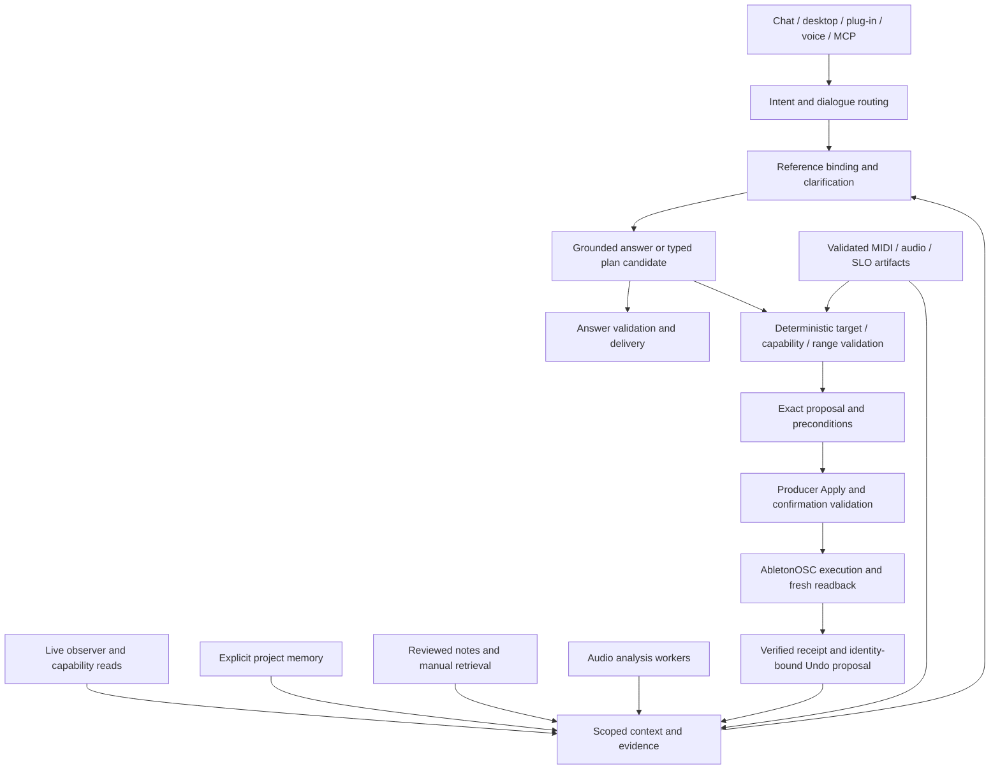

# KENN plan

Updated 2 October 2026. This is KENN's sole product roadmap, architecture direction,
work queue and progress checklist. Start here, then read the named source, tests and
evidence for the task. `AGENTS.md` governs repository work. Dated reports describe
their recorded commit and environment; they do not authorize work or prove today's
build. Component specifications and runbooks explain contracts and procedures.

The previous North Star, mega plan, beta plans, trackers and execution prompts are
retired. Their history remains in Git; the consolidation record is
[the planning audit](docs/evidence/KENN_PLANNING_CONSOLIDATION_2026-10-02.md).
Update this file instead of creating another roadmap, handoff prompt or progress log.

The [2 October product and open-source research](docs/research/KENN_PRODUCT_AND_OPEN_SOURCE_RESEARCH_2026-10-02.md)
informs C1–C2, L2–L3 and B1–B4 below. Its three experiment protocols supply candidate
methods for local delivery, passage reranking and audio measurements; their proposed
thresholds do not replace this plan's acceptance targets. Product references inform
interface choices; new dependencies and model assets still require approval.

## Purpose and decisions

KENN is a local language-model assistant for a producer using Ableton Live. It should
understand ordinary requests and follow-ups, explain music and audio clearly, use
current session facts, and prepare useful changes that the producer can inspect,
Apply and Undo. Fast deterministic commands and grounded conversation both matter.

The owner's current priority is useful conversation, efficient local inference and
good Ableton integration. Large citation-capture projects, source-count targets and
new control families do not take precedence over that work. Grounding remains a
product requirement: unsupported measurements, sources and claims must be rejected.

Decisions already made:

- Local Qwen3 8B chat (`kenn-brain-qwen3-8b`) and Qwen3 4B planner. Keep this model
  choice; investigate pipeline costs before proposing another model. No hosted brain.
- The Mac target is Apple M3 with 16 GB unified memory. Model residency, context and
  concurrency must fit alongside Live. Do not assume both models can stay resident
  without measuring memory pressure and model switching.
- Python owns dialogue, retrieval, memory, policy and jobs. C++ owns measured DSP
  kernels and plug-in realtime work. A whole-backend rewrite is outside this plan.
- AbletonOSC is the Live transport owner. UI, HTTP, voice and MCP must share the
  same typed policy and execution services, without a second write authority.
- Preferences require explicit opt-in. Session inference, diagnostic hypotheses
  and a producer's saved preferences are different kinds of information.
- Engineering runs against `FakeLiveBackend`, mocks and synthetic fixtures. Real
  Live writes require an owner-scheduled, supervised qualification on a disposable
  set. Existing real-Live receipts qualify their recorded scope, not every new build.

### Product direction

The owner's end goal is one assistant that is specialised in music production and
Ableton Live, answers ordinary questions well, controls Live through the existing
Apply and Undo path, and teaches Live to the producer. Local delivery targets below,
including the 15 s / 70% gate, are milestones toward that. Passing them does not show
the end goal is met.

A model that fits beside Live on 16 GB will not match a frontier model on general
intelligence. The route is a strong small model made reliable in the domain:

- Retrieval over reviewed, sourced notes and the Live manual, with the figure checker
  rejecting any number the notes do not contain.
- Deterministic reaction routing for follow-ups, vague asks, off-topic asks and
  third-party plug-ins.
- A small fine-tune (LoRA) so the model keeps the answer format, stays grounded and
  declines properly. It improves behaviour, not general ability. It needs the owner's
  explicit approval, answers checked against the notes, and a held-out evaluation.
- Control of Live as typed tool calls; the model picks the action and policy executes it.

Open for the owner, not decided: whether very hard or open-ended questions may go to
a larger hosted model. That would reverse "No hosted brain" above and brings cost and
privacy terms with it. Until the owner decides, KENN stays fully local.

Review of 4 October 2026, to test before deciding:

- Note-first answers. Today the model rewrites a note and the checker throws out about
  40% of the rewrites. The notes already hold a short answer, steps and a reason, so
  serving the matched note's own sections may help more than a rewrite: figures are
  right by construction and the reply is immediate. The model would then interpret the
  ask, pick the note, ask one clarifying question and tailor a line to the session.
  This stays a hypothesis until a hand-graded comparison (note served as-is against the
  model rewrite, about 40 questions, graded 0/1/2 by the owner) shows which helps more.
- What only KENN can do. A general chatbot can explain Live from the manual. Reading
  the producer's session, listening to the mix and making the change with Apply and Undo
  is where KENN is different, so that work outranks winning the gate on general questions.
- One scoreboard. Acceptance shows the checker is satisfied, not that the answer helped.
  Owner grades on a fixed, held-out question set sit beside the gate figures.
- One experiment at a time, measured on mains power. On 4 October the Mac went to
  battery at 21:04 and generation fell from about 18 to about 5 tokens a second, which
  turned 10 s answers into 30 s ones and made that evening's timing figures meaningless.

## Architecture

This is the intended dependency direction. Existing code already implements much
of it; the audit below identifies where consistency still needs proof. It is not
an instruction to add a new framework or duplicate the current services.



There are two loops. The reasoning loop may read, retrieve, analyse and propose.
The action loop validates, confirms, executes, reads back and records. A fluent
answer, retrieved note, audio finding or model plan cannot grant write permission.

| Responsibility | Existing implementation | Boundary to preserve or qualify |
|---|---|---|
| Request routing and answer delivery | [chat facade](apps/backend/src/kenn/core/chat.py), [routing](apps/backend/src/kenn/core/chat_routing.py), [Live router](apps/backend/src/kenn/core/chat_live_router.py), [answers](apps/backend/src/kenn/core/chat_answer.py) | Route once; ask one useful clarification; align streaming, foreground and background validation. Short commands must not wait for knowledge generation. |
| Model transport and generation | [LLM transport](apps/backend/src/kenn/llm/llm_rewrite.py), [background upgrades](apps/backend/src/kenn/core/answer_upgrades.py) | Qwen calls use the native Ollama path with thinking off unless explicitly configured otherwise. Bound output, timeout, workers and memory; count every attempt and fallback. |
| Retrieval and answer verification | [retrieval](apps/backend/src/kenn/retrieval/retrieval.py), [chat retrieval](apps/backend/src/kenn/core/chat_retrieval.py), [grounding](apps/backend/src/kenn/core/chat_grounding.py) | Evidence must support the claim and units. A user's question and an answer's own source list are not evidence. Keep index/model/prompt provenance. |
| Dialogue references and project facts | [session context](apps/backend/src/kenn/core/session_context.py), [Live world model](apps/backend/src/kenn/core/live_world_model.py), [session world model](apps/backend/src/kenn/core/session_world_model.py) | Separate current observations, conversation slots and durable preferences. Reuse existing owners; audit overlapping state before consolidating it. |
| Command interpretation | [Live command gateway](apps/backend/src/kenn/core/live_command.py), [rule parser](apps/backend/src/kenn/core/live_intent.py), [ordered rule stages](apps/backend/src/kenn/core/live_intent_rules) | Deterministic refusals and target binding remain authoritative. A planner supplies candidates; ambiguous or stale identities require clarification. |
| Proposal, Apply, readback and Undo | [action service](apps/backend/src/kenn/core/live_action_service.py), [backend interface](apps/backend/src/kenn/core/live_backend.py), [recipes](apps/backend/src/kenn/core/live_recipe.py) | Every enabled write needs exact identity, value/unit, preconditions, expiry, confirmation, verified outcome and a stated recovery path. |
| Multi-step tasks and MCP | [coordinator](apps/backend/src/kenn/core/assistant_coordinator.py), [MCP handlers](apps/backend/src/kenn/core/mcp) | Stop on stale state, partial failure or cancellation. No raw OSC, arbitrary execution or policy bypass through a different surface. |
| Explicit memory | [profile memory](apps/backend/src/kenn/core/assistant_profile_memory.py), [project advisory](apps/backend/src/kenn/core/project_memory_advisory.py) | Scope by project/session, expose active and superseded values, support edit/delete/restore, and identify memory when used in an answer. |
| Listening and creation | [analysis](apps/backend/src/kenn/core/audio_analysis.py), [local Mix Review](apps/backend/src/kenn/core/local_mix_review_service.py), [MIDI artifacts](apps/backend/src/kenn/core/audiogen_artifacts.py) | Measured findings, interpretation and proposed fixes stay distinct. An uploaded bounce does not identify a Live target. Generated artifacts require validation and preview before a proposal. |
| Realtime plug-in | [JUCE plug-in](plugins/kenn-vst3-au) | No model, network, filesystem work, blocking lock or allocation in the audio callback. Communicate with companion workers asynchronously. |

### Context and identity contract

Every fact needs its origin and scope: Live observation, manual/note excerpt,
measured audio, generated artifact or explicit preference. Include time/version,
applicability and uncertainty. A stale observation remains stale; a predicted track
role remains a hypothesis. Conflicting evidence is surfaced rather than silently
merged. Prefer relevant official documentation and measured device data over advice;
validate the current implementation of source tiers rather than assume this policy
is fully qualified.

Current target identity uses indexes, names, display positions and snapshot
preconditions; stable host object IDs and a persistent revisioned project graph are
not fully established. Never treat a name or numeric position as durable identity.
Bind to the current snapshot, re-read affected objects before Apply, and reject a
renamed, reordered, removed or multiply matching target. Stable IDs may be adopted
only where the transport exposes and qualifies them; do not manufacture persistence
by attaching an ID to a name.

Cache keys must cover session/project, relevant state, index/model/prompt versions
and the evidence used. Semantic similarity is not exact identity. Never reuse a
cached observation as an Apply precondition. Background answers must carry the same
context scope as foreground answers, and an old job must not replace a newer turn.

### Action and failure contract

A proposal records typed operations, target identities, exact before/after values,
units/ranges, preconditions, expiry and verification predicates. Confirmation is
bound to that proposal and session. No model can create an approval token.

Writes to one Live set must be serialized and idempotency-bound; audit all routes
before claiming this is consistently implemented. Re-read before execution and
read back after it. A timeout can mean the write landed: report an unknown outcome,
inspect state, and never blindly retry. Receipts distinguish requested, attempted,
applied and verified work, including partial batches. Undo uses observed before-state
and refuses an identity mismatch or an independently changed post-state. Do not claim
atomic rollback for an operation whose backend cannot prove it.

Process restart expires in-memory confirmations. Cancellation prevents future
steps; it does not erase an already applied change. Unsupported or non-reversible
operations must state that limitation before Apply. Keep auto mode disabled.

### Performance contract

Keep deterministic command parsing, Live reads and the first useful grounded answer
responsive while a single background answer is generated. The existing upgrade
worker permits one generation at a time and retains at most 50 results for 600 s;
that bound is not proof of per-session ownership, cancellation or fair scheduling.
Audit those properties before adding another job abstraction.

Measure routing, reference binding, query embedding, retrieval, prompt construction,
model prefill, decode, validation, OSC, readback and analysis separately, plus the
complete request. Report TTFT, first useful answer and accepted final answer as
different measures. Include queue time, cache state, model digest, output tokens,
memory pressure and cold/warm residency. Rejected answers and busy attempts count.
Optimize the dominant measured cost one change at a time.

CPU ONNX query embeddings are the current choice. Native DSP remains opt-in pending
rights-cleared and cross-platform release evidence. Historical spectral-only and
later decoder/bulk-metrics results have different scopes; use the exact workload and
receipt in [native qualification](docs/research/CPP_DSP_PHASE4_RELEASE_QUALIFICATION.md).
Component design references are [DSP architecture](docs/research/CPP_DSP_TARGET_ARCHITECTURE.md)
and [shared runtime boundaries](docs/research/CPP_SHARED_RUNTIME_ARCHITECTURE.md).
Kernel timing alone cannot justify changing the default or sharing an ABI.

## Verified starting point

The source baseline for this consolidation is `153f06cb`. These ticks apply only
to the stated implementation and evidence; they do not imply release qualification.

The [2 October capability baseline](docs/evidence/KENN_CAPABILITY_BASELINE_2026-10-02.md)
records implemented features, current limits and qualification boundaries.

- [x] **V1 — Query embedding overhead reduced.** Same fp32 model and index, CPU ONNX
  1.14–1.15 ms p50 versus CoreML 12.43–12.72 ms in two 40-query runs; identical
  ordered top-four results on 240 questions. [Evidence](docs/evidence/KENN_QUERY_EMBEDDING_LATENCY_2026-10-02.md).
- [x] **V2 — Displayed track choices retain the unfinished request.** Exactly two
  fresh choices support “the other one” after selecting one, including after Apply.
  The 300 s window, identity checks, ambiguous model refusal and session isolation
  have 20 tests and seven caught mutations. [Evidence](docs/evidence/KENN_TRACK_CHOICES_2026-10-02.md).
- [x] **V3 — Query-echo sections filtered before candidate limits.** Implemented in
  `f0ebeba6`; regression tests cover Related-questions chunks. This does not certify
  an index rebuild or a new retrieval-quality result.
- [x] **V4 — Preference history and restore implemented.** Existing API/service and
  tests cover superseded values, transactional restore and session boundaries.
  Human UI qualification remains open.
- [x] **V5 — Source excerpt boundary fixes implemented.** Existing
  `test_source_excerpt_boundaries.py` covers word, fence and tag truncation. Retired
  unchecked boxes for this fix and preference history were stale.
- [x] **V6 — Existing monthly reporting and release qualifier identified.** Preserve
  their measurements and gate semantics; update their document paths during cleanup.

The last full backend run at V2: **3,109 passed, 12 skipped, one known failure** in
76.42 s. `test_live_command::test_llm_plan_gets_one_structural_repair_attempt` is
order-dependent and passes alone. A5 later traced that failure to collection-time
environment contamination and fixed it: the combined 2 October run passed
**3,171 tests, with 12 optional-dependency skips and no failures**, in 98.40 s.
[Current baseline and scope](docs/evidence/KENN_TEST_BASELINE_2026-10-02.md).

Model acceptance was 22/29 and 23/29 in two earlier runs recorded by the incoming
handoff. That sample is too small to establish 90%; latency also varied. Its TTFT
sample was 3.18 s median / 5.04 s p95. These are historical observations, not a
post-embedding baseline. Earlier 4090 results met a timing threshold while landing
13/30 answers: **43% does not meet a 70% acceptance requirement**. Re-measure the
current local paths before making a new claim.

## Work sequence and checkboxes

One sequence replaces the old concurrent tracks and dated week estimates. Finish
the active step's bounded slice before adding work. Real-Live or human-review gates
can stay open while independent engineering continues; they cannot be ticked by a
mock, an agent reviewer or an unrelated receipt.

### 1. Consolidate planning and audit architecture

- [x] **A1 — Consolidate navigation.** Retired 45 competing or superseded files,
  preserved evidence and recovery procedures, repaired active references and release
  artifact checks. 57 introduced local links resolve; 64 scoped tests pass and both
  missing-document checks fail as required. [Audit and exact files](docs/evidence/KENN_PLANNING_CONSOLIDATION_2026-10-02.md).
- [x] **A2 — Trace every request and write route.** Inventory UI/HTTP/stream/background/
  voice/MCP entry points through routing, context, proposal, Apply, readback and Undo.
  Compare function/registry bindings, not names alone. Record each bypass or duplicate
  owner with a source symbol and reproducible fixture. Finish the reachability trace
  for each owner before changing it. Two read-only source passes plus a direct trace of the
  ambient guardian found no write that skips the proposal and confirmation gate. Seven
  duplicate-owner or lost-receipt defects found on the way each have a fixture and a fix (the
  A3 sub-bullets below). Limits: a source read, not a runtime trace; the open observations
  (no concurrent-stream guard, unauthenticated local `reload-index`, a dead MCP field, caller-less
  `LiveExecutor`, track-0 fallbacks in snapshot reads, the missing `demo_feedback`) are listed
  with symbols and carried forward. [Route map](docs/evidence/KENN_A2_ROUTE_MAP_2026-10-02.md).
- [x] **A3 — Resolve scoped delivery defects first.** Audit memory/cache isolation,
  project switching, upgrade polling ownership, stale-turn replacement and
  cancellation; fix verified defects with cross-session and late-job tests.
  Preserve the rule against recording the question twice.
  Closed 2 Oct 2026 with these limits, none hidden: inference is not actually aborted on cancel (needs a bridge
  change), no Live set identity scopes tokens or Undo receipts, and six held-out wrapper rows moved to C5.
  - [x] Main HTTP/UI background path retains session/plugin/correlation identifiers,
    reads project preferences without a second memory/cache write, scopes polling
    to the originating chat and discards superseded or cleared results. 48 scoped
    backend and 20 frontend tests pass; 15 mutations are caught. [Evidence and exact files](docs/evidence/KENN_BACKGROUND_CONTEXT_2026-10-02.md).
  - [x] FastAPI ask uses the actual public answer signature, retains session/plugin/
    correlation identifiers and handles nullable optional context. Ask and clear
    discard that chat's older background result; other chats remain intact. 49 scoped
    tests pass; 10 mutations are caught. [Evidence and exact files](docs/evidence/KENN_FASTAPI_CONTEXT_2026-10-02.md).
  - [x] MCP knowledge and both public knowledge wrappers use request-local retrieval
    policy without replacing shared engine functions. Knowledge preserves scoped
    preferences and typed review context without creating transport proposals or
    another chat turn. 218 scoped backend and 100 wrapper tests pass; 25 mutations
    are caught. [Evidence and exact files](docs/evidence/KENN_KNOWLEDGE_POLICY_2026-10-02.md).
  - [x] Both public wrapper imports preserve shared model policy and the default
    corpus. Request-local index reads isolate lexical/matrix/status and semantic
    cache identity, including equal-size corpus replacement. 132 scoped cases
    pass, including 28 new cases; four mutations are caught. [Evidence and exact files](docs/evidence/KENN_WRAPPER_INDEX_ISOLATION_2026-10-02.md).
  - [x] Dismiss revokes the issuing chat's token before hiding a card; held tokens
    cannot execute after acknowledgement. Apply/revoke share the consumption lock,
    pending state counts live tokens and recipe children retire. Chat cancel
    invalidates its delivery without claiming inference or applied work stopped.
    281 backend compatibility and 66 frontend tests pass; typecheck/build pass and
    42 mutations are caught. [Evidence and exact files](docs/evidence/KENN_CONFIRMATION_DISMISSAL_2026-10-02.md).
  - [x] HTTP/CLI streams preserve the authoritative grounded final answer, run
    short commands before cache and discard superseded delivery. Bound memory,
    cache and checkpoint writes share the turn lock; plug-in/proposal events do
    not replay stale evidence or tokens. 97 scoped cases and the combined 3,413-case
    backend run pass; 23 mutations are caught. [Evidence and exact files](docs/evidence/KENN_STREAM_DELIVERY_2026-10-02.md).
  - [x] Semantic cache now clears a session's entries when a preference is saved,
    restored, forgotten or the profile cleared. Proposals, confirmation tokens and
    orchestrator results are never stored, on either path, and the non-stream path
    skips the cache for plug-in-bound requests like the stream path. 3,463 backend
    cases pass; 12 mutations are caught. [Evidence and exact files](docs/evidence/KENN_SEMANTIC_CACHE_STATE_2026-10-02.md).
  - [x] Semantic cache also skips follow-ups and diagnostic reports inside a session,
    answers built from saved mix reviews or track memory, and audio-generation payloads
    that carry a queued job, on both paths. 20 scoped cases pass and nine mutations
    are caught; the gate is a list of routes found by reading, not a proof that no
    other route reads session state. [Evidence and exact files](docs/evidence/KENN_SEMANTIC_CACHE_SESSION_STATE_2026-10-02.md).
  - [x] A semantic-cache hit now records its turn and returns the current session block
    on both paths; before, a repeated question left the last question, turn count and
    topics at the previous exchange. The stream path records only while its turn is
    current. 73 scoped cases pass, six mutations are caught and the full backend run is
    3,480 passed, 12 skipped. Cached answers are not made current by this; it only keeps
    session memory in step. [Evidence and exact files](docs/evidence/KENN_SEMANTIC_CACHE_TURN_RECORD_2026-10-02.md).
  - [x] `/api/feedback` has one owner: FastAPI no longer says "recorded" for a rating it
    threw away. It now returns 503 when nothing can store the rating, 400 for an unknown one
    and 201 with the stored row. Five mutations caught. `demo_feedback` is missing from the
    tree, so feedback is stored nowhere on either server until that is decided.
    [Evidence and exact files](docs/evidence/KENN_FEEDBACK_SINGLE_OWNER_2026-10-02.md).
  - [x] A client that sends only `confirmation_token` (the key proposals hand out) now
    reaches the service on all nine Live apply branches instead of being refused with an empty
    token. 12 scoped cases pass, all nine sites mutation-checked and the full backend run is
    3,500 passed, 12 skipped. `routes/daw_routes.py` still carries a duplicate
    `handle_live_command`. [Evidence and exact files](docs/evidence/KENN_CONFIRMATION_TOKEN_ALIAS_2026-10-02.md).
  - [x] FastAPI `/api/ableton/command` now runs the stdlib handler instead of a drifted copy.
    Before, a MIDI clip, duplication, rename, audition or sample proposal came back
    "requires confirmation" and was never applied there, and an applied command recorded no
    receipt for Undo. 61 scoped cases pass, three mutations caught and the full backend run is
    3,505 passed, 12 skipped. `/api/ableton/osc/undo` still has two owners.
    [Evidence and exact files](docs/evidence/KENN_FASTAPI_LIVE_COMMAND_OWNER_2026-10-02.md).
  - [x] `/api/ableton/osc/undo` has one owner: the inline block in `server.py` moved to
    `daw_command_handler.handle_osc_undo` and FastAPI calls it. Before, FastAPI could not plan
    or apply an undo for any domain receipt (MIDI clip, duplication, rename, audition, sample)
    and recorded no receipt. Four mutations caught, 165 existing tests still pass and the
    full backend run is 3,507 passed, 12 skipped. Only the duplication path has a new
    test; the other moved branches rely on the existing suite.
    [Evidence and exact files](docs/evidence/KENN_OSC_UNDO_SINGLE_OWNER_2026-10-02.md).
  - [x] `/api/session/doctor/remediate` is closed (410). It answered 500 to every request
    because it called the proposal builder with arguments it does not take, and its confirmed
    branch said "applied" without writing to Live. The MCP `kenn_session_doctor` no longer posts
    to `/api/kenn/autonomous-execute-batch`, a route neither server has; it reports
    `not_executed`. Four new cases, both old files fail them, full backend run is 3,511 passed,
    12 skipped. No confirmed remediation path exists yet.
    [Evidence and exact files](docs/evidence/KENN_DOCTOR_REMEDIATION_CLOSED_2026-10-02.md).
  - [x] A batch parameter change with no `track_index` is refused instead of being planned
    against track 0 (the planner inspected track 0's device and issued a token for it). Device
    and parameter indices still default to 0 because parameters can be named. One new case,
    the old line fails it, full backend run is 3,512 passed, 12 skipped.
    [Evidence and exact files](docs/evidence/KENN_BATCH_TRACK_INDEX_2026-10-02.md).
  - [x] Confirmed writes made through the agent tools (track volume/pan/mute/solo/arm, transport,
    device parameter and macro) are now journaled like the HTTP routes, so Undo can find them
    and the cached Live state is invalidated. Failed writes are journaled too. Six new cases,
    each of the three call sites fails the file when deleted, full backend run is
    3,518 passed, 12 skipped.
    [Evidence and exact files](docs/evidence/KENN_AUTONOMOUS_TOOL_RECEIPTS_2026-10-02.md).
  - [x] Removed `tool_auto_remediate_session_issues` and `_track_confirmation` from
    `autonomous_agent.py`. Neither had a caller, and the first applied a whole batch through
    `execute_batch_autonomous`, which confirms its own proposals. Two new cases fail on the old
    file, full backend run is 3,520 passed, 12 skipped.
    [Evidence and exact files](docs/evidence/KENN_AUTONOMOUS_DEAD_WRITE_PATHS_2026-10-02.md).
  - [x] Trace other request owners, Live-change cache invalidation for any remaining
    state-describing routes, raw trace/trust persistence, project switching and
    Apply/Undo during generation.
    Discarding delivery keeps
    the model slot occupied until inference finishes; actual inference cancellation
    remains unqualified.
    Each was traced by reading source and ends in a fix or a recorded open finding: owners in
    [the A2 route map](docs/evidence/KENN_A2_ROUTE_MAP_2026-10-02.md), cache invalidation in
    [its receipt](docs/evidence/KENN_LIVE_CACHE_INVALIDATION_2026-10-02.md), and project switching,
    Apply/Undo during generation and trace storage in
    [the session-clear receipt](docs/evidence/KENN_SESSION_CLEAR_REVOKES_TOKENS_2026-10-02.md). Limits:
    no Live set identity scopes tokens or Undo receipts (open, needs a decision); inference is not
    cancelled and the cancel reply reports `inference_aborted: false`; nothing was run against real Live.
  - [x] Remove confirmed dead code and redundant ownership after checking callers,
    exports, dynamic registries, packaging and tests. Keep cleanup independent of
    the fixed benchmark revision; qualify each deletion with scoped checks.
    Every deletion below was confirmed and checked that way. What is not confirmed dead (the Audio_Too/thursday
    duplicate, `knowledge_flywheel_agent`, `podcast_repair_api`, `listening_benchmark_*`, the four missing files
    `kenn_demo_doctor.py` checks) is listed for a decision in the dead-code evidence and was not deleted.
  - [x] Deleted 17 uncalled Audio_Too scripts and modules plus the `package` command whose script no longer
    exists. Collection is identical before and after; the Audio_Too suite does not run cleanly here, so
    that is parity, not a green run. Candidates left for decision are listed in the
    [evidence](docs/evidence/KENN_AUDIO_TOO_DEAD_CODE_2026-10-02.md).
  - [x] Removed eight more unreferenced Audio_Too functions (`generate_llm_simple` and its helper
    `_ollama_generate`, `stop_automix_worker`, `save_records` and `replace_records`, `export_xlsx`, `str_date`,
    `start_ableton_web`). Collection and the 19 related test files give identical results before and after;
    the Audio_Too suite still cannot run clean here. See the same
    [evidence](docs/evidence/KENN_AUDIO_TOO_DEAD_CODE_2026-10-02.md).
  - [x] Removed two overridden, unreachable clip methods from `AbletonOSCClient`;
    the final public methods retain the same behavior. Caller/registry and AST
    checks establish reachability; 39 scoped OSC/clip tests pass. [Evidence and exact files](docs/evidence/KENN_DEAD_CLIP_METHODS_2026-10-02.md).
  - [x] Removed two uncalled private helpers and four unused import bindings from
    five active modules after symbol/AST/export/registry/packaging checks. Public
    behavior remains covered by 139 scoped cases before and after deletion.
    [Evidence and exact files](docs/evidence/KENN_UNUSED_HELPERS_2026-10-02.md).
  - [x] Removed the overwritten mix-output assignment and unreachable analysis
    branch, cleaned six retired-plan headers, and corrected the wrapper dependency
    include and standalone builder's canonical backend default. 51 scoped backend
    and 58 canonical-wrapper cases pass; six builder mutations are caught.
    [Evidence and exact files](docs/evidence/KENN_ACTIVE_PATH_CLEANUP_2026-10-02.md).
  - [x] Removed four uncalled Audio_Too helpers, one unreachable KENN MIDI return
    and five unused KENN imports after caller/export/registry and retained-AST checks.
    Corrected three wrapper/Mix Review READMEs to match current source and qualification
    limits. 75 KENN and 21 isolated Audio_Too cases pass; four Audio_Too mutations
    are caught. [Evidence and exact files](docs/evidence/KENN_AUDIO_TOO_UNUSED_CODE_2026-10-02.md).
  - [x] Resolve the two existing package-wrapper evaluation failures: three chat
    coverage rows and five held-out rows fail identically before/after cleanup.
    Preserve expected behavior, citation guards and index provenance; trace the
    boundary/diagnosis/citation findings recorded in the cleanup evidence.
    One row is fixed: `wwise-mobile-ambience-memory` was a routing gap (a mobile-build audio
    memory question routed to `production` and was answered by the public wrapper, which refuses
    game audio). Two coverage rows and five held-out rows remain; each cause is in
    [the evidence](docs/evidence/KENN_MOBILE_AUDIO_MEMORY_ROUTE_2026-10-02.md). Full backend
    run is 3,527 passed, 12 skipped.
    A second held-out row is fixed: `new-topic-does-not-inherit-old-diagnosis` (a symptom report with Live
    offline was answered as a control error; see
    [the evidence](docs/evidence/KENN_SYMPTOM_REPORT_OFFLINE_ADVICE_2026-10-02.md)). Four held-out rows
    and two coverage rows stay open as retrieval-ranking or corpus findings, diagnosed in that receipt.
  - Live cache invalidation audited: a gain-staging run that failed readback moved and restored
    volumes without clearing the cached world state; it now does. The other candidate gaps (returns
    cache, doctor-poll fallback age, bridge cache races, unjournaled failure paths) are recorded as open
    in [the evidence](docs/evidence/KENN_LIVE_CACHE_INVALIDATION_2026-10-02.md). Full backend run is
    3,532 passed, 12 skipped.
  - Pointer audit, first part: the LaunchAgent installer substituted a placeholder the plist no longer
    uses, so an installed agent kept literal `<KENN_REPO_ROOT>` paths; fixed with a test, and four docs
    with dead file pointers re-pointed (see
    [the evidence](docs/evidence/KENN_LAUNCHAGENT_AND_DOC_POINTERS_2026-10-02.md)). The Audio_Too symlink
    and the two chat Dockerfiles that depend on it are recorded there as open, along with the finding
    that `chat/` and `packages/chat` are two diverged tracked copies of the wrapper (13 and 23 files). Full backend run is
    3,534 passed, 12 skipped.
  - Clearing a chat now revokes its pending Apply tokens and drops its last-command and undo-link state
    on both servers; before, an old card stayed good for the rest of its five minutes and "again" still
    repeated the old command. Six new cases, the revoke and "again" cases failed on both servers
    before the fix. The trace also found that no set or project identity scopes tokens or Undo
    receipts, and recorded the Apply/Undo-during-generation and trace-storage findings as open in
    [the evidence](docs/evidence/KENN_SESSION_CLEAR_REVOKES_TOKENS_2026-10-02.md). Full backend run is
    3,540 passed, 12 skipped.
  - A third held-out row is fixed: `upgrade-room-null` (a bass-null question never said "room", so the
    acoustics topic did not fire and the room-placement note ranked 4th). The row now cites the note,
    but the generated answer is still weak and does not warn against EQ-boosting a null; see
    [the evidence](docs/evidence/KENN_ACOUSTICS_TOPIC_TERMS_2026-10-02.md). Three held-out rows and
    two coverage rows remain. Full backend run is 3,544 passed, 12 skipped.
    Root cause of three of the five remaining rows is now known: they passed only through "Related
    questions" echo chunks that `f0ebeba6` deliberately excludes, and re-allowing the echo breaks
    `bass-processing` ([evidence](docs/evidence/KENN_EVAL_ROWS_RELATED_QUESTION_ECHO_2026-10-02.md)).
    Closing them is a decision on the rows' expected sources or a note rewrite and index rebuild, not a
    retrieval tweak. `harsh-after-mastering` and `upgrade-buffer-recording` fail either way.
    Jack chose to write answer text: step 7 was added to `thin-vocal-body.md` and
    `arrangement-energy-and-transitions.md` (git-ignored, text kept in the evidence). Verified on the GPU box with a
    fresh CPU build of an isolated copy: coverage goes from 125 to 128 of 128, after a third note
    (`mastering-prep-and-headroom.md`) turned out to be echo-dependent too
    ([evidence](docs/evidence/KENN_ECHO_ROWS_BOX_REBUILD_2026-10-02.md)). The held-out wrapper eval still fails the
    same six rows before and after, so this parent item stays open. The Mac's live index is not rebuilt.
    Each of the six is traced to a cause (ranking behind long transcript notes, answer built from the wrong note, or a
    corpus gap) in [the held-out rows receipt](docs/evidence/KENN_WRAPPER_HELDOUT_ROWS_FRESH_INDEX_2026-10-02.md).
    They are held-out rows, so they are not tuned against. Jack chose on 2 Oct to re-scope: the six rows move to C5
    (below) as its known failing set, and this item is ticked with that receipt as its limit, not as a pass. For
    `harsh-after-mastering` a draft note, `harsh-after-mastering-limiting.md` (local, git-ignored, Status: Draft so it
    is not indexed), awaits his review.
  - [x] Measured what a cancelled answer does to the model slot, on the real Qwen3-4B bridge on the GPU box:
    after the client gives up at 2 s the generation runs on and the slot stays busy another 45.5 s (a 58 s
    generation), refusing 30 retries with 429; an idle short request takes about 1.2 s. KENN's cancel still
    reports `inference_aborted: false`. Stopping generation is an open finding that needs a bridge change; see
    [the evidence](docs/evidence/KENN_INFERENCE_CANCELLATION_MEASURED_2026-10-02.md).
  - [x] Continue the remaining document-pointer and container-path audit, including
    tracked Audio_Too callers and packaging. Its `studio/kenn` compatibility symlink
    points at this product; inventory it once and preserve active exports/CLIs.
    Repointed 19 dangling links in six docs (scan now 257 links, 0 broken), checked every Dockerfile/compose
    source and all 11 tracked symlinks. One open finding: the Audio_Too image's symlinked `studio/` dirs sit
    outside its build context, so it likely cannot build; Docker not run, no change made.
    [Evidence](docs/evidence/KENN_DOC_POINTERS_CONTAINER_PATHS_2026-10-02.md).
  - [x] `packages/chat` is the single chat wrapper: the duplicate `chat/` copy is removed (its two unique
    tests moved) and the wrapper Dockerfile no longer reads Audio_Too, with its own ignore file. Image not
    built (no Docker here) and it needs the git-ignored notes and models on disk.
    [Evidence](docs/evidence/KENN_CHAT_WRAPPER_CANONICAL_2026-10-02.md).
  - [x] Retargeted the Audio_Too `studio/kenn` symlink at `apps/backend/src`, the directory its 164
    `studio/kenn/kenn/...` callers expect. Of the 27 test files that use it, passes went from 22 to 126;
    the Audio_Too suite still does not run green here and no image or CI run was done.
    [Evidence](docs/evidence/KENN_AUDIO_TOO_SYMLINK_RETARGET_2026-10-02.md).
- [x] **A4 — Replace unconditional status claims with observed status.** Audit
  `chat_answer._short_circuit_evaluator`, including its MLX/OSC status text and cancel
  reply, against actual selected inference backend, connection and pending actions.
  Transport branches propose through the action service; trace their validation path
  before changing or describing them as a bypass.
  - [x] Public rewrite status reports an enabled Ollama configuration without a model
    as unavailable. Six new cases and 20 scoped tests pass; the readiness regression
    catches a deliberate mutation. This describes whether configuration permits an
    attempt, not provider health or model residency. [Implementation](apps/backend/src/kenn/llm/llm_rewrite.py)
    and [tests](apps/backend/src/kenn/tests/test_llm_public_status.py).
  - [x] Nonstream chat status reports configured inference and cached Live
    observations without loading weights, probing a provider or claiming current
    health. 21 new cases and 51 scoped tests pass; an unconditional-status mutation
    is caught. [Evidence and exact files](docs/evidence/KENN_CHAT_STATUS_2026-10-02.md).
    Streaming now uses this shortcut; cancel and transport proposal parity are
    covered by the dismissal and stream-delivery evidence above.
  - [x] The play/stop shortcut no longer says "not reachable on OSC port 11000" for every
    refusal; it repeats the action service's own reason. Both branches were traced: they
    propose through `LiveActionService.propose_transport_action` and are not a bypass. Four new
    cases, the old sentence fails two, full backend run is 3,524 passed, 12 skipped. This
    closes the `_short_circuit_evaluator` audit (status, cancel, transport).
    [Evidence and exact files](docs/evidence/KENN_TRANSPORT_SHORTCUT_REASONS_2026-10-02.md).
- [x] **A5 — Establish the clean test baseline.** Scoped collection-time model policy
  to individual tests and the offline replay CLI without changing planner assertions
  or production enablement precedence. Eight import and four CLI guards pass; seven
  mutations are caught. Full backend: 3,171 passed, 12 optional-dependency skips,
  no failures in 98.40 s. [Evidence and exact files](docs/evidence/KENN_TEST_BASELINE_2026-10-02.md).

**Next executable task: continue A2/A3 through the remaining bound request owners.**
Do not resume citation capture, a speculative rewrite or an unfinished extraction
merely because an old document suggested it.

Remaining-owner review, 3 Oct: the revoke import serves both HTTP cancellation
routes. The Live-command and autonomous-producer dispatch paths now reject missing
or malformed owners before preparing proposals or starting deliberation. Explicit
owners and anonymous read-only inspection are covered. Scoped checks: 77 passed;
the shared-owner mutation causes 10 failures. Full backend: 4105 passed, 12 skipped,
the same pre-existing personal-path failure. No broad A2/A3 tick is claimed.
[Code commit, commands, result and limits](docs/evidence/KENN_A2_ANONYMOUS_DISPATCH_OWNERS_2026-10-03.md).
Recipe dispatch review, 3 Oct: rack, MIDI and surgical masking routes now reject
missing or malformed owners before snapshot/telemetry reads or proposal work.
Valid owners and distinct proposal tokens are covered; anonymous rack catalogue
requests remain available. Scoped checks: 134 passed. Full backend: 4133 passed,
12 skipped and the same pre-existing personal-path failure. No broad A2/A3 tick
is claimed. [Code commit, commands, result and limits](docs/evidence/KENN_A2_RECIPE_DISPATCH_OWNERS_2026-10-03.md).
Autonomous producer tokens, 3 Oct: `react_deliberate` no longer invents a `react_`
hash. Its proposal comes from the recipe service, so the `v1.` token is registered, owner-bound,
dismissible and applies once with Undo on fake Live. Steps a recipe cannot carry (more than
three, unsupported actions, no exact target, duplicate targets) are listed as not included.
Eight new cases, seven failed before the fix; scoped checks 136 passed; full backend 4008 passed,
137 skipped, 10 failed, the same ten as on a clean checkout (nine cloud-environment gaps plus the
personal-path failure). No real Live or model run; C1, C2 and C3 stay open.
[Code commit, commands and limits](docs/evidence/KENN_A2_AUTONOMOUS_CONFIRMATION_TOKENS_2026-10-03.md).
Generated-clip owner, 3 Oct: an anonymous `/api/ask` "write chords" request was filed under
the shared owner `chat`; it is now refused without a session ID, and a named chat's clip stays
its own. Scoped checks 165 passed; full backend 4014 passed, 137 skipped, the same ten failures
as a clean checkout. Fake Live only; C1, C2 and C3 stay open. Still untraced: `default_session`
defaults in the agent tool functions and `live_executor.py`.
[Receipt](docs/evidence/KENN_A2_GENERATED_CLIP_OWNER_2026-10-03.md).
Default-session trace, 3 Oct: the `default_session` defaults in the agent tools,
`live_executor.py` and the tool registry are not reachable from any route (chat and upload can
only trigger analysis tools); a guard test pins that. No behavior change, A2/A3 not ticked.
[Receipt](docs/evidence/KENN_A2_DEFAULT_SESSION_TRACE_2026-10-03.md).
Advanced-question probe, 3 Oct (tooling only; C1-C3 stay open): `tooling/scripts/probe_advanced_questions.py` with 47 cases in `tooling/evaluation/advanced_questions.json` records, per question, whether the model ran and whether its text was delivered, and stops if the model never runs. Prompted by the Mac companion answering from the template with the model off. First hand-reported misses and one invented-plugin answer are in [the receipt](docs/evidence/KENN_ADVANCED_QUESTION_PROBE_2026-10-03.md). Run it on the Mac with the model on and `KENN_LLM_CACHE=0`.

Scope correction, 3 Oct: Thursday is a separate
product; its compatibility fallback is removed from KENN's work queue.
[Remaining source trace](docs/evidence/KENN_A2_REMAINING_OWNER_AUDIT_2026-10-03.md).

At Jack's request, a [Claude Cloud handoff](docs/evidence/KENN_CLAUDE_CLOUD_HANDOFF_2026-10-03.md)
is prepared for work while his Mac is off. It summarizes this queue and existing
evidence; it does not start a cloud task or replace this plan. Refresh it when
Jack asks to hand over. Cloud fake-Live checks cannot qualify the local delivery gate.

Sharing request, 3 Oct: Jack approved a one-way, matching-branch `kenn-app`
mirror, its GitHub workflow and repository-scoped write credential. He also
requested Mac catch-up for pushed cloud work: fetch at login and every five
minutes while awake; fast-forward only a clean checked-out branch. Dirty files
and independent local or destination commits pause updates for review.
[Setup and activation limits](docs/runbooks/KENN_REPOSITORY_SYNC.md).
[Dated verification receipt](docs/evidence/KENN_REPOSITORY_SYNC_RECEIPT_2026-10-03.md).
Initial `main` reconciliation remains a review PR; neither `main` is merged
by setup. Local runtime engineering remains paused; C1/C2/C3 remain unticked.

### 2. Qualify useful local conversation and performance

Needs the route/context audit; fixes may land in small slices while that audit continues.

- [ ] **C1 — Current-path baseline.** At least 30 knowledge questions on M3/16 GB,
  separate streaming, foreground and background runs, both caches declared, exact
  model/index/code versions. Capture each stage and rejection reason. Repeat comparable
  runs; keep TTFT separate from completion time. Compare Live-open/closed only under
  controlled owner-supervised conditions, without writing to Live.
  Include admission/queue, context/retrieval, prefill, generation, verification,
  polling and displayed-result timing. Declare model-cold/warm conditions and record
  combined memory pressure, swap and audio dropouts at a fixed Live buffer/session.
  - [x] Captured five existing public knowledge questions through the real stream
    runner on M3/16 GB at `b1d97ad`: two generated answers accepted, two stopped
    for unsupported measurements and one provider timeout with template fallback.
    All-row median completion is 15.603 s; provider streaming takes 98.6–99.4%
    of each row. Caches, cold start, model/index/embedding hashes and isolated
    FakeLive runtime are declared; native phase telemetry and full C1 remain open.
    [Evidence and numeric receipt](docs/evidence/KENN_QWEN_SMALL_CURRENT_PATH_2026-10-02.md).
  - [x] Thirty questions through the stream runner at `7539ec10`, one run, FakeLive, response cache off: 22 of 29
    generated answers accepted, 7 stopped mid-stream (six unsupported measurements, one claimed a Live change).
    Median completion 18.9 s (p95 28.5 s), median first token 3.4 s (p95 8.9 s); completed calls spend about 3.2 s
    in prefill and 16.8 s generating. Stream surface only: no foreground/background runs, no repeat, no
    queue/verification/polling timing, no memory or dropout readings, cold/warm not separated. Against the 15 s/70% local
    delivery gate: 0 of 30 accepted within 15 s (fastest 15.01 s), 10 of 30 within 20 s. C1 stays open.
    [Evidence and numeric receipt](docs/evidence/KENN_C1_STREAM_30Q_2026-10-02.md).
  - Payload surface, same 30 questions (2 Oct): 10 answers kept, 17 cut off by the 20 s foreground read timeout, 3 of 30
    within 15 s, 10 of 30 within 20 s. One run, no repeat; the runner's attempted/accepted counters are empty on this
    surface, so the counts come from each row's `llm_enhanced` flag. C1 stays open.
    [Evidence](docs/evidence/KENN_C1_PAYLOAD_30Q_AND_CACHE_CONTRACT_2026-10-02.md).
  - Stream repeat (2 Oct): 23 of 29 accepted, 3 of 30 within 15 s, 14 of 30 within 20 s; the medians moved by about a second
    and a half between runs. Two of the rejected answers were the guard cutting "-6 dB" before "FS" arrived, fixed with
    tests. C1 stays open. [Evidence](docs/evidence/KENN_C1_STREAM_REPEAT_AND_GUARD_SPLIT_2026-10-02.md).
  - Stream run 3 with the guard fix (3 Oct): 25 of 29 accepted, 4 of 30 within 15 s, 18 of 30 within 20 s. Both false
    rejections are now accepted; the 15 s gate is still failed. C1 stays open. Same evidence note.
  - [x] Every rejected background upgrade now carries the check that rejected it, and the probe counts them by cause
    (`fcd2914f`, `2be6a7c6`, reviewed 5 Oct). Before this, 34 rejected rows in the 4 Oct runs said nothing about why.
- [ ] **C2 — Remove measured wasted work.** Review serial model calls, critique of a
  deterministic fallback, repeated retrieval, prompt/output budgets and residency.
  Native Ollama thinking-off behavior and the general 384-token output cap already
  exist; verify the selected model digest and actual response path before blaming
  hardware. Any MLX comparison must explicitly use the chosen Qwen3 8B lineage,
  rather than the engine's smaller default. Require unchanged safety and a held-out
  quality comparison for each latency change.
  - [x] Reviewed the pinned Ollama runtime, existing cache/attention behavior,
    conditional source costs, fixed-model backend options and Jev/Kev fit against
    the five-question diagnostic. This establishes research findings, not an
    implementation or speed gain. [Findings and primary sources](docs/research/KENN_PRODUCT_AND_OPEN_SOURCE_RESEARCH_2026-10-02.md#12-accelerating-the-fixed-qwen-models-follow-up-findings).
  - [ ] Preserve native load/prefill/decode/cache/completion metrics for every
    attempt, including route calls and rejected/interrupted streams. Missing metrics
    remain unknown; superseded requests cannot persist text or memory/cache writes.
    - [x] Provider attempts record native phase timings, token counts and completion
      reason, including failed, interrupted and cached calls; unreturned metrics stay
      unknown, and the latency script keeps each question's provider calls. Stubbed
      providers only, no mutation checks, no real-model run, and the superseded-request
      write clause is not covered. [Evidence and exact files](docs/evidence/KENN_LLM_ATTEMPT_TELEMETRY_2026-10-02.md).
    - Stream persistence, 3 Oct: cancelled/replaced template and model streams now check request ownership before
      saving citation counts or reasoning traces; critique remains outside the owner lock. Scoped checks: 88 passes;
      full backend: 3680 passes, 12 skips and the pre-existing personal-path failure. Payload foreground ownership
      and provider response-cache writes remain outside this regression; no speed or Live-open qualification.
      [Code commit, commands, results and research limits](docs/evidence/KENN_C2_SUPERSEDED_STREAM_PERSISTENCE_2026-10-03.md).
    - Payload persistence, 3 Oct: foreground and background payloads share the HTTP request owner; superseded knowledge
      answers cannot save memory, citations, traces, semantic-cache turns, feedback or checkpoints after revocation.
      Read-only calls preserve that owner, and invalid session bindings stay unbound. Scoped checks: 149 passes;
      full backend: 3697 passes, 12 skips and the pre-existing personal-path failure. Provider response-cache writes
      remain open; no decode-speed or Live-open qualification.
      [Receipt, exact files and limits](docs/evidence/KENN_C2_SUPERSEDED_PAYLOAD_PERSISTENCE_2026-10-03.md).
    - Provider cache persistence, 3 Oct: bound payload/background/stream calls now hold the request-owner lock around
      the SQLite response-cache save. Cancelled and replaced requests cannot populate it; suspended streams restore
      context before yielding so other chats and unbound calls retain their own cache behavior. Scoped checks: 266
      passes; full backend: 3723 passes, 12 skips and the pre-existing personal-path failure. Stubbed providers only;
      other action/fast-path persistence and the Live-open gate remain outside this check. C2 stays open.
      [Code commit, commands, results and research limits](docs/evidence/KENN_C2_SUPERSEDED_PROVIDER_CACHE_2026-10-03.md).
    - Shortcut stream delivery, 3 Oct: greeting, status and transport proposal streams recheck ownership between
      events, discarding cancelled/replaced replies while preserving other-chat delivery and cancellation replies.
      Scoped checks: 204 passes; full backend: 3747 passes, 12 skips and the pre-existing personal-path failure.
      A removed guard fails eight cases. No decode-speed gain or Live-open qualification; explicit-memory writes
      remain outside this regression. [Code commit, commands and limits](docs/evidence/KENN_C2_SUPERSEDED_SHORTCUT_STREAM_2026-10-03.md).
    - Explicit memory commands, 3 Oct: payload and stream preference saves, forgets and clears now retain request
      ownership through persistence. Scoped checks: 188 passes; removing the guard restores 12 failures.
      Full backend: 3765 passes, 12 skips and the pre-existing personal-path failure. Fake Live only; this protects
      persistence without stopping inference or establishing a speed gain. C2 stays open.
      [Code commit, commands, results and limits](docs/evidence/KENN_C2_SUPERSEDED_MEMORY_COMMANDS_2026-10-03.md).
    - Cancelled stream work, 3 Oct: ownership is checked before advancing the raw stream, avoiding provider startup
      after stale metadata and another provider read after a stale token. Scoped checks: 198 passes; removing the
      check restores eight failures. Full backend: 3789 passes, 12 skips and the pre-existing personal-path failure.
      Stubbed transport and Fake Live only; no measured speed gain or proven inference abort. C2 stays open.
      [Code commit, commands, limits and research priorities](docs/evidence/KENN_C2_CANCELLED_STREAM_WORK_2026-10-03.md).
    - Cancelled payload work, 3 Oct: stale foreground and read-only payloads skip generation after retrieval and
      optional critique after generation or metadata assembly. Scoped checks: 246 passes; removing the two guards
      restores eight and sixteen failures. Full backend: 3837 passes, 12 skips and the pre-existing personal-path
      failure. Stubbed models and Fake Live only; already-started inference is not aborted and no speed gain or
      Live-open gate is established. C2 stays open.
      [Code commit, commands, results and research limits](docs/evidence/KENN_C2_CANCELLED_PAYLOAD_WORK_2026-10-03.md).
    - HTTP shortcut delivery, 3 Oct: eight shortcut exits now discard cancelled/replaced replies after augmentation
      on both ask endpoints, including proposal tokens. Scoped checks: 304 passes; disabling the guard restores
      48 failures. Full backend: 3947 passes, 12 skips and the pre-existing personal-path failure. Already-performed
      shortcut work, token retirement and checkpoint writes remain outside this check; no speed gain or Live-open
      qualification. C2 stays open. [Code commit, commands, exact files and limits](docs/evidence/KENN_C2_SUPERSEDED_HTTP_SHORTCUTS_2026-10-03.md).
    - HTTP checkpoint storage, 3 Oct: cancelled/replaced turns cannot clear, rate or overwrite a newer listening
      checkpoint; a started storage operation finishes before cancellation revokes its owner. Scoped checks: 340
      passes; removing either guard restores failures. Full backend: 3983 passes, 12 skips and the pre-existing
      personal-path failure. No decode-speed gain, inference abort or Live-open qualification; proposal-token
      retirement was outside that slice. C2 stays unticked. [Code commit, commands and limits](docs/evidence/KENN_C2_HTTP_CHECKPOINT_OWNERSHIP_2026-10-03.md).
    - Discarded HTTP proposal tokens, 3 Oct: discarded shortcut replies now revoke their exact confirmation token,
      including tokens issued after cancellation. Newer cards and other chats remain usable. Red regression: 12
      failures; scoped checks: 437 passes. Full backend: 4042 passes, 12 skips and the pre-existing personal-path
      failure. Engine shortcut token ownership was outside that slice; no inference abort, decode-speed gain or Live-open
      qualification. C1, C2 and C3 stay unticked. [Code commit, commands and limits](docs/evidence/KENN_C2_DISCARDED_PROPOSAL_TOKENS_2026-10-03.md).
    - Discarded engine transport tokens, 3 Oct: payload and stream play/stop shortcuts revoke their exact token
      when cancelled or replaced, including cancellation before issuance and a stream suspended after delivery.
      Red regression: 12 failures; scoped checks: 469 passes. Full backend: 4074 passes, 12 skips and the
      pre-existing personal-path failure. Raw dispatch proposal paths were outside that slice; no decode-speed gain,
      inference abort or Live-open qualification. C1, C2 and C3 stay unticked.
      [Code commit, commands and limits](docs/evidence/KENN_C2_ENGINE_PROPOSAL_TOKENS_2026-10-03.md).
    - Discarded dispatch proposal tokens, 3 Oct: the public payload and stream wrappers now retire the exact token
      when a raw dispatch reply loses its turn owner. Newer cards and other chats remain usable. Red regression:
      6 failures; scoped checks: 485 passes. Full backend: 4090 passes, 12 skips and the pre-existing personal-path
      failure. No decode-speed gain, inference abort or Live-open qualification. C1, C2 and C3 stay unticked.
      [Code commit, commands and limits](docs/evidence/KENN_C2_DISPATCH_PROPOSAL_TOKENS_2026-10-03.md).
  - [ ] Measure the HTTP template/upgrade path's conditional repeated routing,
    retrieval and critique; resolve confirmed repetition and task-budget/cache
    contract drift with offline regressions and paired held-out measurements.
    - Measured 2 Oct: the repeated routing, retrieval and critique cost about 25 ms a question against about 15 s of
      generation, so it stays. The background answer did write a second reasoning trace and a second set of citation
      counts, and that is fixed with a regression test. Budget/cache drift and the streaming path are not covered.
      [Receipt](docs/evidence/KENN_UPGRADE_PATH_REPEATED_WORK_2026-10-02.md).
    - Cache contract, 2 Oct: a stream that timed out left a high-confidence template that the semantic cache kept for
      an hour; those results are now marked transient and not cached (guard trips still are). Stream path only. The
      route-classification model call ignoring `allow_llm` is recorded, not changed.
      [Receipt](docs/evidence/KENN_C1_PAYLOAD_30Q_AND_CACHE_CONTRACT_2026-10-02.md).
  - [ ] Use measured phase costs to select stable-prefix, KV/residency or explicit
    same-checkpoint MLX experiments. Preserve full grounding policy and exact
    assets; justify new dependencies/assets separately before adding them.
    - Phase and cap diagnostic, 3 Oct: five questions per surface on M3 / 16 GB with Fake Live. Baseline accepted
      within 15 s: stream 2/5, payload 2/5; a temporary 128-token cap: stream 4/5, payload 1/5. Decode slowed during
      the cap run and accepted answers were truncated. Production cap and residency stay unchanged pending Jack's
      decision; no Live-open gate or held-out quality qualification. C2 stays open.
      [Receipt and keep_alive trade-off](docs/evidence/KENN_C2_MODEL_PHASES_AND_OUTPUT_CAP_2026-10-03.md).
    - Research follow-through, 3 Oct: isolated brief-style instruction with the 384-token ceiling unchanged.
      Fresh baseline timely acceptance was 2/5 on both surfaces; brief style was stream 3/5, payload 1/5.
      No brief answer hit the ceiling, but acceptance and workflow quality declined; production style stays
      unchanged for Jack's decision. A fixed Qwen3 8B / approximately 1,100-token MLX comparison proposal is
      written, not executed; no dependencies/assets added or residency changed. C2 stays open.
      [Measurements, quality limits and runtime proposal](docs/evidence/KENN_C2_BRIEF_STYLE_AND_RUNTIME_PROPOSAL_2026-10-03.md).
    - Response cache identity, 3 Oct: task, answer mode, provider and endpoint now separate cached prose on both
      chat surfaces, while identical contracts retain reuse. Scoped checks: 105 passes; full backend: 3646 passes,
      12 skips and the same pre-existing personal-path failure. Offline correctness repair, no measured decode
      gain or Live-open qualification; remaining configuration drift is documented. C2 stays open.
      [Regression, mutation, full-suite receipt and research priorities](docs/evidence/KENN_C2_RESPONSE_CACHE_IDENTITY_2026-10-03.md).
    - Effective generation cache, 3 Oct: changed numeric ceilings, thinking transport and effective sampling now
      separate HTTP responses on both surfaces; unchanged contracts still reuse across surfaces. Scoped checks:
      116 passes; full backend: 3657 passes, 12 skips and the same pre-existing personal-path failure. Production
      settings stay unchanged; no measured decode gain or Live-open gate claim. C2 stays open.
      [Regression, mutation, full-suite receipt and research decisions](docs/evidence/KENN_C2_EFFECTIVE_GENERATION_CACHE_2026-10-03.md).
    - HTTP background phases, 3 Oct: five real-model requests on Fake Live; 1/5 accepted upgrades within 15 s.
      Repeated retrieval cost 7–26 ms versus 8.8–15.1 s decoding; no foreground provider calls in this selected set.
      Scoped checks: 75 passes. Warm cache, Live closed, fast polling, no unknown-route or held-out qualification;
      production style/residency stay unchanged, and C2 stays open.
      [Native phases, Mac state, research decisions and limits](docs/evidence/KENN_C2_HTTP_BACKGROUND_PHASES_2026-10-03.md).
    - Model admission probe, 3 Oct: held stubbed background transport while advancing foreground payload and stream
      provider wrappers. Both reached peak 2 active requests; a second background upgrade was refused. Scoped checks:
      59 passes; a broken counter restores three failures. No production behavior, real-model concurrency, latency
      or Live-open qualification changed. C2 stays open.
      [Code commit, commands, research decisions and limits](docs/evidence/KENN_C2_MODEL_ADMISSION_PROBE_2026-10-03.md).
    - Local model admission, 3 Oct: competing foreground/background generation now returns a grounded fallback
      immediately instead of overlapping local transport. Cached replies remain available and keep-alive skips
      occupied intervals. Scoped checks: 224 passes; full backend: 3867 passes, 12 skips and the pre-existing
      personal-path failure. Process-local generation only; no priority, abort, measured decode gain or Live-open
      qualification. Production style/residency stay unchanged, and C2 stays open.
      [Code commit, commands, regression and research limits](docs/evidence/KENN_C2_LOCAL_MODEL_ADMISSION_2026-10-03.md).
    - Audio fundamental routing, 3 Oct: precedence effect, phantom power and balanced cabling reach knowledge
      without a model classifier. Scoped checks: 64 passes; full backend: 3999 passes, 12 skips and the pre-existing
      personal-path failure. Same three real-model questions: stream 2/3 timely accepted, payload 0/3; accepted
      stream replies abstained, with useful explanations 0/3 on both surfaces. Routing repair only, no speed gain
      or Live-open qualification. C2 stays open. [Code commit, phases, Mac state and limits](docs/evidence/KENN_C2_AUDIO_FUNDAMENTAL_ROUTING_2026-10-03.md).
    - Research and quality checkpoint, 3 Oct: other-hardware speed figures remain hypotheses. At 13 tok/s,
      220–280 output tokens already take 17–21 s; prefill tuning cannot meet the 15 s gate alone. Cap/brief-style
      trials remain disabled for Jack's decision, residency is unchanged, and the exact Qwen3 8B M3/16 GiB MLX
      comparison remains a proposal requiring approval. Thinking is already off.
    - Measurement and retrieval diagnosis, 3 Oct: the phase harness now separates explicit abstentions from
      raw accepted responses. Recount of the three-question run: stream 2/3 timely accepted but both abstained;
      timely non-abstaining answers 0/3 on each surface. Scoped checks: 65 passes. Existing-index audit found
      sparse concept coverage and unrelated displayed notes; no index rebuild, grounding change or useful-answer
      speed gain. C2 stays open. [Code commit, commands, result and limits](docs/evidence/KENN_C2_ABSTENTIONS_AND_RETRIEVAL_GAP_2026-10-03.md).
    - GPU 1 Qwen inventory, 3 Oct: read-only inspection found 771 generated notes; 762 filenames already
      exist locally and 670 are identical. Nine missing notes need source review; changed notes need comparison
      against local curation. Existing Haas/precedence aliases are present, so inspect current-index passage selection
      before any import or rebuild. Older 4B planner receipts used multiple visible GPUs and do not qualify current
      8B Mac latency. Scoped checks: 65 passes. No runtime/corpus change; C1, C2 and C3 stay open.
      [Inventory, source-review tasks, commands and limits](docs/evidence/KENN_GPU1_QWEN_NOTES_INVENTORY_2026-10-03.md).
    - GPU permission, 3 Oct: Jack authorized physical GPU 0 and GPU 1 for KENN work. GPUs 2–7 remain off limits;
      server restarts, dependency installation, model downloads and an MLX switch still require approval.
    - Precedence/Haas retrieval, 3 Oct: the exact precedence-effect phrase now selects existing Haas evidence
      consistently in candidate and displayed-source ranking. Bare precedence keeps its original meaning.
      Scoped checks: 74 passes; full backend: 4010 passes, 12 skips and the same pre-existing personal-path failure.
      The existing 4642-chunk index was read without rebuilding; phantom power and balanced cabling remain unresolved.
      No new model, decode-speed or Live-open qualification; C1, C2 and C3 stay open.
      [Code commit, commands, result and limits](docs/evidence/KENN_C2_PRECEDENCE_ALIAS_RETRIEVAL_2026-10-03.md).
    - Fundamental source review, 3 Oct: phantom-power and balanced-cabling questions still display unrelated
      passages, while the weak-evidence check accepts their retrieval results. The two exact phantom-power
      matches contain suspect hardware/software category errors; the single balanced-cabling match is a short
      hum-prevention tip. Review provenance and concept coverage before promoting or importing these sources.
      Scoped checks: 45 passes. Existing index only; no model, grounding-policy change or latency qualification.
      C1, C2 and C3 stay open. [Audit, commands, sources and limits](docs/evidence/KENN_C2_FUNDAMENTAL_SOURCE_REVIEW_2026-10-03.md).
- [ ] **C3 — Five-turn conversation qualification.** Model in the loop: anaphora,
  corrections, two-track choices, changing topics, partial requests, failed jobs,
  cancel/restart and project switching. Read-only answers remain distinct from proposed
  actions; only explicit Apply produces an execution receipt. Include the UI delivery path.
  - First model run, 3 Oct: six scripted conversations, 30 turns, 24 reached the model and 12 were accepted (11 guard
    rejections, 1 timeout); accepted answers took 13 to 58 s. Corrections and short follow-ups often lose the thread,
    clarify replies forget the conversation, and a question about an analysis that never ran got an accepted answer
    describing one (fixed 3 Oct with a wording guard; other jobs and phrasings are not covered). One run, answers read in part, no two-track, project-switch or UI turns, so C3 stays open.
    [Evidence](docs/evidence/KENN_C3_FIVE_TURN_FIRST_RUN_2026-10-03.md).
  - Correction dispatch, 3 Oct: both chat surfaces now pass corrections to the history-aware router rather than
    the Live translator. Twelve scoped tests pass, including a mutation check; the full suite has one pre-existing
    personal-path gate failure. No new model qualification. [Receipt](docs/evidence/KENN_C3_CORRECTION_DISPATCH_2026-10-03.md).
  - History boundaries, 3 Oct: natural cancellation avoids retrieval; clarification names earlier requests;
    parameter follow-ups retain context and new export/loudness topics drop unrelated history. Ninety-four scoped
    tests pass; the final full suite has 3605 passes, 12 skips and the same pre-existing personal-path failure.
    Deterministic Fake Live tests only; C3 stays open. [Receipt and limits](docs/evidence/KENN_C3_HISTORY_BOUNDARIES_2026-10-03.md).
  - Generation history, 3 Oct: a 30-turn real-model rerun had 21 attempts and 10 accepted answers, but reading all
    delivered answers found topic and instruction-echo failures. Generation now drops the old conversation when
    retrieval changes subject while retaining typed evidence. Both export replay answers stay on topic; stream
    takes 19.499 s and payload 14.211 s. Scoped checks: 117 passes; full backend: 3619 passes, 12 skips, the same
    pre-existing personal-path failure. No Live/UI or held-out qualification; C3 stays open.
    [Rerun, regression checks and replay receipt](docs/evidence/KENN_C3_GENERATION_HISTORY_AND_MODEL_RERUN_2026-10-03.md).
  - Parameter-suggestion context, 3 Oct: threshold follow-ups retain the limiter request and corrected drum bus
    on both surfaces. Scoped checks: 45 passes; full backend: 3626 passes, 12 skips, the same pre-existing personal-path
    failure. Real-model replay: stream 20.755 s accepted wrong-device guidance; payload 15.306 s rejected and fell
    back to AutoMix. History is fixed, quality and timing remain failed. Research triage keeps style/residency and
    new runtime/assets behind Jack's decision; no plan tick.
    [Regression, replay and research triage receipt](docs/evidence/KENN_C3_THRESHOLD_CONTEXT_AND_RESEARCH_TRIAGE_2026-10-03.md).
  - Limiter command routing, 3 Oct: Put/Add/Insert requests on both chat surfaces now reach the existing honest
    unsupported-device refusal without retrieval, answer generation, proposal or Fake Live writes. Advice questions
    retain knowledge routing. Scoped checks: 52 passes; full backend: 3635 passes, 12 skips and the same pre-existing
    personal-path failure. No decode-speed or Live-open gate claim; C3 stays open.
    [Regression, mutation and full-suite receipt](docs/evidence/KENN_C3_LIMITER_COMMAND_ROUTING_2026-10-03.md).
  - Post-routing model diagnostic, 3 Oct: 30 turns, 20 answer attempts, 8 accepted and 4 accepted within 15 s.
    Median completed rewrite prefill 2.486 s and decode 17.605 tok/s; 12 interrupted calls have unknown phases.
    All delivered answers were read: routing improves, but accepted mono/snare advice and follow-up fallbacks
    still miss intent. No controlled speed gain, payload/UI/Live qualification or plan tick.
    [Measurements, Mac state, answer review and research decisions](docs/evidence/KENN_C3_POST_ROUTING_MODEL_DIAGNOSTIC_2026-10-03.md).
  - Reverb follow-up evidence, 3 Oct: close intent evidence now leads both the fallback and history-aware source
    cards. Scoped checks: 80 passes; full backend: 3666 passes, 12 skips and the same pre-existing personal-path
    failure. Final-commit model replay delivers reverb fallbacks on both surfaces but accepts neither rewrite;
    internal-label echo and generic advice remain. No decode gain or Live-open qualification; C3 stays open.
    [Regression, mutation, final-commit replay and research receipt](docs/evidence/KENN_C3_REVERB_FOLLOWUP_EVIDENCE_2026-10-03.md).
  - Fallback history label, 3 Oct: previous-question prompt context stays in retrieval and generation but no
    longer appears verbatim in the delivered fallback. Scoped checks: 94 passes; full backend: 3668 passes,
    12 skips and the same pre-existing personal-path failure. Presentation repair only; no acceptance,
    decode-speed or Live-open gate claim. C3 stays open.
    [Regression, commands, results and research limits](docs/evidence/KENN_C3_FALLBACK_HISTORY_LABEL_2026-10-03.md).
- [ ] **C4 — Independent language and answer qualification.** Keep tuning, sealed and
  human-reviewed sets separate. Publish per-family correct/clarify/wrong results and
  all attempted/accepted/rejected/busy counts. No regenerated expectations that bless
  a new implementation's mistakes; no tuning on sealed cases.
- [ ] **C5 — Reach the quality and timing targets below.** Improve evidence selection
  and useful answers without lowering grounding thresholds. The fixed local model is
  a constraint to measure against, not a reason to label a missed target as passed.
  - [ ] Carried over from A3: six held-out wrapper rows still fail (`upgrade-kick-tail`, `upgrade-room-null`,
    `upgrade-buffer-recording`, `internet-itu-target-boundary`, `eval-followup-snare-layer-mono`,
    `harsh-after-mastering`). Prefer curated approved notes over close transcript notes, build the answer lead from
    the top curated note, and tune on a separate set so these stay a check.
    [Causes](docs/evidence/KENN_WRAPPER_HELDOUT_ROWS_FRESH_INDEX_2026-10-02.md). `upgrade-room-null` answers with
    EQ advice for a cancellation null, so do it first.
    A probe on 2 Oct found no general weight, topic or curated-note rule that moves these rows without tuning on
    them ([receipt](docs/evidence/KENN_C5_RANKING_PROBE_2026-10-02.md)). The experiment 2 reranker spike has run
    ([receipt](docs/evidence/KENN_C5_RERANK_SPIKE_2026-10-02.md), 2 Oct 2026): blend 0.6 fixes three of the six rows and
    +8 hit@3 on the tuning sets, with coverage and guards unchanged, but the six rows are no longer a clean holdout and
    nothing is shipped. A repo implementation needs a new model file and ONNX Runtime, so it waits for Jack's OK.

### 3. Qualify Ableton knowledge and existing control breadth

Needs C3's dialogue contract. Improve concrete failed journeys before adding families.

- [ ] **L1 — Device capability coverage.** Inventory all 78 target devices against
  the installed Live version. Distinguish manual-described, observed, measured,
  fake-tested and real-Live-qualified parameters. First milestone: at least 25 devices
  and 60 parameters qualified end to end; then close remaining coverage explicitly.
  Qualify nested rack-chain and return/master device targets, complete range and
  enabled/state/automation metadata, chooser labels and display-unit parity. Treat
  the 78 stock entries as a baseline; separately inventory Packs, presets, Max for
  Live and plug-ins, recording unsupported or manual-only controls explicitly.
- [x] **L1a — Audit whole-software Live 12 coverage.** Completed 2 October 2026:
  chat, planner, HTTP, MCP, frontend, native plug-in, desktop, backend and bundled
  Remote Script reviewed against installed Live 12.4.6 and official references.
  Three independent agent reviews confirmed the source/offline findings; the
  [report](docs/evidence/KENN_LIVE12_IMPLEMENTATION_AUDIT_2026-10-02.md) and
  [JSON evidence](docs/evidence/KENN_LIVE12_IMPLEMENTATION_AUDIT_2026-10-02.json)
  record the 78-device matrix and verification limits. Full control is not proved;
  repairs remain in L1/L5 and real-Live qualification remains open.
- [ ] **L2 — Retrieval and knowledge.** Authorized Live 11 manual material already
  exists in the local index; it does not prove Live 12 parameter accuracy. Add only
  reviewed, version-applicable missing facts and craft notes tied to failed questions.
  Audit fixture exclusions (including substring matching) and source tiers before
  claiming improved recall. Any authorized rebuild is a candidate on GPU 0/1 with
  parity, digest, recall and rollback evidence; never rebuild on this Mac.
  Source expansion recommendation, 3 Oct: start with 20–30 concrete failed questions
  and a small batch of primary manuals or attributable transcripts. Check factual
  accuracy, duplicates and answer improvement before considering a large scrape.
  GPUs 0/1 can process reviewed material using existing models; web fetching does
  not materially benefit from a GPU. No scrape has been launched or index rebuilt;
  corpus expansion does not resolve the separate Mac decode-speed limit.
  If a demonstrated passage-relevance gap remains, compare a small CPU ONNX
  cross-encoder on the same top 12–20 candidates with current retrieval. Use research
  experiment 2's quality, latency and memory screens; retain version/unit constraints
  and grounding. Reranking alone does not require an index rebuild or a new database.
  - Substring-matching audit, 3 Oct: 57 of 125 expected-source terms in `device_purpose_retrieval_cases` can be met by
    more than one source, `clipping` matches 27, and three default business cases expect a source the index does not
    contain. Nothing changed; source tiers not audited. L2 stays open.
    [Audit](docs/evidence/KENN_L2_FIXTURE_SOURCE_MATCHING_AUDIT_2026-10-03.md).
- [ ] **L3 — Qualify existing recipes.** At least 15 recipes, fake first, then an
  owner-scheduled disposable-set run: exact target/value, Apply/readback, partial
  failure, stop/cancel and verified Undo. The recipe card and its component test
  already exist; audit usability rather than schedule their creation again.
  Test whether producers can inspect current/proposed values, units and targets,
  edit the suggestion and understand partial-change receipts before expanding recipes.
- [ ] **L4 — Planner shadow qualification.** Keep deterministic authority. Promotion
  requires the existing comparison/time/schema/agreement gates and human review;
  include ambiguity, missing ranges, wrong units and stale identities. A large
  synthetic corpus or high schema validity alone does not qualify action accuracy.
- [ ] **L5 — Confirm transport reliability across surfaces.** Fresh preconditions,
  ordered/duplicate/missing OSC replies, reconnect, idempotency, per-set serialization,
  ambiguous timeout outcomes, restart and identity-bound Undo. Use the A2 route map
  to demonstrate that no frontend or MCP entry point has independent write authority.
  Close L1a's 12 missing declared writes and four reads through implemented handler
  contracts or explicit refusal, with compound OSC payload encoding and feature
  negotiation. Bind complete automation curves to confirmation; replace sent-only
  verified receipts with observed readback and reject partial parameter metadata.
  Test typed MCP proposals through the actual HTTP gateway and validate native
  Apply/Undo outcomes and receipts before displaying success. Resolve the unused
  planner dB conversion path; keep direct C++ writes off pending parity qualification.

### 4. Qualify listening, memory and creation

Listening and memory read-only work may proceed once scoped context is proved.
Creation that writes to Live depends on L3/L5; it does not delay the core assistant.

- [ ] **B1 — Listening usefulness.** Consented mix evaluation with two independent
  human reviewers; keep clipping/headroom/L-R findings and broader unqualified
  interpretations distinct. A finding offers a change only with a separately bound
  Live target, and re-measurement reports what changed rather than promising quality.
  Qualify loudness windows/gating, LRA and true peak
  against permitted conformance vectors and controlled fixtures. A pinned libebur128
  comparison is optional and needs approval; agreement alone is not conformance.
  - [x] Reference matcher, JSON aliases and tool/agent callers reject missing,
    partial or invalid spectra without inventing a finding or EQ recipe. Valid
    supplied 40-band comparisons retain their existing behavior. 73 scoped cases,
    12 consumer cases and five separate multipart cases pass; 17 mutations are
    caught. [Evidence and exact files](docs/evidence/KENN_REFERENCE_INPUTS_2026-10-02.md).
- [ ] **B2 — Memory usability.** Testers can inspect, edit, delete and restore saved
  preferences; answers identify memory used; a different project/session cannot read
  it. Explicit saves only. Verify reset/export/retention behavior and UI/API parity.
- [ ] **B3 — MIDI creation.** Validate bounded, hashed, labelled artifacts; preview
  musical metadata; select an exact target; propose insertion; verify Apply and Undo.
  Owner listening review is required for usefulness claims. Existing artifact/import
  code is a starting point, not a completed creation gate.
- [ ] **B4 — Optional integrations.** Audio-to-MIDI, reference suggestions, AudioGen,
  SLO and offline AutoMix remain separate typed artifact providers with unavailable
  states. Audio generation needs explicit opt-in and license/provider review; no
  silent network provider, filesystem rename or automatic session modification.
  Reference A/B should use authorized files, corresponding sections and matched
  playback loudness; identify analysed regions and normalization separately. For
  later provider trials, investigate local whisper.cpp push-to-talk or Basic Pitch
  ONNX on bounded instrument clips, one at a time. Speech becomes inspectable text
  through the existing policy; MIDI keeps preview/target/Apply/Undo. Pin code and
  weight licences separately and qualify offline operation and resource use.

### 5. Qualify and release one exact build

- [ ] **R1 — Reproducible source and package.** Clean checkout on the supported matrix,
  backend/frontend/native/plugin checks, approved local assets declared separately,
  source/index/model/build digests and distribution rollback. Historical clean builds
  do not prove this commit. Do not change dependencies or CI without approval.
- [ ] **R2 — Human and real-session evidence.** Two independent reviews/adjudication,
  consented real mixes, at least 10 supervised sessions across three projects, and
  an eight-hour reconnect-aware soak for the candidate build. Record unauthorized
  writes and exact Undo outcomes. Owner scheduling is required for Live mutations.
- [ ] **R3 — Distribution and support.** Signing/notarization/clean-host AU and VST3
  validation, clean-account setup under 15 minutes, supported matrix, feedback channel,
  privacy-preserving diagnostics, tester sign-off and exercised rollback. Do not invite
  testers or publish from a historical “ready” assertion.
  - [ ] **First-run model download.** The answering model (kenn-brain-qwen3-8b, about
    5 GB) isn't in the app, so first run fetches it with progress and a resume, checks
    its digest, and says plainly when the Mac can't run it. Until it's there, chat says
    no model is installed rather than falling back to anything smaller. Blocked on
    Jack: where it's hosted (Ollama registry or our own server), the Qwen3 weight
    licence and the fine-tune's terms, and the minimum Mac (16 GB Apple Silicon is
    the working guess). Counts toward the 15-minute setup above.
    Since 5 Oct MLX is no longer the zero-config default: with no provider set, KENN uses
    Ollama and says when no model is configured, rather than answering with MLX's 1.5B.
- [ ] **R4 — Run the existing release qualifier.** Evaluate all 15 named checks at the
  exact release source and artifacts; preserve profile-specific requirements. Required
  failed, pending or unmeasured gates prevent a qualified release. Optional current-Live
  probing is not a substitute for captured qualification evidence.

## Acceptance targets and measurement rules

These carry the North Star's useful targets forward. They are open unless a named
receipt proves the same definition, corpus, build and environment. Never combine
different hardware, routes or fixtures into a single passing figure.

| Measure | Target and denominator |
|---|---|
| Natural requests | At least 95% correct on at least 500 fresh blind phrasings from at least three authors; two human reviewers; zero wrong actionable plans. Clarifications are reported separately. The tuned 505-row set is regression evidence. |
| Chat usefulness and acceptance | At least 90% accepted useful, supported model answers on an independent set large enough to report uncertainty; at least 150 cases for the initial qualification. Also preserve the sealed chat correctness target of at least 95%. Acceptance alone cannot establish truth. |
| Local model delivery | At least 70% of eligible knowledge requests deliver an accepted model answer within 15 s on M3/16 GB with Live open. Count rejected, timed-out and busy requests in eligible requests; separately report attempted-only acceptance. |
| Responsiveness | Clear deterministic command proposals: p95 at most 500 ms as the improvement target. Preserve the existing 700 ms controller qualification budget until a same-scope run proves the stricter target. First useful answer p95 at most 4 s; model-final p95 at most 4 s remains a longer-term performance target, separate from the local 15 s/70% gate. |
| Retrieval and factual accuracy | Recall@4 at least 0.95 on at least 300 independently reviewed questions and at least 0.80 on the sealed set; parameter quiz at least 90%; audit 100 answers for unsupported claims and source applicability. Report abstentions, exclusions and fixture-level scores. |
| Live control | Zero unauthorized writes; 100% verified exact Undo for qualified reversible operations. At least 25 devices/60 parameters first, then all 78 target devices with explicit unsupported entries. |
| Recipes | At least 15 real-Live-qualified recipes; p95 per-step at most 3 s; exact Undo; at least three supervised testers and zero unauthorized writes. Fake receipts do not close this gate. |
| Planner promotion | At least 500 comparisons over at least 14 days, at least 98% schema validity, at least 90% deterministic agreement, no increased wrong plans or safety failures, and human review under `live_llm_promotion.py`. |
| Listening | At least 80% reviewer agreement on useful findings and at least 90% applied-fix remeasurement success on the consented qualified corpus; two reviewers. No unsupported musical-quality claims. |
| Memory and creation | Human memory find/delete/isolation checks; explicit consent and provenance; owner listening review for generated ideas; every enabled insertion has verified Undo or is withheld. |

Report monthly with [monthly measures](tooling/scripts/monthly_measures.py):
understanding by family; answer quality and abstention; retrieval by fixture;
TTFT/first/final answer and stage p50/p95; attempted and delivered model answers;
grounding rejections by reason; answers without supporting sources; unauthorized
writes; verified Undo; recipe/device coverage; memory leaks and job outcomes.
The reporter retains historical North Star comparison labels; those are dated
baselines, not current gates. Missing assets or stage logs mean **not measured**.

The release checker is [qualify_internal_beta.py](tooling/scripts/qualify_internal_beta.py).
Its checks are `artifacts`, `real_live`, `support_matrix`, `human_review`,
`source_snapshot`, `plugin_distribution`, `automated_suite`, `intelligence`,
`planner_bakeoff`, `real_live_assistant`, `companion_soak`, `real_mix`,
`supervised_pilot`, `release_provenance` and optional `current_live`.
Do not replace this with a prose “9/15” count copied from an older build.

## Working method and deferred work

Tick an item only with source commit, scoped command, result and material limits.
Keep detailed measurements in a dated evidence receipt, linked from this plan;
do not append the whole execution transcript here. A partly completed gate remains
open, with its implemented part described precisely. Use one bounded behavior
change per commit, explicit staging and plain commit messages without AI trailers.

No branch merges to `main` until someone who did not write it has attacked it. The
reviewer reads the diff against `main`, cannot edit, and tries the inputs most likely
to break it: real Ableton wording, follow-ups, typos, the questions near each new rule's
edge. It reports each break as a failing question or test, or signs off. Fixes go back to
the builder, and the reviewer looks again. On 4 Oct 2026 the reaction-routing branch
passed its own tests and still had five routing bugs that a separate read-only audit
found, one of which declined ordinary "engine" questions about Live. The 47-question
probe stays the only shared scoreboard; a reviewer's sign-off does not move a gate.

Before a structural extraction: census AST and registry bindings; characterize the
unmodified source; compare against Git's pre-change implementation; preserve ordered
rules; mutation-check each seam; restore and checksum; run the full backend suite.
An unresolved `wip-chat-stream-split` extraction is not authorized to merge based on
an old green claim. Reconstruct its LLM fixtures and prove equivalence first.

Keep `ANSWER_QUALITY_MIN_SCORE`, the 0.16 overlap threshold, `_RANGE_RE`,
`_MEASUREMENT_RE` and `_measurements` unchanged. The streaming prefix guard examines
the first two chunks. `EVIDENCE_SCAN_WINDOW = 12` and both sides of the grounding
contract (`_gate_evidence_text`, `verify_claim_citations`, `evidence_measurements`)
must stay coupled; a necessary fix must test both ends in the same commit.
Never use `KENN_SKIP_EMBEDDINGS=1` to flatter a benchmark. Run one CPU-heavy job
at a time; do not rebuild the index on this Mac. Keep local runtime/workspace data
and private audio out of commits.

Normal scoped backend command, from `products/kenn/apps/backend/src`:

```sh
../.venv/bin/python -m pytest -q -p no:randomly kenn/tests/<touched-area>.py
```

Full backend command for shared entry-point changes, extractions or release:

```sh
../.venv/bin/python -m pytest -q -p no:randomly kenn/tests
```

Deferred until the sequence justifies them: additional control families; speculative
native/shared runtimes; fine-tuning other than the 4B answer tune at the end of this plan; broad dataset intake; a second verifier model;
conformal acceptance policies; huge citation captures; source-volume targets;
autonomous mixing/arrangement and commercial distribution. Existing unfinished
`live_command`/execution extractions and dead-tool removal need a new reachability
audit before scheduling. No old phase number makes them prerequisites for conversation.

Open-source tools may save time only after a named bottleneck, relevant held-out
baseline, license check and complete-request A/B demonstrate value. Reuse existing
structured decoding and session slots first. Dependency installation, hosted services,
permissions and CI changes still require approval. Dataset candidates stay in the
existing [intake registry](apps/backend/src/kenn/training/huggingface_dataset_candidates.json)
until license, provenance, contamination and task relevance are reviewed.

Owner inputs needed later: supervised Live scheduling, independent reviewers,
consented mixes, tester feedback channel, distribution identity and any desired
genre emphasis. Their absence leaves those gates open; independent fake-backed
engineering can continue.

3 Oct 2026: template-path fixes for question-like banter, drum/bass follow-up carry-over and
the symptom opener on advice questions are in, tested on fake Live only; see
[the receipt](docs/evidence/KENN_TEMPLATE_PATH_FIXES_2026-10-03.md). Retrieval gaps
("fab filter", vocal mixing) and model invention still need a real-index probe run.

3 Oct 2026: generated answers that name a plugin brand neither the question nor the notes mention are now rejected by the grounding gate ([receipt](docs/evidence/KENN_UNASKED_PRODUCT_GUARD_2026-10-03.md)). Fake-backed only; the Mac probe still has to say whether the FabFilter answer was invention or leaked context.

3 Oct 2026, Mac probe (fake Live, Live open, no code change): 21 of 47 advanced questions were answered by the model and 26 by the template (25 of those were rejected upgrades); final time p50 18.2 s, p95 26.2 s, 9 of 47 inside 15 s, so the gate stays failed and C1, C2 and C3 stay open. "fab filter" was read as a generic filter and described, and "i need help mixing vocals" still returns only a background-vocals note. A 128-token output cap raised 5-question accepted-within-15 s from 2/5 and 1/5 to 4/5 and 4/5 but is not enabled, pending Jack; see [the receipt](docs/evidence/KENN_MAC_BASELINE_PROBE_AND_OUTPUT_CAP_2026-10-03.md).

3 Oct 2026: the probe no longer scores questions that should abstain on concept recall, so the Mac `scope` 0.0 was partly a scoring artefact; the summary now reports `expected_abstain_handled`. Behaviour is unchanged and the model-abstention gap needs a rerun on the Mac; see [the receipt](docs/evidence/KENN_PROBE_ABSTAIN_SCORING_2026-10-03.md).

4 Oct 2026: the 128-token output cap is on for all prose answer modes at Jack's request ([receipt](docs/evidence/KENN_OUTPUT_CAP_128_ENABLED_2026-10-04.md)). The 15 s gate has not been rerun with it and answers are often cut mid-sentence, so C1, C2 and C3 stay open until the Mac probe and a Live-open soak are rerun.

4 Oct 2026, four Mac probes with the 128-token cap on (fake Live; three with Live open throughout, one with Live quit a minute in): the first three had 18 to 22 of 47 answered by the model, final time p50 28.2 to 32.2 s and 0 to 4 model answers inside 15 s; the fourth, after the model calls sped up to about 10 s at roughly 10:50, had 23 of 47 answered by the model, p50 10.1 s, and all 23 inside 15 s. A caffeinate on/off test showed the speed-up was not caffeinate, and we do not know what it was, but only 23 of 46 attempts were accepted (50%) against the 70% acceptance the gate asks for, so the 15 s gate is still failed and C1, C2 and C3 stay open until acceptance and speed both hold on repeat runs and a Live-open soak has run. Nearly every model answer is cut mid-sentence (21 of 23 in the last run), and unsupported measurements is the largest gate rejection (11 to 13 of about 40 attempts per run); see [the receipt](docs/evidence/KENN_PROBE_CAP128_2026-10-04.md).

### 15 s gate path, 5 Oct 2026

The order we're working the gate in. One change per branch, adversary review, one probe run, keep or revert. The gate
only passes on three clean runs in a row at 31/44 or better; a single good run moves nothing.

Decided by Jack, 5 Oct 2026, after the readiness review:

- The gate is three probe runs in a row at 31/44 or better, on mains power with Live open. That is stricter than a
  flat 70%: a build whose true rate is 70% passes it about one time in six, so aim for 78–80%. Every qualifying run
  also reports accepted-of-attempted on its own line, as the acceptance table asks.
- The probe is tuned against, so it can't stand alone. The 75 held-out rows of the 300-question set (questions
  written by DeepSeek on 4 Oct, every fourth id) must also reach 70% inside 15 s, run in the same session. Nobody tunes
  on those 75. The other 225 stay a gap-finder. The cases, ids and the 4 Oct runs are kept outside git at
  `Nite-DSP/kenn-evaluation-data/2026-10-04-gap-finder-300/` (cases sha256 `47abf035…`). On 4 Oct, on older code,
  the full set got 148 of 305 answers accepted inside 15 s (48.5%) while the probe sat at about 64%. That gap is why
  the holdout is required.
- Probes pin the gate index by running the companion from a detached worktree whose own ignored `data/index` has
  `CURRENT` set to `v-5f6964698b76` (as `workspace/worktrees/kenn/reasons-probe` does). The main checkout's `CURRENT`
  is never touched for a probe.
- The reference notes (`Nite-DSP/kenn-reference-notes.md`, 12 notes) are already in the gate index: `v-5f6964698b76`
  was built on 4 Oct with their 4 Oct text. DeepSeek's figure check on 5 Oct corrected 6 of them. A Mac rebuild with
  the corrections scored the same as one without (126/128 coverage, the same 6 held-out failures), but both lost 2
  coverage rows against the gate index (`arrangement-build-ups-drops-tension`, `adversarial-typo-sidechain`), so the
  gate index stays `v-5f6964698b76` until that drop is explained. Several notes match probe rows, so a rise on the
  probe after any rebuild only counts if the holdout rises too.
- Baseline from the four runs on current code (5 Oct): 119 of 176 eligible rows accepted (67.6%, ±3.5%). On mains
  power the misses are rejections, not time. Four rows never pass (`followup-drums`, `typo-white-noise`,
  `typo-parallel-comp`, `live-pdc`), and 28 of the 44 flip between runs.

- [x] Rejection reasons on every rejected upgrade, merged after review (see C1).
- [x] Chat tests that need the local index skip on a clean checkout, so kenn-app CI fails only on real faults
  (`b7738223`, reviewed 5 Oct). Fresh-clone CI passed all nine steps.
- [x] kenn-app synced to monorepo main `681dc674` (kenn-app `1c3ed858`, fast-forward, no force).
- [ ] One probe run with reasons on merged main, index `v-5f6964698b76`, to `/tmp/kenn-reasons-run1.*`.
  Run 1 (5 Oct, 02:09) doesn't count for timing: the Mac dropped to battery at 02:11, and model answers took 26–30 s
  where the 30 Sept runs took about 10 s. It scored 8/44, with 34 of 44 delivered by the model. The reasons for the 10
  template rows still hold: unsupported measurements 4, no answer 3, model not asked 2, blank 1. Rerun on mains.
- [x] Check the 5 Oct code audit's findings against those reasons and the code; keep only what's confirmed.
  Checked 5 Oct against run 1 and the three 30 Sept runs. Confirmed: a quality-gate swap leaves `llm_enhanced` True
  (finding 4), but no probe row in the four runs was counted that way, so the 27–31 scores stand. Trimming and
  salvage already exist on the background path (8 answers saved by dropping sentences in run 1). The four
  unsupported-measurement rejections are answers where that still wasn't enough. Wrong for this gate: finding 5. The
  template side of an upgrade costs 70–120 ms, and the rest is the model, so item 8 below is dropped. Not checkable
  yet: finding 2 (truncation), because "no answer" lumps a failed request and a failed structure check together.
  New: `followup-drums` ("What's your advice on drum bus compression?") is routed to Live inspection and answered
  "'Drum Bus' has: Compressor.", so the model is never asked.
- [ ] Review follow-ups: a real-path test for the reason, count inline rejections too, match the chat-test skip on
  the test name rather than a `tests/` path segment. Also split "generation returned no answer" into request
  failed or timed out vs failed the structure check, so finding 2 can be checked.
- [ ] Stop a template counting as a model answer when the quality check swaps it in after generation. A correctness
  fix; it didn't change any of the last four scores.
- [x] Unsupported measurements: show the model which numbers the notes contain and have it describe others in words.
  Merged to main 5 Oct (`draft/allowed-figures` 314f1e78).
- [ ] Answers that fit 128 tokens instead of being cut and rejected (`draft/answer-fits-128-tokens`).
- [ ] ~~Stop the background upgrade repeating the template's retrieval and scoring.~~ Dropped 5 Oct: it costs
  70–120 ms of a 10 s answer.
- [x] Advice questions that name a track ("advice on drum bus compression") go to the model, not Live inspection.
  Merged to main 7 Oct (`draft/track-advice-to-model` f98f85cc, three adversary passes). The exact `followup-drums`
  wording already reached the model after `3018af79`, so its 5 Oct failure was a rejected answer, not routing. What
  still leaked was advice put as a value ("what's a good attack for the drum bus compressor" read back "Attack is
  1.00 ms."); a good/right/ideal value or "should I set" next to a parameter now goes to the notes.
- [ ] Lower prose temperature, measured on its own.
- [ ] Reference-numbers note for the values the model keeps inventing (needs Jack and a box rebuild).
- [x] Three clean runs in a row at 31/44 or better. 32 / 33 / 31 on 5 Oct, 4B with allowed figures (below).

5 Oct 2026, 8B against 4B on a quiet Mac. Same code (`dffd1551`, steady-short), gate index `v-5f6964698b76`, fake
Live, mains power, no builds or other model servers running. Runs earlier that day were discarded: opencode was
running Swift builds at the time, swap reached 10 GB, and the 8B scored 18, 12 and 7.

| | Probe runs 1 / 2 / 3 (gate 31) | Accepted when asked | Median final | Held-out inside 15 s |
|---|---|---|---|---|
| 8B `kenn-brain-qwen3-8b` | 18 / 13 / 27 | 27–28 of 47 | 10.5–12.6 s | 41/72 (57%) |
| 4B `qwen3:4b-instruct-2507-q4_K_M` | 28 / 28 / 26 | 26–28 of 47 | 6.1 s | 35/72 (49%) |

- **Acceptance.** The 4B gets about as many answers accepted as the 8B on the probe. Every one of its accepted
  answers lands inside 15 s.
- **Time.** The 8B loses up to half of its accepted answers to the clock, which is why its runs swing from 13 to 27.
- **Held-out.** The 8B is 6 rows ahead. The 4B's held-out losses are mostly figures: 20 of its 37 misses are
  unsupported measurements, against 13 for the 8B.
- **"Generation returned no answer".** This means different things for the two models:
  - On the 4B (6–8 rows a run) these rows come back in 1–4 s. That is a fast failure, not a timeout.
  - On the 8B they take 9–14 s, which looks like the stream deadline.

Decision: allowed figures and the fine-tune are tested on the 4B first, because they go after exactly what it loses
on. The 8B stays as the comparison. Raw runs are in `/tmp/kenn-quiet{8b,4b}-{run1,run2,run3,holdout}.*`.

- [x] Find out why the 4B's "no answer" rows fail in about 2 s. Replayed 5 Oct against the 4B. It isn't a format
  fault in the model's writing: the model replies "Insufficient context: the excerpts do not address …" and cites
  what it was shown. That reply has no "Short answer:" section, so the structure check drops it and the template
  goes out instead. The model is telling the truth, because retrieval ranked the wrong notes first.

  | Probe row | Rank of the note that covers it (top 3 go to the model) |
  |---|---|
  | `eq-linear-vs-min-phase` | 4, 6–9 (five linear-phase chunks) |
  | `dig-oversampling-saturation` | 10–12 ("Transparent Clipping with Oversampling…") |
  | `live-pdc` | 2. Every result after the first scores 0, behind "Sends And Returns" at 688 |
  | `psy-precedence` | none in the top 12. "Precedence" appears only in passing in the stereo-width notes |
  | `live-sends-prepost` | the generic sends and returns notes fill the top 6 |

  The sixth row, `trap-third-party-plugin`, should abstain, and the model did decline; the probe still counted it
  as a template answer.

  This is retrieval ranking, which also explains why `live-pdc` never passes. These are probe rows, so any ranking
  fix counts only if coverage (128/128) and the held-out set hold or rise.

5 Oct 2026, allowed figures (`draft/allowed-figures` 812a42be) on the 4B, same quiet conditions:

| | Probe runs 1 / 2 / 3 (gate 31) | Accepted when asked | Median final | Held-out inside 15 s |
|---|---|---|---|---|
| Plain 4B | 28 / 28 / 26 | 26–28 of 47 | 6.1 s | 35/72 (49%) |
| 4B + allowed figures | 30 / 30 / 30 | 30 of 47 each | 6.2 s | 45/72 (62.5%) |

- **Held-out.** This is the biggest single gain so far: +10. Unsupported-measurement rejections fell from 20 to 15,
  and "no answer" from 6 to 4.
- **Probe.** Three identical runs, one short of the gate. The remaining "no answer" rows are the five ranking misses
  above plus the trap row.
- **Tests.** Full suite: 4382 passed, 1 failed (`test_fastapi_suggest`, already fixed on `draft/suggest-test`).
- **Next.** Adversary review, then merge.

Review fixes (`draft/allowed-figures` 314f1e78): the list now includes the stem-scan and classifier figures the gate
already accepts, is capped at 12 (measured median 1, 90th percentile 6-8, max 14 over 44 probe and 64 held-out
prompts), and drops comma fragments like "000 Hz". Re-review verdict: merge. Same 4B, same quiet conditions:

| | Probe runs 1 / 2 / 3 (gate 31) | Accepted when asked | Median final | Held-out inside 15 s |
|---|---|---|---|---|
| 4B + allowed figures, review fixes | 32 / 33 / 31 | 31–33 of 47 | 6.1 s | 42/72 (58%) |

- **Probe half of the gate: passed.** Three runs in a row at 31 or better. Run 3 sits exactly on the line, so a
  bad run could still drop below; the ranking fix below is the margin.
- **Held-out.** 42 against 45 before the fixes, inside the run-to-run spread we have seen; 15 unsupported-measurement
  rejections, same as before. Still 9 short of the 51 needed, so the held-out half rests on ranking and the fine-tune.
- **Merged to main locally 5 Oct** (not pushed), with `draft/ship-ollama-brain` and `draft/suggest-test`. Full suite
  on the merged tree: 4389 passed, 9 skipped.
- **Review leftovers, not blocking:** the cap can drop a stem-scan figure while the prompt says unlisted figures go
  in words (list specialist figures first); a listed stem-scan figure reaches the model with only 300 characters
  of its context; no test yet that `make_answer` passes the specialist text through.

- [ ] Retrieval ranking for the five rows above: find which boost pushes "Sends And Returns" to 688 while the PDC
  note scores 0, and why dedicated notes sit at ranks 4–12. Measure on coverage, the held-out set and the probe
  together.
- [ ] Treat an explicit "Insufficient context" reply as an abstention, not a dropped answer, so an honest decline
  reaches the producer instead of a template that pretends to answer.

### Answer fine-tune on a 4B, agreed 5 Oct 2026

Jack approved this on 5 Oct as the main route to the held-out half of the gate. The arithmetic: the 5 Oct 8B baseline
had about 40 of 72 held-out answers accepted and 29 inside 15 s. If allowed figures removed every one of the 14
unsupported-measurement rejections, that would still be about 39 of the 51 needed. So answers also have to be
rejected less for other reasons, and come back faster. A LoRA on Qwen3-4B-Instruct-2507 goes after both. It teaches
the answer habits the gate checks for: short, built from the excerpts, no figures the excerpts don't print. The facts
still come from retrieval. Note-first answers (above) stack on top if this only closes part of the gap.

We've done this once and it failed. On 25 Sept a style LoRA on Qwen3-8B, trained on 345 answers the 8B itself had
written and the gate had accepted, was used less often and its slowest answers tripled
([review](docs/reviews/KENN_BRAIN_ANSWERS_REVIEW_2026-09-25.md)). Training on what the model already writes teaches
it nothing. This run differs in three ways:

- A stronger teacher. `qwen3:32b` is already on the box in the `kenn-gpu` Ollama (GPU 0).
- A different student. The 4B, which is faster on the Mac than the 8B.
- Targets capped at 128 tokens, so the student learns short answers, not long ones.

The C6 planner runs add one more lesson: run 12's validation loss went to near zero and it got worse on blind
phrasings, so this run stops early and is judged only on sets it never saw.

- [x] Wait for the quiet 8B against 4B rerun (5 Oct). The plain 4B scored 26–28 on the probe and 35/72 on the
  held-out set, so the tune has to add about 4 probe rows and 16 held-out rows.
- [x] Free about 14 GB on the box. The base weights, merged model and GGUF need about 20 GB, and `/mnt/data` had 18 GB
  free. Done 5 Oct, which took it to 32 GB free. Removed:
  - the run 12 and run 13 planner GGUFs, both judged not better than run 11
  - the `c6/Qwen3.5-4B` base, which can be downloaded again (hashes in `c6/weights.sha256`)
  - scratch

  Run 11's GGUF stays, because it's the only copy left. Older copies (`kenn-GPU`, `kenn-regression-20260910`,
  `kenn_retrieval`) are still waiting for Jack.
- [ ] Questions from the approved notes, a few thousand. Leave out the 44 probe rows, the 75 held-out ids and
  anything near them, reusing the near-test filter in `tooling/scripts/build_brain_style_corpus.py`.
- [ ] Teacher answers from `qwen3:32b`, each given the real retrieved excerpts and the allowed-figures prompt. Keep
  only the answers KENN's own grounding gate accepts at 128 tokens or under.
- [ ] Jack grades about 40 of the kept answers before training.
- [ ] LoRA on GPU 0 in the existing `c6/venv` (peft 0.21, transformers 5.17, torch 2.9), with early stopping.
  Nothing new is installed. Never on a soak night.
- [ ] Merge, convert to GGUF Q4_K_M, serve through Ollama on the Mac. Then 3 probe runs plus the held-out set against
  the plain 4B, on a quiet machine on mains power.
- [ ] Keep it only if:
  - both the probe and the held-out set rise
  - the median time is no slower
  - the negative-advice guard holds

  Otherwise record the result here and drop it.
