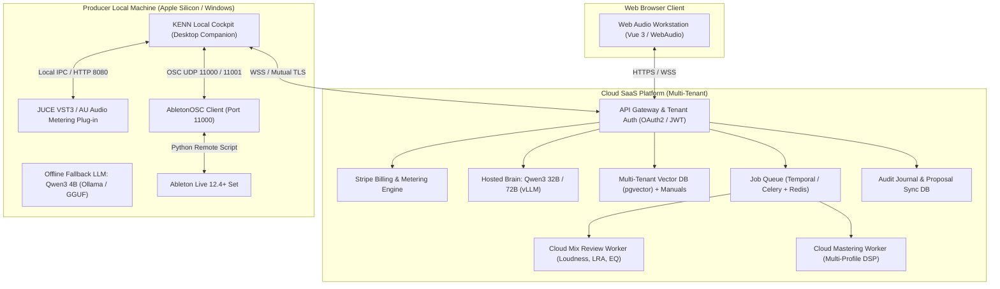
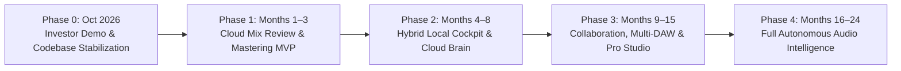
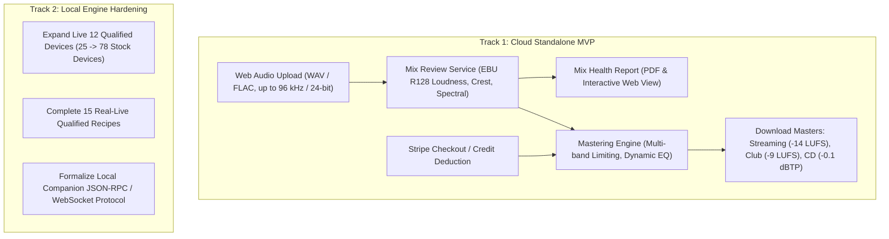
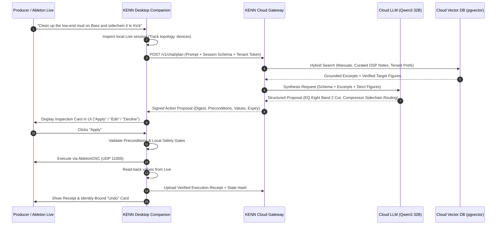
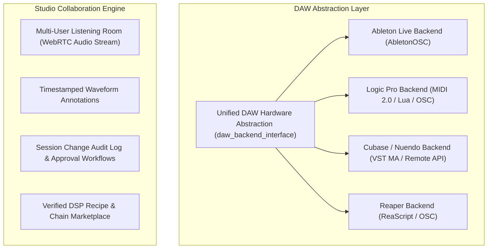

# KENN Long-Term SaaS & Local Engine Mega Plan (2026–2028)

**Consolidated Product Roadmap, Systems Architecture, and Work Queue**  
*Date: 12 October 2026*  
*Supersedes: Transient roadmap fragments; directly merges `Kenn的SaaS扩展方案&Kenn SaaS Expansion Plan.md` with `monorepo/products/kenn/KENN_PLAN.md` and the 11 October 2026 inference audit.*

---

## 1. Executive Summary & Strategic Positioning

KENN transitions from a single-machine Ableton Live assistant on macOS into a **hybrid AI audio engineering SaaS platform**. 

The strategy preserves KENN's core competitive edge—**grounded audio knowledge, typed DAW control, verifiable readback, exact Undo, and strict evidence governance**—while eliminating local hardware bottlenecks by splitting the system into a **cloud brain** and a **lightweight local DAW execution agent**.



### The Three Customer Segments

1. **Independent Producers & Beatmakers (Volume / Long Tail):**
   - *Needs:* Mix health checks, fast mastering for streaming platforms, MIDI melody guidance, Live workflow tutoring.
   - *Delivery:* Web-first self-service portal + free tier local companion.
   - *Pricing:* Pay-as-you-go (\$3 per master / \$1 per mix check) or \$15/month subscription with token allowances.
2. **Professional Mixing & Mastering Engineers (High LTV / Workflow Speed):**
   - *Needs:* Objective mix inspection, reference curve matching, stem processing, repeatable device-parameter proposals, full auditability.
   - *Delivery:* Desktop local cockpit bound to Live + cloud analytics and multi-speaker reference profiles.
   - *Pricing:* \$49/month Pro tier, seat-based studio billing.
3. **Music Educators & Educational Institutions:**
   - *Needs:* Mix Doctor diagnosis breakdown, explaining acoustic principles using verified sources without hallucinated numbers.
   - *Delivery:* Web-based interactive classroom review, batch student assignment assessment.
   - *Pricing:* Educational volume licensing (\$199/month per department).

---

## 2. Core Architectural Principles & Data Boundaries

### A. The Hybrid Invariant: Cloud Brain + Local Execution
- **DAW writes remain local-only:** Cloud services never establish direct network connections to Ableton Live. The local desktop companion receives structured, signed proposals from the cloud brain, renders them in the UI for the producer to inspect, and executes them over local loopback OSC (port 11000) only after explicit local confirmation.
- **Data Minimization:** Producers never upload proprietary Live project files (`.als`), raw session arrangements, or unconsented multi-track recordings to the cloud.
- **Allowed Cloud Ingress:**
  1. Rendered audio bounces explicitly submitted for Mix Review or Mastering (stored in encrypted S3-compatible object storage with time-to-live expiration).
  2. Extracted audio metrics: Integrated LUFS, True Peak (dBTP), Loudness Range (LRA), 40-band spectral energy vectors.
  3. Live session topological schema: Anonymized track names, device types, parameter names, and current normalized values necessary to construct a proposal.
  4. User prompt and conversation history scoped to tenant and project.

### B. Identity, Tokens, and Rollback Invariants
- **Hierarchical Scoping:** Every state row maps to a three-level hierarchy: `TenantID -> WorkspaceID (Project) -> SessionID`.
- **Target Binding:** Target identity must never rely on display names or track indices alone. Bindings use the snapshot token, target device identity, parameter range, and unit.
- **Proposal Lifecycle:**
  $$\text{Draft} \longrightarrow \text{Inspected} \longrightarrow \text{Confirmed} \longrightarrow \text{Executed} \longrightarrow \text{Read-back Verified} \longrightarrow \text{Journaled}$$
- **Exact Undo:** The local executor caches observed pre-state. Undo requires the target to match its pre-execution identity and reports an explicit error if the control was altered manually after write.

---

## 3. Phased Implementation Roadmap



---

### Phase 0: Immediate Demo Freeze & Engine Integrity (October 2026)

**Objective:** Execute the Wednesday 14 October 2026 investor demo, complete D1–D6 tasks, merge pending verification branches, and lock the baseline.

#### Work Stream 0.1: Investor Demo Execution (12–14 October 2026)
- [ ] **D1 — Complete Adversary Reviews:**
  - Outside review sign-off for citation repair `67921916`.
  - Recheck Stage 2/3 guarded parameter control ending at `8564659a` (`adb0d4c4`, `b0056599`, `65c6dc46`).
  - Merge citation fix first, followed by Stage 2/3 to `main`.
- [ ] **D2 — Candidate Build Verification:**
  - Build candidate commit `43a8c1bb` on `draft/investor-candidate-2026-10-14`.
  - Verify backend test suite (4,880 passed, 16 skipped).
  - Verify Vue frontend build (`f684c27c...`) with Node arm64.
- [ ] **D3 — Supervised Real-Live Run (Tuesday 13 Oct, 20:00 London):**
  - Run with disposable copy of demo set.
  - Deploy and verify AbletonOSC Remote Script digest (`a4bbe3cce8805...`).
  - Verify Compressor Threshold change (0 dB to -4 dB), readback, and exact Undo via card and chat (`Undo that`).
  - Verify card Undo after 300 s and after 256 intervening reads.
  - Verify compound EQ Eight parameter proposal (200 Hz to 300 Hz, 0 dB to -3 dB) and clean rollback.
- [ ] **D4 — Answer & Narrative Verification:**
  - Run demo script gate: `tooling/scripts/demo_script_gate.py --route ask --runs 10 --json`.
  - Grade 5-minute showcase answers with Jack; verify timing budget under 300 s.
- [ ] **D5 — 10 Consecutive Rehearsals & Backup Capture:**
  - Complete 10 clean runs of the 20-step operator script (8–12 minutes each).
  - Record backup video via `tooling/scripts/record_demo_live.py` with system audio.
- [ ] **D6 — Live Showing (Wednesday 14 Oct):**
  - Room preflight (mains power, loaded model `qwen3:4b-instruct-2507-q4_K_M`, disposable set, projector).
  - Deliver rehearsed 5-minute showcase.

#### Work Stream 0.2: Quality Gate Consolidation
- [ ] Replay v7 qualification benchmark review sheets (`cand-*.review.md`) for owner-graded correctness.
- [ ] Retain the 15 s / 70% delivery gate bar: 3 consecutive probe runs $\ge 31/44$, held-out $\ge 51/72$ within 15 s on mains power with Live open.
- [ ] Complete citation repair logging verification (`test_citation_repair.py`).

---

### Phase 1: Dual-Track Architecture & Cloud MVP (Months 1–3)

**Objective:** Launch the cloud revenue engine (Mix Health-Check & Online Mastering) that operates independently of real-time Live connectivity, while hardening local Live control.



#### Work Stream 1.1: Cloud Backend Service Extraction
- [ ] **Extract `mixreview-service`:**
  - Decouple `packages/mix-review` and `core/audio_analysis.py` into a containerized Python service.
  - Implement analysis pipeline:
    - EBU R128 Integrated Loudness, Short-Term max, Momentary max, Loudness Range (LRA).
    - True Peak calculation with 4x oversampling interpolation.
    - 40-band 1/3-octave spectral distribution profile.
    - Stereo correlation and mid/side energy balance across low (<120 Hz), mid (120 Hz–4 kHz), and high (>4 kHz) bands.
  - Performance SLA: Analyze 4-minute stereo 44.1 kHz / 24-bit WAV file in under 3.5 seconds on a 4-vCPU cloud worker.
- [ ] **Extract `mastering-service`:**
  - Wrap `mastering_engine` into an asynchronous worker pool managed by Celery/Redis.
  - Target mastering profiles:
    - *Streaming Standard:* -14.0 LUFS integrated ($\pm 0.5$ LUFS), -1.0 dBTP ceiling.
    - *Club / Bass Music:* -9.0 LUFS integrated, -0.3 dBTP ceiling, dynamic low-end Mono below 90 Hz.
    - *Audiophile / Dynamic:* -16.0 LUFS integrated, -1.0 dBTP ceiling, preserve natural crest factor.
    - *Apple Digital Masters compliant:* No inter-sample clipping across lossy AAC transcode checks.
  - Output formats: 44.1 kHz / 24-bit WAV, 48 kHz / 24-bit WAV, 320 kbps MP3 with ID3 metadata preservation.
- [ ] **API Gateway & IAM Setup:**
  - FastAPI-based `api-gateway` with JWT authentication and OIDC support (Google / Apple / Email magic link).
  - Rate limiting: Redis sliding-window token bucket (60 requests/minute for free tier, 600 requests/minute for Pro).
  - Stripe integration: Webhook handlers for invoice payment, credit decrement, and subscription tier provisioning (`free`, `creator`, `pro`).
- [ ] **Object Storage & Lifecycle Management:**
  - S3 / Cloudflare R2 bucket integration for uploaded mix bounces and rendered masters.
  - Strict 7-day automated lifecycle expiry for raw customer uploads; 30-day retention for rendered masters.

#### Work Stream 1.2: Web Client Application (`apps/web`)
- [ ] Build consumer web interface in Vue 3 + Tailwind CSS:
  - Drag-and-drop audio uploader with client-side audio format and channel count validation.
  - WebAudio waveform visualization showing clipping peaks, dynamic range, and frequency balance.
  - Interactive Mix Doctor report card: Highlighting low-end mud (200–350 Hz), harsh resonance (3–5 kHz), and stereo phasing.
  - Instant A/B audio player with loudness-matched gain compensation (preventing louder from sounding better).
  - Preset download: Export recommended EQ curves as Ableton `.adv` device presets or standard CSV filter parameters.

#### Work Stream 1.3: Local Live Control Qualification (L1–L3)
- [ ] **L1 Device Coverage:** Expand verified device parameter profiles from 25 devices to 50 stock Live 12 devices (EQ Eight, Compressor, Glue Compressor, Saturator, Limiter, Roar, Drum Bus, Echo, Reverb, Utility, etc.).
- [ ] **L3 Recipe Verification:** Complete real-Live qualification runs for all 15 core recipes on disposable test sessions. Record execution latency ($p95 \le 3.0\text{ s}$) and 100% verified Undo.

---

### Phase 2: Hybrid SaaS Core & Cloud Brain Integration (Months 4–8)

**Objective:** Unify local DAW control with cloud intelligence. Transition the heavy LLM inference to high-performance cloud GPUs while keeping the local desktop companion as an ultra-responsive execution cockpit.



#### Work Stream 2.1: Cloud Brain & Grounding Infrastructure
- [ ] **Deploy Dedicated Cloud Brain Cluster:**
  - Host Qwen3 32B Instruct on 2x NVIDIA A10G / L4 GPUs using vLLM or TensorRT-LLM with FP8 quantization.
  - Target inference metrics: TTFT $\le 450\text{ ms}$, decode speed $\ge 45\text{ tok/s}$.
  - System prompt prefix caching enabled: Keep the static 544-token system prompt and rules resident in KV cache across all tenant turns.
- [ ] **Multi-Tenant Knowledge Base (Cloud RAG):**
  - Migrate local BM25 + ONNX MiniLM index to PostgreSQL + `pgvector`.
  - Schema isolation:
    - `global_knowledge`: Live 11/12 official documentation, verified mixing and mastering engineering notes, acoustic principles.
    - `tenant_knowledge`: Producer-specific hardware notes, studio room acoustic calibration profiles, reference track curves.
  - Enforce the grounding gate in the cloud: Verify all figures against retrieved excerpts before streaming tokens to the client.
- [ ] **Cross-Device Project Memory Sync:**
  - Cloud storage for producer preferences (e.g., preferred master loudness target, default drum bus chain, reference tracks).
  - Explicit consent model: Only sync preferences explicitly saved via `/api/memory/preference` with full history and rollback capability.

#### Work Stream 2.2: Desktop Client & Local Cockpit (`apps/desktop`)
- [ ] **Upgrade `apps/desktop` to Production Companion:**
  - Electron / Tauri wrapper pairing local AbletonOSC with cloud account authentication.
  - Machine Pairing Flow: One-time QR code or browser OAuth2 pairing token binding the local machine to the SaaS tenant.
  - Hybrid Execution Bridge:
    - Maintains persistent WebSocket connection to Cloud Gateway.
    - Receives cloud action proposals, verifies cryptographic signature, checks local session precondition locks.
    - Fires local OSC commands over 127.0.0.1:11000.
    - Re-reads modified parameters from Live over port 11001 to ensure exact alignment.
    - Uploads read-back verification receipt to the cloud audit journal.
- [ ] **Offline Fallback Architecture:**
  - If internet connectivity drops, the desktop companion seamlessly routes chat queries to local Ollama (`qwen3:4b-instruct-2507-q4_K_M`).
  - Offline mode clearly flags degraded knowledge capability while maintaining 100% of deterministic local Live commands, recipes, and Undo.

#### Work Stream 2.3: Audio Metering Plug-in Cloud Uplink (`plugins/kenn-vst3-au`)
- [ ] Update JUCE VST3 / AU plug-in:
  - Audio callback strictly thread-safe: zero heap allocations, zero blocking locks, zero file/network I/O in `processBlock`.
  - Lock-free ring buffer streams downsampled audio envelopes and 40-band spectral coefficients to background worker.
  - Background worker pushes metrics to local desktop companion via local IPC (Unix domain socket or loopback TCP port 8080).
  - Displays cloud mix health target curves directly in the DAW meter view.

---

### Phase 3: Collaborative Studio, Multi-DAW & Ecosystem (Months 9–15)

**Objective:** Expand from an individual producer assistant to a collaborative studio production platform, broadening compatibility beyond Ableton Live.



#### Work Stream 3.1: DAW Hardware Abstraction Layer
- [ ] Refactor `apps/backend/src/kenn/core/live_backend.py` into generic `daw_backend_interface.py`:
  - Abstract core primitives: `get_track_tree()`, `inspect_device()`, `set_parameter()`, `insert_device()`, `create_midi_clip()`, `get_mixer_state()`.
  - Implement **Logic Pro Backend**: Integration via macOS Accessibility API + OSC / MIDI 2.0 control surface protocol.
  - Implement **Reaper Backend**: High-performance ReaScript / WebRemote integration.
  - Maintain identical proposal, verification, readback, and Undo guarantees across all DAW adapters.

#### Work Stream 3.2: Multi-User Collaboration & Studio Review
- [ ] **WebRTC High-Fidelity Listening Room:**
  - Real-time stereo streaming (Opus 48 kHz / 320 kbps or uncompressed WebRTC) directly from the producer's master bus plug-in to client browsers.
  - Latency target: $<150\text{ ms}$ glass-to-glass for remote client listening.
- [ ] **Collaborative Waveform Annotations:**
  - Clients, mix engineers, and producers place pinned comments at exact bar/beat positions and frequencies.
  - Mix Doctor can parse comments (e.g., *"The vocal is harsh at 1:24"*) and automatically generate actionable EQ proposals.
- [ ] **Enterprise & Studio Governance:**
  - Multi-seat studio billing, role-based access control (Admin, Mixing Engineer, Assistant, Guest Client).
  - Complete tamper-proof audit log export for commercial label compliance.

#### Work Stream 3.3: Developer Platform & MCP Tools
- [ ] **Expose KENN as Model Context Protocol (MCP) Server:**
  - Allow external coding agents and workflow orchestrators to safely query session facts and propose Live modifications through verified KENN safety gates.
  - Zero direct OSC access exposed: all third-party requests must traverse proposal validation, confirmation tokens, and receipt journaling.

---

### Phase 4: Full Autonomous Audio Intelligence (Months 16–24+)

**Objective:** Next-generation generative audio engineering, autonomous stem mixing, and broadcast compliance intelligence.

- [ ] **Autonomous Stem Balancing:** Intelligent multi-track leveling using dynamic spectral masking detection and automatic fader/pan staging.
- [ ] **Style & Artist Profile Matching:** High-dimensional latent audio matching against verified reference libraries, transferring spatial and spectral balance characteristics.
- [ ] **Dynamic Broadcast Compliance:** Automated real-time re-mastering adapting dynamically to streaming, Dolby Atmos, and terrestrial broadcast specifications.

---

## 4. Technical Architecture & Component Mapping

| Subsystem | Monolith State (Today) | Target SaaS Hybrid Architecture | Primary Technologies |
|---|---|---|---|
| **API Entrypoint** | Single FastAPI process (`apps/backend`) | High-concurrency API Gateway with Tenant Auth & Rate Limiting | FastAPI, Traefik/Kong, Redis, JWT/OIDC |
| **Session Model** | Flat in-memory `session_id` string | Hierarchical `TenantID -> WorkspaceID -> SessionID` | PostgreSQL, Redis session cache |
| **Inference Engine** | Local Ollama (`qwen3:4b` / `qwen3:8b`) | Cloud-hosted vLLM cluster + Local Ollama fallback | NVIDIA A10G/L4, vLLM, TensorRT-LLM, Ollama |
| **Knowledge Base** | Local files + ONNX MiniLM BM25 index | Multi-tenant hybrid vector & keyword database | PostgreSQL (`pgvector`), BM25, MiniLM |
| **DAW Transport** | AbletonOSC UDP ports 11000/11001 | Local Desktop Companion bridge with signed WebSocket dispatch | Python 3.12, AbletonOSC, WebSockets, mTLS |
| **Action Authority** | Local `LiveActionService` | Dual-key authority: Cloud generates proposal, Local confirms & applies | SHA-256 tokens, cryptographically signed proposals |
| **Receipt Journal** | SQLite / in-memory list | Cross-device replicated Cloud Audit Log + local journal | PostgreSQL, SQLite local cache |
| **Mix Analysis** | Local Python script on bounced files | Scalable async worker queue for multi-track analysis | Celery / Temporal, Redis, NumPy, SciPy |
| **Mastering DSP** | Local prototype DSP engine | Cloud multi-profile mastering worker farm | C++ DSP kernels, libebur128, Python bindings |
| **DAW Plug-in** | JUCE VST3/AU basic meter | JUCE VST3/AU with cloud curve sync and local IPC uplink | JUCE 7, C++20, Lock-free SPSC queues, Unix sockets |

---

## 5. Risk Assessment & Engineering Mitigations

```mermaid
quadrantChart
    title Risk Assessment Matrix
    x-axis Low Severity --> High Severity
    y-axis Low Probability --> High Probability
    quadrant-1 Monitor & Contain
    quadrant-2 Critical Priority (Mitigate Early)
    quadrant-3 Low Priority (Accept)
    quadrant-4 Contingency Planning Needed
    "Local DAW Write Drift": [0.85, 0.70]
    "Cloud Inference Latency & Cost": [0.75, 0.65]
    "Audio IP & Data Privacy": [0.90, 0.35]
    "Single-DAW Dependency": [0.60, 0.80]
    "DSP Audio Quality Mistrust": [0.70, 0.45]
    "Thermal Throttling on Client": [0.40, 0.75]
```

### 1. Risk: Real-Live Control Reliability & Parameter State Drift
- *Problem:* Ableton Live state can be modified manually by the producer between proposal issuance, inspection, and execution, causing blind overwrites or invalid undos.
- *Mitigation:*
  1. Mandatory re-reading of parameter values immediately prior to write.
  2. Observation tokens expire after 300 s or after 256 intervening reads.
  3. Strict refusal to Undo if post-execution state does not match the recorded write outcome.
  4. Number normalization across JSON serialization (`[0.0, 1.0]` vs `[0, 1]`) to prevent hash verification false negatives.

### 2. Risk: Cloud Inference Costs & Network Latency
- *Problem:* Running 32B/72B models for long audio engineering dialogues can become economically unsustainable on flat subscriptions.
- *Mitigation:*
  1. Static KV-cache prefixing: Pin system prompts and rules in GPU memory.
  2. Small-model routing: Use deterministic rule parsers for 95% of standard Live commands; only route ambiguous acoustic synthesis to the 32B cloud model.
  3. Output token capping: Maintain 128-token cap on structured knowledge summaries.
  4. Tiered subscription billing with clear token and audio minute metering.

### 3. Risk: Audio Intellectual Property, Privacy, and Data Leakage
- *Problem:* Professional producers and major record labels refuse to allow unreleased stems or project binaries on cloud infrastructure.
- *Mitigation:*
  1. Zero-binary policy: `.als` project files are never uploaded.
  2. Temporary bounce analysis: User-uploaded mix bounces are stored in RAM or ephemeral storage with automatic 7-day cryptographic wiping.
  3. Strict opt-in for model training telemetry: Explicit guarantee that customer audio is never used for foundation model training.

### 4. Risk: Audio Quality & Engineering Trust
- *Problem:* Producers reject automated "black-box" mastering that ruins transient punch or squashes dynamics.
- *Mitigation:*
  1. No "black-box one-click magic": Always display precise before/after LUFS, True Peak, LRA, and spectral deltas.
  2. Automatic loudness-matched A/B previewing: Eliminates the psychoacoustic volume bias.
  3. Full parameter transparency: Provide the exact EQ and compressor settings so the engineer can recreate or tweak them manually.

---

## 6. Comprehensive Verification, Milestones & Acceptance Targets

| Milestone | Target Horizon | Measurable Acceptance Gate | Evidence Requirement |
|---|---|---|---|
| **M0: Demo Freeze** | October 2026 | 5-minute Live showcase completed under 300 s; 10 clean rehearsal runs; 0 unauthorized writes; verified card and chat Undo. | Rehearsal log, backup video capture, clean test suite (4,880 passed). |
| **M1: Cloud Mix MVP** | Month 3 | Web upload to interactive report in $<4\text{ s}$ for 4-minute stereo WAV; EBU R128 loudness accuracy within $\pm 0.1$ LUFS against official test vectors; Stripe billing live. | Synthetic audio conformance test suite, live Stripe sandbox receipts. |
| **M2: Cloud Mastering** | Month 4 | Multi-profile mastering pipeline processing 10 concurrent tracks; $100\%$ compliance with -14.0 LUFS / -1.0 dBTP streaming bar; zero inter-sample clipping. | Audio test bench receipts, ITU-R BS.1770-4 compliance logs. |
| **M3: Hybrid Bridge** | Month 6 | Desktop companion securely paired to cloud tenant; round-trip command latency $p95 \le 400\text{ ms}$; signed proposal verification; 100% verified Undo. | End-to-end WebSocket integration suite, fake/real Live test receipts. |
| **M4: Cloud Brain RAG** | Month 8 | Cloud Qwen3 32B delivery: $\ge 85\%$ acceptance on held-out set; TTFT $\le 450\text{ ms}$; zero hallucinated parameters or unsupported measurements. | 300-question held-out benchmark suite, blind human grading report. |
| **M5: Studio Collab** | Month 12 | WebRTC multi-client listening with $<150\text{ ms}$ glass-to-glass latency; multi-user timestamped waveform comments; session audit journal. | Network soak tests, WebRTC packet loss and jitter telemetry. |
| **M6: Multi-DAW Core** | Month 15 | Logic Pro and Reaper backend adapters passing identical 15 core recipe qualifications and verified Undo. | Cross-DAW test matrix receipts on macOS and Windows test hosts. |

---

## 7. Working Agreements & Engineering Boundary Checklist

*In accordance with repository `AGENTS.md` and project hygiene rules:*

1. **Live Belongs to the Producer:**
   - Daily engineering, regression testing, and CI continue to run exclusively against `FakeLiveBackend`, synthetic audio fixtures, and mocks.
   - Never write to a running Ableton Live session without explicit owner scheduling and supervision on a disposable project set.
2. **Plain, Specific Audio & Engineering Terms (Zero AI Slop):**
   - No vague marketing hype (*seamless*, *cutting-edge*, *comprehensive*, *orchestrate*).
   - Use concrete measurements and units: `-1 dBTP`, `-14 LUFS`, `4:1 ratio`, `30 ms attack`, `port 11000 UDP`, `15 s / 70% gate`.
3. **Hardware Boundaries:**
   - Only GPUs 0 and 1 are authorized for KENN tasks on multi-GPU compute nodes. GPUs 2–7 are multi-tenant and strictly off-limits.
   - Mac client target remains Apple Silicon M3 with 16 GB unified memory.
4. **Git Discipline:**
   - One bounded change per commit.
   - Human-authored single-line commit messages explaining the change and its rationale.
   - Absolutely no automated AI attribution trailers (`Co-Authored-By: ...`, etc.).
5. **Security & Data Hygiene:**
   - Never commit API keys, remote hostnames, IP addresses, customer stems, or personal session data.
